# BỘ SƠ ĐỒ USE CASE UML 2.5 — MÃ NGUỒN PLANTUML (BẢN TLCN — 87 USE CASE)
## SÀN THƯƠNG MẠI ĐIỆN TỬ ĐA NGƯỜI BÁN GENIE (MULTI-VENDOR MARKETPLACE)

> Sinh từ cùng mô hình với đặc tả [Usecase.md](./Usecase.md) — **87 use case**, **11 phân hệ**, **16 tác nhân**, **4 use case dùng chung**, **37 «include»**, **15 «extend»**.
> Không sửa tay từng sơ đồ: sửa mô hình / Usecase.md rồi sinh lại để tài liệu, sơ đồ, XMI và Excel luôn khớp.

## 📑 MỤC LỤC

- [PHẦN I: Quy ước ký hiệu UML 2.5](#phan-i)
- [PHẦN II: Danh mục tác nhân & sơ đồ phân cấp tác nhân](#phan-ii)
- [PHẦN III: Sơ đồ tổng quan 11 phân hệ](#phan-iii)
- [PHẦN IV: 11 sơ đồ use case theo phân hệ](#phan-iv)
  - [4.01 Xác thực & Tài khoản người dùng](#uc-01)
  - [4.02 Danh mục, Sản phẩm & Tìm kiếm](#uc-02)
  - [4.03 Giỏ hàng, Đặt hàng & Đơn hàng](#uc-03)
  - [4.04 Thanh toán, Ký quỹ (Escrow) & Sổ cái](#uc-04)
  - [4.05 Gian hàng & Thẩm định KYC người bán](#uc-05)
  - [4.06 Vận chuyển qua đối tác 3PL](#uc-06)
  - [4.07 Khuyến mãi, Voucher, Flash Sale & Điểm](#uc-07)
  - [4.08 Chat, Đánh giá & Theo dõi shop](#uc-08)
  - [4.09 Trả hàng, Hoàn tiền & Khiếu nại](#uc-09)
  - [4.10 Thông báo](#uc-10)
  - [4.11 Quản trị sàn, Nhân viên & Rút tiền](#uc-11)
- [PHẦN V: Danh mục quan hệ «include» / «extend»](#phan-v)
- [PHẦN VI: Ma trận độ phủ 87 use case](#phan-vi)
- [PHẦN VII: Hướng dẫn kết xuất & kiểm tra](#phan-vii)

---

<a id="phan-i"></a>
# PHẦN I: QUY ƯỚC KÝ HIỆU UML 2.5 & QUY TẮC MÔ HÌNH HÓA

### 1.1 Bảng ký hiệu

| Phần tử UML 2.5 | Ký hiệu chuẩn | Cú pháp PlantUML trong bộ sơ đồ | Quy tắc áp dụng |
|---|---|---|---|
| **Subject** (ranh giới hệ thống) | Hình chữ nhật, tên ở trên | `rectangle "Giỏ hàng, Đặt hàng & Đơn hàng" <<subsystem>> { … }` | Mỗi phân hệ là một subject; use case nằm trong, tác nhân nằm ngoài |
| **Actor** (người) | Hình người que | `actor "Customer\n(khách hàng)" as CUS` | Vai trò tương tác với subject |
| **Actor** (hệ thống ngoài) | Hình người que + «system» | `actor "Google Gemini API" as GEM <<system>>` | Hệ thống nằm ngoài ranh giới ứng dụng |
| **Use case** | Hình elip, tên là cụm động từ | `usecase "Đăng nhập hệ thống\nUC-AUTH-02" as AUTH_02` | Ghi mã UC dưới tên để truy vết với Usecase.md |
| **Extension point** | Ngăn thứ hai trong elip | `…\n--\nextension points\nChọn voucher` | Khai báo ở use case **gốc** của mọi «extend» |
| **Association** | Đường liền, không mũi tên | `CUS -- ORD_07` · `ORD_06 -- TPL` | Tác nhân chính bên trái, tác nhân phụ bên phải |
| **Include** | Nét đứt + «include», từ UC gốc → UC được bao gồm | `ORD_07 .> ORD_04 : <<include>>` | Hành vi **luôn** thực hiện |
| **Extend** | Nét đứt + «extend», từ UC mở rộng → UC gốc | `PRO_04 .> ORD_04 : <<extend>>` + `note on link` | Hành vi **có điều kiện** tại extension point |
| **Generalization** | Đường liền, tam giác rỗng hướng về cha | `CUS -up-|> GST` · `MOD -up-|> STF` | Chỉ dùng giữa tác nhân |

### 1.2 Quy tắc mô hình hóa đã áp dụng

1. **Một subject cho mỗi phân hệ.** Use case thuộc phân hệ khác nhưng tham gia «include» / «extend» được vẽ trong subject phụ có nhãn *(tham chiếu)*.
2. **Tác nhân chính bên trái, tác nhân phụ bên phải** (`left to right direction`), khớp dòng *Tác nhân chính / phụ* trong Usecase.md.
3. **Hạ tầng nội bộ không phải tác nhân:** PostgreSQL, Redis, WebSocket hub, các module Spring Boot nằm trong subject.
4. **Use case dùng chung không có mã riêng** (Gửi mã OTP xác thực, Ghi nhật ký kiểm toán, Tải tệp lên Silo (Presigned URL), Kiểm tra số dư khả dụng) được vẽ với nhãn *dùng chung*; tác nhân phụ của chúng (Email Service, Silo) nối thẳng vào use case dùng chung.
5. **Use case chỉ do hệ thống thực hiện** (`UC-PAY-05`, `UC-PAY-06`, `UC-CAT-12`, `UC-LOG-15`) không gắn tác nhân chính mà được use case khác «include».
6. **3 chức danh nhân viên** (`MOD`, `CS`, `FIN`) và `ADM` kế thừa `STF`; không có Super Admin.

---

<a id="phan-ii"></a>
# PHẦN II: DANH MỤC TÁC NHÂN & SƠ ĐỒ PHÂN CẤP TÁC NHÂN

| Mã | Tác nhân | Alias PlantUML | Phân loại | Kế thừa |
|---|---|---|---|---|
| `ACT-GST` | Guest (khách vãng lai) | `GST` | Con người | — |
| `ACT-CUS` | Customer (khách hàng) | `CUS` | Con người | Guest (khách vãng lai) |
| `ACT-VND` | Vendor (người bán/shop) | `VND` | Con người | Customer (khách hàng) |
| `ACT-STF` | Staff (Nhân viên sàn) | `STF` | Con người | — |
| `ACT-MOD` | Moderator (Nhân viên kiểm duyệt) | `MOD` | Chức danh nhân viên sàn | Staff (Nhân viên sàn) |
| `ACT-CS` | CS Specialist (Nhân viên CSKH) | `CS` | Chức danh nhân viên sàn | Staff (Nhân viên sàn) |
| `ACT-FIN` | Finance Officer (Nhân viên tài chính) | `FIN` | Chức danh nhân viên sàn | Staff (Nhân viên sàn) |
| `ACT-ADM` | Admin | `ADM` | Con người | Staff (Nhân viên sàn) |
| `ACT-PGW` | Payment Gateway (VNPay, SePay) | `PGW` | Hệ thống | — |
| `ACT-3PL` | Đối tác vận chuyển (GHN, GHTK, ViettelPost, J&T) | `TPL` | Hệ thống | — |
| `ACT-AIW` | AI Worker Service (KYC & PhoBERT) | `AIW` | Hệ thống | — |
| `ACT-GEM` | Google Gemini API | `GEM` | Hệ thống | — |
| `ACT-IDP` | Identity Provider (Google, Apple) | `IDP` | Hệ thống | — |
| `ACT-MIN` | Silo S3 Storage | `MIN` | Hệ thống | — |
| `ACT-EML` | Email Service | `EML` | Hệ thống | — |
| `ACT-CRN` | Platform Cron / Scheduler | `CRN` | Hệ thống | — |

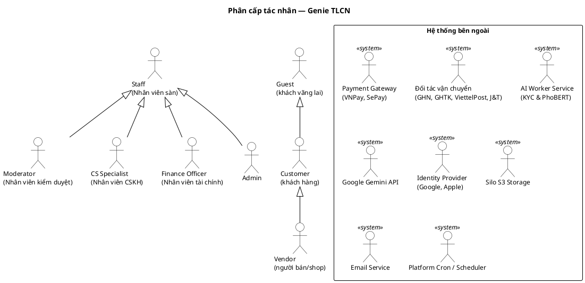

---

<a id="phan-iii"></a>
# PHẦN III: SƠ ĐỒ TỔNG QUAN 11 PHÂN HỆ

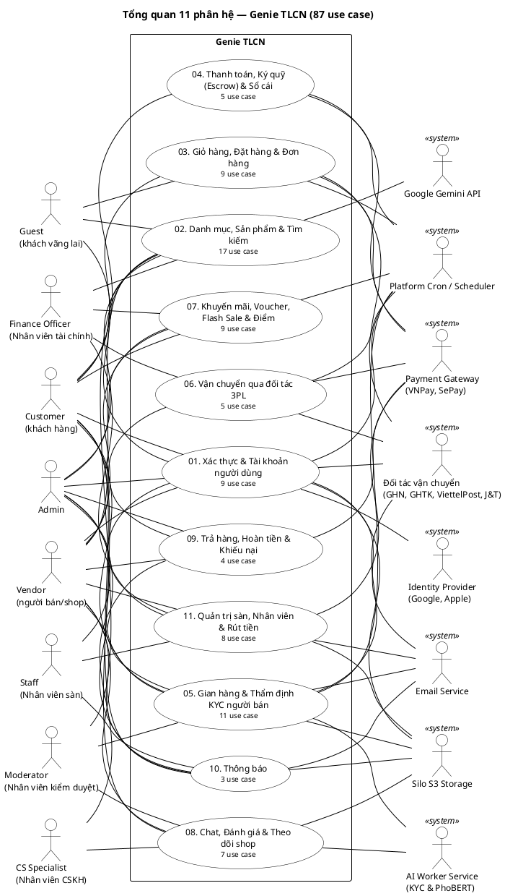

---

<a id="phan-iv"></a>
# PHẦN IV: 11 SƠ ĐỒ USE CASE THEO PHÂN HỆ

<a id="uc-01"></a>
### 4.01 PHÂN HỆ 01: XÁC THỰC & TÀI KHOẢN NGƯỜI DÙNG

- **Use case (9):** `UC-AUTH-01`, `UC-AUTH-02`, `UC-AUTH-03`, `UC-AUTH-04`, `UC-AUTH-06`, `UC-AUTH-08`, `UC-AUTH-09`, `UC-AUTH-10`, `UC-AUTH-11`
- **Use case dùng chung:** Gửi mã OTP xác thực, Ghi nhật ký kiểm toán, Tải tệp lên Silo (Presigned URL)
- **Tác nhân chính:** Guest (khách vãng lai), Customer (khách hàng), Vendor (người bán/shop), Staff (Nhân viên sàn), Admin
- **Tác nhân phụ / hệ thống:** Đối tác vận chuyển (GHN, GHTK, ViettelPost, J&T), Identity Provider (Google, Apple), Silo S3 Storage, Email Service, Platform Cron / Scheduler

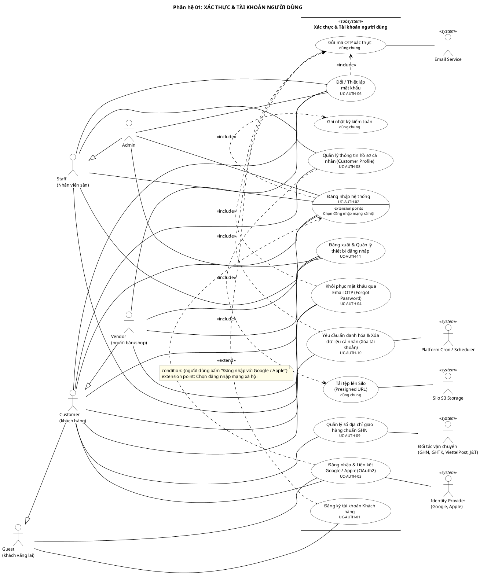

---

<a id="uc-02"></a>
### 4.02 PHÂN HỆ 02: DANH MỤC, SẢN PHẨM & TÌM KIẾM

- **Use case (17):** `UC-CAT-01`, `UC-CAT-02`, `UC-CAT-04`, `UC-CAT-05`, `UC-CAT-06`, `UC-CAT-07`, `UC-CAT-08`, `UC-CAT-09`, `UC-CAT-10`, `UC-CAT-11`, `UC-CAT-12`, `UC-CAT-13`, `UC-CAT-14`, `UC-CAT-15`, `UC-CAT-16`, `UC-CAT-17`, `UC-CAT-18`
- **Use case dùng chung:** Tải tệp lên Silo (Presigned URL)
- **Tác nhân chính:** Guest (khách vãng lai), Customer (khách hàng), Vendor (người bán/shop), Moderator (Nhân viên kiểm duyệt), Finance Officer (Nhân viên tài chính), Admin
- **Tác nhân phụ / hệ thống:** Google Gemini API, Silo S3 Storage

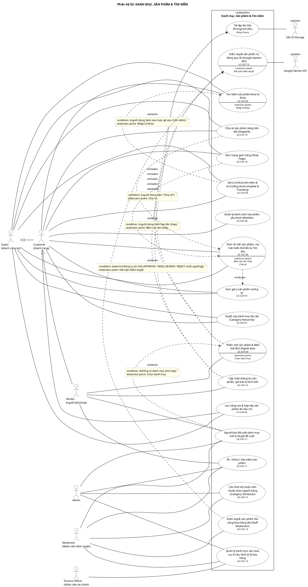

---

<a id="uc-03"></a>
### 4.03 PHÂN HỆ 03: GIỎ HÀNG, ĐẶT HÀNG & ĐƠN HÀNG

- **Use case (9):** `UC-ORD-01`, `UC-ORD-04`, `UC-ORD-06`, `UC-ORD-07`, `UC-ORD-08`, `UC-ORD-09`, `UC-ORD-10`, `UC-ORD-11`, `UC-ORD-12`
- **Use case dùng chung:** —
- **Tác nhân chính:** Guest (khách vãng lai), Customer (khách hàng), Platform Cron / Scheduler
- **Tác nhân phụ / hệ thống:** Payment Gateway (VNPay, SePay), Đối tác vận chuyển (GHN, GHTK, ViettelPost, J&T)

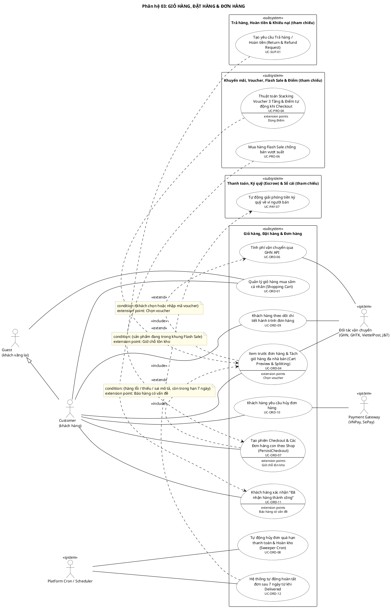

---

<a id="uc-04"></a>
### 4.04 PHÂN HỆ 04: THANH TOÁN, KÝ QUỸ (ESCROW) & SỔ CÁI

- **Use case (5):** `UC-PAY-01`, `UC-PAY-03`, `UC-PAY-05`, `UC-PAY-06`, `UC-PAY-07`
- **Use case dùng chung:** —
- **Tác nhân chính:** Customer (khách hàng), Payment Gateway (VNPay, SePay), Platform Cron / Scheduler
- **Tác nhân phụ / hệ thống:** —

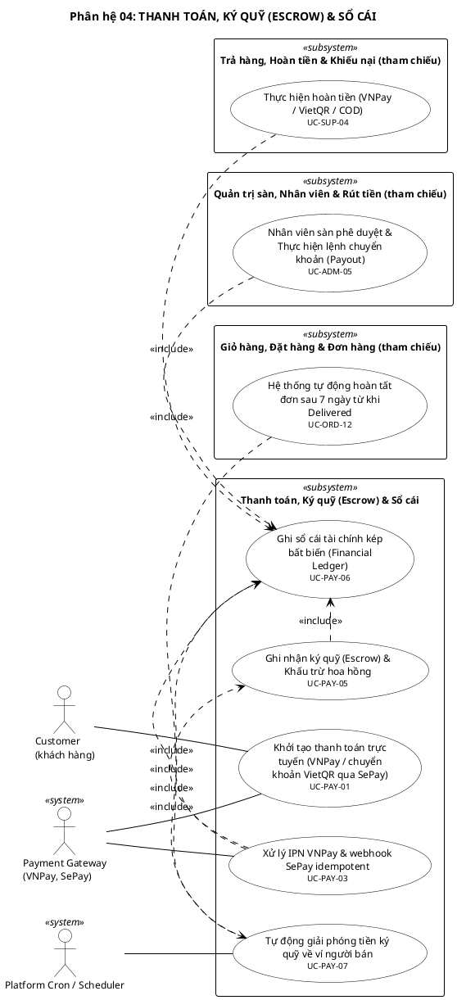

---

<a id="uc-05"></a>
### 4.05 PHÂN HỆ 05: GIAN HÀNG & THẨM ĐỊNH KYC NGƯỜI BÁN

- **Use case (11):** `UC-VND-01`, `UC-VND-02`, `UC-VND-03`, `UC-VND-04`, `UC-VND-05`, `UC-VND-06`, `UC-VND-07`, `UC-VND-08`, `UC-VND-19`, `UC-VND-20`, `UC-VND-21`
- **Use case dùng chung:** Gửi mã OTP xác thực, Tải tệp lên Silo (Presigned URL)
- **Tác nhân chính:** Customer (khách hàng), Vendor (người bán/shop), Moderator (Nhân viên kiểm duyệt), Admin, AI Worker Service (KYC & PhoBERT)
- **Tác nhân phụ / hệ thống:** Đối tác vận chuyển (GHN, GHTK, ViettelPost, J&T), Silo S3 Storage, Email Service, Platform Cron / Scheduler

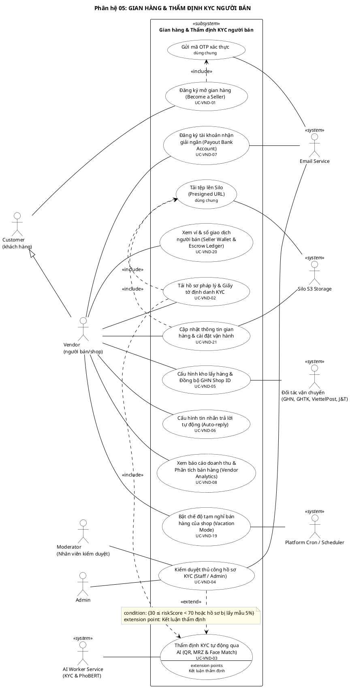

---

<a id="uc-06"></a>
### 4.06 PHÂN HỆ 06: VẬN CHUYỂN QUA ĐỐI TÁC 3PL

- **Use case (5):** `UC-LOG-01`, `UC-LOG-02`, `UC-LOG-03`, `UC-LOG-15`, `UC-LOG-16`
- **Use case dùng chung:** —
- **Tác nhân chính:** Vendor (người bán/shop), Đối tác vận chuyển (GHN, GHTK, ViettelPost, J&T)
- **Tác nhân phụ / hệ thống:** Finance Officer (Nhân viên tài chính), Payment Gateway (VNPay, SePay), Platform Cron / Scheduler

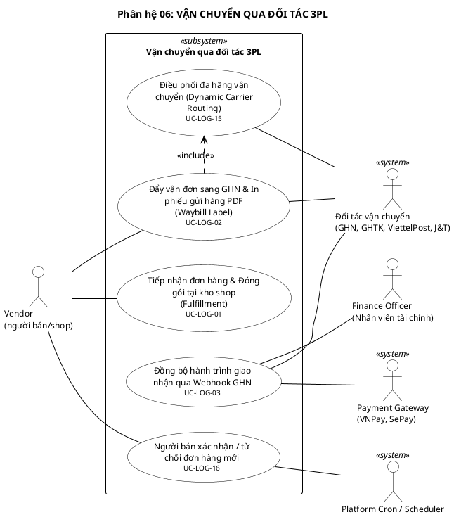

---

<a id="uc-07"></a>
### 4.07 PHÂN HỆ 07: KHUYẾN MÃI, VOUCHER, FLASH SALE & ĐIỂM

- **Use case (9):** `UC-PRO-01`, `UC-PRO-02`, `UC-PRO-03`, `UC-PRO-04`, `UC-PRO-05`, `UC-PRO-06`, `UC-PRO-08`, `UC-PRO-09`, `UC-PRO-10`
- **Use case dùng chung:** —
- **Tác nhân chính:** Customer (khách hàng), Vendor (người bán/shop), Finance Officer (Nhân viên tài chính), Admin
- **Tác nhân phụ / hệ thống:** Platform Cron / Scheduler

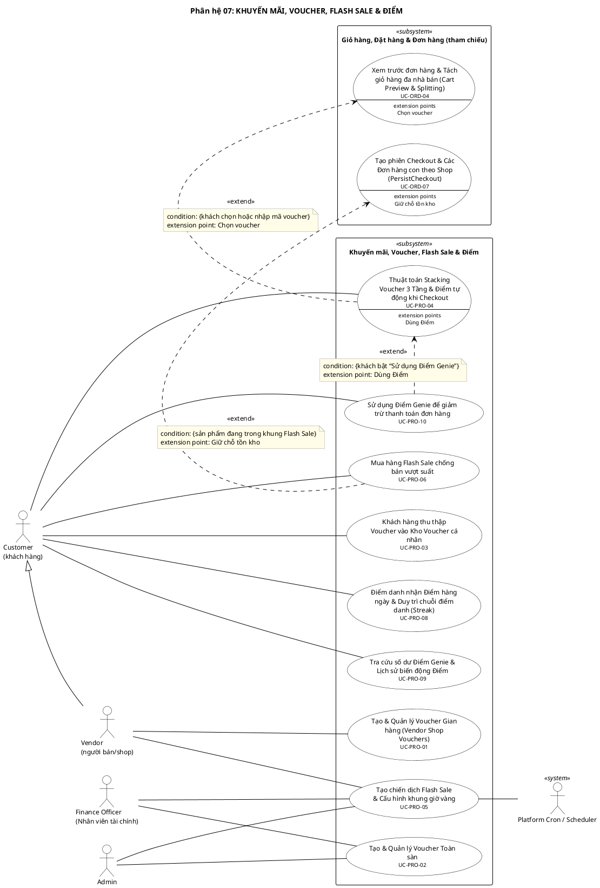

---

<a id="uc-08"></a>
### 4.08 PHÂN HỆ 08: CHAT, ĐÁNH GIÁ & THEO DÕI SHOP

- **Use case (7):** `UC-SOC-01`, `UC-SOC-02`, `UC-SOC-03`, `UC-SOC-04`, `UC-SOC-05`, `UC-SOC-06`, `UC-AI-07`
- **Use case dùng chung:** Ghi nhật ký kiểm toán, Tải tệp lên Silo (Presigned URL)
- **Tác nhân chính:** Customer (khách hàng), Vendor (người bán/shop), Moderator (Nhân viên kiểm duyệt), CS Specialist (Nhân viên CSKH)
- **Tác nhân phụ / hệ thống:** Silo S3 Storage, AI Worker Service (KYC & PhoBERT) — tác nhân chính hệ thống của UC-AI-07

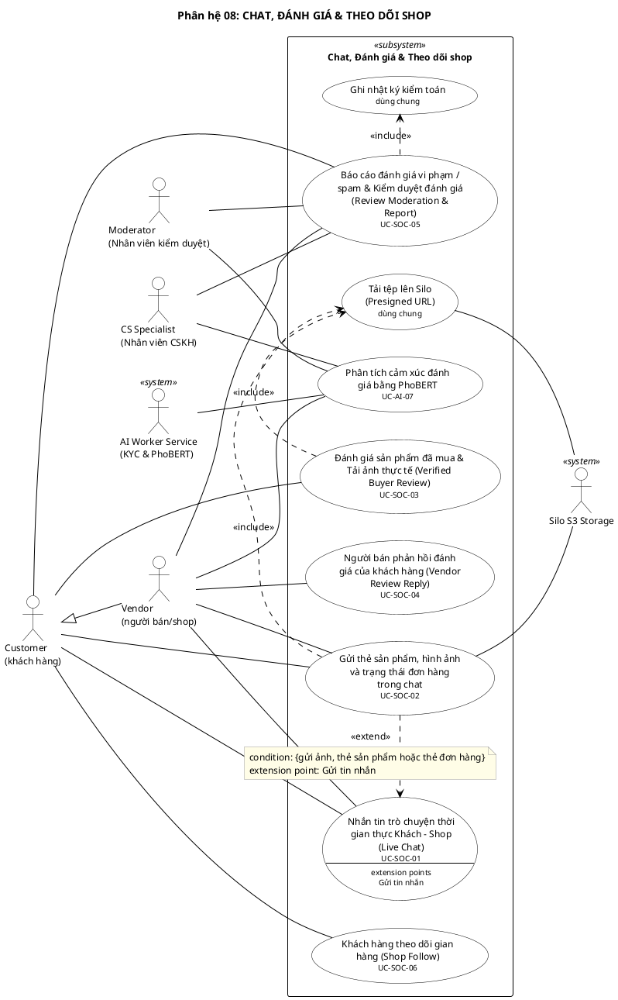

---

<a id="uc-09"></a>
### 4.09 PHÂN HỆ 09: TRẢ HÀNG, HOÀN TIỀN & KHIẾU NẠI

- **Use case (4):** `UC-SUP-01`, `UC-SUP-02`, `UC-SUP-03`, `UC-SUP-04`
- **Use case dùng chung:** Tải tệp lên Silo (Presigned URL)
- **Tác nhân chính:** Customer (khách hàng), Vendor (người bán/shop), CS Specialist (Nhân viên CSKH), Admin
- **Tác nhân phụ / hệ thống:** Payment Gateway (VNPay, SePay), Silo S3 Storage

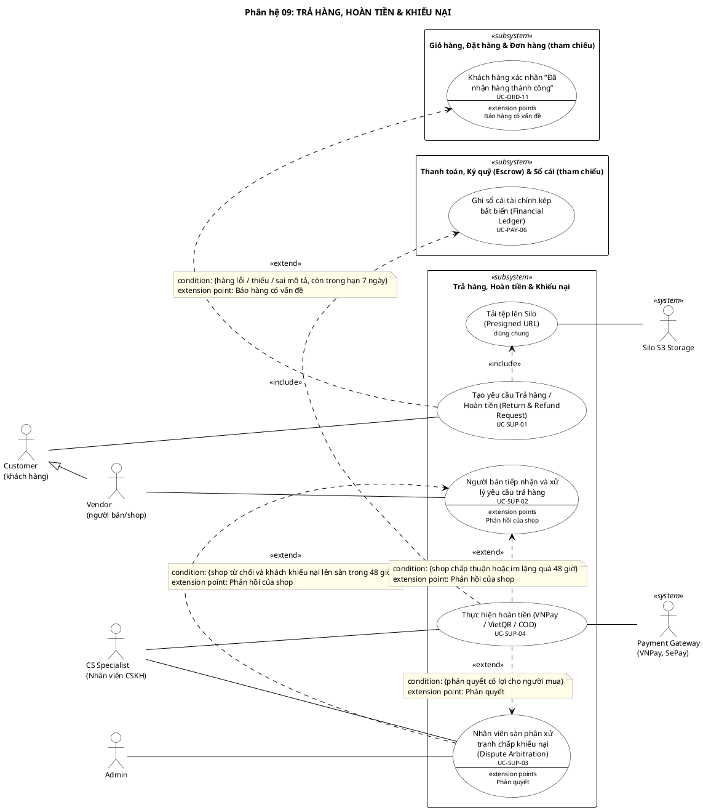

---

<a id="uc-10"></a>
### 4.10 PHÂN HỆ 10: THÔNG BÁO

- **Use case (3):** `UC-NOT-01`, `UC-NOT-03`, `UC-NOT-05`
- **Use case dùng chung:** Tải tệp lên Silo (Presigned URL)
- **Tác nhân chính:** Customer (khách hàng), Vendor (người bán/shop), Staff (Nhân viên sàn), Admin
- **Tác nhân phụ / hệ thống:** Silo S3 Storage, Email Service

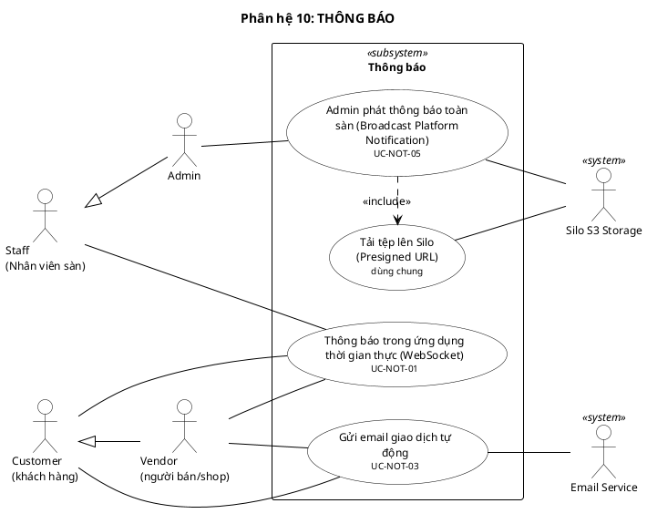

---

<a id="uc-11"></a>
### 4.11 PHÂN HỆ 11: QUẢN TRỊ SÀN, NHÂN VIÊN & RÚT TIỀN

- **Use case (8):** `UC-ADM-01`, `UC-ADM-02`, `UC-ADM-03`, `UC-ADM-04`, `UC-ADM-05`, `UC-ADM-06`, `UC-ADM-07`, `UC-ADM-12`
- **Use case dùng chung:** Gửi mã OTP xác thực, Ghi nhật ký kiểm toán, Tải tệp lên Silo (Presigned URL), Kiểm tra số dư khả dụng
- **Tác nhân chính:** Vendor (người bán/shop), Staff (Nhân viên sàn), Finance Officer (Nhân viên tài chính), Admin
- **Tác nhân phụ / hệ thống:** Payment Gateway (VNPay, SePay), Silo S3 Storage, Email Service

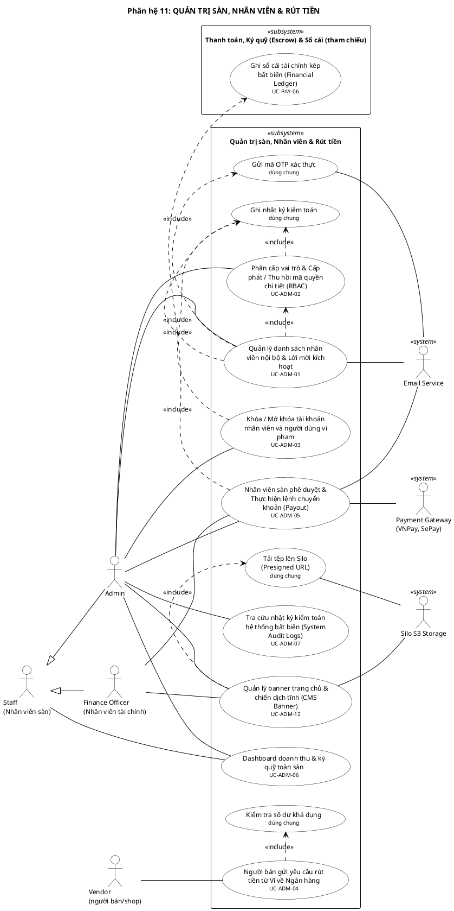

---

<a id="phan-v"></a>
# PHẦN V: DANH MỤC QUAN HỆ «include» / «extend»

### 5.1 «include» (37)

| # | Use case gốc | → Use case được bao gồm |
|:---:|---|---|
| 1 | `UC-AUTH-01` Đăng ký tài khoản Khách hàng | Gửi mã OTP xác thực |
| 2 | `UC-AUTH-04` Khôi phục mật khẩu qua Email OTP (Forgot Password) | Gửi mã OTP xác thực |
| 3 | `UC-AUTH-06` Đổi / Thiết lập mật khẩu | Gửi mã OTP xác thực |
| 4 | `UC-AUTH-10` Yêu cầu ẩn danh hóa & Xóa dữ liệu cá nhân (Xóa tài khoản) | Gửi mã OTP xác thực |
| 5 | `UC-VND-01` Đăng ký mở gian hàng (Become a Seller) | Gửi mã OTP xác thực |
| 6 | `UC-ADM-01` Quản lý danh sách nhân viên nội bộ & Lời mời kích hoạt | Gửi mã OTP xác thực |
| 7 | `UC-AUTH-02` Đăng nhập hệ thống | Ghi nhật ký kiểm toán |
| 8 | `UC-ADM-01` Quản lý danh sách nhân viên nội bộ & Lời mời kích hoạt | Ghi nhật ký kiểm toán |
| 9 | `UC-ADM-02` Phân cấp vai trò & Cấp phát / Thu hồi mã quyền chi tiết (RBAC) | Ghi nhật ký kiểm toán |
| 10 | `UC-ADM-03` Khóa / Mở khóa tài khoản nhân viên và người dùng vi phạm | Ghi nhật ký kiểm toán |
| 11 | `UC-SOC-05` Báo cáo đánh giá vi phạm / spam & Kiểm duyệt đánh giá (Review Moderation & Report) | Ghi nhật ký kiểm toán |
| 12 | `UC-AUTH-08` Quản lý thông tin hồ sơ cá nhân (Customer Profile) | Tải tệp lên Silo (Presigned URL) |
| 13 | `UC-CAT-09` Thêm mới sản phẩm & Biến thể SKU (Người bán) | Tải tệp lên Silo (Presigned URL) |
| 14 | `UC-CAT-10` Cập nhật thông tin sản phẩm, giá bán & hình ảnh | Tải tệp lên Silo (Presigned URL) |
| 15 | `UC-VND-02` Tải hồ sơ pháp lý & Giấy tờ định danh KYC | Tải tệp lên Silo (Presigned URL) |
| 16 | `UC-VND-21` Cập nhật thông tin gian hàng & cài đặt vận hành | Tải tệp lên Silo (Presigned URL) |
| 17 | `UC-SOC-02` Gửi thẻ sản phẩm, hình ảnh và trạng thái đơn hàng trong chat | Tải tệp lên Silo (Presigned URL) |
| 18 | `UC-SOC-03` Đánh giá sản phẩm đã mua & Tải ảnh thực tế (Verified Buyer Review) | Tải tệp lên Silo (Presigned URL) |
| 19 | `UC-SUP-01` Tạo yêu cầu Trả hàng / Hoàn tiền (Return & Refund Request) | Tải tệp lên Silo (Presigned URL) |
| 20 | `UC-NOT-05` Admin phát thông báo toàn sàn (Broadcast Platform Notification) | Tải tệp lên Silo (Presigned URL) |
| 21 | `UC-ADM-12` Quản lý banner trang chủ & chiến dịch tĩnh (CMS Banner) | Tải tệp lên Silo (Presigned URL) |
| 22 | `UC-CAT-06` Xem chi tiết sản phẩm, ma trận biến thể SKU & Tồn kho | `UC-CAT-07` Xem gợi ý sản phẩm tương tự |
| 23 | `UC-CAT-09` Thêm mới sản phẩm & Biến thể SKU (Người bán) | `UC-CAT-12` Kiểm duyệt sản phẩm tự động qua AI (Google Gemini API) |
| 24 | `UC-CAT-10` Cập nhật thông tin sản phẩm, giá bán & hình ảnh | `UC-CAT-12` Kiểm duyệt sản phẩm tự động qua AI (Google Gemini API) |
| 25 | `UC-ORD-04` Xem trước đơn hàng & Tách giỏ hàng đa nhà bán (Cart Preview & Splitting) | `UC-ORD-06` Tính phí vận chuyển qua GHN API |
| 26 | `UC-ORD-07` Tạo phiên Checkout & Các Đơn hàng con theo Shop (PersistCheckout) | `UC-ORD-04` Xem trước đơn hàng & Tách giỏ hàng đa nhà bán (Cart Preview & Splitting) |
| 27 | `UC-PAY-03` Xử lý IPN VNPay & webhook SePay idempotent | `UC-PAY-05` Ghi nhận ký quỹ (Escrow) & Khấu trừ hoa hồng |
| 28 | `UC-ORD-12` Hệ thống tự động hoàn tất đơn sau 7 ngày từ khi Delivered | `UC-PAY-07` Tự động giải phóng tiền ký quỹ về ví người bán |
| 29 | `UC-PAY-05` Ghi nhận ký quỹ (Escrow) & Khấu trừ hoa hồng | `UC-PAY-06` Ghi sổ cái tài chính kép bất biến (Financial Ledger) |
| 30 | `UC-PAY-07` Tự động giải phóng tiền ký quỹ về ví người bán | `UC-PAY-06` Ghi sổ cái tài chính kép bất biến (Financial Ledger) |
| 31 | `UC-ADM-05` Nhân viên sàn phê duyệt & Thực hiện lệnh chuyển khoản (Payout) | `UC-PAY-06` Ghi sổ cái tài chính kép bất biến (Financial Ledger) |
| 32 | `UC-SUP-04` Thực hiện hoàn tiền (VNPay / VietQR / COD) | `UC-PAY-06` Ghi sổ cái tài chính kép bất biến (Financial Ledger) |
| 33 | `UC-VND-02` Tải hồ sơ pháp lý & Giấy tờ định danh KYC | `UC-VND-03` Thẩm định KYC tự động qua AI (QR, MRZ & Face Match) |
| 34 | `UC-LOG-02` Đẩy vận đơn sang GHN & In phiếu gửi hàng PDF (Waybill Label) | `UC-LOG-15` Điều phối đa hãng vận chuyển (Dynamic Carrier Routing) |
| 35 | `UC-ADM-04` Người bán gửi yêu cầu rút tiền từ Ví về Ngân hàng | Kiểm tra số dư khả dụng |
| 36 | `UC-ADM-01` Quản lý danh sách nhân viên nội bộ & Lời mời kích hoạt | `UC-ADM-02` Phân cấp vai trò & Cấp phát / Thu hồi mã quyền chi tiết (RBAC) |
| 37 | `UC-PAY-03` Xử lý IPN VNPay & webhook SePay idempotent | `UC-PAY-06` Ghi sổ cái tài chính kép bất biến (Financial Ledger) |

### 5.2 «extend» (15)

| # | Use case mở rộng | → Use case gốc | Extension point | Điều kiện |
|:---:|---|---|---|---|
| 1 | `UC-AUTH-03` Đăng nhập & Liên kết tài khoản Google / Apple (OAuth2 / OpenID Connect) | `UC-AUTH-02` Đăng nhập hệ thống | Chọn đăng nhập mạng xã hội | {người dùng bấm “Đăng nhập với Google / Apple”} |
| 2 | `UC-CAT-04` Gợi ý từ khóa tìm kiếm & Xu hướng (Autocomplete & Trending) | `UC-CAT-02` Tìm kiếm sản phẩm theo từ khóa | Nhập từ khóa | {người dùng bấm vào hoặc gõ vào ô tìm kiếm} |
| 3 | `UC-CAT-16` Xem trang gian hàng (Shop Page) | `UC-CAT-06` Xem chi tiết sản phẩm, ma trận biến thể SKU & Tồn kho | Bấm vào tên shop | {người dùng bấm vào tên shop} |
| 4 | `UC-CAT-18` Chia sẻ sản phẩm bằng liên kết (Deeplink) | `UC-CAT-06` Xem chi tiết sản phẩm, ma trận biến thể SKU & Tồn kho | Chia sẻ | {người dùng bấm “Chia sẻ”} |
| 5 | `UC-CAT-17` Người bán đề xuất danh mục mới & Duyệt đề xuất | `UC-CAT-09` Thêm mới sản phẩm & Biến thể SKU (Người bán) | Chọn danh mục | {không có danh mục phù hợp} |
| 6 | `UC-PRO-04` Thuật toán Stacking Voucher 3 Tầng & Điểm tự động khi Checkout | `UC-ORD-04` Xem trước đơn hàng & Tách giỏ hàng đa nhà bán (Cart Preview & Splitting) | Chọn voucher | {khách chọn hoặc nhập mã voucher} |
| 7 | `UC-PRO-10` Sử dụng Điểm Genie để giảm trừ thanh toán đơn hàng | `UC-PRO-04` Thuật toán Stacking Voucher 3 Tầng & Điểm tự động khi Checkout | Dùng Điểm | {khách bật “Sử dụng Điểm Genie”} |
| 8 | `UC-CAT-13` Kiểm duyệt sản phẩm thủ công theo hàng đợi (Staff Moderator) | `UC-CAT-12` Kiểm duyệt sản phẩm tự động qua AI (Google Gemini API) | Kết luận kiểm duyệt | {Gemini không tự từ chối (APPROVE / NEED_REVIEW / REJECT dưới ngưỡng)} |
| 9 | `UC-PRO-06` Mua hàng Flash Sale chống bán vượt suất | `UC-ORD-07` Tạo phiên Checkout & Các Đơn hàng con theo Shop (PersistCheckout) | Giữ chỗ tồn kho | {sản phẩm đang trong khung Flash Sale} |
| 10 | `UC-SOC-02` Gửi thẻ sản phẩm, hình ảnh và trạng thái đơn hàng trong chat | `UC-SOC-01` Nhắn tin trò chuyện thời gian thực Khách - Shop (Live Chat) | Gửi tin nhắn | {gửi ảnh, thẻ sản phẩm hoặc thẻ đơn hàng} |
| 11 | `UC-SUP-01` Tạo yêu cầu Trả hàng / Hoàn tiền (Return & Refund Request) | `UC-ORD-11` Khách hàng xác nhận "Đã nhận hàng thành công" | Báo hàng có vấn đề | {hàng lỗi / thiếu / sai mô tả, còn trong hạn 7 ngày} |
| 12 | `UC-VND-04` Kiểm duyệt thủ công hồ sơ KYC (Staff / Admin) | `UC-VND-03` Thẩm định KYC tự động qua AI (QR, MRZ & Face Match) | Kết luận thẩm định | {30 ≤ riskScore < 70 hoặc hồ sơ bị lấy mẫu 5%} |
| 13 | `UC-SUP-03` Nhân viên sàn phân xử tranh chấp khiếu nại (Dispute Arbitration) | `UC-SUP-02` Người bán tiếp nhận và xử lý yêu cầu trả hàng | Phản hồi của shop | {shop từ chối và khách khiếu nại lên sàn trong 48 giờ} |
| 14 | `UC-SUP-04` Thực hiện hoàn tiền (VNPay / VietQR / COD) | `UC-SUP-02` Người bán tiếp nhận và xử lý yêu cầu trả hàng | Phản hồi của shop | {shop chấp thuận hoặc im lặng quá 48 giờ} |
| 15 | `UC-SUP-04` Thực hiện hoàn tiền (VNPay / VietQR / COD) | `UC-SUP-03` Nhân viên sàn phân xử tranh chấp khiếu nại (Dispute Arbitration) | Phán quyết | {phán quyết có lợi cho người mua} |

---

<a id="phan-vi"></a>
# PHẦN VI: MA TRẬN ĐỘ PHỦ 87 USE CASE

| Mã UC | Tên use case | Sơ đồ | Tác nhân chính | Tác nhân phụ | Kế hoạch |
|---|---|:---:|---|---|---|
| `UC-AUTH-01` | Đăng ký tài khoản Khách hàng | UC_01 | GST | — | Sprint 1 |
| `UC-AUTH-02` | Đăng nhập hệ thống | UC_01 | CUS, VND, STF, ADM | — | Sprint 1 |
| `UC-AUTH-03` | Đăng nhập & Liên kết tài khoản Google / Apple (OAuth2 / OpenID Connect) | UC_01 | GST, CUS | IDP | Sprint 7 |
| `UC-AUTH-04` | Khôi phục mật khẩu qua Email OTP (Forgot Password) | UC_01 | CUS, VND, STF | — | Sprint 1 |
| `UC-AUTH-06` | Đổi / Thiết lập mật khẩu | UC_01 | CUS, VND, STF, ADM | — | Sprint 1 |
| `UC-AUTH-08` | Quản lý thông tin hồ sơ cá nhân (Customer Profile) | UC_01 | CUS, STF | — | Sprint 2 |
| `UC-AUTH-09` | Quản lý sổ địa chỉ giao hàng chuẩn GHN | UC_01 | CUS | TPL | Sprint 2 |
| `UC-AUTH-10` | Yêu cầu ẩn danh hóa & Xóa dữ liệu cá nhân (Xóa tài khoản) | UC_01 | CUS | CRN | Sprint 7 |
| `UC-AUTH-11` | Đăng xuất & Quản lý thiết bị đăng nhập | UC_01 | CUS, VND, STF, ADM | — | Sprint 1 |
| `UC-CAT-01` | Duyệt cây danh mục đa cấp (Category Hierarchy) | UC_02 | GST, CUS | — | Sprint 2 |
| `UC-CAT-02` | Tìm kiếm sản phẩm theo từ khóa | UC_02 | GST, CUS | — | Sprint 2 |
| `UC-CAT-04` | Gợi ý từ khóa tìm kiếm & Xu hướng (Autocomplete & Trending) | UC_02 | GST, CUS | — | Sprint 7 |
| `UC-CAT-05` | Lọc nâng cao & Sắp xếp sản phẩm đa tiêu chí | UC_02 | GST, CUS | — | Sprint 2 |
| `UC-CAT-06` | Xem chi tiết sản phẩm, ma trận biến thể SKU & Tồn kho | UC_02 | GST, CUS | — | Sprint 2 |
| `UC-CAT-07` | Xem gợi ý sản phẩm tương tự | UC_02 | GST, CUS | — | Sprint 7 |
| `UC-CAT-08` | Quản lý danh sách sản phẩm yêu thích (Wishlist) | UC_02 | CUS | — | Sprint 6 |
| `UC-CAT-09` | Thêm mới sản phẩm & Biến thể SKU (Người bán) | UC_02 | VND | — | Sprint 2 |
| `UC-CAT-10` | Cập nhật thông tin sản phẩm, giá bán & hình ảnh | UC_02 | VND | — | Sprint 2 |
| `UC-CAT-11` | Ẩn / Khóa / Xóa mềm sản phẩm | UC_02 | VND, MOD, ADM | — | Sprint 2 |
| `UC-CAT-12` | Kiểm duyệt sản phẩm tự động qua AI (Google Gemini API) | UC_02 | — | GEM | Sprint 7 |
| `UC-CAT-13` | Kiểm duyệt sản phẩm thủ công theo hàng đợi (Staff Moderator) | UC_02 | MOD | — | Sprint 2 |
| `UC-CAT-14` | Quản lý danh mục sàn toàn cục & Cấu hình tỷ lệ hoa hồng | UC_02 | MOD, FIN, ADM | — | Sprint 2 |
| `UC-CAT-15` | Cấu hình bộ thuộc tính chuẩn theo ngành hàng (Category Attributes) | UC_02 | ADM, MOD | — | Sprint 7 |
| `UC-CAT-16` | Xem trang gian hàng (Shop Page) | UC_02 | GST, CUS | — | Sprint 2 |
| `UC-CAT-17` | Người bán đề xuất danh mục mới & Duyệt đề xuất | UC_02 | VND, MOD, ADM | — | Sprint 7 |
| `UC-CAT-18` | Chia sẻ sản phẩm bằng liên kết (Deeplink) | UC_02 | GST, CUS | — | Sprint 7 |
| `UC-ORD-01` | Quản lý giỏ hàng mua sắm cá nhân (Shopping Cart) | UC_03 | GST, CUS | — | Sprint 3 |
| `UC-ORD-04` | Xem trước đơn hàng & Tách giỏ hàng đa nhà bán (Cart Preview & Splitting) | UC_03 | CUS | TPL | Sprint 3 |
| `UC-ORD-06` | Tính phí vận chuyển qua GHN API | UC_03 | — | TPL | Sprint 3 |
| `UC-ORD-07` | Tạo phiên Checkout & Các Đơn hàng con theo Shop (PersistCheckout) | UC_03 | CUS | — | Sprint 3 |
| `UC-ORD-08` | Tự động hủy đơn quá hạn thanh toán & Hoàn kho (Sweeper Cron) | UC_03 | CRN | — | Sprint 3 |
| `UC-ORD-09` | Khách hàng theo dõi chi tiết hành trình đơn hàng | UC_03 | CUS | TPL | Sprint 4 |
| `UC-ORD-10` | Khách hàng yêu cầu hủy đơn hàng | UC_03 | CUS | PGW | Sprint 4 |
| `UC-ORD-11` | Khách hàng xác nhận "Đã nhận hàng thành công" | UC_03 | CUS | — | Sprint 4 |
| `UC-ORD-12` | Hệ thống tự động hoàn tất đơn sau 7 ngày từ khi Delivered | UC_03 | CRN | — | Sprint 4 |
| `UC-PAY-01` | Khởi tạo thanh toán trực tuyến (VNPay / chuyển khoản VietQR qua SePay) | UC_04 | CUS | PGW | Sprint 3 |
| `UC-PAY-03` | Xử lý IPN VNPay & webhook SePay idempotent | UC_04 | PGW | — | Sprint 3 |
| `UC-PAY-05` | Ghi nhận ký quỹ (Escrow) & Khấu trừ hoa hồng | UC_04 | — | — | Sprint 3 |
| `UC-PAY-06` | Ghi sổ cái tài chính kép bất biến (Financial Ledger) | UC_04 | — | — | Sprint 3 |
| `UC-PAY-07` | Tự động giải phóng tiền ký quỹ về ví người bán | UC_04 | CRN | — | Sprint 4 |
| `UC-VND-01` | Đăng ký mở gian hàng (Become a Seller) | UC_05 | CUS | — | Sprint 2 |
| `UC-VND-02` | Tải hồ sơ pháp lý & Giấy tờ định danh KYC | UC_05 | VND | — | Sprint 2 |
| `UC-VND-03` | Thẩm định KYC tự động qua AI (QR, MRZ & Face Match) | UC_05 | AIW | — | Sprint 2 |
| `UC-VND-04` | Kiểm duyệt thủ công hồ sơ KYC (Staff / Admin) | UC_05 | MOD, ADM | EML | Sprint 2 |
| `UC-VND-05` | Cấu hình kho lấy hàng & Đồng bộ GHN Shop ID | UC_05 | VND | TPL | Sprint 2 |
| `UC-VND-06` | Cấu hình tin nhắn trả lời tự động (Auto-reply) | UC_05 | VND | — | Sprint 7 |
| `UC-VND-07` | Đăng ký tài khoản nhận giải ngân (Payout Bank Account) | UC_05 | VND | EML | Sprint 4 |
| `UC-VND-08` | Xem báo cáo doanh thu & Phân tích bán hàng (Vendor Analytics) | UC_05 | VND | — | Sprint 6 |
| `UC-VND-19` | Bật chế độ tạm nghỉ bán hàng của shop (Vacation Mode) | UC_05 | VND | CRN | Sprint 7 |
| `UC-VND-20` | Xem ví & sổ giao dịch người bán (Seller Wallet & Escrow Ledger) | UC_05 | VND | — | Sprint 7 |
| `UC-VND-21` | Cập nhật thông tin gian hàng & cài đặt vận hành | UC_05 | VND | MIN | Sprint 7 |
| `UC-LOG-01` | Tiếp nhận đơn hàng & Đóng gói tại kho shop (Fulfillment) | UC_06 | VND | — | Sprint 4 |
| `UC-LOG-02` | Đẩy vận đơn sang GHN & In phiếu gửi hàng PDF (Waybill Label) | UC_06 | VND | TPL | Sprint 4 |
| `UC-LOG-03` | Đồng bộ hành trình giao nhận qua Webhook GHN | UC_06 | TPL | FIN, PGW | Sprint 4 |
| `UC-LOG-15` | Điều phối đa hãng vận chuyển (Dynamic Carrier Routing) | UC_06 | — | TPL | Sprint 7 |
| `UC-LOG-16` | Người bán xác nhận / từ chối đơn hàng mới | UC_06 | VND | CRN | Sprint 4 |
| `UC-PRO-01` | Tạo & Quản lý Voucher Gian hàng (Vendor Shop Vouchers) | UC_07 | VND | — | Sprint 5 |
| `UC-PRO-02` | Tạo & Quản lý Voucher Toàn sàn | UC_07 | FIN, ADM | — | Sprint 5 |
| `UC-PRO-03` | Khách hàng thu thập Voucher vào Kho Voucher cá nhân | UC_07 | CUS | — | Sprint 5 |
| `UC-PRO-04` | Thuật toán Stacking Voucher 3 Tầng & Điểm tự động khi Checkout | UC_07 | CUS | — | Sprint 8 |
| `UC-PRO-05` | Tạo chiến dịch Flash Sale & Cấu hình khung giờ vàng | UC_07 | FIN, ADM, VND | CRN | Sprint 8 |
| `UC-PRO-06` | Mua hàng Flash Sale chống bán vượt suất | UC_07 | CUS | — | Sprint 8 |
| `UC-PRO-08` | Điểm danh nhận Điểm hàng ngày & Duy trì chuỗi điểm danh (Streak) | UC_07 | CUS | — | Sprint 8 |
| `UC-PRO-09` | Tra cứu số dư Điểm Genie & Lịch sử biến động Điểm | UC_07 | CUS | — | Sprint 8 |
| `UC-PRO-10` | Sử dụng Điểm Genie để giảm trừ thanh toán đơn hàng | UC_07 | CUS | — | Sprint 8 |
| `UC-SOC-01` | Nhắn tin trò chuyện thời gian thực Khách - Shop (Live Chat) | UC_08 | CUS, VND | — | Sprint 6 |
| `UC-SOC-02` | Gửi thẻ sản phẩm, hình ảnh và trạng thái đơn hàng trong chat | UC_08 | CUS, VND | MIN | Sprint 8 |
| `UC-SOC-03` | Đánh giá sản phẩm đã mua & Tải ảnh thực tế (Verified Buyer Review) | UC_08 | CUS | — | Sprint 5 |
| `UC-SOC-04` | Người bán phản hồi đánh giá của khách hàng (Vendor Review Reply) | UC_08 | VND | — | Sprint 5 |
| `UC-SOC-05` | Báo cáo đánh giá vi phạm / spam & Kiểm duyệt đánh giá (Review Moderation & Report) | UC_08 | VND, CUS, MOD, CS | — | Sprint 8 |
| `UC-SOC-06` | Khách hàng theo dõi gian hàng (Shop Follow) | UC_08 | CUS | — | Sprint 8 |
| `UC-AI-07` | Phân tích cảm xúc đánh giá bằng PhoBERT | UC_08 | AIW | VND, MOD, CS | Sprint 6 |
| `UC-SUP-01` | Tạo yêu cầu Trả hàng / Hoàn tiền (Return & Refund Request) | UC_09 | CUS | — | Sprint 5 |
| `UC-SUP-02` | Người bán tiếp nhận và xử lý yêu cầu trả hàng | UC_09 | VND | — | Sprint 5 |
| `UC-SUP-03` | Nhân viên sàn phân xử tranh chấp khiếu nại (Dispute Arbitration) | UC_09 | CS, ADM | — | Sprint 5 |
| `UC-SUP-04` | Thực hiện hoàn tiền (VNPay / VietQR / COD) | UC_09 | CS | PGW | Sprint 5 |
| `UC-NOT-01` | Thông báo trong ứng dụng thời gian thực (WebSocket) | UC_10 | CUS, VND, STF | — | Sprint 5 |
| `UC-NOT-03` | Gửi email giao dịch tự động | UC_10 | CUS, VND | EML | Sprint 5 |
| `UC-NOT-05` | Admin phát thông báo toàn sàn (Broadcast Platform Notification) | UC_10 | ADM | MIN | Sprint 8 |
| `UC-ADM-01` | Quản lý danh sách nhân viên nội bộ & Lời mời kích hoạt | UC_11 | ADM | EML | Sprint 1 |
| `UC-ADM-02` | Phân cấp vai trò & Cấp phát / Thu hồi mã quyền chi tiết (RBAC) | UC_11 | ADM | — | Sprint 1 |
| `UC-ADM-03` | Khóa / Mở khóa tài khoản nhân viên và người dùng vi phạm | UC_11 | ADM | — | Sprint 6 |
| `UC-ADM-04` | Người bán gửi yêu cầu rút tiền từ Ví về Ngân hàng | UC_11 | VND | — | Sprint 4 |
| `UC-ADM-05` | Nhân viên sàn phê duyệt & Thực hiện lệnh chuyển khoản (Payout) | UC_11 | FIN, ADM | PGW, EML | Sprint 4 |
| `UC-ADM-06` | Dashboard doanh thu & ký quỹ toàn sàn | UC_11 | ADM, STF | — | Sprint 6 |
| `UC-ADM-07` | Tra cứu nhật ký kiểm toán hệ thống bất biến (System Audit Logs) | UC_11 | ADM | — | Sprint 7 |
| `UC-ADM-12` | Quản lý banner trang chủ & chiến dịch tĩnh (CMS Banner) | UC_11 | ADM, FIN | MIN | Sprint 8 |

---

<a id="phan-vii"></a>
# PHẦN VII: HƯỚNG DẪN KẾT XUẤT & KIỂM TRA

**Kết xuất ảnh** — tách từng khối ` ```plantuml ` thành tệp `.puml` (hoặc dán vào [plantuml.com](https://www.plantuml.com/plantuml) / tiện ích PlantUML trong VS Code):

```bash
java -jar plantuml.jar -charset UTF-8 -tpng *.puml     # PNG
java -jar plantuml.jar -charset UTF-8 -tsvg *.puml     # SVG để chèn báo cáo
```

**Danh sách kiểm tra (tự động khi sinh tài liệu):**

- [x] 87/87 use case có mặt đúng một lần trong subject của phân hệ mình.
- [x] 37 «include» đi từ UC gốc → UC được bao gồm; 15 «extend» đi từ UC mở rộng → UC gốc, có extension point ở UC gốc và điều kiện `{…}`.
- [x] Association giữa tác nhân và use case là đường liền không mũi tên; tác nhân luôn nằm ngoài subject.
- [x] Generalization chỉ dùng giữa tác nhân (Customer → Guest, Vendor → Customer, MOD / CS / FIN / Admin → Staff).

## LỊCH SỬ PHIÊN BẢN

- **TLCN v1.4 (2026-11-16):** tác nhân `ACT-MIN` đổi tên "Silo S3 Storage" (kho tệp thay MinIO — ADR 0009), use case phụ "Tải tệp lên Silo (Presigned URL)"; đổi tên `UC-AUTH-03` (Đăng nhập & Liên kết tài khoản Google / Apple), `UC-AUTH-06` (Đổi / Thiết lập mật khẩu), `UC-AUTH-11` (Đăng xuất & Quản lý thiết bị đăng nhập) theo giao diện; mô hình (tác nhân, «include» / «extend») không đổi.

- **TLCN v1.2 (2026-11-06):** thêm `UC-AI-07` Phân tích cảm xúc đánh giá bằng PhoBERT vào sơ đồ UC_08 (87 use case, phân hệ 08 có 7 UC); tác nhân `AIW` đổi tên "AI Worker Service (KYC & PhoBERT)" và nối với phân hệ 08 ở sơ đồ tổng quan; Genie / Điểm.

- **TLCN v1.1 (2026-10-29):** đối chiếu giao diện client + prototype — 86 use case / 11 phân hệ / 16 tác nhân (DATN: 206 / 23 / 44).
- **MVP v1.0 (2026-10-28):** 57 use case / 11 phân hệ / 11 tác nhân.
