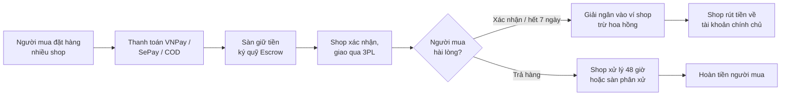

# BRD — TÀI LIỆU YÊU CẦU KINH DOANH (Business Requirements Document)

| Thuộc tính | Nội dung |
|---|---|
| Mã tài liệu | GENIE-TLCN-BRD |
| Dự án | Genie — Sàn thương mại điện tử đa người bán (bản TLCN — Tiểu luận chuyên ngành) |
| Phiên bản | 1.1 (đồng bộ bộ tài liệu TLCN v1.4 và mã nguồn 2026-11-16) |
| Ngày ban hành | 2026-11-06 |
| Nhóm tác giả | Mo Ha Mach Bu Ba Ka · Nguyen Quoc Khoa · Nguyen Ngoc Thien · Nghiem Phu Dang Quan |
| Trạng thái | Bản phát hành để rà soát |
| Mục đích | Xác định vấn đề kinh doanh, mục tiêu, phạm vi, các bên liên quan, mô hình doanh thu, quy tắc nghiệp vụ, ràng buộc pháp lý và tiêu chí thành công của sàn Genie bản TLCN. |
| Người đọc | Giảng viên hướng dẫn, hội đồng đánh giá, nhóm dự án (vai trò Product Owner / BA) |
| Tài liệu liên quan | PRD.md, SRS.md, HLD.md, LLD.md; BAO_CAO_KIEN_THUC_KINH_DOANH_KINH_TE_v1.0.md; BAO_CAO_HE_THONG_CHINH_SACH_HOP_DONG_PHAP_LY_v1.0.md; BAO_CAO_DU_TOAN_CHI_PHI_VA_GIAI_PHAP_AI_v1.0.md; BAO_CAO_PHAM_VI_MVP.md |

> Các tham chiếu trong tài liệu ghi theo **tên tệp và mục** (ví dụ "Usecase.md, Phần III, UC-ORD-07"), không dùng liên kết, để tài liệu dùng được khi tách khỏi thư mục gốc.

### Lịch sử phiên bản

| Phiên bản | Ngày | Nội dung |
|---|---|---|
| 1.0 | 2026-11-06 | Phát hành lần đầu, tổng hợp từ bộ tài liệu TLCN v1.2 (87 use case, 11 phân hệ, 16 tác nhân, 64 bảng) |
| 1.1 | 2026-11-16 | Đồng bộ với mã nguồn `genie-multivendor-platform` (TLCN v1.4): kho tệp MinIO → **Silo** (ADR-15 / ADR 0009 trong repo); AUTH chỉnh theo phần đã hiện thực (đăng ký giữ tạm Redis 15 phút, `GNE-AUTH-4012`, `GNE-AUTH-4098`, khóa tạm không đổi `status`, refresh giữ `family_id` + ân hạn 10 giây, xóa tài khoản giữ phiên hiện tại, cron 02:30); `V14__auth_additions.sql` thay cho `V14__api_sync_v13.sql`; đổi tên UC-AUTH-03 / 06 / 11 theo giao diện; thêm mã lỗi `GNE-SYS-4040/4050/5000` |
## Mục lục

1. Tóm tắt điều hành
2. Bối cảnh & vấn đề kinh doanh
3. Mục tiêu kinh doanh & chỉ số thành công
4. Phạm vi
5. Các bên liên quan
6. Mô hình kinh doanh & doanh thu
7. Yêu cầu kinh doanh (BR)
8. Quy tắc nghiệp vụ & tham số chuẩn
9. Quy trình nghiệp vụ mục tiêu
10. Yêu cầu pháp lý & tuân thủ
11. Giả định, ràng buộc & phụ thuộc
12. Rủi ro kinh doanh
13. Chi phí & nguồn lực
14. Tiêu chí nghiệm thu kinh doanh
15. Phê duyệt

## 1. Tóm tắt điều hành

**Genie** là sàn thương mại điện tử đa người bán tại Việt Nam. Điểm khác biệt không nằm ở giá rẻ mà ở **an tâm về tiền**: sàn giữ tiền của người mua trong tài khoản ký quỹ (Escrow) và chỉ chuyển cho shop khi người mua xác nhận đã nhận hàng hoặc hết 7 ngày bảo vệ — áp dụng cho cả VNPay, chuyển khoản VietQR (SePay) và COD. Người bán phải qua xác minh danh tính (KYC) tự động bằng AI mới được bán; sản phẩm được Gemini sàng lọc và nhân viên kiểm duyệt duyệt cuối.

Bản **TLCN** là MVP khép kín, do nhóm 4 người xây trong 16 tuần (8 sprint): **87 use case / 11 phân hệ / 16 tác nhân / 65 bảng**, chạy trên 1 máy chủ (~50 người dùng đồng thời). Bản hoàn chỉnh (206 use case) là kế hoạch Đồ án tốt nghiệp (DATN); mọi tên và mã ở TLCN trùng DATN để chỉ cần mở rộng, không phải viết lại.

## 2. Bối cảnh & vấn đề kinh doanh

| Vấn đề | Ai gặp | Hệ quả | Genie giải quyết bằng |
|---|---|---|---|
| Sợ trả tiền rồi nhận hàng lỗi / không nhận được hàng | Người mua | Chỉ dám mua shop quen, chuộng COD | Ký quỹ 7 ngày cho **mọi** phương thức, kể cả COD; trả hàng có bằng chứng và phân xử của sàn |
| Không biết người bán là ai | Người mua | Nghi ngờ shop mới, hàng giả | KYC theo tầng (QR + MRZ CCCD, so khớp khuôn mặt); rút tiền chỉ về tài khoản chính chủ; nhãn **Chính hãng** |
| Hàng cấm, mô tả sai, ảnh vi phạm | Sàn, người mua | Rủi ro pháp lý, mất uy tín | Gemini API chấm tự động + Moderator duyệt cuối; giấy tờ chứng thực cho ngành yêu cầu |
| Shop nhỏ khó tiếp cận khách và tự xử lý vận chuyển, thanh toán | Người bán | Chi phí vận hành cao | Một tài khoản hai chế độ Mua / Bán; tích hợp sẵn 3PL (GHN, GHTK, ViettelPost, J&T), VNPay, SePay; voucher, Flash Sale, chat |
| Vận hành sàn cần chia việc và kiểm soát nhân viên | Đội vận hành | Lạm quyền, sai tiền | RBAC 13 mã quyền, 3 chức danh, sổ cái kép bất biến, nhật ký kiểm toán |

## 3. Mục tiêu kinh doanh & chỉ số thành công

| Mã | Mục tiêu | Chỉ số (KPI) | Mục tiêu chạy thử |
|---|---|---|---|
| BO-01 | Chứng minh mô hình niềm tin vận hành được end-to-end | Vòng nghiệp vụ mua – bán – giải ngân – hoàn tiền chạy thật trên sandbox | 100% 9 kịch bản E2E xanh |
| BO-02 | Tạo doanh thu bền vững từ hoa hồng | Take rate thực = Σ hoa hồng đã giải ngân / GMV | ≥ 5% |
| BO-03 | Giữ chi phí khuyến mãi trong ngân sách | (Voucher sàn + Freeship + Điểm) / GMV | ≤ 3% |
| BO-04 | Mở shop nhanh mà vẫn an toàn | Tỷ lệ KYC tự duyệt; thời gian duyệt tay | ≥ 60%; < 24 giờ làm việc |
| BO-05 | Chuyển đổi mua hàng tốt | Phiên checkout hoàn tất / phiên tạo | ≥ 60% |
| BO-06 | Kiểm soát tranh chấp và rủi ro COD | Tỷ lệ khiếu nại; tỷ lệ hoàn hàng COD | ≤ 5%; ≤ 10% |
| BO-07 | Chạy được với chi phí sinh viên | Chi phí hạ tầng + dịch vụ / tháng | ≤ 1,5 triệu (demo), ≤ 2,9 triệu (chạy thử) |

Bảng KPI đầy đủ (15 chỉ số, công thức trên 65 bảng): BAO_CAO_KIEN_THUC_KINH_DOANH_KINH_TE_v1.0.md, Phần 8.

## 4. Phạm vi

### 4.1 Trong phạm vi (TLCN)

| Mảng | Trong TLCN |
|---|---|
| Tài khoản | Đăng ký email + OTP, đăng nhập JWT (access 15 phút + refresh 7 ngày), đăng nhập Google / Apple, quên / đổi mật khẩu, đăng xuất & thu hồi phiên, hồ sơ, sổ địa chỉ chuẩn GHN, xóa tài khoản (ẩn danh hóa); **một tài khoản hai chế độ Mua / Bán** |
| Danh mục & sản phẩm | Cây danh mục 3 cấp + thuộc tính chuẩn theo ngành, thương hiệu, tìm kiếm full-text PostgreSQL + từ khóa gợi ý / xu hướng, lọc & sắp xếp, chi tiết SKU (lượt xem, nút ♥ yêu thích, nút Chia sẻ deeplink), sản phẩm tương tự, trang shop (điểm đánh giá, người theo dõi, số sản phẩm, tỉ lệ phản hồi chat); shop CRUD sản phẩm, hàng đặt trước, giấy tờ chứng thực, đề xuất danh mục mới; kiểm duyệt **Gemini** + Moderator |
| Đơn hàng | Giỏ hàng (cả khách vãng lai, gộp khi đăng nhập), tách đơn theo shop, phí ship theo hãng, ghi chú cho shop, tự hủy đơn quá hạn 15 phút, hủy đơn, xác nhận đã nhận, tự hoàn tất sau 7 ngày |
| Thanh toán | VNPay (Return URL + IPN idempotent, refund API), chuyển khoản VietQR qua SePay (webhook tiền vào / tiền ra), **COD kết hợp Escrow**; ký quỹ 7 ngày; hoa hồng theo ngành / theo shop; sổ cái kép bất biến |
| Gian hàng | Mở shop, KYC theo tầng (AI + duyệt tay), kho lấy hàng & cấu hình vận chuyển (freeship, hãng bật), tài khoản nhận tiền chính chủ, thông tin & cài đặt gian hàng (logo, ảnh bìa, mô tả), tự trả lời chat, tạm nghỉ, ví & sổ giao dịch, báo cáo & phân tích bán hàng |
| Vận chuyển | Shop xác nhận / từ chối đơn mới; điều phối đa hãng GHN / GHTK / ViettelPost / J&T; tạo vận đơn, in phiếu A6, webhook hành trình, đối soát COD |
| Khuyến mãi | Voucher **xếp chồng 3 tầng** (Shop → Sàn → Freeship) với phạm vi danh mục / sản phẩm + **Điểm** (tối đa 50% đơn, 1 Điểm = 1₫); Flash Sale; điểm danh nhận Điểm; đổi Điểm lấy voucher |
| Tương tác | Chat WebSocket (văn bản, ảnh, thẻ sản phẩm, trạng thái đơn), đánh giá có ảnh / video + nút "Hữu ích", shop phản hồi, báo cáo đánh giá vi phạm, phân tích cảm xúc đánh giá bằng PhoBERT (tích cực / trung tính / tiêu cực), theo dõi shop |
| Sau bán | Trả hàng / hoàn tiền (toàn phần & một phần), phân xử tranh chấp, hoàn tiền VNPay / VietQR / COD |
| Thông báo | In-app thời gian thực + email giao dịch + thông báo toàn sàn |
| Quản trị | Nhân viên & lời mời kích hoạt, RBAC 13 mã quyền (3 chức danh + Admin), khóa / mở khóa tài khoản, duyệt rút tiền, dashboard doanh thu & ký quỹ, nhật ký hệ thống, banner trang chủ |
| Giao diện | Đa ngôn ngữ vi / en, responsive 360–1440 px, SEO + Open Graph |

### 4.2 Ngoài phạm vi (thuộc DATN)

Ví khách hàng & mã PIN, MoMo / ZaloPay / thẻ quốc tế / BNPL, hóa đơn điện tử & khấu trừ thuế; Genie Express (đội tài xế, app Shipper PWA, Hub, định tuyến VRPTW); voucher tầng 4 (ưu đãi thanh toán), combo / bundle; gamification ngoài Điểm (hạng thành viên, nhiệm vụ, vòng quay, vật phẩm trang trí), giới thiệu bạn bè, affiliate, livestream; trợ lý mua sắm AI, tìm kiếm bằng ảnh, gợi ý vector cá nhân hóa, phân tích cảm xúc theo khía cạnh (ABSA); đa kho, tài khoản phụ shop, trang trí gian hàng, gói VIP, quảng cáo PPC, điểm phạt; ticket CSKH theo SLA; MFA; A/B testing, analytics clickstream, đa tiền tệ, B2B; Kafka, RabbitMQ, Elasticsearch, Qdrant, Kubernetes, Saga, feature flag. Use case tương ứng ở `Usecase.md` (cột Hiện trạng trong `Quản Lý UseCase.xlsx` của DATN đánh “Đã triển khai” cho 87 use case đã có ở TLCN). Danh sách chi tiết theo từng use case / entity: BAO_CAO_PHAM_VI_MVP.md.

## 5. Các bên liên quan

| Bên liên quan | Vai trò | Quan tâm chính | Mức ảnh hưởng |
|---|---|---|---|
| Nhóm dự án (4 thành viên) | Phân tích, thiết kế, xây dựng, kiểm thử, triển khai | Hoàn thành đúng phạm vi trong 16 tuần | Cao |
| Giảng viên hướng dẫn | Định hướng, duyệt phạm vi | Tính đúng đắn kỹ thuật và nghiệp vụ | Cao |
| Hội đồng đánh giá | Chấm đồ án | Cơ chế riêng (ký quỹ, KYC, phân quyền) chạy thật, mô hình hóa nghiêm túc | Cao |
| Người mua (Guest, Customer) | Mua hàng | An tâm về tiền, mua nhanh, đổi trả rõ ràng | Cao |
| Người bán (Vendor) | Bán hàng | Mở shop nhanh, nhận tiền đúng hạn, công cụ bán hàng | Cao |
| Nhân viên sàn (Moderator, CS Specialist, Finance Officer) và Admin | Vận hành | Hàng chờ rõ ràng, đúng quyền, có nhật ký | Trung bình |
| Đối tác thanh toán (VNPay, SePay) | Xử lý tiền | Tích hợp đúng chuẩn, chữ ký, idempotent | Trung bình |
| Đối tác vận chuyển (GHN, GHTK, ViettelPost, J&T) | Giao hàng, thu hộ COD | Vận đơn, webhook, đối soát | Trung bình |
| Google (Gemini, đăng nhập), Apple | Dịch vụ AI và danh tính | Dùng đúng hạn mức, đúng điều khoản | Thấp |
| Cơ quan quản lý (Bộ Công Thương, thuế, bảo vệ dữ liệu) | Pháp lý | Đăng ký sàn, dữ liệu cá nhân, thuế — khi chạy thương mại | Trung bình (sau đồ án) |

## 6. Mô hình kinh doanh & doanh thu

- **Marketplace:** sàn không sở hữu hàng; bán **niềm tin và lưu lượng**. Tài sản cốt lõi là mạng lưới hai phía và cơ chế niềm tin.
- **Doanh thu duy nhất của TLCN:** hoa hồng theo ngành trên mỗi đơn hoàn tất (thứ tự áp dụng: hoa hồng riêng của shop → hoa hồng ngành → mặc định 5%). Gói thành viên, quảng cáo, phí vận chuyển nội bộ… thuộc DATN.
- **Chi phí sàn chịu:** voucher Sàn, Freeship, Điểm Genie, phí cổng VNPay (chuyển khoản qua SePay không mất phí %).
- **Biên đóng góp ước tính:** hoa hồng bình quân ~5,5% − chi phí biến đổi ~1,8% ≈ **3,7% GMV**.

**Ví dụ một đơn (unit economics):**

**Ví dụ đơn 350.000đ, ngành Thời trang (8%), khách dùng voucher shop 20.000đ và voucher sàn 15.000đ, phí ship 30.000đ khách trả, thanh toán VNPay:**

| Khoản | Khách trả | Shop nhận | Sàn |
|---|--:|--:|--:|
| Giá hàng | 350.000 | | |
| Voucher shop (shop chịu) | −20.000 | | |
| Voucher sàn (sàn chịu) | −15.000 | | −15.000 |
| Phí ship (trả GHN) | +30.000 | | (chuyển cho GHN) |
| **Khách thanh toán** | **345.000** | | |
| `grossAmount` = 350.000 − 20.000 | | 330.000 | |
| Hoa hồng 8% × 330.000 | | −26.400 | +26.400 |
| **`netAmount` shop nhận khi giải ngân** | | **303.600** | |
| Phí cổng VNPay (~1,1% × 345.000, sàn chịu) | | | −3.800 |
| **Lợi nhuận góp của sàn trên đơn** | | | **≈ 7.600** |

> Kiểm tra cân đối: khách trả 345.000 = GHN 30.000 + shop 303.600 + sàn giữ 26.400 − sàn bù voucher 15.000 → 30.000 + 303.600 + 11.400 = 345.000 ✓.
> Bài học: voucher sàn ăn trực tiếp vào hoa hồng — **ngân sách voucher sàn (`Voucher.budget`) phải được giới hạn**, nếu không mỗi đơn có thể lỗ.

**Chiến lược khởi động (bài toán con gà – quả trứng):** cung trước (10–20 shop nhỏ, hoa hồng ưu đãi 0–3% trong 3 tháng), một ngách hẹp trong một thành phố, cầu sau bằng voucher đơn đầu có ngân sách cố định; Flash Sale, Điểm, voucher sàn bật theo ngân sách.

## 7. Yêu cầu kinh doanh (BR)

| Mã | Yêu cầu kinh doanh | Ưu tiên | Hiện thực bởi (SRS) |
|---|---|:---:|---|
| BR-01 | Người dùng tạo tài khoản an toàn bằng email + OTP, đăng nhập bằng mật khẩu, OTP hoặc Google / Apple; một tài khoản dùng được cả hai chế độ Mua / Bán | MUST | FR-AUTH |
| BR-02 | Người mua tìm được hàng nhanh (tiếng Việt có / không dấu), xem đủ thông tin người bán, biến thể, tồn kho | MUST | FR-CAT |
| BR-03 | Người mua đặt hàng nhiều shop trong một lần thanh toán; mỗi shop thành một đơn riêng; không bán vượt tồn kho | MUST | FR-ORD |
| BR-04 | Tiền người mua được giữ ở tài khoản sàn và chỉ chuyển cho shop sau khi nhận hàng hoặc hết 7 ngày, kể cả COD; sổ sách tiền không thể sửa | MUST | FR-PAY |
| BR-05 | Người bán phải được xác minh danh tính trước khi bán; chỉ rút tiền về tài khoản chính chủ | MUST | FR-VND, FR-ADM |
| BR-06 | Hàng hóa được kiểm duyệt trước khi lên sàn (AI sàng lọc, con người duyệt cuối) | MUST | FR-CAT |
| BR-07 | Giao hàng qua đối tác 3PL, shop xác nhận / từ chối đơn, đối soát tiền COD | MUST | FR-LOG |
| BR-08 | Sàn kích cầu bằng voucher 3 tầng, Flash Sale, Điểm Genie trong giới hạn ngân sách | SHOULD | FR-PRO |
| BR-09 | Người mua và người bán tương tác: chat, đánh giá có kiểm duyệt, theo dõi shop; sàn nắm được cảm xúc đánh giá (PhoBERT) | SHOULD | FR-SOC |
| BR-10 | Người mua trả hàng / hoàn tiền có bằng chứng; sàn phân xử khi hai bên không thống nhất | MUST | FR-SUP |
| BR-11 | Người dùng nhận thông báo kịp thời (in-app, email); sàn phát thông báo toàn sàn | MUST | FR-NOT |
| BR-12 | Sàn vận hành bằng đội nhân viên có phân quyền, duyệt rút tiền, theo dõi doanh thu, có nhật ký kiểm toán, quản lý banner | MUST | FR-ADM |
| BR-13 | Giao diện tiếng Việt / tiếng Anh, dùng tốt trên điện thoại, chia sẻ link sản phẩm có ảnh xem trước | SHOULD | Yêu cầu giao diện, NFR-14 |

## 8. Quy tắc nghiệp vụ & tham số chuẩn

| Nhóm | Tham số | Entity / Use case |
|---|---|---|
| Hoa hồng ngành hàng | 3,5% – 8,0% (Điện tử 3,5%, Bách hóa 4,5%, Mẹ & Bé / Gia dụng 5,5%, Mỹ phẩm 7,0%, Thời trang 8,0%); mặc định 5% nếu ngành chưa cấu hình | `Category.commissionRate` — UC-CAT-14 |
| Hoa hồng riêng của shop | Ghi đè tỷ lệ ngành nếu Admin thỏa thuận (`VendorProfile.commissionRate`) | UC-PAY-05 |
| Voucher | **3 tầng**: Shop (shop chịu, mỗi shop 1) → Sàn (sàn chịu) → Freeship (sàn chịu); tổng giảm Shop + Sàn ≤ 85% giá trị hàng; giá trị tối thiểu sau giảm 1.000đ | `Voucher`, `OrderDiscount` — UC-PRO-01…04 |
| Điểm | 1 Điểm = 1₫; dùng tối đa 50% tiền hàng còn lại sau voucher; hết hạn 12 tháng; điểm danh 100 Điểm / ngày, ngày thứ 7 liên tiếp 1.000 Điểm | `UserCoin`, `CoinTransaction`, `DailyCheckin` — UC-PRO-08…10 |
| Ký quỹ (Escrow) | Giữ tiền đến 7 ngày sau `DELIVERED` hoặc khi khách xác nhận; khiếu nại → `DISPUTED` | `EscrowLedger` — UC-PAY-05, UC-PAY-07 |
| Khiếu nại | Khách gửi trong 7 ngày; shop phản hồi 48 giờ (quá hạn → tự chấp thuận); shop từ chối → khách có 48 giờ khiếu nại lên sàn | `RefundRequest` — UC-SUP-01…04 |
| Giữ chỗ tồn kho | 15 phút chờ thanh toán | `StockReservation` — UC-ORD-07, UC-ORD-08 |
| KYC người bán | Điểm rủi ro < 30 tự duyệt · 30–69 người duyệt · ≥ 70 từ chối; lấy mẫu 5% | `KycResult` — UC-VND-03 |
| Rút tiền | Tối thiểu 100.000đ; chỉ về tài khoản ngân hàng đúng tên trên CCCD; duyệt một bước | `WithdrawalRequest` — UC-ADM-04, UC-ADM-05 |

Quy tắc chi tiết từng luồng tiền (đặt hàng, VNPay / VietQR, COD, giải ngân, hoàn tiền) và ai chịu tiền khuyến mãi: BAO_CAO_KIEN_THUC_KINH_DOANH_KINH_TE_v1.0.md, Phần 4, 5, 5B.

## 9. Quy trình nghiệp vụ mục tiêu

1. **Shop mở gian hàng & KYC tự động:** khách hàng bấm "Trở thành người bán", nộp CCCD + selfie; AI Worker giải mã QR, đọc MRZ, so khớp khuôn mặt, chấm điểm rủi ro; hồ sơ nghi ngờ chuyển Staff duyệt tay.
2. **Đăng bán sản phẩm đa biến thể (SPU / SKU):** thương hiệu, tình trạng, hàng đặt trước, giấy tờ chứng thực; ảnh tải thẳng lên Silo qua Presigned URL; **Gemini API** chấm tự động, Moderator duyệt phần nghi ngờ; shop đề xuất danh mục mới khi không có danh mục phù hợp.
3. **Giỏ hàng đa shop & tách đơn tự động:** một lần thanh toán sinh N đơn con (mỗi shop một đơn), phí ship GHN tính riêng từng shop, giữ chỗ tồn kho 15 phút chống bán vượt.
4. **Thanh toán VNPay / chuyển khoản VietQR (SePay) / COD kết hợp ký quỹ (Escrow):** voucher xếp chồng 3 tầng (Shop → Sàn → Freeship) + Điểm; tiền khách nằm ở tài khoản sàn, ghi sổ cái kép; giải ngân vào ví shop sau khi khách xác nhận hoặc hết 7 ngày, đã trừ hoa hồng theo ngành hàng.
5. **Giao hàng qua 3PL:** shop xác nhận / từ chối đơn mới, hệ thống chọn hãng (GHN mặc định, GHTK / ViettelPost / J&T khi shop bật), shop tạo vận đơn và in phiếu; webhook cập nhật hành trình; tiền COD đối soát theo bảng kê.
6. **Sau bán & tương tác:** đánh giá có nút "Hữu ích" và báo cáo vi phạm, PhoBERT chấm cảm xúc từng đánh giá cho người bán và kiểm duyệt, theo dõi shop, chat khách – shop (thẻ sản phẩm, ảnh, tự trả lời), trả hàng / hoàn tiền có phân xử của sàn.
6b. **Khuyến mãi & giữ chân:** Flash Sale chống bán vượt suất, điểm danh nhận Điểm (hết hạn sau 12 tháng), đổi Điểm lấy voucher, dùng Điểm giảm tối đa 50% đơn.
7. **Quản trị:** nhân viên 3 chức danh (Moderator, CS Specialist, Finance Officer) + Admin, phân quyền 13 mã quyền; duyệt KYC, duyệt sản phẩm, danh mục, thuộc tính & hoa hồng, voucher sàn, Flash Sale, duyệt rút tiền, khóa tài khoản, dashboard & sổ cái, nhật ký hệ thống, banner trang chủ, thông báo toàn sàn.

## 10. Yêu cầu pháp lý & tuân thủ

| Nhóm | Văn bản / việc cần có | Demo đồ án | Chạy thử thương mại | Căn cứ chính |
|---|---|:---:|:---:|---|
| 1. TMĐT & sàn | Quy chế hoạt động sàn; thông tin người sở hữu sàn ở chân trang; đăng ký sàn với Bộ Công Thương | Bản nháp công khai trên web | ✅ Bắt buộc | Luật TMĐT 2025; NĐ 248/2026 |
| 2. Dữ liệu cá nhân | Chính sách quyền riêng tư; đồng ý khi đăng ký; **đồng ý riêng** cho dữ liệu sinh trắc học khi KYC; quy trình xử lý yêu cầu của chủ thể dữ liệu (xóa tài khoản tự phục vụ — UC-AUTH-10; yêu cầu khác qua email) | ✅ | ✅ | Luật BVDLCN 2025 (kế thừa NĐ 13/2023) |
| 3. Thuế | Quy trình khấu trừ & nộp thuế thay hộ / cá nhân kinh doanh khi sàn có chức năng thanh toán | Không áp dụng (không có giao dịch thật) | ⚠️ **Phải bổ sung** (chưa có trong MVP) | NĐ 117/2025/NĐ-CP |
| 4. Thanh toán | Hợp đồng với VNPay; chính sách thanh toán & hoàn tiền; **không giữ ví tiền người mua** | Sandbox | ✅ | NĐ 52/2024/NĐ-CP |
| 5. Vận chuyển | Chính sách vận chuyển (GHN mặc định, GHTK / ViettelPost / J&T khi shop bật); hợp đồng với từng hãng | ✅ (dev) | ✅ | — (không tự vận hành đội xe) |
| 6. Người bán | Hợp đồng điện tử cung ứng dịch vụ sàn / điều khoản người bán (tick đồng ý khi mở shop); biểu phí hoa hồng | ✅ | ✅ | Luật TMĐT 2025 |
| 8. Người tiêu dùng | Chính sách đổi trả & hoàn tiền 7 ngày; công bố thông tin sản phẩm (giá, xuất xứ, người bán) | ✅ | ✅ | Luật BVQLNTD 2023 |
| 9. SHTT & hàng cấm | Danh mục hàng cấm / hạn chế; giấy tờ chứng thực cho ngành yêu cầu; kiểm duyệt Gemini + Moderator; quy trình gỡ sản phẩm vi phạm (UC-CAT-11) | ✅ | ✅ | Luật TMĐT 2025 |
| 10. Tranh chấp | Quy chế giải quyết khiếu nại (theo luồng UC-SUP-01…04) | ✅ | ✅ | Luật TMĐT 2025 |
| 12. Khuyến mại | Thể lệ voucher 3 tầng, Flash Sale (khung giờ, số suất), Điểm Genie (cách nhận, hạn 12 tháng, giới hạn 50%) hiển thị công khai | ✅ | ✅ | Luật Thương mại 2005 |

**Nhóm của DATN không cần cho TLCN:** 7 (hợp đồng tài xế — không có đội xe), 11 (AML / kiểm toán nội bộ ở quy mô lớn — chỉ giữ nhật ký `system_logs`), 13 (quảng cáo PPC / KOL / livestream), 14 (ngoại hối — không đa tiền tệ), giấy phép ví điện tử (không làm ví), quy chế livestream.

Ranh giới pháp lý của thiết kế: sàn **không giữ ví tiền của người mua**; tiền khách đi qua VNPay / chuyển khoản / hãng vận chuyển về tài khoản doanh nghiệp của sàn và chỉ chi cho shop theo quy tắc ký quỹ; dữ liệu cá nhân theo Luật Bảo vệ dữ liệu cá nhân 2025 (đồng ý riêng cho sinh trắc học khi KYC, mã hóa ảnh CCCD). Khấu trừ thuế thay người bán **chưa có** trong MVP — bắt buộc bổ sung trước khi chạy thương mại.

## 11. Giả định, ràng buộc & phụ thuộc

| Loại | Nội dung |
|---|---|
| Giả định | Quy mô demo / chạy thử: vài trăm người dùng, ~50 người dùng đồng thời, ~500 đơn / tháng; người dùng truy cập bằng trình duyệt (chưa có app native) |
| Giả định | VNPay sandbox, SePay, GHN dev, Gemini (hạn mức miễn phí) đủ cho demo |
| Ràng buộc | Nhóm 4 người, 16 tuần, 8 sprint × 2 tuần; một VPS 4 vCPU / 8 GB RAM |
| Ràng buộc | Tên bảng, cột, enum, mã use case trùng DATN — chỉ được thêm, không đổi tên |
| Ràng buộc | OTP chỉ qua email (không SMS / Zalo ZNS) |
| Phụ thuộc | VNPay, SePay, GHN / GHTK / ViettelPost / J&T, Gemini API, Google / Apple OIDC, SMTP — mỗi dịch vụ có phương án dự phòng (SRS.md, mục 2.6) |

## 12. Rủi ro kinh doanh

| Rủi ro | Biểu hiện | Kiểm soát trong TLCN |
|---|---|---|
| Người bán lừa đảo (hàng giả, không giao) | Khiếu nại tăng | KYC theo tầng; Gemini + Moderator kiểm duyệt, giấy tờ chứng thực cho ngành yêu cầu; ký quỹ 7 ngày; rút tiền chỉ về tài khoản chính chủ; Admin khóa shop (UC-ADM-03) |
| Người mua lạm dụng hoàn tiền | Khiếu nại "không nhận được hàng" khi đã nhận | Bằng chứng ảnh / video bắt buộc; GHN có trạng thái giao + chữ ký; phân xử 2 chiều |
| Lạm dụng voucher (nhiều tài khoản) | Chi phí voucher sàn vượt kế hoạch | `usagePerUser`, `budget`, OTP email khi đăng ký; theo dõi KPI chi phí voucher |
| Tự mua hàng của chính mình (thổi đánh giá, quay vòng voucher) | | Chặn `GNE-ORD-4094` |
| COD bom hàng | Hoàn hàng, mất phí ship | Ký quỹ COD chỉ nạp khi tiền về; theo dõi tỷ lệ; có thể tắt COD theo shop / khách ở DATN |
| Đánh giá giả / spam | Điểm shop bị thổi hoặc bị dìm | Chỉ đơn `COMPLETED` được đánh giá; báo cáo vi phạm, Moderator / CS ẩn (UC-SOC-05); tính lại điểm |
| Lạm dụng Điểm / điểm danh nhiều tài khoản | Chi phí Điểm vượt kế hoạch | Điểm giới hạn 50% đơn, hết hạn 12 tháng; `balanceHash`; theo dõi KPI chi phí khuyến mãi |
| Nhân viên lạm quyền | Duyệt chi sai, sửa hoa hồng | 13 mã quyền, tách biệt chi tiền / sửa hoa hồng, nhật ký hệ thống (UC-ADM-07) |
| Bán vượt tồn kho | Hủy đơn, mất uy tín | Giữ chỗ có điều kiện + `@Version` |
| Lệch tiền | Ví shop ≠ sổ giao dịch | `balanceHash`, sổ chỉ ghi thêm, job đối soát đêm |
| Pháp lý (sàn có chức năng thanh toán) | Nghĩa vụ khấu trừ thuế, đăng ký sàn | Xem báo cáo pháp lý TLCN — chỉ vận hành thương mại sau khi hoàn tất |

## 13. Chi phí & nguồn lực

| Giai đoạn | Quy mô | Hạ tầng | Dịch vụ ngoài | **Tổng / tháng** |
|---|---|--:|--:|--:|
| **M0 — Phát triển & demo đồ án** (16 tuần) | Nhóm 4 người + hội đồng | 0 – 1.400k | ~125k | **≈ 0,13 – 1,5 triệu** |
| **M1 — Chạy thử có người dùng thật** (sau bảo vệ, 3–6 tháng) | ≤ 1.000 user, ≤ 50 shop, ~500 đơn/tháng, ~1.000 lượt kiểm duyệt sản phẩm/tháng | 2.240k | ~325 – 625k | **≈ 2,6 – 2,9 triệu** |

**Năm kết luận chính:**
1. **Bỏ Elasticsearch, Qdrant, RabbitMQ, Kafka, OSRM giúp MVP chạy trên 1 máy** — so với T1 của DATN (14,0 triệu/tháng hạ tầng, 7 máy) chi phí hạ tầng M1 giảm ~84%.
2. **Không dùng OTP SMS / Zalo ZNS** (khoản tốn nhất của bản đầy đủ): OTP và thông báo đi qua **email** (miễn phí ở quy mô MVP) + in-app.
3. **KYC tự host bản rút gọn (QR + MRZ + ONNX)** chạy CPU ~1–2 giây / hồ sơ, RAM < 1,5 GB — không cần GPU, không trả phí theo hồ sơ.
4. **Không làm ví khách hàng** → không phát sinh chi phí giấy phép trung gian thanh toán (vốn tối thiểu 50 tỷ đồng theo NĐ 52/2024 — xem DATN Phần 0.3).
5. **Kiểm duyệt sản phẩm bằng Gemini API** thay vì tự dựng pipeline CLIP: M0 nằm trong hạn mức miễn phí; M1 ước ~40đ / lượt → **~40–50k / tháng** cho ~1.000 lượt — rẻ hơn nhiều so với thuê thêm máy GPU / CPU cho mô hình tự host.

**Nguồn lực:** 4 thành viên — Backend 1 (luồng tiền), Backend 2 (xác thực, danh mục, tích hợp), AI + Backend 3 (AI Worker KYC + PhoBERT, gian hàng, tương tác, quản trị), Frontend (Storefront, Seller Center, Admin Portal). Chi tiết dự toán: BAO_CAO_DU_TOAN_CHI_PHI_VA_GIAI_PHAP_AI_v1.0.md.

## 14. Tiêu chí nghiệm thu kinh doanh

- [ ] 87 use case đặc tả đầy đủ; các use case MUST chạy được trên môi trường demo.
- [ ] 9 kịch bản E2E: mua VNPay, mua VietQR, mua COD, mở shop + KYC, đăng sản phẩm qua Gemini, voucher 3 tầng + Điểm, Flash Sale, trả hàng, nhân viên đúng quyền.
- [ ] 5 kịch bản tiền: không bán vượt tồn (100 luồng / tồn 10), IPN lặp chỉ ghi 1 lần, Return URL không đổi trạng thái, giải ngân đúng sau 7 ngày, hoàn một phần cân "khách + shop + sàn = tiền đơn".
- [ ] Dashboard hiển thị được các KPI chính (mục 3); chi phí vận hành demo ≤ 1,5 triệu / tháng.
- [ ] Kịch bản demo 20 phút trình bày trọn vòng: mời nhân viên → mở shop + KYC → đăng sản phẩm → mua 2 shop → giao → giải ngân → rút tiền → trả hàng.

## 15. Phê duyệt

| Vai trò | Họ tên | Ngày | Chữ ký |
|---|---|---|---|
| Đại diện nhóm (Product Owner) | | | |
| Giảng viên hướng dẫn | | | |
