# NỀN TẢNG THƯƠNG MẠI ĐIỆN TỬ ĐA NGƯỜI BÁN GENIE — BẢN MVP (PHẠM VI ĐỒ ÁN)

**Đặc tả yêu cầu phần mềm (SRS) · Thiết kế tổng thể (HLD) · Thiết kế chi tiết (LLD)**
**Phiên bản: TLCN v1.4 — Phạm vi Tiểu luận chuyên ngành (phủ toàn bộ giao diện prototype Genie)**

| Thuộc tính | Nội dung |
|---|---|
| **Phiên bản tài liệu** | TLCN v1.4 (2026-11-16, đồng bộ mã nguồn) — 87 use case / 11 phân hệ / 16 tác nhân / 65 bảng. Đặc tả API: `document/API_SPEC.md`. Bản hoàn chỉnh cho đồ án tốt nghiệp: `DATN/document/Document_Vi.md` (206 use case) |
| **Thời điểm ban hành** | Tháng 10/2026 |
| **Nhóm tác giả** | Mo Ha Mach Bu Ba Ka · Nguyen Quoc Khoa · Nguyen Ngoc Thien · Nghiem Phu Dang Quan |
| **Backend** | Java 21 LTS, Spring Boot 3.3.x (Web, Security 6, Data JPA, Validation, WebSocket, Mail, Scheduling), Flyway — **một ứng dụng modular monolith** |
| **AI** | AI Worker Python 3.12, FastAPI, ONNX Runtime — KYC (OpenCV: QR, MRZ, YuNet/SFace) và **phân tích cảm xúc đánh giá bằng PhoBERT** (mô hình nhóm tự fine-tune, 3 nhãn) · **Google Gemini API** (structured output JSON) kiểm duyệt sản phẩm tự động |
| **Frontend** | Astro (storefront SSR cho SEO, thẻ Open Graph cho link chia sẻ) + React 19 (Kênh Người bán, Admin Portal), Tailwind CSS, đa ngôn ngữ vi / en (i18n) |
| **Cơ sở dữ liệu** | PostgreSQL 16 — **65 bảng** (full-text search `tsvector` + `unaccent` + `pg_trgm`) |
| **Cache & tạm thời** | Redis 7 (OTP, rate limit, cache số liệu, token bị thu hồi, bộ đếm lượt xem / từ khóa / banner, suất Flash Sale) |
| **Lưu trữ tệp** | Silo (S3-compatible, Presigned URL, bucket riêng tư cho KYC) |
| **Thanh toán** | VNPay (sandbox, có API hoàn tiền), chuyển khoản VietQR xác nhận tự động qua **SePay**, **COD kết hợp ký quỹ** (tiền thu hộ về sàn rồi mới vào Escrow); ký quỹ Escrow 7 ngày, sổ cái kép, ví shop & rút tiền |
| **Vận chuyển** | GHN mặc định (tính phí, vận đơn, webhook, thu hộ COD); GHTK / ViettelPost / J&T Express khi shop bật — điều phối đa hãng qua một adapter chung (UC-LOG-15) |
| **Thông báo** | In-app (WebSocket STOMP) + Email (SMTP) + thông báo toàn sàn; **mọi OTP gửi qua email** (không SMS / Zalo ZNS) |
| **Xác thực** | Email + mật khẩu (Argon2id), OTP email, đăng nhập Google / Apple (OAuth2 / OIDC); RBAC 4 vai trò + 13 mã quyền cho nhân viên (3 chức danh, không có Super Admin) |
| **Triển khai** | Docker Compose trên 1 VPS (4 vCPU / 8 GB RAM), Nginx reverse proxy + HTTPS (Let's Encrypt), GitHub Actions CI |

---

## Mục lục

- [Chương 01: Tổng quan dự án & Phạm vi MVP](#chuong-1)
- [Chương 02: Thiết kế & Phân tích hệ thống (HLD)](#chuong-2)
- [Chương 03: Thiết kế chi tiết hệ thống (LLD)](#chuong-3)
- [Chương 04: Quy trình kỹ thuật, Kiểm thử & Triển khai](#chuong-4)
- [Phụ lục A: Danh mục 87 use case](#phu-luc-a) · [Phụ lục B: Quyết định kiến trúc (ADR)](#phu-luc-b) · [Phụ lục C: Ma trận sẵn sàng triển khai](#phu-luc-c) · [Phụ lục D: Lộ trình mở rộng](#phu-luc-d)

---

<a id="chuong-1"></a>
# Chương 01: Tổng quan dự án & Phạm vi MVP

## 1.1 Giới thiệu

**Tên dự án:** Nền tảng Thương mại Điện tử Đa Người bán Genie (Multi-Vendor Marketplace) — bản MVP.

Tài liệu này đặc tả phạm vi **khép kín và phủ toàn bộ giao diện đã dựng** (prototype tương tác ở thư mục `genie/ui_kits/` của repo — Storefront, Seller Center, Admin Console, Auth; thương hiệu hiển thị là **Genie**, điểm thưởng là **Điểm Genie**) của một sàn TMĐT đa người bán, để hiện thực, kiểm thử và demo trong 16 tuần với nhóm 4 người. Bản hoàn chỉnh (206 use case, 169 entity, kiến trúc 100.000 CCU) ở thư mục `DATN/` là **kế hoạch đồ án tốt nghiệp**; mọi tên entity, tên bảng, mã và tên use case của TLCN trùng với DATN để mở rộng về sau chỉ cần **thêm**, không phải đổi. Đối chiếu từng màn hình ↔ use case: [BAO_CAO_DOI_CHIEU_GIAO_DIEN.md](../BAO_CAO_DOI_CHIEU_GIAO_DIEN.md).

> **Quy mô mục tiêu của MVP:** demo đồ án và vận hành thử nghiệm — vài trăm người dùng, ~50 người dùng đồng thời (CCU), API P95 < 500 ms trên 1 máy chủ 4 vCPU / 8 GB RAM. Không đặt mục tiêu 10.000 / 100.000 CCU.

**Vòng nghiệp vụ mà bản TLCN phải chạy được từ đầu đến cuối:**
1. **Shop mở gian hàng & KYC tự động:** khách hàng bấm "Trở thành người bán", nộp CCCD + selfie; AI Worker giải mã QR, đọc MRZ, so khớp khuôn mặt, chấm điểm rủi ro; hồ sơ nghi ngờ chuyển Staff duyệt tay.
2. **Đăng bán sản phẩm đa biến thể (SPU / SKU):** thương hiệu, tình trạng, hàng đặt trước, giấy tờ chứng thực; ảnh tải thẳng lên Silo qua Presigned URL; **Gemini API** chấm tự động, Moderator duyệt phần nghi ngờ; shop đề xuất danh mục mới khi không có danh mục phù hợp.
3. **Giỏ hàng đa shop & tách đơn tự động:** một lần thanh toán sinh N đơn con (mỗi shop một đơn), phí ship GHN tính riêng từng shop, giữ chỗ tồn kho 15 phút chống bán vượt.
4. **Thanh toán VNPay / chuyển khoản VietQR (SePay) / COD kết hợp ký quỹ (Escrow):** voucher xếp chồng 3 tầng (Shop → Sàn → Freeship) + Điểm; tiền khách nằm ở tài khoản sàn, ghi sổ cái kép; giải ngân vào ví shop sau khi khách xác nhận hoặc hết 7 ngày, đã trừ hoa hồng theo ngành hàng.
5. **Giao hàng qua 3PL:** shop xác nhận / từ chối đơn mới, hệ thống chọn hãng (GHN mặc định, GHTK / ViettelPost / J&T khi shop bật), shop tạo vận đơn và in phiếu; webhook cập nhật hành trình; tiền COD đối soát theo bảng kê.
6. **Sau bán & tương tác:** đánh giá có nút "Hữu ích" và báo cáo vi phạm, PhoBERT chấm cảm xúc từng đánh giá cho người bán và kiểm duyệt, theo dõi shop, chat khách – shop (thẻ sản phẩm, ảnh, tự trả lời), trả hàng / hoàn tiền có phân xử của sàn.
6b. **Khuyến mãi & giữ chân:** Flash Sale chống bán vượt suất, điểm danh nhận Điểm (hết hạn sau 12 tháng), đổi Điểm lấy voucher, dùng Điểm giảm tối đa 50% đơn.
7. **Quản trị:** nhân viên 3 chức danh (Moderator, CS Specialist, Finance Officer) + Admin, phân quyền 13 mã quyền; duyệt KYC, duyệt sản phẩm, danh mục, thuộc tính & hoa hồng, voucher sàn, Flash Sale, duyệt rút tiền, khóa tài khoản, dashboard & sổ cái, nhật ký hệ thống, banner trang chủ, thông báo toàn sàn.

<a id="12-pham-vi-du-an"></a>
## 1.2 Phạm vi dự án & Ranh giới hệ thống

### 1.2.1 Trong phạm vi (TLCN)

| Mảng | Trong TLCN |
|---|---|
| Tài khoản | Đăng ký email + OTP, đăng nhập JWT (access 15 phút + refresh 7 ngày), đăng nhập Google / Apple, quên / đổi mật khẩu, đăng xuất & thu hồi phiên, hồ sơ, sổ địa chỉ chuẩn GHN, xóa tài khoản (ẩn danh hóa); **một tài khoản hai chế độ Mua / Bán** |
| Danh mục & sản phẩm | Cây danh mục 3 cấp + thuộc tính chuẩn theo ngành, thương hiệu, tìm kiếm full-text PostgreSQL + từ khóa gợi ý / xu hướng, lọc & sắp xếp, chi tiết SKU (lượt xem, nút ♥ yêu thích, nút Chia sẻ deeplink), sản phẩm tương tự, trang shop (điểm đánh giá, người theo dõi, số sản phẩm, tỉ lệ phản hồi chat); shop CRUD sản phẩm, hàng đặt trước, giấy tờ chứng thực, đề xuất danh mục mới; kiểm duyệt **Gemini** + Moderator |
| Đơn hàng | Giỏ hàng (cả khách vãng lai, gộp khi đăng nhập), tách đơn theo shop, phí ship theo hãng, ghi chú cho shop, tự hủy đơn quá hạn 15 phút, hủy đơn, xác nhận đã nhận, tự hoàn tất sau 7 ngày |
| Thanh toán | VNPay (Return URL + IPN idempotent, refund API), chuyển khoản VietQR qua SePay (webhook tiền vào / tiền ra), **COD kết hợp Escrow**; ký quỹ 7 ngày; hoa hồng theo ngành / theo shop; sổ cái kép bất biến |
| Gian hàng | Mở shop, KYC theo tầng (AI + duyệt tay), kho lấy hàng & cấu hình vận chuyển (freeship, hãng bật), tài khoản nhận tiền chính chủ, thông tin & cài đặt gian hàng (logo, ảnh bìa, mô tả), tự trả lời chat, tạm nghỉ, ví & sổ giao dịch, báo cáo & phân tích bán hàng |
| Vận chuyển | Shop xác nhận / từ chối đơn mới; điều phối đa hãng GHN / GHTK / ViettelPost / J&T; tạo vận đơn, in phiếu A6, webhook hành trình, đối soát COD |
| Khuyến mãi | Voucher **xếp chồng 3 tầng** (Shop → Sàn → Freeship) với phạm vi danh mục / sản phẩm + **Điểm** (tối đa 50% đơn, 1 Điểm = 1₫); Flash Sale; điểm danh nhận Điểm; đổi Điểm lấy voucher |
| Tương tác | Chat WebSocket (văn bản, ảnh, thẻ sản phẩm, trạng thái đơn), đánh giá có ảnh / video + nút "Hữu ích", shop phản hồi, báo cáo đánh giá vi phạm, phân tích cảm xúc đánh giá bằng PhoBERT (tích cực / trung tính / tiêu cực), theo dõi shop |
| Sau bán | Trả hàng / hoàn tiền (toàn phần & một phần), phân xử tranh chấp, hoàn tiền VNPay / VietQR / COD |
| Thông báo | In-app thời gian thực + email giao dịch + thông báo toàn sàn |
| Quản trị | Nhân viên & lời mời kích hoạt, RBAC 13 mã quyền (3 chức danh + Admin), khóa / mở khóa tài khoản, duyệt rút tiền, dashboard doanh thu & ký quỹ, nhật ký hệ thống, banner trang chủ |
| Giao diện | Đa ngôn ngữ vi / en, responsive 360–1440 px, SEO + Open Graph |

### 1.2.2 Ngoài phạm vi (thuộc DATN — đồ án tốt nghiệp)

Ví khách hàng & mã PIN, MoMo / ZaloPay / thẻ quốc tế / BNPL, hóa đơn điện tử & khấu trừ thuế; Genie Express (đội tài xế, app Shipper PWA, Hub, định tuyến VRPTW); voucher tầng 4 (ưu đãi thanh toán), combo / bundle; gamification ngoài Điểm (hạng thành viên, nhiệm vụ, vòng quay, vật phẩm trang trí), giới thiệu bạn bè, affiliate, livestream; trợ lý mua sắm AI, tìm kiếm bằng ảnh, gợi ý vector cá nhân hóa, phân tích cảm xúc theo khía cạnh (ABSA); đa kho, tài khoản phụ shop, trang trí gian hàng, gói VIP, quảng cáo PPC, điểm phạt; ticket CSKH theo SLA; MFA; A/B testing, analytics clickstream, đa tiền tệ, B2B; Kafka, RabbitMQ, Elasticsearch, Qdrant, Kubernetes, Saga, feature flag. Use case tương ứng ở `DATN/diagrams/UseCaseDiagram/Usecase.md` (cột Hiện trạng trong `Quản Lý UseCase.xlsx` của DATN đánh “Đã triển khai” cho 87 use case đã có ở TLCN). Danh sách chi tiết theo từng use case / entity: [BAO_CAO_PHAM_VI_MVP.md](../BAO_CAO_PHAM_VI_MVP.md).

### 1.2.3 Ranh giới & giả định pháp lý

- **Tiền tệ:** VND, `DECIMAL(19,2)`.
- **Thanh toán:** sàn **không giữ ví tiền của người mua** (tránh yêu cầu giấy phép trung gian thanh toán của NHNN); tiền khách đi qua VNPay / chuyển khoản trực tiếp / GHN rồi về tài khoản doanh nghiệp của sàn (SePay chỉ **theo dõi** biến động số dư, không giữ tiền), được ghi nhận ở `escrow_ledgers` và chỉ chi cho shop theo quy tắc ký quỹ.
- **Dữ liệu cá nhân:** tuân thủ Luật Bảo vệ dữ liệu cá nhân 2025 (kế thừa NĐ 13/2023) ở mức MVP: thông báo & đồng ý khi đăng ký và khi nộp KYC, mã hóa ảnh CCCD (AES-256-GCM), che dữ liệu khi hiển thị, nhật ký truy cập hồ sơ KYC.
- **TMĐT:** sàn hiển thị thông tin người bán, quy chế hoạt động, chính sách đổi trả 7 ngày (tham khảo `kien-thuc/BAO_CAO_HE_THONG_CHINH_SACH_HOP_DONG_PHAP_LY_v1.0.md`).

## 1.3 Quy ước tài liệu

### 1.3.1 Phân loại ưu tiên MoSCoW

Mọi yêu cầu nghiệp vụ và kỹ thuật trong tài liệu đều được gán nhãn ưu tiên theo chuẩn MoSCoW:
- **MUST (Bắt buộc):** Các yêu cầu cốt lõi không thể thiếu để hệ thống vận hành hợp pháp, an toàn và đảm bảo giao dịch thông suốt. Thiếu yêu cầu này, sản phẩm không thể phát hành (Release Blocker).
- **SHOULD (Nên có):** Các tính năng mang lại giá trị vận hành và trải nghiệm cao, có giải pháp thay thế tạm thời trong ngắn hạn nhưng bắt buộc phải có trong phiên bản hoàn thiện.
- **COULD (Có thể có):** Các cải tiến nâng cao trải nghiệm người dùng, tối ưu hóa giao diện và tiện ích bổ trợ, triển khai khi nguồn lực cho phép.
- **WON'T (Chưa làm):** Các tính năng nằm ngoài phạm vi phiên bản hiện tại, được bảo lưu cho các chu kỳ phát triển tiếp theo (ví dụ: giao dịch xuyên biên giới đa tiền tệ, sàn giao dịch đấu giá trực tiếp).

### 1.3.2 Bảng thuật ngữ & Từ viết tắt

| Thuật ngữ / Viết tắt | Tên tiếng Anh đầy đủ | Định nghĩa & Ý nghĩa kỹ thuật trong Genie |
|---|---|---|
| **SRS** | Software Requirements Specification | Tài liệu Đặc tả Yêu cầu Phần mềm — văn bản hợp đồng kỹ thuật chuẩn. |
| **HLD** | High-Level Design | Thiết kế Mức Cao — cấu trúc kiến trúc tổng thể, phân rã hệ thống và luồng dữ liệu. |
| **LLD** | Low-Level Design | Thiết kế Mức Chi tiết — thiết kế CSDL vật lý, sơ đồ lớp, mã lỗi và giải thuật. |
| **SKU** | Stock Keeping Unit | Mã định danh quản lý tồn kho duy nhất cho từng biến thể sản phẩm (Màu, Size...). |
| **KYC / E-KYC** | Electronic Know Your Customer | Quy trình xác minh danh tính điện tử người bán qua OCR CCCD và đối chiếu khuôn mặt. |
| **3PL** | Third-Party Logistics | Đơn vị cung cấp dịch vụ giao vận bưu chính bên thứ ba (GHN, GHTK, Viettel Post). |
| **Silo** | Silo S3-Compatible Storage (fork cộng đồng của MinIO — ADR 0009) | Hệ thống lưu trữ đối tượng phân tán hiệu năng cao tương thích chuẩn AWS S3. |
| **HMAC** | Hash-based Message Authentication Code | Mã xác thực tin nhắn dựa trên băm mật mã dùng để bảo vệ tính toàn vẹn của số dư ví. |
| **Escrow** | Escrow Holding Account | Cơ chế tài khoản ký quỹ trung gian bảo đảm quyền lợi giao dịch giữa Người mua và Người bán. |
| **PDPA** | Personal Data Protection Act | Quy định bảo vệ dữ liệu cá nhân của Việt Nam: Luật Bảo vệ dữ liệu cá nhân 2025 (Luật 91/2025/QH15, hiệu lực 01/01/2026), kế thừa Nghị định 13/2023/NĐ-CP. |

<a id="14-phu-thuoc--gia-dinh"></a>

## 1.4 Phụ thuộc hệ thống & Giả định kiến trúc

| Phụ thuộc | Vai trò | Phương án khi lỗi |
|---|---|---|
| VNPay sandbox / production | Thanh toán online, hoàn tiền | Khách chọn COD; IPN lỡ → đối chiếu thủ công qua cổng merchant VNPay |
| GHN API | Phí ship, vận đơn, webhook | Phí cố định dự phòng 15.000 / 30.000đ; tạo vận đơn thử lại; webhook lỡ → job đồng bộ trạng thái mỗi 30 phút gọi API tra cứu |
| SePay | Webhook biến động tài khoản ngân hàng (VietQR, tiền GHN về, xác nhận lệnh chi) | SePay tự thử lại tối đa 7 lần; quá 24 giờ chưa khớp → Staff xác nhận tay theo sao kê |
| SMTP (Gmail / Mailtrap) | OTP (kênh OTP duy nhất), email giao dịch | Thử lại 3 lần; OTP vẫn hiển thị lỗi để người dùng gửi lại |
| AI Worker (nội bộ) | KYC tự động; phân tích cảm xúc đánh giá (PhoBERT) | KYC: hết thời gian / lỗi → hồ sơ chuyển `MANUAL_REVIEW` cho Staff. Cảm xúc: để `NULL`, Cron chạy lại; Phân tích bán hàng chỉ dùng số sao |
| Google Gemini API | Kiểm duyệt sản phẩm tự động (UC-CAT-12) | Hết thời gian / vượt hạn mức / JSON sai → sản phẩm vào hàng đợi Moderator (`decision = MANUAL_REVIEW`) |
| Google / Apple (OAuth2 / OIDC) | Đăng nhập mạng xã hội (UC-AUTH-03) | Ẩn nút đăng nhập mạng xã hội, người dùng đăng nhập email + mật khẩu / OTP |
| GHTK / ViettelPost / J&T Express | Hãng vận chuyển phụ khi shop bật (UC-LOG-15) | Bỏ qua hãng lỗi khi điều phối, dùng GHN |
| Silo | Ảnh, hồ sơ KYC | Chạy cùng Docker Compose, sao lưu ổ đĩa hằng ngày |

**Giả định:** một môi trường production duy nhất (VPS), một môi trường staging trên máy nhóm; người dùng truy cập qua trình duyệt (desktop & mobile web), chưa có ứng dụng native.

## 1.5 Danh mục Tác nhân (16 tác nhân)

### 1.5.1 Tác nhân con người & chức danh nhân viên

| Mã | Tác nhân | Kế thừa | Mô tả |
|---|---|---|---|
| `ACT-GST` | Guest (khách vãng lai) | — | Người chưa đăng nhập. Xem danh mục, tìm kiếm (từ khóa gợi ý), xem chi tiết sản phẩm, sản phẩm tương tự, trang shop, đánh giá; mở link chia sẻ sản phẩm; thêm vào giỏ tạm (lưu trình duyệt); đăng ký tài khoản hoặc đăng nhập Google / Apple. |
| `ACT-CUS` | Customer (khách hàng) | `ACT-GST` | Đã đăng ký và kích hoạt tài khoản. Quản lý hồ sơ, sổ địa chỉ, giỏ hàng; đặt hàng nhiều shop trong 1 lần, thanh toán VNPay / VietQR (SePay) / COD; lưu và xếp chồng voucher 3 tầng, dùng Điểm; mua Flash Sale; theo dõi đơn, xác nhận đã nhận, đánh giá, bấm Hữu ích, báo cáo đánh giá; chat, theo dõi shop; yêu cầu trả hàng / hoàn tiền; xóa tài khoản. |
| `ACT-VND` | Vendor (người bán/shop) | `ACT-CUS` | Khách hàng đã mở shop và được duyệt KYC (cùng 1 tài khoản, có thêm chế độ Bán). Quản lý sản phẩm / SKU / giấy tờ chứng thực, đề xuất danh mục, xác nhận và xử lý đơn, voucher shop, đăng ký Flash Sale, phản hồi và báo cáo đánh giá, chat (trả lời tự động), cài đặt gian hàng / vận chuyển / tạm nghỉ, ví & sổ giao dịch, tài khoản nhận tiền và rút tiền. |
| `ACT-STF` | Staff (Nhân viên sàn) | — | Nhân viên vận hành sàn (role STAFF). Tác nhân tổng quát của 3 chức danh MOD / CS / FIN — quyền thật do Admin cấp theo từng mã quyền (UC-ADM-02). Dùng chung các use case tài khoản (đăng nhập, đổi mật khẩu, thông báo). |
| `ACT-MOD` | Moderator (Nhân viên kiểm duyệt) | `ACT-STF` | Chức danh MODERATOR: duyệt KYC, duyệt sản phẩm (kết quả Gemini), quản lý danh mục và duyệt đề xuất danh mục, kiểm duyệt đánh giá. |
| `ACT-CS` | CS Specialist (Nhân viên CSKH) | `ACT-STF` | Chức danh CS_SPECIALIST: phân xử tranh chấp trả hàng / hoàn tiền, thực hiện hoàn tiền, kiểm duyệt đánh giá. |
| `ACT-FIN` | Finance Officer (Nhân viên tài chính) | `ACT-STF` | Chức danh FINANCE_OFFICER: duyệt và chi lệnh rút tiền, cấu hình hoa hồng, xem sổ cái và dashboard tài chính, quản lý voucher sàn và chiến dịch Flash Sale. |
| `ACT-ADM` | Admin | `ACT-STF` | Quản trị viên cao nhất (không có Super Admin). Mọi quyền của nhân viên, cộng thêm: quản lý nhân viên & phân quyền, khóa / mở khóa người dùng, nhật ký hệ thống, thông báo toàn sàn, banner trang chủ. |

> Không có Super Admin: vai trò cao nhất là `ADMIN`. Ba chức danh nhân viên (`AdminProfile.staffTitle`) chỉ là **mẫu** nạp quyền mặc định; quyền thật là 13 mã quyền ở `staff_permissions`, Admin chỉnh từng quyền (UC-ADM-02) — xem mục 3.6.

### 1.5.2 Tác nhân hệ thống

| Mã | Tác nhân | Tương tác |
|---|---|---|
| `ACT-PGW` | Payment Gateway (VNPay, SePay) | VNPay (sandbox khi demo): chuyển hướng thanh toán thẻ / QR, IPN HMAC-SHA512, API hoàn tiền. SePay: theo dõi biến động tài khoản ngân hàng của sàn, gửi webhook khi có tiền vào (khách chuyển khoản VietQR, GHN chuyển tiền COD) và tiền ra (xác nhận lệnh rút tiền / hoàn tiền nhân viên chuyển tay); SePay không tự chi tiền. |
| `ACT-3PL` | Đối tác vận chuyển (GHN, GHTK, ViettelPost, J&T) | GHN là hãng mặc định: API địa giới, tính phí, tạo vận đơn, in phiếu gửi, webhook hành trình, thu hộ COD và đối soát. GHTK / ViettelPost / J&T Express dùng cùng giao thức qua lớp adapter khi shop bật hãng đó (UC-LOG-15). |
| `ACT-AIW` | AI Worker Service (KYC & PhoBERT) | Dịch vụ Python FastAPI chạy riêng: (1) KYC — giải mã QR CCCD, đọc MRZ, phát hiện quốc huy / vân tay, so khớp khuôn mặt (ONNX) và chấm điểm rủi ro; (2) phân tích cảm xúc đánh giá bằng mô hình PhoBERT nhóm đã fine-tune (UC-AI-07). |
| `ACT-GEM` | Google Gemini API | Mô hình ngôn ngữ lớn của Google gọi qua REST API (structured output JSON). Dùng cho kiểm duyệt sản phẩm tự động (UC-CAT-12): nhận tên, mô tả, danh mục, ảnh sản phẩm; trả quyết định APPROVE / REJECT / NEED_REVIEW, điểm rủi ro và lý do. |
| `ACT-IDP` | Identity Provider (Google, Apple) | Nhà cung cấp danh tính OAuth2 / OpenID Connect cho đăng nhập mạng xã hội (UC-AUTH-03). |
| `ACT-MIN` | Silo S3 Storage | Lưu trữ đối tượng tương thích S3: ảnh sản phẩm / mô tả / đánh giá, ảnh đại diện, logo và ảnh bìa shop, banner, hồ sơ KYC và giấy tờ chứng thực sản phẩm (bucket riêng tư), bằng chứng trả hàng; cấp Presigned URL. Trong sơ đồ: nối với use case dùng chung «Tải tệp lên Silo (Presigned URL)». |
| `ACT-EML` | Email Service | Dịch vụ SMTP (Gmail SMTP / Mailtrap khi demo) gửi OTP, lời mời kích hoạt nhân viên, cảnh báo đăng nhập và email giao dịch. Trong sơ đồ: nối với use case dùng chung «Gửi mã OTP xác thực» và trực tiếp với các use case gửi email. |
| `ACT-CRN` | Platform Cron / Scheduler | Tác vụ định kỳ của Spring (@Scheduled): hủy đơn quá hạn thanh toán, tự hoàn tất đơn sau 7 ngày, giải ngân ký quỹ, mở / đóng Flash Sale, hết hạn Điểm, ẩn danh hóa tài khoản sau 30 ngày, tổng hợp lượt xem / từ khóa, tính chỉ số shop. |

Chi tiết: [Usecase.md](../diagrams/UseCaseDiagram/Usecase.md) Phần I.

## 1.6 Yêu cầu giao diện & Trải nghiệm người dùng

| Khu vực | Công nghệ | Màn hình chính |
|---|---|---|
| **Storefront** (`/`) | Astro SSR + React islands | Trang chủ (banner do Admin quản lý ở 6 vị trí kể cả popup, khối "Genie giữ tiền đến khi bạn nhận hàng", voucher, Flash Sale, danh mục, "Gợi ý cho bạn" → trang "Gợi ý hôm nay"), trang chiến dịch (đích của banner), tìm kiếm & lọc (từ khóa gợi ý / xu hướng), chi tiết sản phẩm (♥ yêu thích, Chia sẻ, Hữu ích ở đánh giá, sản phẩm tương tự), trang shop, giỏ hàng & mini-cart, checkout (voucher 3 tầng + Điểm), đơn của tôi, chat, thông báo, Điểm Genie & điểm danh, kho voucher, sản phẩm yêu thích, shop đang theo dõi, hồ sơ, liên kết đăng nhập Google / Apple, thiết bị đăng nhập |
| **Kênh Người bán** (`/seller`) | React SPA | Đăng ký shop & KYC, sản phẩm (giấy tờ chứng thực, đề xuất danh mục), đơn hàng (xác nhận / từ chối, in phiếu), vận chuyển (hãng, freeship), voucher shop, Flash Sale của shop, đánh giá, trả hàng, chat & tự trả lời, phân tích bán hàng (kể cả tỉ lệ cảm xúc đánh giá do PhoBERT chấm), ví & sổ giao dịch, rút tiền, thông tin & cài đặt gian hàng, tạm nghỉ |
| **Admin Portal** (`/admin`) | React SPA | Dashboard, duyệt KYC, duyệt sản phẩm (kết quả Gemini), danh mục, thuộc tính & hoa hồng, đề xuất danh mục, kiểm duyệt đánh giá (ưu tiên đánh giá PhoBERT gắn tiêu cực), voucher sàn, Flash Sale, khiếu nại & hoàn tiền, đối soát COD, rút tiền, sổ cái tài chính, người dùng, nhân viên & phân quyền, nhật ký hệ thống, banner, thông báo toàn sàn — mục nav hiện theo mã quyền |

- **Responsive** từ 360 px (mobile web) đến 1440 px; Tailwind breakpoint `sm/md/lg`.
- **Chuyển chế độ Mua / Bán** bằng nút trên header khi tài khoản là Vendor — không đăng nhập lại.
- **SEO & chia sẻ** cho trang sản phẩm / danh mục / shop: SSR, thẻ `title` / `meta description`, Open Graph (ảnh, tên, giá khi dán link deeplink vào Messenger / Zalo — UC-CAT-18), `sitemap.xml`, JSON-LD `Product`.
- **Đa ngôn ngữ:** chuỗi giao diện tách file `vi.json` / `en.json`, chọn ngôn ngữ ở header, lưu trong cookie; dữ liệu do người dùng nhập (tên sản phẩm, mô tả) giữ nguyên ngôn ngữ gốc.
- **Khả năng truy cập:** độ tương phản WCAG AA, nhãn cho ô nhập, điều hướng bàn phím ở form chính.
- **Chủ đề màu:** prototype có bộ chủ đề màu (Đèn thần, Phố Hội, Trống đồng…) chọn ở thanh demo để so sánh thiết kế — đây là công cụ trình diễn, không phải yêu cầu chức năng; bản hiện thực dùng một chủ đề mặc định.

<a id="17-yeu-cau-chuc-nang"></a>
## 1.7 Yêu cầu chức năng (11 phân hệ — FR)

> Mỗi FR truy vết tới use case ở [Usecase.md](../diagrams/UseCaseDiagram/Usecase.md). Ưu tiên MoSCoW ở Phụ lục A; FR không ghi chú là **MUST**.

### 1.7.1 FR-AUTH: Xác thực & Tài khoản
- **FR-AUTH-01** Đăng ký bằng email, xác thực OTP 6 số (TTL 5 phút, gửi lại sau 60 giây, tối đa 5 mã / giờ, sai quá 5 lần hủy phiên); dữ liệu đăng ký giữ tạm ở Redis 15 phút, chỉ tạo tài khoản khi OTP đúng; email không phân biệt hoa thường — UC-AUTH-01.
- **FR-AUTH-02** Đăng nhập email + mật khẩu hoặc OTP email; JWT access 15 phút, refresh token 7 ngày lưu băm và xoay vòng khi làm mới; sai 5 lần (mật khẩu hoặc OTP) khóa tạm 15 phút bằng `lockedUntil`, mở khóa sớm qua OTP email; tài khoản chỉ có Google đăng nhập bằng mật khẩu → `GNE-AUTH-4012` (không tính lần sai); cảnh báo email khi đăng nhập từ thiết bị / mạng lạ — UC-AUTH-02.
- **FR-AUTH-03** Đăng nhập Google / Apple (OAuth2 / OIDC): email đã có thì liên kết, chưa có thì tạo tài khoản khách hàng; tài khoản chỉ có đăng nhập mạng xã hội được đặt mật khẩu sau; mục **Liên kết đăng nhập** ở Tài khoản cho liên kết / gỡ liên kết Google (chỉ gỡ được khi tài khoản đã có mật khẩu); không liên kết khi IdP trả `email_verified = false` hoặc email trùng tài khoản đang bị khóa — UC-AUTH-03 (**SHOULD**). Liên kết thủ công yêu cầu email Google trùng email tài khoản (`GNE-AUTH-4098`); gỡ liên kết phải nhập lại mật khẩu; mỗi tài khoản tối đa một nhà cung cấp; Apple bật sau (cần Apple Developer Program).
- **FR-AUTH-04** Quên mật khẩu qua OTP email (tài khoản chỉ có Google dùng để thiết lập mật khẩu; đặt lại xong thu hồi mọi phiên); đổi mật khẩu cần mật khẩu cũ + OTP bước 2, thiết lập lần đầu chỉ cần OTP; đổi xong thu hồi phiên ở thiết bị khác — UC-AUTH-04, UC-AUTH-06.
- **FR-AUTH-05** Đăng xuất thu hồi phiên hiện tại (refresh token + chặn access token theo `jti`); màn **Thiết bị đăng nhập** liệt kê phiên (mã phiên `family_id` ổn định), đăng xuất từng thiết bị hoặc mọi thiết bị khác — UC-AUTH-11.
- **FR-AUTH-06** Hồ sơ cá nhân (ảnh đại diện qua Silo) và sổ địa chỉ có mã tỉnh / huyện / xã GHN, một địa chỉ mặc định — UC-AUTH-08, UC-AUTH-09.
- **FR-AUTH-07** Xóa tài khoản: xác nhận OTP, chặn khi còn đơn chưa hoàn tất / số dư ví shop; trong 30 ngày vẫn đăng nhập và hủy yêu cầu được (các thiết bị khác bị đăng xuất); sau 30 ngày cron 02:30 ẩn danh hóa dữ liệu cá nhân, giữ đơn hàng & sổ cái — UC-AUTH-10 (**SHOULD**).

### 1.7.2 FR-CAT: Danh mục, Sản phẩm & Tìm kiếm
- **FR-CAT-01** Cây danh mục tối đa 3 cấp, mỗi danh mục có tỷ lệ hoa hồng và bộ thuộc tính chuẩn (bắt buộc / tùy chọn, kiểu dữ liệu, danh sách giá trị) — UC-CAT-01, UC-CAT-14, UC-CAT-15.
- **FR-CAT-02** Tìm kiếm full-text tiếng Việt có / không dấu, chịu gõ sai nhẹ; gợi ý từ khóa khi gõ và từ khóa xu hướng (`search_keyword_stats`); lọc theo danh mục, thương hiệu, khoảng giá, đánh giá, tình trạng; sắp xếp mới nhất / bán chạy / giá — UC-CAT-02, UC-CAT-04, UC-CAT-05.
- **FR-CAT-03** Chi tiết sản phẩm với ma trận biến thể (tối đa 2 thuộc tính), ảnh theo biến thể, tồn khả dụng, thương hiệu, tình trạng, hàng đặt trước (số ngày chuẩn bị); ghi lượt xem theo ngày / nguồn truy cập (`product_view_stats`); nút ♥ yêu thích — UC-CAT-06, UC-CAT-08.
- **FR-CAT-04** Sản phẩm tương tự cùng danh mục / thương hiệu / khoảng giá (truy vấn SQL, không dùng vector) — UC-CAT-07 (**SHOULD**).
- **FR-CAT-05** Trang shop: logo, ảnh bìa, mô tả, **điểm đánh giá shop, số người theo dõi, số sản phẩm đang bán, tỉ lệ phản hồi chat & thời gian phản hồi trung bình**, ngày tham gia, danh sách sản phẩm, nút Theo dõi / Chat — UC-CAT-16.
- **FR-CAT-06** Chia sẻ sản phẩm: nút "Chia sẻ" tạo link `https://genie.vn/p/{slug}-{productId}?v={variantId}&src=share` (Web Share API hoặc sao chép); trang render SSR có thẻ Open Graph để hiện ảnh xem trước trên Facebook / Zalo / Messenger; lượt mở link tính nguồn `EXTERNAL_LINK` — UC-CAT-18 (**SHOULD**).
- **FR-CAT-07** Shop thêm / sửa / ẩn / xóa mềm sản phẩm; tối đa 8 ảnh + 1 video / sản phẩm, 50 SKU / sản phẩm; thương hiệu, tình trạng (mới / đã qua sử dụng), hàng đặt trước; tải giấy tờ chứng thực (giấy phép, CO/CQ) khi danh mục yêu cầu — UC-CAT-09…11.
- **FR-CAT-08** Kiểm duyệt 2 bước: **Gemini API** chấm tự động ngay sau khi lưu (JSON theo schema: `decision` APPROVE / REJECT / NEED_REVIEW, `riskScore` 0–100, `violations[]`, `reasoning`); `REJECT` và `riskScore` ≥ 85 → `REJECTED` kèm lý do; `NEED_REVIEW` hoặc `REJECT` dưới ngưỡng → `FLAGGED`, hàng chờ ưu tiên cao; `APPROVE` → hàng chờ thường. **Moderator luôn là người đăng bán cuối cùng** (TLCN không cho AI tự đăng) — UC-CAT-12, UC-CAT-13.
- **FR-CAT-09** Shop đề xuất danh mục mới khi không có danh mục phù hợp; Moderator / Admin duyệt (tạo danh mục) hoặc từ chối có lý do — UC-CAT-17 (**SHOULD**).

### 1.7.3 FR-ORD: Giỏ hàng & Đơn hàng
- **FR-ORD-01** Giỏ hàng tài khoản; khách vãng lai lưu giỏ tạm ở trình duyệt và gộp khi đăng nhập; mini-cart ở header; cấm mua sản phẩm của chính shop mình (`GNE-ORD-4094`) — UC-ORD-01.
- **FR-ORD-02** Xem trước & tách đơn theo shop, phí ship theo hãng đã chọn cho từng shop, áp voucher 3 tầng + Điểm, ghi chú cho shop — UC-ORD-04, UC-ORD-06.
- **FR-ORD-03** Tạo phiên thanh toán: 1 `CheckoutSession` + N `Order`, snapshot giá / địa chỉ / voucher / Điểm, giữ chỗ tồn kho 15 phút — UC-ORD-07.
- **FR-ORD-04** Scheduler 60 giây hủy phiên quá hạn, nhả tồn, hoàn lượt voucher và Điểm — UC-ORD-08.
- **FR-ORD-05** Theo dõi đơn theo dòng thời gian trạng thái + hành trình hãng vận chuyển — UC-ORD-09.
- **FR-ORD-06** Khách hủy đơn khi shop chưa giao cho hãng vận chuyển (hoàn tiền tự động nếu đã trả VNPay, hoàn Điểm) — UC-ORD-10.
- **FR-ORD-07** Xác nhận đã nhận hàng; tự hoàn tất sau 7 ngày từ khi `DELIVERED` nếu không có khiếu nại — UC-ORD-11, UC-ORD-12.

### 1.7.4 FR-PAY: Thanh toán, Ký quỹ & Sổ cái
- **FR-PAY-01** Thanh toán VNPay (`vnp_Version 2.1.0`, chữ ký HMAC-SHA512) hoặc **chuyển khoản VietQR** (QR động, nội dung `TR{paymentTransactionId}`), hết hạn 15 phút; hoặc **COD** — UC-PAY-01.
- **FR-PAY-02** IPN VNPay và webhook SePay idempotent: kiểm tra chữ ký / API Key, số tiền, trạng thái đã xử lý (SePay chống trùng theo `id`); Return URL chỉ hiển thị, không cập nhật trạng thái — UC-PAY-03.
- **FR-PAY-03** Ghi ký quỹ cho từng đơn con: `grossAmount`, `commissionFee` (theo từng dòng hàng: shop → ngành → 5%), `netAmount`; **COD kết hợp Escrow**: ký quỹ `PENDING_FUNDING` tới khi tiền thu hộ về tài khoản sàn và đối soát xong mới `HELD` — UC-PAY-05.
- **FR-PAY-04** Mọi biến động tiền ghi **sổ cái kép bất biến** (`financial_ledger`: nợ / có cân bằng, chỉ ghi thêm, bút toán đảo khi điều chỉnh) — UC-PAY-06.
- **FR-PAY-05** Giải ngân tự động vào ví shop khi đơn `COMPLETED` và ký quỹ `HELD`; ví có `balanceHash` chống sửa trực tiếp CSDL — UC-PAY-07.

### 1.7.5 FR-VND: Gian hàng & KYC
- **FR-VND-01** Mở shop từ tài khoản khách (một tài khoản một shop) — UC-VND-01.
- **FR-VND-02** Nộp CCCD 2 mặt + selfie (kiểm tra mờ / lóa phía client), ảnh mã hóa AES-256-GCM trên Silo — UC-VND-02.
- **FR-VND-03** AI thẩm định theo tầng: QR mặt trước, MRZ mặt sau, đối chiếu QR ↔ MRZ, dấu hiệu quốc huy / vân tay ghi vào `riskSignalsJson`, so khớp khuôn mặt + liveness, chấm `riskScore` (< 30 tự duyệt, 30–69 duyệt tay, ≥ 70 từ chối; lấy mẫu 5% hồ sơ tự duyệt để hậu kiểm) — UC-VND-03, UC-VND-04.
- **FR-VND-04** Kho lấy hàng (một kho), đăng ký cửa hàng GHN; cấu hình vận chuyển của shop (`vendor_shipping_config`: hãng bật, ngưỡng freeship) — UC-VND-05, UC-VND-21.
- **FR-VND-05** Tài khoản nhận tiền phải **chính chủ** (tên chủ tài khoản khớp họ tên CCCD) — UC-VND-07.
- **FR-VND-06** Báo cáo doanh thu & phân tích: doanh thu, số đơn, tỷ lệ hủy, tiền đang ký quỹ, lượt xem / tỉ lệ chuyển đổi theo nguồn truy cập, sản phẩm bán chạy; kết quả đơn (hoàn tất / khách hủy / shop từ chối / trả hàng), tiền thực về shop (sau hoa hồng và voucher shop), tỉ lệ shop tự hủy / từ chối, số khiếu nại shop thua và số đơn sàn tự xác nhận do quá 24 giờ trong 30 ngày; tỉ lệ đánh giá tích cực / trung tính / tiêu cực do PhoBERT chấm (UC-AI-07) — UC-VND-08 (**SHOULD**).
- **FR-VND-07** Tin nhắn tự trả lời (chào mừng, ngoài giờ) — UC-VND-06; chế độ tạm nghỉ (ẩn nút mua, tự tắt khi hết hạn) — UC-VND-19 (**SHOULD**).
- **FR-VND-08** Ví & sổ giao dịch người bán: số dư khả dụng, tiền đang ký quỹ, lịch sử `wallet_transactions` lọc theo loại / thời gian, xuất CSV — UC-VND-20.
- **FR-VND-09** Thông tin & cài đặt gian hàng: tên, logo, ảnh bìa, mô tả, giờ hỗ trợ, bật hàng đặt trước, hãng vận chuyển & freeship — UC-VND-21.

### 1.7.6 FR-LOG: Vận chuyển qua 3PL
- **FR-LOG-01** Shop **xác nhận hoặc từ chối** đơn mới (từ chối kèm lý do → `CANCELLED_BY_VENDOR`, hoàn kho, hoàn tiền / Điểm / voucher); quá 24 giờ cron tự xác nhận và ghi điểm "chậm xác nhận" của shop — UC-LOG-16.
- **FR-LOG-02** Shop đóng gói, tạo vận đơn và in phiếu A6 (hạn bàn giao 2 ngày làm việc) — UC-LOG-01, UC-LOG-02.
- **FR-LOG-03** Điều phối đa hãng: gọi tính phí song song các hãng shop đã bật (GHN mặc định, GHTK, ViettelPost, J&T; timeout 3 giây mỗi hãng), chọn phí thấp nhất trong các hãng có thời gian giao ≤ hãng nhanh nhất + 1 ngày; webhook mọi hãng chuẩn hóa về `ShipmentTrackingStatus` qua adapter — UC-LOG-15.
- **FR-LOG-04** Webhook hãng vận chuyển (xác thực token, idempotent theo `trackingCode + status + time`) cập nhật `ShipmentEvent` và trạng thái đơn — UC-LOG-03.
- **FR-LOG-05** Đối soát COD: SePay báo tiền hãng chuyển về, Finance Officer tải bảng kê, hệ thống khớp tổng tiền và từng vận đơn, nạp ký quỹ — UC-LOG-03.

### 1.7.7 FR-PRO: Khuyến mãi, Voucher, Flash Sale & Điểm
- **FR-PRO-01** Voucher shop (giảm % có trần / số tiền cố định, đơn tối thiểu, tổng lượt, lượt / người, ngân sách, phạm vi danh mục / sản phẩm) — UC-PRO-01.
- **FR-PRO-02** Voucher sàn và voucher Freeship (sàn tài trợ, `platformSharePercent` khi đồng tài trợ) — UC-PRO-02.
- **FR-PRO-03** Khách lưu voucher vào kho cá nhân — UC-PRO-03.
- **FR-PRO-04** **Xếp chồng 3 tầng + Điểm** khi checkout: Tầng 1 — tối đa 1 voucher Shop cho **mỗi** shop; Tầng 2 — 1 voucher Sàn trên tổng sau tầng 1; Tầng 3 — 1 mã Freeship trừ vào phí ship; sau cùng Điểm tối đa 50% tiền hàng còn lại (1 Điểm = 1₫); hệ thống tự gợi ý bộ mã giảm nhiều nhất; phân bổ chiết khấu xuống từng dòng hàng — UC-PRO-04.
- **FR-PRO-05** Flash Sale: nhân viên (Finance Officer / Admin) tạo chiến dịch & khung giờ, shop đăng ký sản phẩm (giảm ≥ 15% so với giá 30 ngày, suất ≤ tồn khả dụng), nhân viên duyệt; cron mở / đóng; mua chống bán vượt suất bằng UPDATE có điều kiện trên `flash_stock − sold_count − reserved_count` — UC-PRO-05, UC-PRO-06 (**SHOULD**).
- **FR-PRO-06** Điểm: điểm danh hằng ngày (ngày 1–6: 100 Điểm, ngày 7 liên tiếp: 1.000 Điểm), tra cứu số dư, Điểm sắp hết hạn & lịch sử, đổi Điểm lấy voucher sàn (trừ lô sắp hết hạn trước — FEFO); Điểm hết hạn sau **12 tháng**; dùng Điểm giảm trừ khi thanh toán, sàn chịu phần giảm — UC-PRO-08, UC-PRO-09, UC-PRO-10 (**SHOULD**).

### 1.7.8 FR-SOC: Chat, Đánh giá & Theo dõi shop
- **FR-SOC-01** Chat khách – shop thời gian thực (STOMP over WebSocket), văn bản + ảnh, trạng thái đã xem, lưu lịch sử — UC-SOC-01 (**SHOULD**).
- **FR-SOC-02** Gửi thẻ sản phẩm (kèm biến thể), ảnh và thẻ trạng thái đơn trong chat — UC-SOC-02 (**SHOULD**).
- **FR-SOC-03** Đánh giá 1–5 sao, chữ, tối đa 5 ảnh + 1 video, chỉ với dòng hàng của đơn `COMPLETED`, mỗi dòng 1 lần; nút **"Hữu ích"** (mỗi người 1 lần, `helpfulCount`), sắp xếp theo hữu ích — UC-SOC-03.
- **FR-SOC-04** Shop phản hồi đánh giá một lần — UC-SOC-04.
- **FR-SOC-05** Báo cáo đánh giá vi phạm / spam; Moderator / CS ẩn hoặc giữ đánh giá — UC-SOC-05 (**SHOULD**).
- **FR-SOC-06** Theo dõi / bỏ theo dõi shop, danh sách shop đang theo dõi, đếm `followerCount` — UC-SOC-06 (**SHOULD**).
- **FR-SOC-07** Phân tích cảm xúc tổng thể của đánh giá có nội dung chữ bằng mô hình **PhoBERT** nhóm đã fine-tune (3 nhãn `POSITIVE` / `NEUTRAL` / `NEGATIVE` + độ tin cậy), chạy bất đồng bộ trong AI Worker sau khi lưu đánh giá, lưu ở `product_reviews.aspectSentimentJson` (khóa `overall`); dùng cho Phân tích bán hàng của shop và ưu tiên hàng chờ kiểm duyệt đánh giá; kết quả chỉ tham khảo, không tự ẩn đánh giá — UC-AI-07 (**SHOULD**).

### 1.7.9 FR-SUP: Trả hàng & Hoàn tiền
- **FR-SUP-01** Yêu cầu trả hàng / hoàn tiền trong 7 ngày từ khi giao, kèm bằng chứng; ký quỹ đóng băng (`DISPUTED`) — UC-SUP-01.
- **FR-SUP-02** Shop phản hồi trong 48 giờ (đồng ý hoàn, đồng ý nhận lại hàng, yêu cầu thêm bằng chứng, từ chối); im lặng quá hạn → tự chấp thuận — UC-SUP-02.
- **FR-SUP-03** Khách khiếu nại lên sàn trong 48 giờ sau khi shop từ chối; CS Specialist phân xử — UC-SUP-03.
- **FR-SUP-04** Hoàn tiền VNPay qua API refund; VietQR / COD chuyển khoản tay với nội dung `TRRF{id}`, SePay xác nhận; hoàn một phần giữ đúng "khách + shop + sàn = tiền đơn"; Điểm đã dùng hoàn theo tỉ lệ — UC-SUP-04.

### 1.7.10 FR-NOT: Thông báo
- **FR-NOT-01** Thông báo in-app lưu bảng `notifications` và đẩy qua WebSocket khi người dùng online; badge số chưa đọc; chuông Admin Console dùng bảng riêng `admin_notifications` (hộp thư chung của đội vận hành: đơn mới, KYC chờ duyệt, yêu cầu rút tiền, lệch số dư, cảnh báo hệ thống — có `referenceUrl` tới trang xử lý) — UC-NOT-01.
- **FR-NOT-02** Email giao dịch: xác nhận đơn, giao thành công, hoàn tiền, kết quả KYC, kết quả rút tiền — UC-NOT-03.
- **FR-NOT-03** Admin phát thông báo toàn sàn (tiêu đề, nội dung, ảnh banner) theo đối tượng `ALL` / `CUSTOMER` / `VENDOR` / `SPECIFIC_USERS`; đẩy WebSocket cho người đang trực tuyến; thống kê đã đọc / tỉ lệ đọc — UC-NOT-05 (**SHOULD**).

### 1.7.11 FR-ADM: Quản trị sàn, Nhân viên & Rút tiền
- **FR-ADM-01** Admin mời nhân viên qua email (link kích hoạt 48 giờ), chọn 1 trong 3 chức danh; khóa / mở nhân viên — UC-ADM-01.
- **FR-ADM-02** RBAC 2 tầng: vai trò (`CUSTOMER`, `VENDOR`, `STAFF`, `ADMIN`) + 13 mã quyền cho STAFF; Admin cấp / thu hồi từng quyền; nav Admin hiện theo quyền; API kiểm tra `@PreAuthorize` — UC-ADM-02.
- **FR-ADM-03** Khóa / mở khóa tài khoản có lý do và thời hạn, ghi nhật ký — UC-ADM-03.
- **FR-ADM-04** Shop yêu cầu rút tiền (tối thiểu 100.000đ, tối đa số dư khả dụng); Finance Officer duyệt / từ chối, chuyển khoản tay với nội dung `TRWD{id}`; webhook SePay (tiền ra) tự hoàn tất lệnh — UC-ADM-04, UC-ADM-05.
- **FR-ADM-05** Dashboard GMV, hoa hồng, ký quỹ đang giữ, COD chờ đối soát, chi phí voucher sàn / Điểm, xuất CSV — UC-ADM-06 (**SHOULD**).
- **FR-ADM-06** Tra cứu nhật ký hệ thống (lọc theo người thực hiện, hành động, thời gian) — UC-ADM-07 (**SHOULD**).
- **FR-ADM-07** Quản lý banner (ảnh desktop / mobile; liên kết đích chọn từ dữ liệu sàn: danh mục, sản phẩm, cửa hàng, khu Flash Sale, trang Gợi ý hôm nay hoặc trang chiến dịch, chỉ trong miền sàn; 6 vị trí `HOME_TOP_CAROUSEL`, `HOME_TOP_SIDE`, `HOME_MIDDLE`, `CATEGORY_TOP`, `FLASH_SALE_TOP`, `POPUP`; thứ tự, thời gian hiển thị, tối đa 8 banner đang hiển thị mỗi vị trí; đếm lượt hiển thị / bấm, CTR; "Tắt ngay") và trang chiến dịch tĩnh làm đích của banner — UC-ADM-12 (**SHOULD**).

<a id="18-yeu-cau-phi-chuc-nang"></a>
## 1.8 Yêu cầu phi chức năng (NFR — mức MVP)

> Các mục "use case kỹ thuật" của bản đầy đủ (xoay vòng token, khóa brute-force, idempotency, rate limit, nhật ký kiểm toán, sổ ví…) được đặt ở đây vì không có tác nhân chủ động — đúng chuẩn UML.

| Mã | Nhóm | Yêu cầu | Cách kiểm chứng |
|---|---|---|---|
| NFR-01 | Hiệu năng | API đọc P95 < 300 ms, API ghi P95 < 500 ms với 50 CCU; trang sản phẩm SSR < 1,5 s (LCP) | k6 50 VU × 10 phút; Lighthouse |
| NFR-02 | Sẵn sàng | ≥ 99% thời gian demo / thử nghiệm; khởi động lại tự động (`restart: unless-stopped`) | Uptime Kuma |
| NFR-03 | Toàn vẹn tồn kho | Không bán vượt tồn: giữ chỗ bằng `UPDATE … WHERE stock_count - reserved_count >= ?` + `@Version` | Test 100 luồng đặt cùng 1 SKU còn 10 |
| NFR-04 | Toàn vẹn tiền | Tiền `DECIMAL(19,2)`; IPN / webhook idempotent; `balanceHash` HMAC-SHA256 ở ví shop; sổ `wallet_transactions` chỉ ghi thêm, `balanceBefore + amount = balanceAfter` | Test IPN gửi lặp 5 lần; job đối soát đêm |
| NFR-05 | Bảo mật xác thực | Mật khẩu Argon2id; JWT HS256 15 phút; refresh token băm SHA-256, xoay vòng, phát hiện dùng lại → thu hồi cả họ token; khóa 15 phút sau 5 lần sai | Test tích hợp Spring Security |
| NFR-06 | Bảo mật ứng dụng | HTTPS bắt buộc; CORS theo domain; chống OWASP Top 10 cơ bản (Bean Validation, JPA tham số hóa, escape đầu ra, CSRF cho form cookie); rate limit Redis cho đăng nhập / OTP / tìm kiếm | OWASP ZAP baseline scan |
| NFR-07 | Dữ liệu cá nhân | Ảnh CCCD mã hóa AES-256-GCM, bucket riêng tư, xem qua Presigned URL 5 phút; che số CCCD / STK khi hiển thị; ghi `system_logs` khi Staff xem hồ sơ | Rà soát mã |
| NFR-08 | Kiểm toán | Ghi `system_logs` cho đăng nhập, khóa tài khoản, duyệt KYC / sản phẩm, giải ngân, rút tiền, hoàn tiền, đổi hoa hồng | Kiểm tra bản ghi sau mỗi luồng E2E |
| NFR-09 | Khả năng bảo trì | Modular monolith: mỗi phân hệ 1 package (`auth`, `catalog`, `order`, `payment`, `vendor`, `shipping`, `promotion`, `social`, `support`, `notification`, `admin`), chỉ giao tiếp qua service interface / sự kiện; tích hợp ngoài (VNPay, SePay, 3PL, Gemini, OAuth) sau interface adapter; Flyway migration; coverage service ≥ 60% | SonarCloud |
| NFR-10 | Quan sát | Log JSON có `traceId`; Spring Boot Actuator `/health`, `/metrics`; cảnh báo email khi health DOWN | Kiểm tra thủ công |
| NFR-11 | Sao lưu | `pg_dump` hằng ngày giữ 7 bản; sao lưu volume Silo hằng tuần; thử khôi phục 1 lần trước demo | Biên bản thử khôi phục |
| NFR-12 | Khả năng mở rộng mô hình | Tên bảng / cột / enum, mã & tên use case trùng DATN; chỉ thêm, không đổi tên | Đối chiếu ENTITY.md Phụ lục D, `Quản Lý UseCase.xlsx` của DATN |
| NFR-13 | Phân quyền | Mọi API quản trị có `@PreAuthorize` theo mã quyền; giao diện chỉ ẩn mục, không thay kiểm tra phía máy chủ; truy cập trái quyền ghi `ACCESS_DENIED` | Test tích hợp theo ma trận quyền mục 3.6 |
| NFR-14 | Đa ngôn ngữ | 100% chuỗi giao diện có khóa i18n vi / en; định dạng tiền / ngày theo ngôn ngữ | Script kiểm thiếu khóa trong CI |
| NFR-15 | Chi phí AI | Gemini chỉ gọi khi tạo / sửa tên, mô tả, ảnh sản phẩm; tối đa 4 ảnh / lần; không gửi dữ liệu cá nhân và nội dung giấy tờ. PhoBERT tự host trong AI Worker (0 đồng / lượt), mỗi đánh giá có chữ chạy 1 lần | Đếm lượt gọi theo `product_moderation_results`; đếm đánh giá có / chưa có `aspectSentimentJson` |

<a id="19-ma-tran-truy-vet"></a>
## 1.9 Ma trận truy vết yêu cầu

| Nhóm FR | Use case | Entity chính | Sơ đồ lớp |
|---|---|---|---|
| FR-AUTH | AUTH-01, AUTH-02, AUTH-03, AUTH-04, AUTH-06, AUTH-08, AUTH-09, AUTH-10, AUTH-11 | `User`, `CustomerProfile`, `RefreshToken`, `SystemLog`, `Notification`, `Address` | 1, 10 |
| FR-CAT | CAT-01, CAT-02, CAT-04, CAT-05, CAT-06, CAT-07, CAT-08, CAT-09, CAT-10, CAT-11, CAT-12, CAT-13, CAT-14, CAT-15, CAT-16, CAT-17, CAT-18 | `Category`, `Product`, `ProductVariant`, `SearchKeywordStat`, `VendorProfile`, `Brand`, `VendorShippingConfig`, `ProductImage`, `ProductViewStat`, `UserWishlist`, `ProductDocument`, `CategoryAttribute`, `ProductModerationResult`, `Notification`, `AdminProfile`, `SystemLog`, `CategoryProposal`, `ProductReview`, `ShopFollow` | 1, 2, 6, 7, 8, 10 |
| FR-ORD | ORD-01, ORD-04, ORD-06, ORD-07, ORD-08, ORD-09, ORD-10, ORD-11, ORD-12 | `Cart`, `CartItem`, `CheckoutSession`, `VendorProfile`, `Address`, `Product`, `VendorShippingConfig`, `Order`, `OrderItem`, `OrderDiscount`, `UserCoin`, `FlashSaleItem`, `StockReservation`, `ShipmentTracking`, `ShipmentEvent`, `EscrowLedger`, `VendorWallet`, `WalletTransaction`, `RefundRequest` | 1, 2, 4, 5, 6, 9 |
| FR-PAY | PAY-01, PAY-03, PAY-05, PAY-06, PAY-07 | `PaymentTransaction`, `CheckoutSession`, `Order`, `AdminNotification`, `EscrowLedger`, `OrderItem`, `VendorProfile`, `Category`, `FinancialLedger`, `VendorWallet`, `WalletTransaction` | 1, 2, 4, 5, 10 |
| FR-VND | VND-01, VND-02, VND-03, VND-04, VND-05, VND-06, VND-07, VND-08, VND-19, VND-20, VND-21 | `VendorProfile`, `User`, `AdminNotification`, `KycResult`, `Message`, `Order`, `OrderItem`, `EscrowLedger`, `ProductViewStat`, `VendorWallet`, `WalletTransaction`, `WithdrawalRequest`, `VendorShippingConfig` | 1, 4, 5, 6, 7, 8, 10 |
| FR-LOG | LOG-01, LOG-02, LOG-03, LOG-15, LOG-16 | `Order`, `OrderItem`, `ShipmentTracking`, `ShipmentEvent`, `VendorShippingConfig`, `StockReservation`, `Notification` | 4, 6, 10 |
| FR-PRO | PRO-01, PRO-02, PRO-03, PRO-04, PRO-05, PRO-06, PRO-08, PRO-09, PRO-10 | `Voucher`, `VoucherCategory`, `UserVoucher`, `VoucherUsage`, `OrderDiscount`, `OrderItem`, `FlashSaleCampaign`, `FlashSaleItem`, `Product`, `Order`, `StockReservation`, `DailyCheckin`, `UserCoin`, `CoinTransaction` | 2, 3, 4, 9 |
| FR-SOC | SOC-01, SOC-02, SOC-03, SOC-04, SOC-05, SOC-06, AI-07 | `Conversation`, `Message`, `ProductVariant`, `Order`, `ProductReview`, `Product`, `ReviewHelpfulVote`, `CoinTransaction`, `ReviewReport`, `VendorProfile`, `SystemLog`, `ShopFollow`, `Notification` | 1, 2, 4, 7, 9, 10 |
| FR-SUP | SUP-01, SUP-02, SUP-03, SUP-04 | `RefundRequest`, `RefundRequestItem`, `RefundEvidence`, `ShipmentTracking`, `EscrowLedger`, `PaymentRefund`, `PaymentTransaction`, `VendorWallet` | 5, 6 |
| FR-NOT | NOT-01, NOT-03, NOT-05 | `Notification`, `AdminNotification`, `SystemLog`, `PlatformNotification`, `UserPlatformNotificationRead` | 10 |
| FR-ADM | ADM-01, ADM-02, ADM-03, ADM-04, ADM-05, ADM-06, ADM-07, ADM-12 | `User`, `AdminProfile`, `StaffPermission`, `SystemLog`, `WithdrawalRequest`, `VendorWallet`, `WalletTransaction`, `AdminNotification`, `Order`, `EscrowLedger`, `OrderDiscount`, `VendorProfile`, `FinancialLedger`, `HomeBanner`, `Category` | 1, 2, 4, 5, 10 |

Ma trận chi tiết từng use case: [Usecase.md](../diagrams/UseCaseDiagram/Usecase.md) Phần II.

## 1.10 Wireframe & Luồng màn hình

Luồng mua chính: **Trang chủ → Tìm kiếm → Chi tiết sản phẩm (♥ / Chia sẻ / trang shop) → Giỏ hàng → Checkout (địa chỉ, hãng vận chuyển, voucher 3 tầng + Điểm, VNPay / VietQR / COD) → Kết quả → Đơn của tôi → Đã nhận hàng → Đánh giá**.
Luồng bán chính: **Trở thành người bán → Nộp KYC → Chờ duyệt → Cấu hình kho & vận chuyển → Thông tin gian hàng → Thêm sản phẩm (Gemini duyệt) → Đơn mới → Xác nhận / từ chối → In phiếu → Ví & sổ giao dịch → Rút tiền**.
Luồng quản trị: **Admin mời nhân viên → gán chức danh & quyền → nhân viên thấy đúng mục nav → duyệt KYC / sản phẩm / rút tiền / khiếu nại**.
Giao diện đã dựng ở `genie/ui_kits/` (prototype React chạy bằng dữ liệu mock — Storefront, Seller Center, Admin Console, Auth; bản hiện thực theo ngăn xếp ở mục 2.8); bảng đối chiếu từng màn hình ↔ use case ở [BAO_CAO_DOI_CHIEU_GIAO_DIEN.md](../BAO_CAO_DOI_CHIEU_GIAO_DIEN.md).

---

<a id="chuong-2"></a>
# Chương 02: Thiết kế & Phân tích hệ thống (HLD)

## 2.1 Kiến trúc tổng thể — Modular Monolith 3 khối

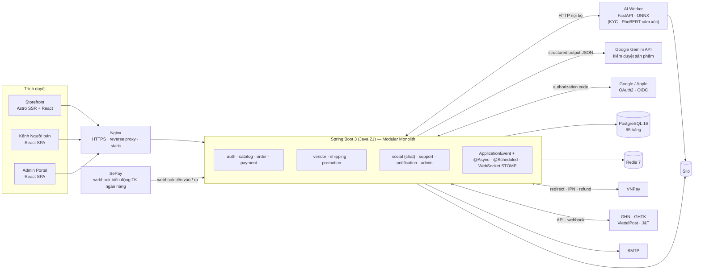

**Vì sao modular monolith thay vì microservices:** nhóm 4 người, một học kỳ; một tiến trình Spring Boot giữ được **giao dịch ACID** cho luồng tiền (đặt hàng → giữ tồn → ký quỹ) mà không cần Saga / message broker; vẫn chia module rõ để sau này tách dịch vụ (bản đầy đủ). Quy tắc: module chỉ gọi nhau qua interface `*Service` công khai hoặc sự kiện; không truy cập repository của module khác.

### 2.1.1 Giao tiếp nội bộ & bất đồng bộ

| Nhu cầu | MVP dùng | Bản đầy đủ dùng |
|---|---|---|
| Sau khi đơn đổi trạng thái → gửi thông báo, email | `ApplicationEventPublisher` + `@TransactionalEventListener(AFTER_COMMIT)` + `@Async` | RabbitMQ + Transactional Outbox |
| Gửi KYC sang AI Worker | HTTP `@Async` + callback `PATCH /internal/kyc/{id}/result` (token nội bộ) | RabbitMQ queue `vendor.kyc` |
| Phân tích cảm xúc đánh giá (PhoBERT) | `@TransactionalEventListener(AFTER_COMMIT)` + `@Async` gọi AI Worker `POST /sentiment`, callback `PATCH /internal/reviews/{id}/sentiment` | RabbitMQ `review.created` |
| Việc định kỳ | `@Scheduled` + `SELECT … FOR UPDATE SKIP LOCKED` (chạy an toàn nếu sau này nhiều instance) | Quartz cluster / Kafka |
| Chat, thông báo realtime | Spring WebSocket STOMP, simple broker trong bộ nhớ | STOMP + broker relay RabbitMQ |
| Tìm kiếm | PostgreSQL full-text + bảng `search_keyword_stats` cho gợi ý / xu hướng | Elasticsearch + Qdrant |
| Kiểm duyệt sản phẩm | `@TransactionalEventListener(AFTER_COMMIT)` + `@Async` gọi Gemini API | AI Worker + RabbitMQ |
| Lượt xem / bấm banner | Bộ đếm Redis `INCR`, `@Scheduled` 5 phút ghi gộp vào `product_view_stats` / `home_banners` | Kafka clickstream |

### 2.1.2 Chiến lược hiệu năng mức MVP
- Cache Redis cho: cây danh mục (TTL 1 giờ), số liệu sản phẩm `product:stats:{id}`, số liệu shop, phí ship (10 phút).
- Phân trang offset cho danh sách nhỏ, keyset (cursor) cho đơn hàng và tin nhắn.
- Ảnh: client nén WebP trước khi tải, Nginx phục vụ ảnh công khai qua Silo với `Cache-Control: max-age=7d`.
- Astro SSR + `stale-while-revalidate` 60 giây cho trang sản phẩm.

## 2.2 Sơ đồ phân rã chức năng (11 phân hệ)

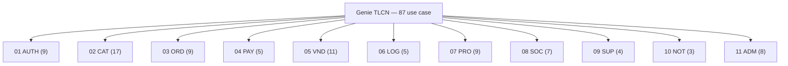

## 2.3 Sơ đồ Use Case

Bộ 13 sơ đồ (tác nhân, tổng quan, 11 phân hệ) ở [UML_UseCase_PlantUML.md](../diagrams/UseCaseDiagram/UML_UseCase_PlantUML.md); mô hình Enterprise Architect ở `diagrams/UseCaseDiagram/Genie_UseCase_UML25.xmi`; đặc tả đầy đủ 87 use case ở [Usecase.md](../diagrams/UseCaseDiagram/Usecase.md); bảng quản lý (lọc, sắp xếp, hiện trạng) ở `diagrams/UseCaseDiagram/Quản Lý UseCase.xlsx`.

## 2.4 Đặc tả luồng nghiệp vụ trọng yếu (10 luồng)

### 2.4.1 Đăng ký & đăng nhập (UC-AUTH-01, UC-AUTH-02)
Đăng ký lưu dữ liệu tạm ở Redis `register:temp:{email}` (TTL 5 phút) cùng OTP; chỉ tạo `users` + `customer_profiles` khi OTP đúng — không để bản ghi rác. Đăng nhập trả access token (15 phút) trong body và refresh token trong cookie `HttpOnly; Secure; SameSite=Strict`; refresh token lưu băm SHA-256 ở `refresh_tokens`, mỗi lần làm mới cấp token mới và thu hồi token cũ.

### 2.4.2 Mở shop & KYC theo tầng (UC-VND-01…04)
`VendorProfile` tạo với `NOT_SUBMITTED` → nộp hồ sơ `PENDING` → AI Worker `AI_PROCESSING` → `VERIFIED` (riskScore < 30) / `MANUAL_REVIEW` (30–69 hoặc lấy mẫu 5%) / `REJECTED` (≥ 70). Tầng 0: giải mã QR mặt trước (< 100 ms), đọc MRZ mặt sau, đối chiếu số CCCD, ngày sinh, hạn thẻ. Tầng 1: YuNet + SFace so khớp chân dung với selfie (≥ 0,85) + liveness chủ động. Tầng 2: tiền chỉ rút về tài khoản ngân hàng đứng đúng tên trên CCCD (UC-VND-07).

### 2.4.3 Đăng bán sản phẩm (UC-CAT-09, UC-CAT-12, UC-CAT-13)
Client xin Presigned PUT URL (5 phút) cho từng ảnh, tải thẳng lên Silo, gửi danh sách khóa ảnh cùng dữ liệu SPU + SKU. Backend kiểm tra shop đã `VERIFIED` và `isPickupConfigured()`, kiểm tra thuộc tính bắt buộc của danh mục (`category_attributes`) và giấy tờ bắt buộc (`requiresBusinessLicense`), tạo `products` (`PENDING_APPROVAL`), `product_variants`, `product_images`, `product_documents` trong 1 transaction → sự kiện `ProductSubmitted` → Gemini chấm (mục 2.4.8) → `REJECTED` tự động hoặc hàng chờ Moderator → Moderator duyệt → `PUBLISHED`.

### 2.4.4 Checkout nhiều shop (UC-ORD-04, UC-ORD-07)
Nhóm dòng giỏ theo `vendorId` → phí ship GHN từng shop → áp voucher (shop cho từng đơn con, sàn cho cả phiên, phân bổ xuống `order_items.prorated_discount`) → 1 transaction: tạo `checkout_sessions`, N `orders` (`PENDING_PAYMENT`), `order_items` (snapshot), `order_discounts`, `stock_reservations` (ACTIVE, hết hạn 15 phút, `reserved_count += q` có điều kiện) → VNPay: tạo `payment_transactions` và URL thanh toán; COD: tạo ký quỹ `PENDING_FUNDING`, đơn chờ shop xác nhận.

### 2.4.5 IPN VNPay & ký quỹ (UC-PAY-03, UC-PAY-05)
Kiểm tra `vnp_SecureHash` (HMAC-SHA512) → tìm giao dịch theo `vnp_TxnRef` → đã `SUCCESS` thì trả `02` (idempotent) → số tiền khớp → 1 transaction: `PaymentTransaction.markSuccess()`, `StockReservation.confirm()` + `ProductVariant.commitSale()`, `Order.markPaid()`, `EscrowLedger.fund(ONLINE_GATEWAY)` → `HELD` → commit → sự kiện `OrderPaid` gửi thông báo shop.

### 2.4.6 COD kết hợp ký quỹ & đối soát (UC-PAY-05, UC-LOG-03)
Bưu tá GHN thu tiền khi giao (`DELIVERED`) → GHN chuyển tiền thu hộ về tài khoản sàn theo chu kỳ kèm bảng kê → Staff tải bảng kê → hệ thống khớp `trackingCode` + số tiền → `EscrowLedger.fund(COD_CASH)` → `HELD`, `Order.markPaid()`, ghi bút toán sổ cái. Ký quỹ COD chỉ giải ngân sau bước này — COD dùng **cùng** cơ chế Escrow 7 ngày với VNPay / VietQR, khác ở thời điểm tiền vào ký quỹ.

### 2.4.7 Giải ngân 7 ngày (UC-ORD-11, UC-ORD-12, UC-PAY-07)
Khách bấm "Đã nhận hàng" hoặc hết 7 ngày từ `delivered_at` không có khiếu nại, **và** ký quỹ đã `HELD` (VNPay / VietQR luôn `HELD`; COD sau khi đối soát GHN — nếu khách xác nhận trước khi đối soát thì đơn được hoàn tất ngay tại bước đối soát) → `Order.complete()` → `EscrowLedger.release()` trả `netAmount` → `VendorWallet.credit()` + `WalletTransaction(CREDIT_ESCROW_RELEASE)` + `system_logs(ESCROW_RELEASED)` trong 1 transaction.

### 2.4.8 Kiểm duyệt sản phẩm bằng Gemini (UC-CAT-12, UC-CAT-13)
Sau commit, listener `@Async` dựng yêu cầu (tên, mô tả đã bỏ HTML, danh mục, thương hiệu, giá, tối đa 4 ảnh, tên + loại giấy tờ chứng thực, chính sách cấm bán) và gọi `generateContent` với `responseMimeType = application/json` + `responseSchema` (`decision` APPROVE / REJECT / NEED_REVIEW, `riskScore` 0–100, `violations[]`, `reasoning`). Kết quả lưu `product_moderation_results` (`modelName`, phản hồi gốc). `REJECT` và `riskScore` ≥ 85 → `REJECTED` + thông báo lý do; `NEED_REVIEW` / `REJECT` dưới ngưỡng → `Product.flag()` vào hàng chờ ưu tiên cao; `APPROVE` → hàng chờ thường; Moderator duyệt cuối (UC-CAT-13) kèm ô "Phân tích từ AI". Gemini lỗi / quá 20 s / hết hạn mức: thử lại 3 lần (2 s, 8 s, 30 s) rồi `ProductModerationResult.fallback()` (`fallbackToManual = true`). Sửa tên / mô tả / ảnh của sản phẩm đã duyệt → chấm lại.

### 2.4.9 Xếp chồng voucher 3 tầng + Điểm (UC-PRO-04, UC-PRO-10)
Tầng 1 — mỗi shop tối đa 1 voucher Shop, đơn tối thiểu tính trên tạm tính hàng hợp lệ của shop, giảm trực tiếp tiền hàng của shop. Tầng 2 — 1 voucher Sàn trên tổng sau tầng 1, phân bổ về từng shop rồi từng dòng theo tỷ lệ giá trị. Tầng 3 — 1 mã Freeship trừ vào tổng phí ship, phân bổ theo phí ship từng shop, không vượt phí thực tế. Sau cùng — Điểm tối đa 50% tiền hàng còn lại (1 Điểm = 1₫). Ghi `order_discounts` từng tầng, `order_items` (`shopDiscount`, `platformDiscount`, `coinDiscount`, `proratedDiscount`). Điểm trừ trong cùng transaction tạo đơn (`UserCoin.spend()` có `version`), hoàn lại theo phần phân bổ khi đơn hủy / quá hạn / hoàn tiền; sàn chịu phần giảm Điểm (bút toán `COIN_COST`).

### 2.4.10 Mua Flash Sale chống bán vượt suất (UC-PRO-05, UC-PRO-06)
Cron mở (`activate()`) / đóng (`end()`) chiến dịch theo khung giờ. Khi tạo đơn: `UPDATE flash_sale_items SET reserved_count = reserved_count + :q WHERE id = :id AND flash_stock - sold_count - reserved_count >= :q` (0 dòng → `GNE-INV-4091`, khách mua giá thường); giá Flash Sale snapshot vào `order_items`; thanh toán thành công `recordSale()` chuyển suất giữ thành đã bán; phiên hết hạn `releaseReservation()`.

## 2.5 Bốn điểm nhấn kỹ thuật của TLCN

| Điểm nhấn | Vấn đề giải quyết | Kỹ thuật |
|---|---|---|
| **Tách đơn đa shop + ký quỹ** | Một lần trả tiền cho nhiều shop, mỗi shop giao và nhận tiền riêng; bảo vệ người mua 7 ngày | `CheckoutSession` 1–N `Order`, `EscrowLedger` theo đơn con, hoa hồng theo dòng hàng, idempotent IPN |
| **Chống bán vượt tồn kho** | Nhiều người cùng đặt SKU cuối | Giữ chỗ mềm 15 phút có điều kiện SQL + `@Version`, sweeper nhả chỗ, trừ tồn cứng chỉ khi đã thanh toán |
| **KYC tự động theo tầng** | Duyệt người bán nhanh mà vẫn an toàn | QR + MRZ (không cần OCR toàn ảnh), ONNX face match, điểm rủi ro, lấy mẫu hậu kiểm, rút tiền chỉ về tài khoản chính chủ |
| **Kiểm duyệt sản phẩm bằng LLM** | Duyệt hàng nghìn sản phẩm mà ít nhân viên | Gemini structured output JSON, ngưỡng `riskScore`, hàng chờ ưu tiên theo kết quả AI, Moderator duyệt cuối, lưu phản hồi gốc |

## 2.6 Giao tiếp hệ thống & Luồng dữ liệu

| Tích hợp | Chiều | Giao thức | Bảo mật | Idempotency |
|---|---|---|---|---|
| VNPay thanh toán | Backend → VNPay (redirect) | HTTPS query string | HMAC-SHA512 `vnp_SecureHash` | `vnp_TxnRef` = `payment_transactions.id` |
| VNPay IPN | VNPay → Backend | HTTPS GET | Kiểm tra chữ ký + IP whitelist | Trạng thái giao dịch đã xử lý |
| VNPay refund | Backend → VNPay | HTTPS POST JSON | HMAC-SHA512 | `vnp_RequestId` = `payment_refunds.id` |
| SePay webhook | SePay → Backend | HTTPS POST JSON | Header `Authorization: Apikey …`; chỉ nhận nội dung có tiền tố `TR` | `id` giao dịch SePay (UNIQUE) |
| VietQR | Client hiển thị | Ảnh QR `qr.sepay.vn/img?acc=…&bank=…&amount=…&des=TR{id}` | — | Mã `TR{id}` trong nội dung chuyển khoản |
| GHN phí / vận đơn | Backend → GHN | HTTPS REST | Header `Token`, `ShopId` | Mã đơn `orderCode` làm `client_order_code` |
| GHN webhook | GHN → Backend | HTTPS POST | Token bí mật trên URL + kiểm tra đơn tồn tại | `(trackingCode, status, time)` |
| GHTK / ViettelPost / J&T | Backend ↔ hãng | HTTPS REST + webhook | Token theo hãng (`CarrierAdapter`) | `client_order_code` = `orderCode` |
| Gemini API | Backend → Google | HTTPS POST `generateContent` | API key trong biến môi trường, không gửi dữ liệu cá nhân / nội dung giấy tờ | Mỗi lần gửi duyệt 1 dòng `product_moderation_results` |
| Google / Apple OAuth2 | Trình duyệt ↔ IdP ↔ Backend | Authorization Code + PKCE | Kiểm tra `state`, `nonce`, chữ ký `id_token` (JWKS) | `(provider, providerUserId)` UNIQUE |
| AI Worker | Backend ↔ AI Worker | HTTP nội bộ (mạng Docker) | Header `X-Internal-Token` | `vendorProfileId` + lần nộp |
| Silo | Client ↔ Silo | Presigned URL | Chữ ký S3 v4, hết hạn 5 phút | Khóa đối tượng UUID |
| Client ↔ Backend | | REST JSON + STOMP/WebSocket | JWT Bearer; WebSocket xác thực ở `CONNECT` | Header `Idempotency-Key` cho POST tạo đơn / rút tiền |

## 2.7 Thiết kế dữ liệu mức khái niệm (12 nhóm, 65 entity)

| Nhóm | Entity | Ghi chú |
|---|---|---|
| 1. Người dùng & định danh | User, CustomerProfile, Address, VendorProfile, AdminProfile, KycResult, RefreshToken, StaffPermission | 1 tài khoản – nhiều hồ sơ theo vai trò; quyền nhân viên tách bảng |
| 2. Danh mục & sản phẩm | Category, Product, ProductVariant, ProductImage, UserWishlist, CategoryAttribute, Brand, ProductDocument, CategoryProposal, ProductModerationResult, SearchKeywordStat, ProductViewStat | SPU / SKU tách biệt; kiểm duyệt & thống kê truy cập |
| 3. Giỏ hàng | Cart, CartItem | Giỏ trỏ SKU |
| 4. Khuyến mãi, voucher, flash sale & điểm | Voucher, VoucherUsage, UserVoucher, VoucherCategory, VoucherProduct, VoucherExcludedCategory, VoucherExcludedProduct, FlashSaleCampaign, FlashSaleItem, UserCoin, CoinTransaction, DailyCheckin | 3 tầng + phạm vi; Flash Sale; Điểm 12 tháng |
| 5. Đơn hàng | CheckoutSession, Order, OrderItem, OrderDiscount, StockReservation | Snapshot bất biến |
| 6. Thanh toán & ký quỹ | PaymentTransaction, PaymentRefund, EscrowLedger, VendorWallet, WalletTransaction, WithdrawalRequest, FinancialLedger | Tiền đi một chiều có kiểm soát; sổ cái kép |
| 7. Vận chuyển | ShipmentTracking, ShipmentEvent, VendorShippingConfig | Đa hãng 3PL |
| 8. Hoàn tiền / khiếu nại | RefundRequest, RefundRequestItem, RefundEvidence | Hoàn toàn phần / một phần |
| 9. Đánh giá & tương tác shop | ProductReview, ShopFollow, ReviewReport, ReviewHelpfulVote | Hữu ích, báo cáo, theo dõi |
| 10. Thông báo & nội dung sàn | Notification, PlatformNotification, UserPlatformNotificationRead, HomeBanner, AdminNotification | Cá nhân + toàn sàn + chuông Admin + banner |
| 11. Nhắn tin (chat) | Conversation, Message | Chat realtime |
| 12. Nhật ký hệ thống | SystemLog | Chỉ ghi thêm |

Đặc tả đầy đủ từng cột, ràng buộc, phương thức: [ENTITY.md](../diagrams/ClassDiagram/ENTITY.md).

## 2.8 Ngăn xếp công nghệ & Cơ sở lựa chọn

> Bản tổng hợp đầy đủ để dựng codebase (cấu trúc monorepo, Clean Architecture theo tính năng, mọi quy ước): [TECH_STACK_VA_QUY_UOC.md](../kien-thuc/TECH_STACK_VA_QUY_UOC.md); nơi lưu từng loại dữ liệu (PostgreSQL / Redis / Silo / trình duyệt): [LUU_TRU_DU_LIEU.md](../kien-thuc/LUU_TRU_DU_LIEU.md).

| Thành phần | Lựa chọn | Lý do chọn cho MVP | Thay thế đã cân nhắc |
|---|---|---|---|
| Backend | Spring Boot 3.3 / Java 21 | Nhóm đã học Java / Spring; hệ sinh thái Security, JPA, WebSocket, Scheduling đủ cho mọi phân hệ trong một tiến trình | Node.js NestJS |
| ORM & migration | Spring Data JPA + Hibernate 6, Flyway | Ánh xạ trực tiếp ENTITY.md; migration có phiên bản | MyBatis |
| CSDL | PostgreSQL 16 | ACID cho luồng tiền, JSONB, full-text + `unaccent` + `pg_trgm` thay được search engine ở quy mô nhỏ | MySQL 8 |
| Cache | Redis 7 | OTP có TTL, rate limit, cache | Caffeine (chỉ trong tiến trình) |
| Lưu trữ tệp | Silo | Tương thích S3, tự host miễn phí, Presigned URL | Cloudinary, AWS S3 |
| AI KYC | FastAPI + ONNX Runtime + OpenCV | Mô hình nhỏ (YuNet, SFace), chạy CPU ~1–2 s / hồ sơ | API eKYC VNPT / FPT (~8.000đ / hồ sơ) |
| AI cảm xúc đánh giá | PhoBERT (nhóm tự fine-tune 3 nhãn) xuất ONNX, chạy trong AI Worker + RDRSegmenter tách từ | Mô hình chuyên cho tiếng Việt, nhóm đã huấn luyện; tự host nên không tốn phí theo lượt, nội dung đánh giá không rời hệ thống | Gemini API (tốn hạn mức, gửi dữ liệu ra ngoài), từ điển cảm xúc (kém với văn nói) |
| Kiểm duyệt sản phẩm | Google Gemini API (bản Flash) | Hiểu cả chữ lẫn ảnh, structured output JSON, có hạn mức miễn phí đủ cho demo | Tự huấn luyện mô hình phân loại (thiếu dữ liệu), duyệt tay 100% |
| Đa ngôn ngữ | i18n JSON phía frontend (vi / en) | Không cần thư viện server; Astro tạo trang theo `lang` | Spring `MessageSource` |
| Frontend | Astro + React + Tailwind | SSR cho SEO storefront, React cho trang quản trị | Next.js |
| Triển khai | Docker Compose + Nginx | 1 VPS, một lệnh `docker compose up -d` | Kubernetes (quá mức cho MVP) |
| CI | GitHub Actions | Miễn phí cho repo nhóm | GitLab CI |

## 2.9 Hạ tầng triển khai mức MVP

| Môi trường | Cấu hình | Thành phần |
|---|---|---|
| **Local** (mỗi thành viên) | Docker Desktop | `postgres`, `redis`, `silo` (+ `silo-init`), `mailpit` bằng Compose; backend / frontend chạy từ IDE |
| **Staging / Demo** | 1 VPS 4 vCPU / 8 GB RAM / 80 GB SSD (≈ 1,4 triệu đồng / tháng theo đơn giá của `kien-thuc/BAO_CAO_DU_TOAN_CHI_PHI_VA_GIAI_PHAP_AI_v1.0.md`; giai đoạn phát triển có thể chạy 0 đồng bằng laptop + Cloudflare Tunnel) | Toàn bộ Compose: `nginx`, `backend`, `ai-worker`, `frontend`, `postgres`, `redis`, `silo`, `uptime-kuma` |

Chi tiết tệp Compose và quy trình triển khai: mục 4.4, 4.5.

---

<a id="chuong-3"></a>
# Chương 03: Thiết kế chi tiết hệ thống (LLD)

## 3.1 Sơ đồ tuần tự (7 luồng cốt lõi)

### 3.1.1 SD-01: Đăng nhập & làm mới token

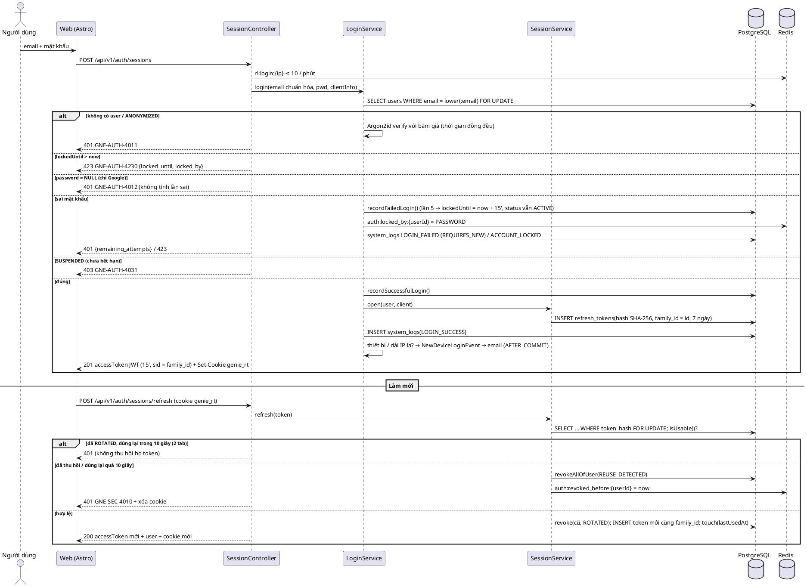

### 3.1.2 SD-02: Checkout nhiều shop & giữ chỗ tồn kho

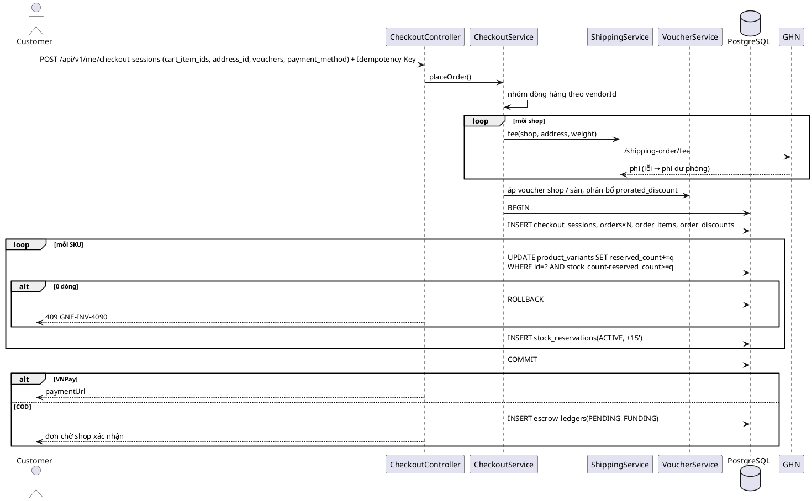

### 3.1.3 SD-03: IPN VNPay & ghi ký quỹ

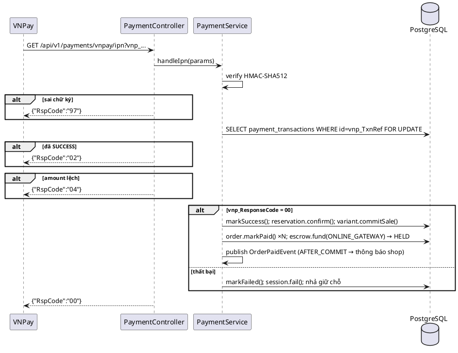

### 3.1.4 SD-04: KYC tự động

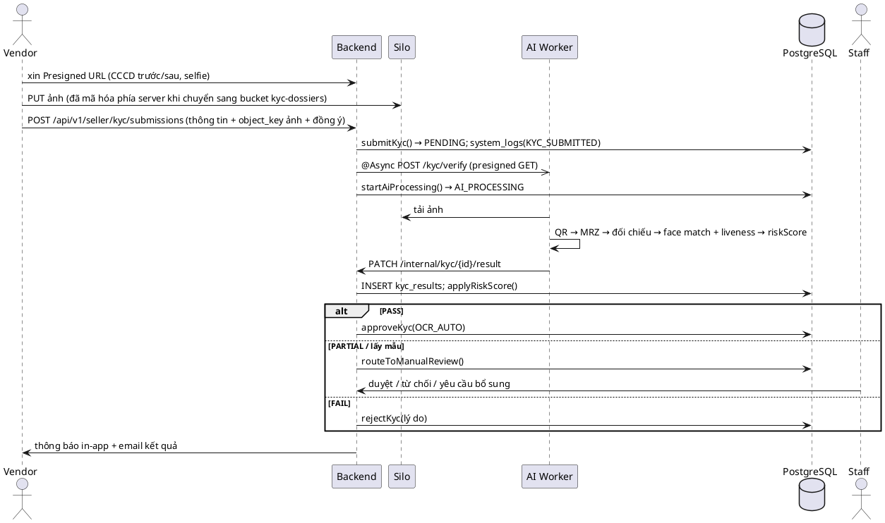

### 3.1.5 SD-05: Giải ngân ký quỹ

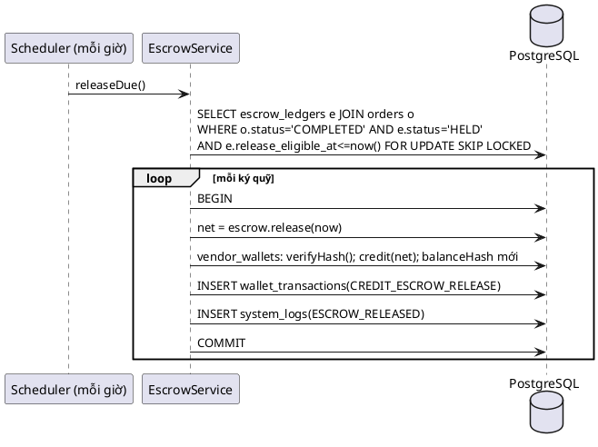

### 3.1.6 SD-06: Trả hàng & hoàn tiền

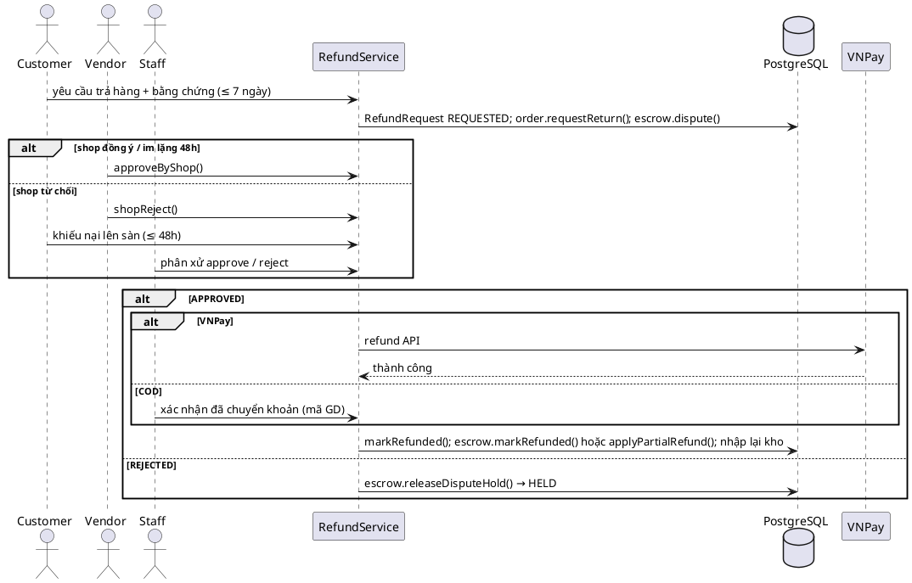

### 3.1.7 SD-07: Kiểm duyệt sản phẩm bằng Gemini

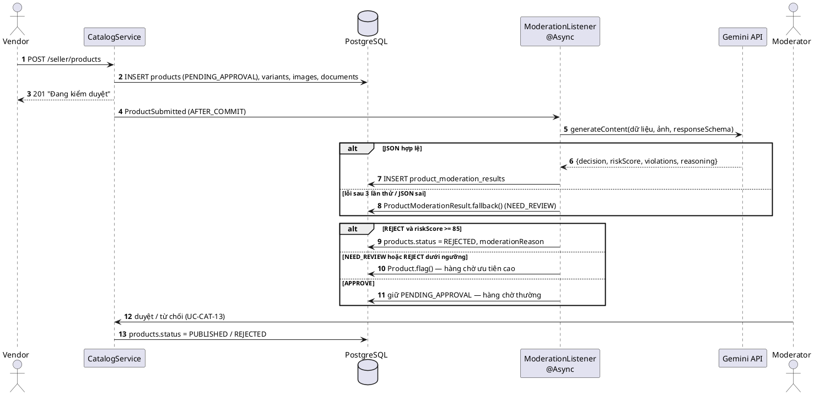

## 3.2 Sơ đồ lớp (10 sơ đồ)

| Sơ đồ | Tên | Entity | File Java |
|:---:|---|---|---|
| 1 | Định danh, Hồ sơ người dùng, KYC & Phân quyền nhân viên (Nhóm 1) | `User`, `CustomerProfile`, `Address`, `VendorProfile`, `AdminProfile`, `KycResult`, `RefreshToken`, `StaffPermission` | `Diagram01_IdentityAndRbac.java` |
| 2 | Danh mục, Thương hiệu, Sản phẩm, Biến thể SKU, Yêu thích & Giỏ hàng (Nhóm 2–3) | `Category`, `CategoryAttribute`, `Brand`, `Product`, `ProductVariant`, `ProductImage`, `UserWishlist`, `Cart`, `CartItem` | `Diagram02_CatalogAndCart.java` |
| 3 | Voucher 3 tầng Shop / Sàn / Freeship & Phạm vi áp dụng (Nhóm 4) | `Voucher`, `VoucherCategory`, `VoucherProduct`, `VoucherExcludedCategory`, `VoucherExcludedProduct`, `VoucherUsage`, `UserVoucher` | `Diagram03_VoucherPromotion.java` |
| 4 | Phiên thanh toán, Đơn hàng con theo shop & Giữ chỗ tồn kho (Nhóm 5) | `CheckoutSession`, `Order`, `OrderItem`, `OrderDiscount`, `StockReservation` | `Diagram04_OrderAndInventory.java` |
| 5 | Thanh toán VNPay / VietQR, Ký quỹ Escrow, Ví shop, Rút tiền & Sổ cái (Nhóm 6) | `PaymentTransaction`, `PaymentRefund`, `EscrowLedger`, `VendorWallet`, `WalletTransaction`, `WithdrawalRequest`, `FinancialLedger` | `Diagram05_PaymentAndEscrow.java` |
| 6 | Vận đơn 3PL, Cấu hình vận chuyển của shop, Trả hàng & Hoàn tiền (Nhóm 7–8) | `ShipmentTracking`, `ShipmentEvent`, `VendorShippingConfig`, `RefundRequest`, `RefundRequestItem`, `RefundEvidence` | `Diagram06_ShippingAndRefund.java` |
| 7 | Đánh giá, Hữu ích, Báo cáo vi phạm, Theo dõi shop & Chat (Nhóm 9, 11) | `ProductReview`, `ReviewHelpfulVote`, `ReviewReport`, `ShopFollow`, `Conversation`, `Message` | `Diagram07_ReviewFollowAndChat.java` |
| 8 | Kiểm duyệt sản phẩm, Giấy tờ chứng thực, Đề xuất danh mục & Thống kê truy cập (Nhóm 2) | `ProductDocument`, `ProductModerationResult`, `CategoryProposal`, `SearchKeywordStat`, `ProductViewStat` | `Diagram08_ProductModerationAndInsights.java` |
| 9 | Flash Sale, Điểm Genie & Điểm danh (Nhóm 4) | `FlashSaleCampaign`, `FlashSaleItem`, `UserCoin`, `CoinTransaction`, `DailyCheckin` | `Diagram09_FlashSaleAndCoin.java` |
| 10 | Thông báo cá nhân, Thông báo sàn, Thông báo quản trị, Banner & Nhật ký hệ thống (Nhóm 10, 12) | `Notification`, `PlatformNotification`, `UserPlatformNotificationRead`, `HomeBanner`, `AdminNotification`, `SystemLog` | `Diagram10_NotificationBannerAndAudit.java` |

Mỗi sơ đồ có danh sách entity (PK / FK / UQ), enum, ngăn Operations và ma trận quan hệ ở [ENTITY.md](../diagrams/ClassDiagram/ENTITY.md) Phụ lục C; import vào Enterprise Architect bằng `Genie_ClassDiagram_UML25.xmi` hoặc *Code Import* thư mục `java-code/`.

## 3.3 Lược đồ CSDL vật lý (65 bảng)

| # | Bảng | Entity | Nhóm | Số cột | Ghi chú |
|:---:|---|---|---|:---:|---|
| 1 | `users` | `User` | 1. Người dùng & định danh | 18 |  |
| 2 | `customer_profiles` | `CustomerProfile` | 1. Người dùng & định danh | 14 |  |
| 3 | `addresses` | `Address` | 1. Người dùng & định danh | 16 |  |
| 4 | `vendor_profiles` | `VendorProfile` | 1. Người dùng & định danh | 51 |  |
| 5 | `admin_profiles` | `AdminProfile` | 1. Người dùng & định danh | 9 |  |
| 6 | `kyc_results` | `KycResult` | 1. Người dùng & định danh | 29 | Kết quả AI theo tầng |
| 7 | `refresh_tokens` | `RefreshToken` | 1. Người dùng & định danh | 9 | Lưu băm SHA-256 |
| 8 | `staff_permissions` | `StaffPermission` | 1. Người dùng & định danh | 6 | 13 mã quyền, thu hồi bằng `revoked_at` |
| 9 | `categories` | `Category` | 2. Danh mục & sản phẩm | 10 |  |
| 10 | `products` | `Product` | 2. Danh mục & sản phẩm | 33 | `search_vector` (tsvector) cho tìm kiếm |
| 11 | `product_variants` | `ProductVariant` | 2. Danh mục & sản phẩm | 12 |  |
| 12 | `product_images` | `ProductImage` | 2. Danh mục & sản phẩm | 12 |  |
| 13 | `user_wishlists` | `UserWishlist` | 2. Danh mục & sản phẩm | 4 |  |
| 14 | `category_attributes` | `CategoryAttribute` | 2. Danh mục & sản phẩm | 15 |  |
| 15 | `brands` | `Brand` | 2. Danh mục & sản phẩm | 7 |  |
| 16 | `product_documents` | `ProductDocument` | 2. Danh mục & sản phẩm | 10 | Bucket riêng tư |
| 17 | `category_proposals` | `CategoryProposal` | 2. Danh mục & sản phẩm | 11 |  |
| 18 | `product_moderation_results` | `ProductModerationResult` | 2. Danh mục & sản phẩm | 11 | Kết quả Gemini + phản hồi gốc |
| 19 | `search_keyword_stats` | `SearchKeywordStat` | 2. Danh mục & sản phẩm | 6 | Gộp theo ngày |
| 20 | `product_view_stats` | `ProductViewStat` | 2. Danh mục & sản phẩm | 8 | Gộp theo ngày & nguồn |
| 21 | `carts` | `Cart` | 3. Giỏ hàng | 3 |  |
| 22 | `cart_items` | `CartItem` | 3. Giỏ hàng | 7 |  |
| 23 | `vouchers` | `Voucher` | 4. Khuyến mãi, voucher, flash sale & điểm | 23 |  |
| 24 | `voucher_usages` | `VoucherUsage` | 4. Khuyến mãi, voucher, flash sale & điểm | 7 |  |
| 25 | `user_vouchers` | `UserVoucher` | 4. Khuyến mãi, voucher, flash sale & điểm | 6 |  |
| 26 | `voucher_categories` | `VoucherCategory` | 4. Khuyến mãi, voucher, flash sale & điểm | 4 |  |
| 27 | `voucher_products` | `VoucherProduct` | 4. Khuyến mãi, voucher, flash sale & điểm | 4 |  |
| 28 | `voucher_excluded_categories` | `VoucherExcludedCategory` | 4. Khuyến mãi, voucher, flash sale & điểm | 4 |  |
| 29 | `voucher_excluded_products` | `VoucherExcludedProduct` | 4. Khuyến mãi, voucher, flash sale & điểm | 4 |  |
| 30 | `flash_sale_campaigns` | `FlashSaleCampaign` | 4. Khuyến mãi, voucher, flash sale & điểm | 8 |  |
| 31 | `flash_sale_items` | `FlashSaleItem` | 4. Khuyến mãi, voucher, flash sale & điểm | 9 | `sold_count + reserved_count <= flash_stock`, `@Version` |
| 32 | `user_coins` | `UserCoin` | 4. Khuyến mãi, voucher, flash sale & điểm | 5 | `@Version` |
| 33 | `coin_transactions` | `CoinTransaction` | 4. Khuyến mãi, voucher, flash sale & điểm | 8 | Chỉ ghi thêm, hạn 12 tháng |
| 34 | `daily_checkins` | `DailyCheckin` | 4. Khuyến mãi, voucher, flash sale & điểm | 4 | UNIQUE (user_id, checkin_date) |
| 35 | `checkout_sessions` | `CheckoutSession` | 5. Đơn hàng | 8 |  |
| 36 | `orders` | `Order` | 5. Đơn hàng | 31 | Đơn con theo shop, `@Version`, máy trạng thái 19 trạng thái |
| 37 | `order_items` | `OrderItem` | 5. Đơn hàng | 17 |  |
| 38 | `order_discounts` | `OrderDiscount` | 5. Đơn hàng | 7 |  |
| 39 | `stock_reservations` | `StockReservation` | 5. Đơn hàng | 9 | Giữ chỗ 15 phút |
| 40 | `payment_transactions` | `PaymentTransaction` | 6. Thanh toán & ký quỹ | 12 | UNIQUE `idempotency_key` |
| 41 | `payment_refunds` | `PaymentRefund` | 6. Thanh toán & ký quỹ | 6 |  |
| 42 | `escrow_ledgers` | `EscrowLedger` | 6. Thanh toán & ký quỹ | 18 | Ký quỹ 7 ngày, tách nguồn online (VNPay / VietQR qua SePay) / COD |
| 43 | `vendor_wallets` | `VendorWallet` | 6. Thanh toán & ký quỹ | 8 | `balanceHash` HMAC |
| 44 | `wallet_transactions` | `WalletTransaction` | 6. Thanh toán & ký quỹ | 10 | Chỉ ghi thêm |
| 45 | `withdrawal_requests` | `WithdrawalRequest` | 6. Thanh toán & ký quỹ | 12 |  |
| 46 | `financial_ledger` | `FinancialLedger` | 6. Thanh toán & ký quỹ | 10 |  |
| 47 | `shipment_trackings` | `ShipmentTracking` | 7. Vận chuyển | 10 |  |
| 48 | `shipment_events` | `ShipmentEvent` | 7. Vận chuyển | 7 |  |
| 49 | `vendor_shipping_config` | `VendorShippingConfig` | 7. Vận chuyển | 8 |  |
| 50 | `refund_requests` | `RefundRequest` | 8. Hoàn tiền / khiếu nại | 20 |  |
| 51 | `refund_request_items` | `RefundRequestItem` | 8. Hoàn tiền / khiếu nại | 5 |  |
| 52 | `refund_evidences` | `RefundEvidence` | 8. Hoàn tiền / khiếu nại | 7 |  |
| 53 | `product_reviews` | `ProductReview` | 9. Đánh giá & tương tác shop | 16 | `aspect_sentiment_json` (jsonb, UC-AI-07) |
| 54 | `shop_follows` | `ShopFollow` | 9. Đánh giá & tương tác shop | 4 | PK (user_id, vendor_id) |
| 55 | `review_reports` | `ReviewReport` | 9. Đánh giá & tương tác shop | 6 |  |
| 56 | `review_helpful_votes` | `ReviewHelpfulVote` | 9. Đánh giá & tương tác shop | 4 | PK (review_id, user_id) |
| 57 | `notifications` | `Notification` | 10. Thông báo & nội dung sàn | 16 |  |
| 58 | `platform_notifications` | `PlatformNotification` | 10. Thông báo & nội dung sàn | 12 |  |
| 59 | `user_platform_notification_reads` | `UserPlatformNotificationRead` | 10. Thông báo & nội dung sàn | 3 |  |
| 60 | `home_banners` | `HomeBanner` | 10. Thông báo & nội dung sàn | 17 |  |
| 61 | `admin_notifications` | `AdminNotification` | 10. Thông báo & nội dung sàn | 9 |  |
| 62 | `conversations` | `Conversation` | 11. Nhắn tin (chat) | 9 |  |
| 63 | `messages` | `Message` | 11. Nhắn tin (chat) | 10 |  |
| 64 | `system_logs` | `SystemLog` | 12. Nhật ký hệ thống | 11 | Không FK cứng — chụp email / role |
| 65 | `cod_remittances` | `CodRemittance` | 6. Thanh toán & ký quỹ | 12 | Phiên đối soát COD, UNIQUE `bank_reference` (TLCN v1.3) |

## 3.4 Máy trạng thái hữu hạn

#### 3.4.1 Máy trạng thái Phiên thanh toán Đơn hàng Tổng (CheckoutSession Lifecycle — SessionStatus)

Phiên thanh toán tổng (`checkout_sessions` — tương ứng với Master Order) đại diện cho một phiên giao dịch checkout hợp nhất của khách hàng chứa nhiều gian hàng (`vendor_id`). Vòng đời của phiên tuân thủ nghiêm ngặt enum **`SessionStatus` (5 trạng thái chuẩn)** được khai báo trong `ENTITY.md`:

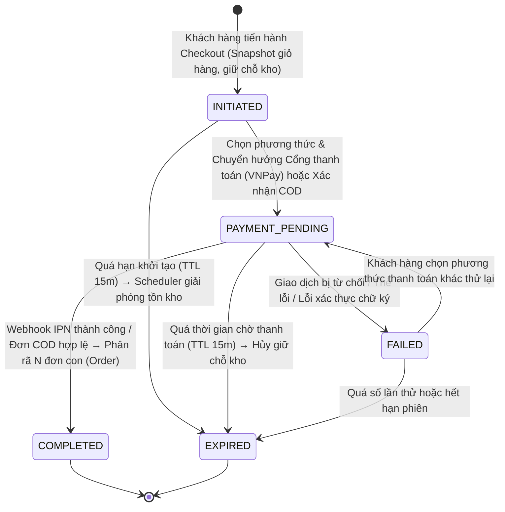

*Quy tắc chuyển đổi CheckoutSession (Master Order):*
1. `INITIATED`: Phiên checkout được khởi tạo ngay khi khách hàng bấm "Tiến hành đặt hàng". Hệ thống chụp ảnh bất biến giỏ hàng và kích hoạt `StockReservation` (trạng thái `ACTIVE`) với thời hạn sống (TTL) 15 phút.
2. `PAYMENT_PENDING`: Khách hàng chọn phương thức thanh toán. Với thanh toán trực tuyến, hệ thống sinh URL chuyển hướng sang cổng thanh toán (VNPay, ZaloPay, VietQR); với đơn COD, phiên ghi nhận phương thức thu hộ.
3. `COMPLETED`: Khi nhận được Webhook IPN hợp lệ có chữ ký điện tử an toàn từ cổng thanh toán (hoặc khi xác thực đơn COD hợp lệ), phiên thanh toán chuyển sang `COMPLETED`. Hệ thống kích hoạt Saga Orchestrator tự động phân tách phiên thành N đơn hàng con vật lý (`orders`) tương ứng với từng gian hàng (`vendor_id`).
4. `FAILED` & `EXPIRED`: Nếu giao dịch bị cổng từ chối hoặc quá thời hạn thanh toán 15 phút, Scheduler tự động cập nhật phiên sang `EXPIRED`, giải phóng tồn kho (`StockReservation` chuyển `RELEASED`), hoàn trả lượt dùng Voucher và Điểm Genie.
5. *Phân tách trách nhiệm:* Mọi trạng thái nghiệp vụ tiếp theo (chuẩn bị hàng, giao vận, ký quỹ, khiếu nại, hoàn tiền) được bàn giao hoàn toàn cho từng đơn hàng con (`Order`) độc lập theo máy trạng thái `OrderStatus` (19 trạng thái chuẩn) tại Mục 3.4.2 bên dưới.

#### 3.4.2 Máy trạng thái Đơn hàng Con (Sub-Order Lifecycle)

```mermaid
stateDiagram-v2
    [*] --> PENDING_PAYMENT : Đơn online/COD vừa tạo

    state "Online Flow" as Online {
        PENDING_PAYMENT --> PAID : Webhook IPN OK → Escrow HELD
        PAID --> CONFIRMED : Shop xác nhận
    }

    state "COD Flow" as COD {
        PENDING_PAYMENT --> CONFIRMED : Shop xác nhận (COD không cần chờ TT)
    }

    CONFIRMED --> PREPARING : Đóng gói hàng
    PREPARING --> READY_FOR_PICKUP : In nhãn vận chuyển
    READY_FOR_PICKUP --> DELIVERING : GHN lấy hàng
    DELIVERING --> DELIVERED : Ký POD thành công

    state "Hậu giao hàng & Đối soát Ký quỹ" as PostDelivery {
        DELIVERED --> COMPLETED : Đơn Online (đã PAID) — 7 ngày không khiếu nại (Escrow RELEASED)
        DELIVERED --> PAID : Đơn COD — Staff đối soát tiền thu hộ GHN (Escrow HELD)
        PAID --> COMPLETED : Đơn COD — 7 ngày không khiếu nại (Escrow RELEASED)
    }

    PENDING_PAYMENT --> CANCELLED : Khách hủy đơn chủ động
    PENDING_PAYMENT --> CANCELLED_BY_VENDOR : Shop từ chối đơn COD chờ xác nhận / đơn chưa thanh toán (hết hàng, không giao tới khu vực)
    PENDING_PAYMENT --> AUTO_CANCELLED : Quá hạn 15p (Sweeper Cron)
    PAID --> CANCELLED : Khách hủy đơn online chưa giao (hoàn tiền UC-SUP-04)
    PAID --> CANCELLED_BY_VENDOR : Shop hủy đơn online đã thanh toán
    CONFIRMED --> CANCELLED : Khách hủy trước khi đóng gói xong (UC-ORD-10)
    CONFIRMED --> CANCELLED_BY_VENDOR : Shop hết hàng / Hủy
    PREPARING --> CANCELLED : Khách hủy khi chưa bàn giao vận chuyển (UC-ORD-10)
    PREPARING --> CANCELLED_BY_VENDOR : Shop hủy khi đang đóng gói
    DELIVERING --> DELIVERY_FAILED : Không liên lạc được / Sai địa chỉ (tổng tối đa 3 lần giao = 1 lần đầu + 2 lần giao lại)
    DELIVERY_FAILED --> DELIVERING : Tái phát giao (Leg tiếp theo)
    DELIVERY_FAILED --> RETURNING : Chuyển hoàn về kho Shop sau 3 lần thất bại
    RETURNING --> RETURNED_TO_VENDOR : Shop nhận lại hàng
    RETURNED_TO_VENDOR --> REFUNDED : Đơn đã trả tiền online — tự tạo RefundRequest REFUND_ONLY, hoàn theo UC-SUP-04
    DELIVERED --> RETURN_REQUESTED : Khách mở yêu cầu đổi trả/khiếu nại
    PAID --> RETURN_REQUESTED : Đơn COD đã đối soát — khách khiếu nại trong 7 ngày
    RETURN_REQUESTED --> RETURN_APPROVED : Shop / CSKH duyệt đổi trả
    RETURN_REQUESTED --> RETURN_REJECTED : Khiếu nại bị từ chối
    RETURN_APPROVED --> REFUNDED : Hoàn đủ grandTotal (hoàn ngay, hoặc sau khi hàng hoàn về kho shop)
    RETURN_APPROVED --> PARTIALLY_REFUNDED : Hoàn một phần (trả một số món)
    RETURN_APPROVED --> COMPLETED : Khách không gửi hàng hoàn trong 7 ngày (RefundRequest RETURN_FAILED)
    PARTIALLY_REFUNDED --> RETURN_REQUESTED : Trả tiếp món khác trong hạn 7 ngày
    PARTIALLY_REFUNDED --> COMPLETED : Hết hạn khiếu nại — giải ngân phần còn lại
    RETURN_REJECTED --> COMPLETED : Duy trì trạng thái hoàn thành

    COMPLETED --> [*]
    REFUNDED --> [*]
```

> **Quy tắc bảo vệ máy trạng thái (khớp `Order.ALLOWED` — ENTITY.md mục 5.2):** mọi chuyển trạng thái đi qua `transitionTo()`; đơn **online** chỉ `CONFIRMED` sau `PAID`, đơn **COD** chỉ `PAID` sau `DELIVERED` (Staff đối soát COD với GHN — UC-LOG-03) và chỉ `COMPLETED` sau `PAID`; `PAID → COMPLETED / RETURN_REQUESTED` chỉ hợp lệ khi đơn đã giao (`deliveredAt ≠ null`); không thể hủy từ `READY_FOR_PICKUP` trở đi (`GNE-ORD-4092`); `markRefunded(amount)` chuyển `REFUNDED` khi tổng hoàn đủ `grandTotal`, ngược lại `PARTIALLY_REFUNDED` (hoàn nhiều đợt được; v2.8 — 19 trạng thái). `paymentStatus` / `fundingStatus` được cập nhật cùng lúc trong `markPaid()`, `markPaymentFailed()`, `markDelivered()`, `markRefunded()`.

## 3.5 Chuẩn thiết kế API (Spring Boot RESTful)

#### 3.5.1 Cấu trúc Đóng gói Chuẩn (Standard JSON Envelope)

Mọi HTTP Response trả về từ Spring Boot Application đều được bọc trong cấu trúc `ApiResponse<T>` đồng nhất:

##### Cấu trúc Thành công (HTTP 200 OK / 201 Created):
```json
{
  "code": "SUCCESS",
  "status": 200,
  "message": "Chi tiết đơn hàng được xử lý thành công.",
  "data": {
    "order_id": "ord_88291049",
    "status": "PAID",
    "total_amount": 1250000,
    "currency": "VND"
  },
  "meta": {
    "request_id": "req_01HP8S9W5Q8Y9K1M3B00000001",
    "timestamp": "2026-10-16T08:00:00.125Z",
    "server_version": "mvp-1.0"
  }
}
```

##### Cấu trúc Thất bại theo RFC 7807 Problem Details (HTTP 4xx / 5xx):
```json
{
  "code": "GNE-VAL-4220",
  "status": 422,
  "message": "Dữ liệu yêu cầu không hợp lệ.",
  "errors": [
    {
      "field": "shipping_address.phone",
      "code": "PATTERN_MISMATCH",
      "rejected_value": "012345",
      "message": "Số điện thoại người nhận phải gồm 10 chữ số hợp lệ tại Việt Nam."
    }
  ],
  "meta": {
    "request_id": "req_01HP8S9W5Q8Y9K1M3B00000002",
    "timestamp": "2026-10-16T08:00:01.050Z",
    "path": "/api/v1/me/checkout-sessions"
  }
}
```

#### 3.5.2 Chuẩn Tính Bất khả lặp (Idempotency Contract)

Đối với tất cả các thao tác thay đổi trạng thái tài chính và kho hàng (`POST /api/v1/me/checkout-sessions`, `POST /api/v1/me/checkout-sessions/{id}/payments`, `POST /api/v1/seller/withdrawals`, `POST /api/v1/me/refund-requests`, `POST /api/v1/seller/orders/{id}/shipments`, `POST /api/v1/admin/refunds/{id}/retry`, `POST /api/v1/admin/cod-remittances/{id}/confirm`), client bắt buộc phải gửi Header `Idempotency-Key: <UUIDv4>`.

```
Client                             Spring Boot Gateway                  Redis 7
  |                                        |                                  |
  |--- POST /checkout-sessions (Key: 123)->|                                  |
  |                                        |--- SETNX idempotency:uuid-123 -->|
  |                                        |<-- 1 (Khóa thành công, TTL 24h)--|
  |                                        |                                  |
  |                                        |== Thực thi nghiệp vụ Database ==|
  |                                        |                                  |
  |                                        |--- Lưu Response payload cache -->|
  |<-- 201 Created (Data) -----------------|                                  |
  |                                        |                                  |
  |--- [RETRY] POST /checkout-sessions --->|                                  |
  |                                        |--- SETNX idempotency:uuid-123 -->|
  |                                        |<-- 0 (Khóa đã tồn tại) ----------|
  |                                        |--- Đọc Response từ Cache ------->|
  |<-- 201 Created (Cached Data) ----------|                                  |
```

#### 3.5.3 Chuẩn Phân trang Dữ liệu Lớn (Cursor / Keyset Pagination)

Để loại bỏ hoàn toàn vấn đề suy giảm hiệu năng do `OFFSET` lớn trong PostgreSQL 16 đối với các bảng hàng chục triệu bản ghi, hệ thống áp dụng Cursor Pagination dựa trên `id` tuần tự hoặc `created_at`:

```http
GET /api/v1/me/notifications?limit=20&cursor=eyJpZCI6OTg0NTEsInByaWNlIjoxNTAwMDB9
```

##### Cấu trúc Response Phân trang:
```json
{
  "code": "SUCCESS",
  "status": 200,
  "data": [ ... 20 items ... ],
  "pagination": {
    "limit": 20,
    "has_more": true,
    "next_cursor": "eyJpZCI6OTg0NzEsInByaWNlIjoxNjUwMDB9",
    "total_estimated": 1250000
  }
}
```

#### 3.5.4 Quy trình Tải ảnh Lên Silo S3 qua Presigned URL

Khắc phục hoàn toàn nghẽn cổ chai I/O trên máy chủ ứng dụng Spring Boot, toàn bộ tệp đa phương tiện (ảnh sản phẩm, video đánh giá, ảnh ký nhận hàng POD, hồ sơ KYC định danh) được tải trực tiếp từ Client lên Silo Object Storage:

```
Client (Web/App)                  Spring Boot Backend                  Silo S3 Storage  
  |                                        |                                  |
  |--- 1. POST /api/v1/uploads/presigned-urls                                  |
  |    { purpose, file_name, content_type, |                                  |
  |      content_length } ---------------->|                                  |
  |                                        |--- 2. MinioClient.getPresignedObjectUrl(
  |                                        |       PutObjectArgs, TTL=15m) -->|
  |<-- 3. { upload_url, object_key } -----|                                  |
  |                                                                           |
  |--- 4. PUT direct upload payload (Binary) -------------------------------->|
  |<-- 5. 200 OK (ETag header) -----------------------------------------------|
  |                                                                           |
  |--- 6. Request nghiệp vụ kèm object_key (vd POST /seller/products) ------>|
  |       (server statObject, chuyển tmp/ → khóa chính thức, lưu DB — không   |
  |        có bước confirm riêng, API_SPEC.md 0.8)                            |
```

##### Danh mục Phân quyền Silo Bucket:
| Bucket Tên | Quyền Truy cập | Thời hạn Presigned URL | Mục đích Sử dụng |
| :--- | :--- | :--- | :--- |
| `product-media` | Public Read, Signed Write | 15 phút (Write) | Ảnh / video sản phẩm, ảnh theo phân loại, ảnh trong mô tả |
| `avatar-assets` | Public Read, Signed Write | 15 phút (Write) | Ảnh đại diện người dùng, logo & ảnh bìa shop, logo thương hiệu |
| `review-media` | Public Read, Signed Write | 15 phút (Write) | Ảnh / video đánh giá |
| `content-assets` | Public Read, Signed Write | 15 phút (Write) | Banner trang chủ, ảnh thông báo sàn |
| `chat-media` | Private, Signed Get/Put | 15 phút (Write), 5 phút (Get) | Ảnh trong chat (chỉ 2 bên hội thoại) |
| `product-docs` | Private, Signed Get/Put | 15 phút (Write), 5 phút (Get) | Giấy tờ chứng thực sản phẩm |
| `refund-evidence` | Private, Signed Get/Put | 15 phút (Write), 5 phút (Get) | Bằng chứng trả hàng của khách và shop |
| `kyc-dossiers` | Encrypted Private (AES-256-GCM), Signed Get/Put | 10 phút (Write), 5 phút (Get — NFR-07) | Ảnh CCCD, selfie, giấy phép kinh doanh |
| `ml-models` | Private, nội bộ | Không cấp ra ngoài | Mô hình ONNX của AI Worker (KYC, PhoBERT) |

Tệp tải lên vào tiền tố `tmp/` trước, server kiểm tra rồi chuyển sang khóa chính thức; quy tắc đặt khóa và vòng đời ở [LUU_TRU_DU_LIEU.md](../kien-thuc/LUU_TRU_DU_LIEU.md) mục 5. Bucket `delivery-pod` (ảnh giao hàng của shipper) thuộc DATN.

---

<a id="36-thiet-ke-bao-mat"></a>

## 3.6 Thiết kế bảo mật mức MVP

| Lớp | Biện pháp |
|---|---|
| Truyền tải | HTTPS (Let's Encrypt) cho mọi domain; HSTS; WebSocket qua `wss://` |
| Xác thực | JWT HS256 (khóa ≥ 256 bit trong biến môi trường), refresh token xoay vòng, khóa đăng nhập sau 5 lần sai |
| Phân quyền | Tầng 1 — vai trò: `@PreAuthorize("hasRole('VENDOR')")`, RoleHierarchy `ADMIN > STAFF`, `VENDOR > CUSTOMER`. Tầng 2 — 13 mã quyền của nhân viên nạp từ `staff_permissions` vào authority khi đăng nhập: `@PreAuthorize("hasAuthority('REVIEW_KYC')")`; ADMIN có mọi quyền, `MANAGE_RBAC` không cấp được cho STAFF. Kiểm tra **quyền sở hữu** tài nguyên ở service (shop chỉ sửa sản phẩm của mình — chống IDOR) |
| Đăng nhập mạng xã hội | Authorization Code + PKCE; kiểm tra `state`, `nonce`, chữ ký `id_token`; nhận diện bằng `sub` (UNIQUE `uk_users_oauth` trên `oauth_provider`, `oauth_provider_id`); không liên kết khi IdP báo email chưa xác minh hoặc tài khoản đang bị khóa |
| Đầu vào | Bean Validation, giới hạn kích thước tệp (ảnh 5 MB, video 30 MB), kiểm tra MIME phía server |
| Dữ liệu nhạy cảm | Ảnh CCCD mã hóa AES-256-GCM (khóa trong biến môi trường, không trong CSDL); số CCCD / STK che khi hiển thị (`0792******34`); bucket `kyc-dossiers` không công khai |
| Tích hợp | Xác minh chữ ký VNPay; API Key cho webhook SePay; token bí mật cho webhook 3PL; token nội bộ cho AI Worker; API key Gemini chỉ ở backend, prompt không chứa dữ liệu cá nhân; không mở cổng PostgreSQL / Redis / Silo ra Internet |
| Bí mật | `.env` không commit; GitHub Actions Secrets khi triển khai |
| Kiểm toán | `system_logs` cho thao tác nhạy cảm (NFR-08) |

**Ma trận quyền mặc định (UC-ADM-01, UC-ADM-02):**

| Mã quyền | Mục nav Admin | Moderator | CS Specialist | Finance Officer | Admin |
|---|---|:---:|:---:|:---:|:---:|
| `VIEW_DASHBOARD` | Tổng quan | ✓ | ✓ | ✓ | ✓ |
| `REVIEW_KYC` | Duyệt KYC | ✓ | | | ✓ |
| `MANAGE_CATALOG` | Danh mục, thuộc tính, duyệt sản phẩm, đề xuất danh mục | ✓ | | | ✓ |
| `MODERATE_REVIEW` | Kiểm duyệt đánh giá | ✓ | ✓ | | ✓ |
| `HANDLE_DISPUTE` | Trả hàng & hoàn tiền | | ✓ | | ✓ |
| `PROCESS_PAYOUT` | Rút tiền, đối soát COD | | | ✓ | ✓ |
| `UPDATE_COMMISSION` | Cấu hình hoa hồng | | | ✓ | ✓ |
| `VIEW_FINANCE` | Sổ cái tài chính | | | ✓ | ✓ |
| `MANAGE_VOUCHER` | Voucher sàn, Flash Sale, banner trang chủ | | | ✓ | ✓ |
| `MANAGE_PLATFORM_NOTIFICATION` | Thông báo sàn | | | | ✓ |
| `VIEW_AUDIT_LOG` | Nhật ký hệ thống | | | | ✓ |
| `MANAGE_USER` | Người dùng (khóa / mở) | | | | ✓ |
| `MANAGE_RBAC` | Nhân viên & phân quyền | | | | ✓ (chỉ Admin) |

Admin có thể thêm / bớt từng quyền cho từng nhân viên; bảng trên chỉ là bộ mặc định theo chức danh. Không có Super Admin — tài khoản Admin đầu tiên tạo bằng seed Flyway khi triển khai.

## 3.7 Xử lý ngoại lệ & Phục hồi lỗi

### 3.7.1 Danh mục mã lỗi

| Mã Lỗi Hệ thống | HTTP Code | Miêu tả Ý nghĩa Nghiệp vụ | Hành động Phục hồi Khuyến nghị cho Client |
| :--- | :--- | :--- | :--- |
| `GNE-SEC-4010` | 401 Unauthorized | Access Token hết hạn hoặc chữ ký JWT không hợp lệ | Gọi ngay `POST /api/v1/auth/sessions/refresh` |
| `GNE-SEC-4030` | 403 Forbidden | Tài khoản không có quyền thao tác trên Resource | Thông báo người dùng nâng cấp quyền / Đăng nhập lại |
| `GNE-VAL-4220` | 422 Unprocessable | Dữ liệu đầu vào sai định dạng hoặc không vượt qua Bean Validation | Hiển thị lỗi đỏ dưới từng ô nhập liệu tương ứng |
| `GNE-INV-4090` | 409 Conflict | Hết tồn kho khi giữ chỗ (`ProductVariant.reserve()` cập nhật 0 dòng) | Hiển thị "Sản phẩm vừa hết hàng", tải lại giỏ |
| `GNE-ORD-4094` | 409 Conflict | Giỏ hàng / đơn chứa sản phẩm của chính shop người mua (cấm tự mua — UC-ORD-01, UC-ORD-07) | Bỏ sản phẩm của shop mình khỏi giỏ |
| `GNE-ORD-4092` | 409 Conflict | Đơn hàng đã ở trạng thái xử lý, không thể hủy bỏ | Tải lại chi tiết đơn hàng để đồng bộ trạng thái mới |
| `GNE-WAL-4001` | 400 Bad Request | Số dư khả dụng của ví shop không đủ cho lệnh rút (UC-ADM-04) | Hiển thị số dư khả dụng, giảm số tiền rút |
| `GNE-RAT-4290` | 429 Too Many Req | Vượt giới hạn tần suất (bộ đếm Redis theo IP / tài khoản) | Đọc Header `Retry-After`, thử lại sau |
| `GNE-AUTH-4011` | 401 Unauthorized | Sai email/mật khẩu (kèm số lần thử còn lại, UC-AUTH-02) | Hiển thị cảnh báo, gợi ý Quên mật khẩu |
| `GNE-AUTH-4012` | 401 Unauthorized | Tài khoản chỉ có Google / Apple (`password = NULL`) đăng nhập bằng mật khẩu — không tính lần sai (UC-AUTH-02, v1.4) | Gợi ý Đăng nhập Google / bằng mã email / Thiết lập mật khẩu |
| `GNE-AUTH-4031` | 403 Forbidden | Tài khoản bị đình chỉ (`users.status = SUSPENDED`, kèm `suspensionReason`) | Hiển thị lý do và kênh khiếu nại |
| `GNE-AUTH-4091` | 409 Conflict | Email đã được đăng ký (UC-AUTH-01) | Chuyển sang Đăng nhập / Quên mật khẩu |
| `GNE-AUTH-4101` | 410 Gone | Mã OTP quá hạn 5 phút | Hiển thị nút 'Gửi lại mã' |
| `GNE-AUTH-4221` | 422 Unprocessable | Nhập sai OTP quá 5 lần, OTP bị hủy | Yêu cầu gửi lại OTP mới |
| `GNE-AUTH-4230` | 423 Locked | Sai mật khẩu / OTP đăng nhập 5 lần liên tiếp — khóa đăng nhập 15 phút (`lockedUntil`, `status` vẫn `ACTIVE`, UC-AUTH-02) | Hiển thị đếm ngược + nút Mở khóa qua email |
| `GNE-WAL-4032` | 403 Forbidden | Tài khoản nhận tiền chưa xác minh chính chủ (UC-VND-07, UC-ADM-04) | Chuyển tới màn hình xác minh tài khoản ngân hàng |
| `GNE-PAY-4021` | 402 Payment Required | VNPay từ chối giao dịch (thẻ hết hạn, không đủ số dư) | Gợi ý thanh toán lại hoặc chọn COD |
| `GNE-PAY-4092` | 409 Conflict | IPN/Webhook trùng lặp (`Idempotency-Key` hoặc mã giao dịch đã xử lý) | Trả HTTP 200 cho cổng, không xử lý lại |
| `GNE-VCH-4221` | 422 Unprocessable | Voucher không hợp lệ: hết hạn, chưa đạt đơn tối thiểu, sai cổng (`applicablePaymentMethod`) hoặc Tầng 1 + 2 vượt 85% | Bỏ chọn voucher, gợi ý voucher khác |
| `GNE-INV-4093` | 409 Conflict | Giữ chỗ tồn kho đã hết hạn 15 phút | Tải lại giỏ hàng, kiểm tra tồn kho |
| `GNE-INV-4091` | 409 Conflict | Sản phẩm Flash Sale đã hết suất (UC-PRO-06) | Mua với giá thường |
| `GNE-ORD-4093` | 409 Conflict | Shop đang tạm nghỉ hoặc đã từ chối đơn (UC-VND-19, UC-LOG-16) | Bỏ sản phẩm khỏi giỏ / chọn shop khác |
| `GNE-SEC-4031` | 403 Forbidden | Thao tác phân quyền không hợp lệ (cấp `MANAGE_RBAC` cho STAFF — UC-ADM-02) | Hiển thị lý do |
| `GNE-SYS-5030` | 503 Service Unavailable | Không kiểm được Idempotency-Key vì Redis lỗi — API tiền (checkout, thanh toán, rút tiền, hoàn tiền) từ chối xử lý để không tạo giao dịch trùng | Báo "Hệ thống đang bận", thử lại sau với **cùng** Idempotency-Key |
| `GNE-DB-5002` | 500 Internal | Deadlock PostgreSQL giữa 2 giao dịch tài chính (đã tự động thử lại) | Thử lại sau vài giây |
| `GNE-SYS-4040` | 404 Not Found | Không tìm thấy tài nguyên / không thuộc người gọi (v1.4) | Hiển thị trang 404 / tải lại |
| `GNE-SYS-4050` | 405 Method Not Allowed | Phương thức HTTP không hỗ trợ (v1.4) | Lỗi lập trình phía client |
| `GNE-SYS-5000` | 500 Internal | Lỗi không lường trước — không lộ stack trace, kèm `request_id` (v1.4) | Báo lỗi chung, gửi `request_id` cho hỗ trợ |
| `GNE-MINIO-5003` | 500 Internal | Presigned URL Silo hết hạn khi tải tệp lớn | Gọi lại API cấp Presigned URL mới |
| `GNE-AUTH-4001` | 400 Bad Request | OAuth `state` / `nonce` / `id_token` không hợp lệ | Bắt đầu lại luồng |
| `GNE-AUTH-4032` | 403 Forbidden | Email phía Google/Apple chưa xác minh — không liên kết | Hiển thị lý do, chặn thao tác |
| `GNE-AUTH-4092` | 409 Conflict | Tài khoản Google đã gắn với người dùng khác | Tải lại dữ liệu, hiển thị lý do kèm `details` |
| `GNE-AUTH-4093` | 409 Conflict | Không gỡ được cách đăng nhập duy nhất | Tải lại dữ liệu, hiển thị lý do kèm `details` |
| `GNE-AUTH-4098` | 409 Conflict | Liên kết Google: email Google khác email tài khoản Genie (UC-AUTH-03, v1.4) | Nhắc chọn đúng tài khoản Google (`details.account_email`) |
| `GNE-AUTH-4102` | 410 Gone | `reset_token` hết hạn | Cho làm lại bước trước (gửi lại mã / xin link mới) |
| `GNE-AUTH-4103` | 410 Gone | Lời mời nhân viên hết hạn | Cho làm lại bước trước (gửi lại mã / xin link mới) |
| `GNE-AUTH-4222` | 422 Unprocessable | Sai OTP (`remaining_attempts`) | Hiển thị lỗi ngay tại ô / bước tương ứng |
| `GNE-AUTH-4223` | 422 Unprocessable | Mật khẩu mới trùng mật khẩu hiện tại / gần nhất | Hiển thị lỗi ngay tại ô / bước tương ứng |
| `GNE-USR-4091` | 409 Conflict | Còn đơn đang xử lý, chưa xóa được tài khoản (`active_order_codes`) | Tải lại dữ liệu, hiển thị lý do kèm `details` |
| `GNE-USR-4092` | 409 Conflict | Không xóa được địa chỉ mặc định | Tải lại dữ liệu, hiển thị lý do kèm `details` |
| `GNE-CAT-4041` | 404 Not Found | Danh mục không tồn tại / đã ẩn | Hiển thị "không tìm thấy" và gợi ý thay thế |
| `GNE-CAT-4042` | 404 Not Found | Sản phẩm không còn bán | Hiển thị "không tìm thấy" và gợi ý thay thế |
| `GNE-CAT-4091` | 409 Conflict | Trùng tên / slug danh mục (`existing_category`) | Tải lại dữ liệu, hiển thị lý do kèm `details` |
| `GNE-CAT-4092` | 409 Conflict | Danh mục còn sản phẩm / danh mục con | Tải lại dữ liệu, hiển thị lý do kèm `details` |
| `GNE-CAT-4093` | 409 Conflict | Sản phẩm đang bị sàn khóa | Tải lại dữ liệu, hiển thị lý do kèm `details` |
| `GNE-CAT-4094` | 409 Conflict | Sản phẩm còn đơn đang xử lý | Tải lại dữ liệu, hiển thị lý do kèm `details` |
| `GNE-CAT-4095` | 409 Conflict | Trùng mã thuộc tính trong ngành | Tải lại dữ liệu, hiển thị lý do kèm `details` |
| `GNE-CAT-4221` | 422 Unprocessable | Đã có 5 đề xuất danh mục đang chờ | Hiển thị lỗi ngay tại ô / bước tương ứng |
| `GNE-CAT-4222` | 422 Unprocessable | Ngành bắt buộc giấy tờ chứng thực | Hiển thị lỗi ngay tại ô / bước tương ứng |
| `GNE-CAT-4223` | 422 Unprocessable | Thiếu thông số bắt buộc của ngành (`missing_specs`) | Hiển thị lỗi ngay tại ô / bước tương ứng |
| `GNE-INV-4094` | 409 Conflict | Số lượng vượt tồn khả dụng trong giỏ (`stock`) | Tải lại dữ liệu, hiển thị lý do kèm `details` |
| `GNE-ORD-4095` | 409 Conflict | Đơn chưa giao, chưa xác nhận nhận hàng được | Tải lại dữ liệu, hiển thị lý do kèm `details` |
| `GNE-ORD-4041` | 404 Not Found | Đơn không tồn tại hoặc không thuộc shop của người gọi | Hiển thị "không tìm thấy" và gợi ý thay thế |
| `GNE-VCH-4041` | 404 Not Found | Mã voucher không tồn tại / đã hết hạn | Hiển thị "không tìm thấy" và gợi ý thay thế |
| `GNE-VCH-4091` | 409 Conflict | Voucher đã được lưu | Tải lại dữ liệu, hiển thị lý do kèm `details` |
| `GNE-VCH-4092` | 409 Conflict | Trùng mã voucher | Tải lại dữ liệu, hiển thị lý do kèm `details` |
| `GNE-VCH-4093` | 409 Conflict | Voucher đã có lượt dùng, không xóa được | Tải lại dữ liệu, hiển thị lý do kèm `details` |
| `GNE-PRO-4091` | 409 Conflict | Đã điểm danh hôm nay | Tải lại dữ liệu, hiển thị lý do kèm `details` |
| `GNE-PRO-4221` | 422 Unprocessable | Giá Flash không thấp hơn ≥ 15% / số suất không hợp lệ | Hiển thị lỗi ngay tại ô / bước tương ứng |
| `GNE-PRO-4222` | 422 Unprocessable | Không đủ Điểm | Hiển thị lỗi ngay tại ô / bước tương ứng |
| `GNE-PRO-4223` | 422 Unprocessable | Quá số sản phẩm tối đa / quá hạn đăng ký Flash Sale | Hiển thị lỗi ngay tại ô / bước tương ứng |
| `GNE-PRO-4224` | 422 Unprocessable | Lên lịch Flash Sale khi chưa có sản phẩm được duyệt | Hiển thị lỗi ngay tại ô / bước tương ứng |
| `GNE-SUP-4091` | 409 Conflict | Đã yêu cầu bổ sung bằng chứng một lần | Tải lại dữ liệu, hiển thị lý do kèm `details` |
| `GNE-SUP-4092` | 409 Conflict | Quá hạn 7 ngày / đơn đã có yêu cầu trả hàng đang mở | Tải lại dữ liệu, hiển thị lý do kèm `details` |
| `GNE-SUP-4221` | 422 Unprocessable | Thiếu ảnh hoặc video bằng chứng | Hiển thị lỗi ngay tại ô / bước tương ứng |
| `GNE-SOC-4031` | 403 Forbidden | Thẻ đơn / sản phẩm không thuộc hội thoại | Hiển thị lý do, chặn thao tác |
| `GNE-SOC-4091` | 409 Conflict | Đã đánh giá dòng hàng này | Tải lại dữ liệu, hiển thị lý do kèm `details` |
| `GNE-SOC-4092` | 409 Conflict | Đơn chưa hoàn thành, chưa đánh giá được | Tải lại dữ liệu, hiển thị lý do kèm `details` |
| `GNE-SOC-4093` | 409 Conflict | Đã báo cáo đánh giá này | Tải lại dữ liệu, hiển thị lý do kèm `details` |
| `GNE-SOC-4094` | 409 Conflict | Shop đã phản hồi đánh giá | Tải lại dữ liệu, hiển thị lý do kèm `details` |
| `GNE-SOC-4221` | 422 Unprocessable | Phản hồi chứa số điện thoại | Hiển thị lỗi ngay tại ô / bước tương ứng |
| `GNE-VND-4031` | 403 Forbidden | Shop chưa `VERIFIED` (cổng KYC) | Hiển thị lý do, chặn thao tác |
| `GNE-VND-4091` | 409 Conflict | Đổi tên shop quá 1 lần / 30 ngày | Tải lại dữ liệu, hiển thị lý do kèm `details` |
| `GNE-VND-4092` | 409 Conflict | Còn đơn chưa bàn giao, chưa bật chế độ nghỉ được | Tải lại dữ liệu, hiển thị lý do kèm `details` |
| `GNE-VND-4093` | 409 Conflict | Tài khoản đã có shop | Tải lại dữ liệu, hiển thị lý do kèm `details` |
| `GNE-VND-4094` | 409 Conflict | Tên shop đã được dùng | Tải lại dữ liệu, hiển thị lý do kèm `details` |
| `GNE-VND-4095` | 409 Conflict | Hồ sơ KYC đang được xử lý / đã duyệt | Tải lại dữ liệu, hiển thị lý do kèm `details` |
| `GNE-VND-4096` | 409 Conflict | Đã gửi yêu cầu nhân viên xem xét hồ sơ KYC | Tải lại dữ liệu, hiển thị lý do kèm `details` |
| `GNE-VND-4221` | 422 Unprocessable | Phải bật ít nhất 1 hãng vận chuyển | Hiển thị lỗi ngay tại ô / bước tương ứng |
| `GNE-VND-4222` | 422 Unprocessable | Bật tự trả lời mà không có nội dung | Hiển thị lỗi ngay tại ô / bước tương ứng |
| `GNE-VND-4223` | 422 Unprocessable | Hồ sơ KYC thiếu giấy tờ (`missing`) | Hiển thị lỗi ngay tại ô / bước tương ứng |
| `GNE-VND-4224` | 422 Unprocessable | Ngày mở lại của chế độ nghỉ phải trong 30 ngày tới | Hiển thị lỗi ngay tại ô / bước tương ứng |
| `GNE-WAL-4221` | 422 Unprocessable | Dưới mức rút tối thiểu 100.000₫ | Hiển thị lỗi ngay tại ô / bước tương ứng |
| `GNE-WAL-4222` | 422 Unprocessable | Tên chủ tài khoản không khớp CCCD | Hiển thị lỗi ngay tại ô / bước tương ứng |
| `GNE-WAL-4092` | 409 Conflict | Duyệt chi cho shop chưa `VERIFIED` | Tải lại dữ liệu, hiển thị lý do kèm `details` |
| `GNE-WAL-4091` | 409 Conflict | Còn lệnh rút đang chờ, chưa xóa tài khoản nhận tiền | Tải lại dữ liệu, hiển thị lý do kèm `details` |
| `GNE-LOG-4221` | 422 Unprocessable | Bảng kê COD không cân | Hiển thị lỗi ngay tại ô / bước tương ứng |
| `GNE-LOG-5021` | 502 Bad Gateway | Hãng vận chuyển lỗi khi tạo vận đơn | Báo hãng đối tác đang lỗi, cho thử lại |
| `GNE-LOG-5022` | 502 Bad Gateway | GHN lỗi khi đồng bộ kho lấy hàng | Báo hãng đối tác đang lỗi, cho thử lại |
| `GNE-BNR-4221` | 422 Unprocessable | Vị trí banner đã đủ 8 banner đang hiển thị | Hiển thị lỗi ngay tại ô / bước tương ứng |
| `GNE-BNR-4222` | 422 Unprocessable | Liên kết banner ngoài miền sàn | Hiển thị lỗi ngay tại ô / bước tương ứng |
| `GNE-NOT-4091` | 409 Conflict | Thông báo sàn đã phát, không sửa được | Tải lại dữ liệu, hiển thị lý do kèm `details` |
| `GNE-NOT-4221` | 422 Unprocessable | Danh sách người nhận rỗng hoặc có email không tồn tại (`unknown_emails`) | Hiển thị lỗi ngay tại ô / bước tương ứng |
| `GNE-ADM-4091` | 409 Conflict | Email nhân viên đã được dùng | Tải lại dữ liệu, hiển thị lý do kèm `details` |
| `GNE-ADM-4092` | 409 Conflict | Không xóa được chính mình | Tải lại dữ liệu, hiển thị lý do kèm `details` |
| `GNE-ADM-4221` | 422 Unprocessable | Email nhân viên không có đuôi `@genie.example` | Hiển thị lỗi ngay tại ô / bước tương ứng |
| `GNE-AUTH-4094` | 409 Conflict | Email mới đã thuộc tài khoản khác | Tải lại dữ liệu, hiển thị lý do kèm `details` |
| `GNE-AUTH-4096` | 409 Conflict | Tài khoản không ở trạng thái khóa tạm, không cần mở khóa | Hiển thị lý do, quay về màn Đăng nhập |
| `GNE-AUTH-4097` | 409 Conflict | Không thu hồi được phiên hiện tại bằng `/me/sessions/{id}` (dùng `DELETE /auth/sessions/current`) | Tải lại dữ liệu, hiển thị lý do kèm `details` |
| `GNE-AUTH-4095` | 409 Conflict | Tài khoản chỉ có Google, cần thiết lập mật khẩu trước khi đổi email | Tải lại dữ liệu, hiển thị lý do kèm `details` |
| `GNE-AUTH-4224` | 422 Unprocessable | Email mới trùng email hiện tại | Hiển thị lỗi ngay tại ô / bước tương ứng |
| `GNE-PAY-4093` | 409 Conflict | Ký quỹ đã giải ngân / hoàn, không phong tỏa được | Tải lại dữ liệu, hiển thị lý do kèm `details` |
| `GNE-BNR-4091` | 409 Conflict | Xóa banner đang hiển thị / đã lên lịch | Tải lại dữ liệu, hiển thị lý do kèm `details` |

> **Quy ước mã lỗi:** `GNE-<MIỀN>-<HTTP><STT>`. TLCN v1.3 thêm 66 mã cho các màn hình (nguồn: `API_SPEC.md` mục 15). Bản TLCN giữ nguyên mã của DATN cho các lỗi còn dùng; mã của tính năng chỉ có ở DATN (ví khách, MFA, Risk Engine, Saga…) chưa kích hoạt.

### 3.7.2 Phục hồi khi gọi dịch vụ ngoài

| Dịch vụ | Timeout | Thử lại | Dự phòng |
|---|---|---|---|
| GHN phí ship | 3 s | Không (đang trong request người dùng) | Phí cố định 15.000 / 30.000đ |
| GHN tạo vận đơn | 10 s | 3 lần, cách 2 / 4 / 8 s (Spring Retry) | Báo shop "Tạo vận đơn thất bại, thử lại" |
| VNPay refund | 10 s | 3 lần | Staff hoàn tay |
| SMTP | 10 s | 3 lần qua `@Scheduled` | Ghi `Notification.FAILED` |
| AI Worker | 30 s | 1 lần | `MANUAL_REVIEW` |
| Gemini API | 20 s | 3 lần (2 / 8 / 30 s) | `fallback()` → hàng chờ Moderator |
| Hãng 3PL phụ | 10 s | Không | Chuyển hãng kế tiếp / GHN |

Lỗi CSDL do xung đột khóa lạc quan (`OptimisticLockException`) ở giữ chỗ tồn kho / ví shop được thử lại tối đa 3 lần trong service (`@Retryable`). MVP **không** dùng circuit breaker / bulkhead (Resilience4j) — để bản mở rộng.

---

<a id="chuong-4"></a>
# Chương 04: Quy trình kỹ thuật, Kiểm thử & Triển khai

### 4.1 Quy trình Quản trị Mã nguồn & Phối hợp Nhóm (Gitflow & Conventional Commits)

Hệ thống Genie áp dụng mô hình phân nhánh **Gitflow Enterprise** kết hợp chặt chẽ với quy ước commit chuẩn quốc tế nhằm bảo đảm tính minh bạch, khả năng truy vết và độ ổn định của nhánh phát hành.

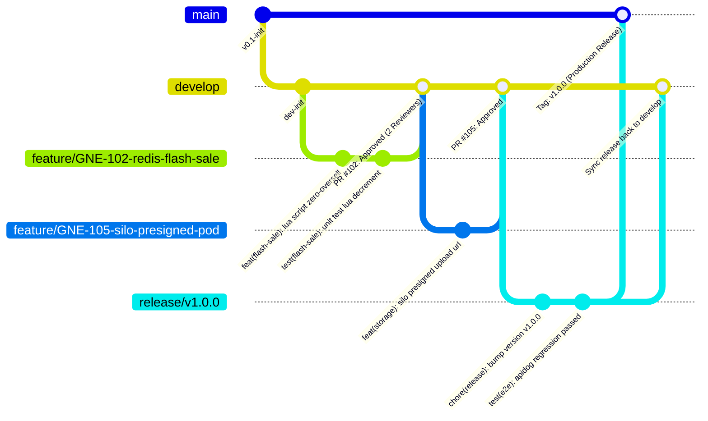

#### 4.1.1 Chiến lược Phân nhánh (Branching Strategy)

| Tên Nhánh | Mục đích & Phạm vi Hoạt động | Quy tắc Bảo vệ & Hạn chế Quyền |
| :--- | :--- | :--- |
| `main` / `master` | Nhánh Production chứa mã nguồn đang chạy trên môi trường thực tế. Mỗi commit trên `main` bắt buộc phải là một bản phát hành chính thức có gắn Tag phiên bản Semantic (`v1.0.0`). | **Tuyệt đối cấm commit trực tiếp.** Bắt buộc thông qua Pull Request từ nhánh `release/*` hoặc `hotfix/*`. Yêu cầu tối thiểu 2 Tech Lead duyệt và 100% kiểm thử tự động CI vượt qua. |
| `develop` | Nhánh tích hợp mã nguồn chính cho môi trường Staging/UAT. Tất cả các tính năng mới đều được tích hợp tại đây. | **Cấm commit trực tiếp.** Chỉ tiếp nhận mã nguồn thông qua PR từ các nhánh `feature/*` hoặc `bugfix/*`. |
| `feature/<Jira-Key>-<mo-ta>` | Phát triển tính năng mới. Tách nhánh từ `develop`. Ví dụ: `feature/GNE-102-redis-flash-sale`. | Xóa nhánh sau khi PR được merge vào `develop`. |
| `bugfix/<Jira-Key>-<mo-ta>` | Sửa lỗi phát sinh trong Sprint trên môi trường Development/Staging. Tách nhánh từ `develop`. | Merge vào `develop` sau khi QA xác nhận pass. |
| `release/vX.Y.Z` | Đóng băng mã nguồn (Feature Freeze) để kiểm thử hồi quy UAT, kiểm thử tải và chuẩn bị phát hành. | Chỉ cho phép commit sửa lỗi nghiêm trọng phát hiện trong UAT. Sau khi hoàn tất sẽ merge vào cả `main` và `develop`. |
| `hotfix/<Jira-Key>-<mo-ta>` | Xử lý sự cố khẩn cấp (P0/P1) trực tiếp trên môi trường Production. Tách nhánh từ `main`. | Sau khi kiểm thử nghiêm ngặt, merge đồng thời vào cả `main` (gắn tag bản vá `v2.0.1`) và `develop`. |

#### 4.1.2 Quy chuẩn Thông điệp Commit (Conventional Commits Standard)

Mọi commit của toàn bộ kỹ sư bắt buộc phải tuân thủ cú pháp:
```text
<type>(<scope>): <subject> [#<Jira-Issue-Key>]

[optional body: giải thích nguyên nhân và giải pháp kỹ thuật]

[optional footer: BREAKING CHANGE, Closes #JIRA-KEY]
```

- **Quy ước `type`**:
  - `feat`: Thêm tính năng mới (Feature).
  - `fix`: Sửa lỗi phần mềm (Bug fix).
  - `refactor`: Tái cấu trúc mã nguồn không làm thay đổi hành vi nghiệp vụ.
  - `perf`: Tối ưu hóa hiệu năng (tăng tốc độ truy vấn, giảm tiêu hao RAM).
  - `test`: Thêm hoặc chỉnh sửa bộ kiểm thử (Unit test, Integration test).
  - `chore`: Thay đổi cấu hình build, công cụ, quản lý thư viện dependency.
  - `docs`: Cập nhật tài liệu kỹ thuật hoặc tài liệu hướng dẫn API.
  - `ci`: Chỉnh sửa cấu hình CI/CD pipeline (GitHub Actions, Dockerfile).
- **Quy ước `scope`** (danh sách cố định trong `commitlint.config.cjs` của repo — sai scope thì commit bị chặn): `auth`, `catalog`, `order`, `payment`, `vendor`, `shipping`, `promotion`, `social`, `support`, `notification`, `admin`, `common`, `web`, `seller-ui`, `admin-ui`, `ai-worker`, `db`, `deploy`, `deps`, `release`, `api`. Tiêu đề commit tiếng Anh, chữ thường, ≤ 100 ký tự.
- **Cơ chế cưỡng chế (Enforcement)**: Hệ thống sử dụng công cụ **Husky** kết hợp với **commitlint** tại máy trạm cục bộ để tự động chặn các commit không đúng định dạng trước khi đẩy lên remote repository.

#### 4.1.3 Quy chuẩn Kiểm duyệt Mã nguồn (Pull Request & Code Review Policy)

1. **Tiêu chí Bắt buộc của một Pull Request (PR Requirements):**
   - Tiêu đề PR phải chứa mã Jira Task (ví dụ: `[GNE-102] feat(order): conditional stock reservation on checkout`).
   - Điền đầy đủ PR Template: Mô tả vấn đề, Giải pháp kỹ thuật, Tác động CSDL (kèm script migration nếu có), Ảnh chụp/Video bằng chứng test thành công.
2. **Quy tắc Phê duyệt (Approval Gateways):**
   - Tối thiểu **2 lượt chấp thuận (Approvals)** từ các kỹ sư trong dự án (trong đó bắt buộc có ít nhất 1 Tech Lead hoặc Senior Engineer).
   - 100% các bài kiểm thử tự động (Unit Test, Integration Test) trong GitHub Actions phải chuyển sang trạng thái xanh (Pass).
   - Vượt qua cổng chất lượng **SonarQube Quality Gate**: Độ bao phủ mã nguồn mới (New Code Coverage) >= 80% (toàn bộ tầng service vẫn giữ mốc ≥ 60% của NFR-09 / mục 4.3), 0 lỗi bảo mật Blocker/Critical, 0 điểm rò rỉ bảo mật (Vulnerabilities).

---

<a id="414-quy-chuan-danh-so-phien-ban"></a>
#### 4.1.4 Quy chuẩn Đánh số Phiên bản & Gắn nhãn Git Tag Bất biến (Semantic Versioning & Git Tagging)

Hệ thống Genie áp dụng triệt để quy chuẩn **Semantic Versioning 2.0.0 (SemVer)** kết hợp với cơ chế gắn nhãn Git Tag bất biến có ký số để bảo đảm truy vết chính xác tuyệt đối từng dòng mã nguồn đưa lên môi trường thử nghiệm và sản xuất.

1. **Cấu trúc Định danh Phiên bản:**
   > **Định dạng phiên bản:** `v<MAJOR>.<MINOR>.<PATCH>[-<PRERELEASE>]`
   - **MAJOR (Phiên bản Lớn):** Tăng khi có những thay đổi đột phá làm gãy tính tương thích ngược (Breaking Changes). Ví dụ: Chuyển đổi toàn diện khung Backend từ Go sang Spring Boot 3.3, tái cấu trúc bảng CSDL `orders` thành `checkout_sessions` và `orders` (v1.0.0 -> v1.0.0).
   - **MINOR (Phiên bản Nhỏ):** Tăng khi bổ sung các phân hệ hoặc tính năng nghiệp vụ mới hoàn toàn nhưng vẫn bảo toàn tính tương thích ngược với các API hiện hành. Ví dụ: Ra mắt cụm PWA Shipper Genie Express, bổ sung Cổng thanh toán MoMo/ZaloPay (v1.0.0 -> v1.1.0).
   - **PATCH (Bản vá Lỗi):** Tăng khi phát hành các bản vá lỗi phần mềm, tối ưu hiệu năng hoặc khắc phục sự cố bảo mật khẩn cấp (Hotfix) mà không làm biến đổi bất kỳ API contract nào (v1.0.0 -> v2.0.1).
   - **PRERELEASE (Bản tiền phát hành):** Sử dụng hậu tố thử nghiệm trước khi phát hành chính thức: `v1.0.0-rc.1` (Release Candidate 1), `v1.0.0-beta.2`.

2. **Quy trình Tạo Git Tag có Chữ ký Số (Annotated Signed Git Tags):**
   Mọi bản phát hành trên nhánh `main` bắt buộc phải được gắn thẻ Annotated Tag kèm thông điệp tóm tắt thay đổi (Release Notes) và được ký số GPG bởi Tech Lead:
   ```bash
   # Tạo thẻ phiên bản chính thức
   git tag -s v1.0.0 -m "Release v1.0.0: MVP with Spring Boot 3.3, VNPay, GHN & 38 Tables"
   
   # Đẩy thẻ lên máy chủ mã nguồn
   git push origin v1.0.0
   ```

3. **Chính sách Bất biến của Git Tag (Tag Immutability & Protection):**
   - Trên GitHub/GitLab, các tag có định dạng `v*` được thiết lập quyền **Protected Tag**.
   - Tuyệt đối cấm thao tác Force Push ghi đè tag (`git push -f --tags`) hoặc xóa tag đã phát hành (`git tag -d`). Bất kỳ sự cố nào trên một tag đều phải được giải quyết bằng cách phát hành một bản vá mang số hiệu PATCH mới hơn.

---

<a id="42-quan-tri-du-an"></a>
### 4.2 Quản trị Dự án & Vòng đời Quản lý Lỗi (Jira Software & Bug Governance)

Dự án vận hành theo phương pháp luận **Agile/Scrum** với chu kỳ Sprint cố định 2 tuần. Toàn bộ yêu cầu nghiệp vụ, tiến độ kỹ thuật và lỗi phần mềm được quản lý tập trung trên nền tảng **Jira Software**.

#### 4.2.1 Cấu trúc Phân cấp Công việc (Jira Issue Hierarchy)

```
Initiative (Mục tiêu Chiến lược Nền tảng E-Commerce)
  └── Epic (Phân hệ Nghiệp vụ, ví dụ: [EPIC-ORD] Phân hệ Giỏ hàng, Đặt hàng & Đơn hàng)
        ├── User Story (Yêu cầu Người dùng: Là một [Actor], Tôi muốn [Action], Để [Value])
        │     ├── Engineering Task (Nhiệm vụ Kỹ thuật: Viết API, Tạo Migration DDL, Cấu hình Queue)
        │     └── Sub-Task (Viết Unit Test, Viết Apidog Test Suite, Soạn Doc)
        └── Bug (Lỗi Phần mềm phát sinh trong Sprint hoặc trên Staging/Production)
```

#### 4.2.2 Ma trận Phân loại Mức độ Nghiêm trọng của Lỗi (Bug Severity & SLA Matrix)

Mọi lỗi phát hiện đều được gán nhãn mức độ nghiêm trọng (Severity) và mức độ ưu tiên (Priority) để kích hoạt cam kết thời gian khắc phục (SLA):

| Cấp độ Nghiêm trọng | Định nghĩa & Tiêu chí Nhận diện | Ví dụ Thực tế trong Hệ thống | SLA Phản hồi | SLA Khắc phục |
| :--- | :--- | :--- | :--- | :--- |
| **P0 - Blocker** (Khẩn cấp tối cao) | Toàn bộ hoặc một phân hệ trọng yếu bị tê liệt; rò rỉ dữ liệu tài chính hoặc mất an toàn thông tin nghiêm trọng; người dùng không thể đăng nhập hoặc thanh toán đơn hàng. | Lỗi sập cổng thanh toán VNPay; Lỗi rò rỉ tiền ví số cái kép; Database PostgreSQL 16 bị treo; Silo bị tấn công rò rỉ CCCD. | **< 15 phút** | **< 2 giờ** (Hotfix ngay lập tức) |
| **P1 - Critical** (Rất nghiêm trọng) | Chức năng nghiệp vụ cốt lõi bị lỗi mà không có phương án thay thế khả dĩ; ảnh hưởng đến diện rộng người dùng hoặc gian hàng. | Không trừ được tồn kho Flash Sale; Không tạo được mã vận đơn Shipper; API tìm kiếm Elasticsearch 8.15 LTS trả về mã 500. | **< 30 phút** | **< 6 giờ** |
| **P2 - Major** (Nghiêm trọng vừa) | Tính năng quan trọng bị lỗi nhưng người dùng vẫn có phương án dự phòng tạm thời; hoặc lỗi chỉ phát sinh trong trường hợp biên (Edge Case). | Bộ lọc nâng cao không hoạt động theo khoảng giá; Không gửi được email thông báo đơn hàng (vẫn có Push In-app). | **< 2 giờ** | **< 24 giờ** |
| **P3 - Minor** (Nhẹ / Thẩm mỹ) | Lỗi giao diện nhỏ, sai lệch canh lề hiển thị trên một số kích thước màn hình hiếm, lỗi chính tả tài liệu, thiếu gợi ý tooltip. | Nút bấm lệch 2px trên giao diện Tablet; Font chữ thông báo chưa đồng bộ; Icon trạng thái bị mờ. | **< 8 giờ** | Xử lý trong Sprint tiếp theo |

#### 4.2.3 Quy trình Vòng đời Lỗi Phần mềm (Bug Lifecycle Workflow)

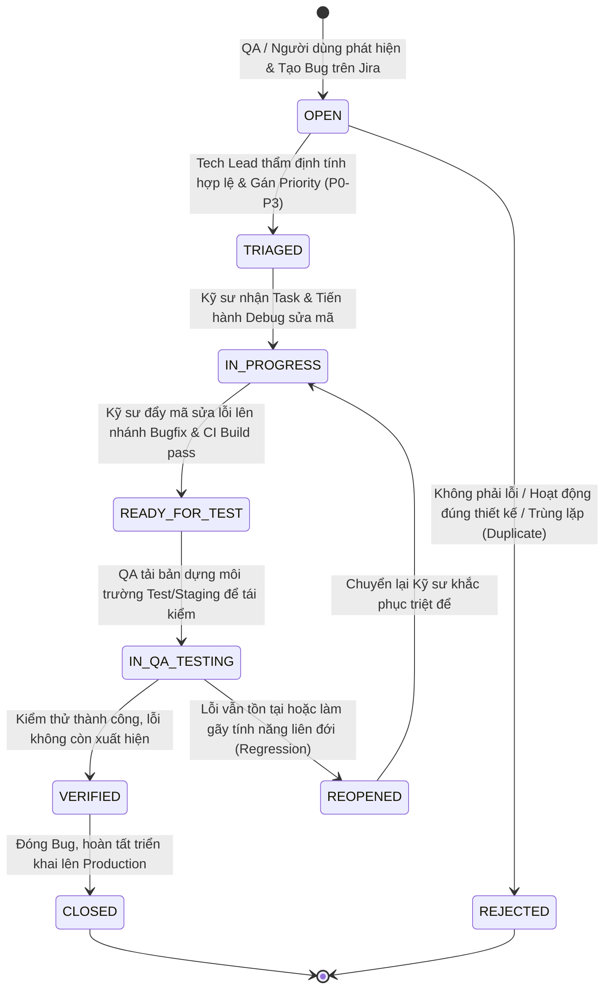

#### 4.2.4 Mẫu Báo cáo Lỗi Tiêu chuẩn (Standard Bug Report Template)

Mọi phiếu báo lỗi trên Jira bắt buộc phải được soạn thảo theo cấu trúc chuẩn sau:

```markdown
### [GNE-BUG-XXX] Tiêu đề tóm tắt lỗi ngắn gọn, rõ ràng

* **Mức độ nghiêm trọng (Severity):** P1 - Critical
* **Phân hệ nghiệp vụ (Component):** Checkout & Order Service (`UC-ORD-01`)
* **Môi trường phát hiện (Environment):** Staging mvp-1.0-rc1 | Browser: Chrome 128 | OS: Windows 11
* **Tài khoản kiểm thử (Test Account):** `test_buyer_01@genie.vn` (Role: CUSTOMER)

#### 1. Tiền điều kiện (Pre-conditions):
- Người dùng đã đăng nhập thành công.
- Giỏ hàng có 01 sản phẩm thuộc Shop ID `vnd_9981` với số lượng tồn kho còn 02.

#### 2. Các bước tái hiện lỗi (Steps to Reproduce):
1. Truy cập vào trang Giỏ hàng `/cart`.
2. Bấm nút "Tiến hành Đặt hàng" chuyển đến màn hình Checkout.
3. Chọn phương thức thanh toán "Ví Genie" và nhấn nút "Thanh toán Ngay".
4. Quan sát phản hồi trên màn hình và thông điệp mạng tại Tab Network của DevTools.

#### 3. Kết quả mong đợi (Expected Result):
- Hệ thống gọi API `POST /api/v1/me/checkout-sessions` thành công với HTTP 201 Created.
- IPN VNPay thành công và đơn hàng chuyển sang trạng thái `PAID`.

#### 4. Kết quả thực tế (Actual Result):
- Màn hình hiển thị hộp thoại lỗi: `Lỗi hệ thống không xác định (500)`.
- Đơn vẫn ở `PENDING_PAYMENT` nhưng `reserved_count` của SKU bị âm.

#### 5. Bằng chứng đính kèm (Evidence & Attachments):
- Ảnh chụp màn hình lỗi và Video quay lại thao tác: `s3://delivery-pod/bugs/lzd-bug-125.mp4`
- Nhật ký yêu cầu mạng (Network Request / Response):
  - Request URL: `POST https://api.staging.genie.vn/api/v1/me/checkout-sessions`
  - Header: `Idempotency-Key: a4c89f2e-4b71-4fa3-9f81-229ef4021201`
  - Response Body: `{"code":"GNE-DB-5002", "status":500, "message":"Database deadlock detected"}`
- Trích xuất log máy chủ (`docker compose logs backend`) (Request ID `req_01HP8S9W5Q`):
  ```text
  org.springframework.dao.CannotAcquireLockException: Lock wait timeout exceeded; try restarting transaction
  ```
```

---

<a id="43-chien-luoc-kiem-thu"></a>

### 4.3 Chiến lược kiểm thử (mức MVP)

| Tầng | Công cụ | Phạm vi bắt buộc | Mục tiêu |
|---|---|---|---|
| Unit | JUnit 5 + Mockito | Phương thức nghiệp vụ entity (`Order.transitionTo`, `EscrowLedger.release`, `Voucher.calculateDiscount`, `ProductVariant.reserve`), service tính tiền | Coverage service ≥ 60% |
| Tích hợp | Spring Boot Test + Testcontainers (PostgreSQL, Redis) | Checkout giữ chỗ đồng thời, IPN lặp, giải ngân, hoàn tiền một phần | 100% luồng tiền |
| API | Apidog (hoặc Postman) collection | 87 use case — mỗi UC ít nhất 1 kịch bản thành công + 1 kịch bản lỗi; kịch bản quyền cho 13 mã quyền | Chạy trước mỗi lần merge `develop` |
| E2E | Playwright | Mua hàng VNPay sandbox, mua VietQR, mua COD, mở shop + KYC, đăng sản phẩm qua Gemini, voucher 3 tầng + Điểm, Flash Sale, trả hàng, nhân viên đúng quyền | 9 kịch bản chính |
| Tải | k6 | 50 VU: tìm kiếm, xem sản phẩm, checkout | Đạt NFR-01 |
| Bảo mật | OWASP ZAP baseline | Storefront, API | Không có cảnh báo High |

**Kịch bản kiểm thử bắt buộc cho luồng tiền:** (1) 100 luồng đặt cùng SKU tồn 10 → đúng 10 đơn thành công; (2) IPN gửi 5 lần → 1 lần ghi nhận; (3) Return URL tới trước IPN → không đổi trạng thái; (4) hoàn một phần 300.000đ của đơn 1.000.000đ, hoa hồng 5% → shop nhận 665.000đ, sàn 35.000đ; (5) Cron giải ngân chạy 2 instance song song → không giải ngân trùng (`SKIP LOCKED`); (6) 50 luồng mua Flash Sale suất 10 → đúng 10 thành công; (7) xếp chồng Shop 10% + Sàn 50.000đ + Freeship + Điểm 50% → tổng chiết khấu phân bổ khớp từng dòng, sổ cái cân bằng.

### 4.4 Triển khai bằng Docker Compose

```yaml
# docker-compose.yml (staging / demo) — rút gọn
services:
  nginx:
    image: nginx:1.27-alpine
    ports: ["80:80", "443:443"]
    volumes: [./nginx/conf.d:/etc/nginx/conf.d:ro, ./certs:/etc/letsencrypt:ro]
    depends_on: [backend, frontend]
    restart: unless-stopped
  frontend:
    image: ghcr.io/genie/frontend:${TAG}
    environment: [PUBLIC_API_URL=https://api.genie.vn]
    restart: unless-stopped
  backend:
    image: ghcr.io/genie/backend:${TAG}
    env_file: .env                       # DB_URL, JWT_SECRET, VNPAY_*, SEPAY_API_KEY, GHN_*, GHTK_*, VTP_*, JT_*, SMTP_*, GEMINI_API_KEY, GOOGLE_* / APPLE_* (OAuth), KYC_AES_KEY, INTERNAL_TOKEN
    environment: [SPRING_PROFILES_ACTIVE=prod, JAVA_OPTS=-Xms512m -Xmx1536m]
    depends_on: [postgres, redis, silo]
    healthcheck: {test: ["CMD", "wget", "-qO-", "http://localhost:8080/actuator/health"], interval: 30s}
    restart: unless-stopped
  ai-worker:
    image: ghcr.io/genie/ai-worker:${TAG}
    environment: [WORKERS=1, INTERNAL_TOKEN=${INTERNAL_TOKEN}]
    deploy: {resources: {limits: {memory: 2g}}}
    restart: unless-stopped
  postgres:
    image: postgres:16-alpine
    environment: [POSTGRES_DB=genie, POSTGRES_USER=genie, POSTGRES_PASSWORD=${DB_PASSWORD}]
    volumes: [pgdata:/var/lib/postgresql/data]
    restart: unless-stopped
  redis:
    image: redis:7-alpine
    command: ["redis-server", "--appendonly", "yes", "--requirepass", "${REDIS_PASSWORD}"]
    volumes: [redisdata:/data]
    restart: unless-stopped
  silo:                                  # kho tệp S3 — Silo, fork cộng đồng của MinIO (ADR 0009); biến MINIO_* là tên Silo bắt buộc
    image: pgsty/silo:RELEASE.2026-10-26T00-00-00Z
    command: server /data --console-address ":9001"
    environment: [MINIO_ROOT_USER=${MINIO_ROOT_USER}, MINIO_ROOT_PASSWORD=${MINIO_ROOT_PASSWORD}]
    volumes: [silodata:/data]
    healthcheck: {test: ["CMD-SHELL", "silo healthcheck ready || mcli ready local || mc ready local"], interval: 15s}
    restart: unless-stopped
  silo-init:                             # chạy một lần: 9 bucket, chính sách công khai, lifecycle tmp/ 1 ngày, tài khoản ứng dụng
    image: pgsty/silo:RELEASE.2026-10-26T00-00-00Z
    depends_on: {silo: {condition: service_healthy}}
    entrypoint: ["/bin/sh", "/init.sh"]
    volumes: [./silo/init.sh:/init.sh:ro]
volumes: {pgdata: {}, redisdata: {}, silodata: {}}
```

- PostgreSQL, Redis, Silo **không** publish cổng ra ngoài; chỉ Nginx mở 80 / 443.
- AI Worker 1 worker, giới hạn 2 GB RAM (nạp các mô hình ONNX KYC và PhoBERT một lần khi khởi động; PhoBERT-base lượng tử hóa INT8 khoảng vài trăm MB — đo lại theo mô hình thật của nhóm).
- Sao lưu: cron máy chủ `docker exec postgres pg_dump … | gzip > /backup/$(date +%F).sql.gz`, xoá bản cũ hơn 7 ngày.

### 4.5 CI/CD với GitHub Actions

| Bước | Kích hoạt | Nội dung |
|---|---|---|
| CI | Pull request vào `develop` / `main` | Build Maven + chạy unit / integration test (Testcontainers), `npm run build` frontend, lint, SonarCloud |
| Build image | Merge `main` hoặc tag `v*` | Build 3 image (`backend`, `frontend`, `ai-worker`), gắn tag = git tag / SHA ngắn, đẩy GHCR |
| Deploy | Tag `v*` (thủ công phê duyệt) | SSH vào VPS: `docker compose pull && docker compose up -d`; Flyway chạy migration khi backend khởi động |
| Rollback | Thủ công | Đặt `TAG` về phiên bản trước và `up -d`; migration chỉ tiến (viết migration sửa lỗi thay vì lùi) |

### 4.6 Giám sát & nhật ký mức MVP
- **Spring Boot Actuator** `/actuator/health` (kèm DB, Redis, Silo), `/actuator/metrics`; chỉ mở cho mạng nội bộ.
- **Uptime Kuma** kiểm tra storefront, API health, VNPay IPN endpoint mỗi 1 phút, gửi email khi lỗi.
- **Log** JSON (Logback + `logstash-logback-encoder`) có `traceId` (Micrometer Tracing), xoay vòng file 7 ngày; xem bằng `docker compose logs`.
- Prometheus / Grafana / Loki để DATN (cấu hình mẫu ở `DATN/document/Document_Vi.md` mục 4.6).

---

<a id="phu-luc-a"></a>
## Phụ lục A: Danh mục 87 use case

| # | Mã UC | Tên use case | Phân hệ | Tác nhân chính | Sprint | Mức ưu tiên |
|:---:|---|---|---|---|:---:|:---:|
| 1 | `UC-AUTH-01` | Đăng ký tài khoản Khách hàng | 01. Xác thực & Tài khoản người dùng | Guest (khách vãng lai) | S1 | MUST |
| 2 | `UC-AUTH-02` | Đăng nhập hệ thống | 01. Xác thực & Tài khoản người dùng | Customer (khách hàng), Vendor (người bán/shop), Staff (Nhân viên sàn), Admin | S1 | MUST |
| 3 | `UC-AUTH-03` | Đăng nhập & Liên kết tài khoản Google / Apple (OAuth2 / OpenID Connect) | 01. Xác thực & Tài khoản người dùng | Guest (khách vãng lai), Customer (khách hàng) | S7 | SHOULD |
| 4 | `UC-AUTH-04` | Khôi phục mật khẩu qua Email OTP (Forgot Password) | 01. Xác thực & Tài khoản người dùng | Customer (khách hàng), Vendor (người bán/shop), Staff (Nhân viên sàn) | S1 | MUST |
| 5 | `UC-AUTH-06` | Đổi / Thiết lập mật khẩu | 01. Xác thực & Tài khoản người dùng | Customer (khách hàng), Vendor (người bán/shop), Staff (Nhân viên sàn), Admin | S1 | MUST |
| 6 | `UC-AUTH-08` | Quản lý thông tin hồ sơ cá nhân (Customer Profile) | 01. Xác thực & Tài khoản người dùng | Customer (khách hàng), Staff (Nhân viên sàn) | S2 | MUST |
| 7 | `UC-AUTH-09` | Quản lý sổ địa chỉ giao hàng chuẩn GHN | 01. Xác thực & Tài khoản người dùng | Customer (khách hàng) | S2 | MUST |
| 8 | `UC-AUTH-10` | Yêu cầu ẩn danh hóa & Xóa dữ liệu cá nhân (Xóa tài khoản) | 01. Xác thực & Tài khoản người dùng | Customer (khách hàng) | S7 | SHOULD |
| 9 | `UC-AUTH-11` | Đăng xuất & Quản lý thiết bị đăng nhập | 01. Xác thực & Tài khoản người dùng | Customer (khách hàng), Vendor (người bán/shop), Staff (Nhân viên sàn), Admin | S1 | MUST |
| 10 | `UC-CAT-01` | Duyệt cây danh mục đa cấp (Category Hierarchy) | 02. Danh mục, Sản phẩm & Tìm kiếm | Guest (khách vãng lai), Customer (khách hàng) | S2 | MUST |
| 11 | `UC-CAT-02` | Tìm kiếm sản phẩm theo từ khóa | 02. Danh mục, Sản phẩm & Tìm kiếm | Guest (khách vãng lai), Customer (khách hàng) | S2 | MUST |
| 12 | `UC-CAT-04` | Gợi ý từ khóa tìm kiếm & Xu hướng (Autocomplete & Trending) | 02. Danh mục, Sản phẩm & Tìm kiếm | Guest (khách vãng lai), Customer (khách hàng) | S7 | SHOULD |
| 13 | `UC-CAT-05` | Lọc nâng cao & Sắp xếp sản phẩm đa tiêu chí | 02. Danh mục, Sản phẩm & Tìm kiếm | Guest (khách vãng lai), Customer (khách hàng) | S2 | MUST |
| 14 | `UC-CAT-06` | Xem chi tiết sản phẩm, ma trận biến thể SKU & Tồn kho | 02. Danh mục, Sản phẩm & Tìm kiếm | Guest (khách vãng lai), Customer (khách hàng) | S2 | MUST |
| 15 | `UC-CAT-07` | Xem gợi ý sản phẩm tương tự | 02. Danh mục, Sản phẩm & Tìm kiếm | Guest (khách vãng lai), Customer (khách hàng) | S7 | SHOULD |
| 16 | `UC-CAT-08` | Quản lý danh sách sản phẩm yêu thích (Wishlist) | 02. Danh mục, Sản phẩm & Tìm kiếm | Customer (khách hàng) | S6 | SHOULD |
| 17 | `UC-CAT-09` | Thêm mới sản phẩm & Biến thể SKU (Người bán) | 02. Danh mục, Sản phẩm & Tìm kiếm | Vendor (người bán/shop) | S2 | MUST |
| 18 | `UC-CAT-10` | Cập nhật thông tin sản phẩm, giá bán & hình ảnh | 02. Danh mục, Sản phẩm & Tìm kiếm | Vendor (người bán/shop) | S2 | MUST |
| 19 | `UC-CAT-11` | Ẩn / Khóa / Xóa mềm sản phẩm | 02. Danh mục, Sản phẩm & Tìm kiếm | Vendor (người bán/shop), Moderator (Nhân viên kiểm duyệt), Admin | S2 | MUST |
| 20 | `UC-CAT-12` | Kiểm duyệt sản phẩm tự động qua AI (Google Gemini API) | 02. Danh mục, Sản phẩm & Tìm kiếm | — (được include) | S7 | SHOULD |
| 21 | `UC-CAT-13` | Kiểm duyệt sản phẩm thủ công theo hàng đợi (Staff Moderator) | 02. Danh mục, Sản phẩm & Tìm kiếm | Moderator (Nhân viên kiểm duyệt) | S2 | MUST |
| 22 | `UC-CAT-14` | Quản lý danh mục sàn toàn cục & Cấu hình tỷ lệ hoa hồng | 02. Danh mục, Sản phẩm & Tìm kiếm | Moderator (Nhân viên kiểm duyệt), Finance Officer (Nhân viên tài chính), Admin | S2 | MUST |
| 23 | `UC-CAT-15` | Cấu hình bộ thuộc tính chuẩn theo ngành hàng (Category Attributes) | 02. Danh mục, Sản phẩm & Tìm kiếm | Admin, Moderator (Nhân viên kiểm duyệt) | S7 | SHOULD |
| 24 | `UC-CAT-16` | Xem trang gian hàng (Shop Page) | 02. Danh mục, Sản phẩm & Tìm kiếm | Guest (khách vãng lai), Customer (khách hàng) | S2 | MUST |
| 25 | `UC-CAT-17` | Người bán đề xuất danh mục mới & Duyệt đề xuất | 02. Danh mục, Sản phẩm & Tìm kiếm | Vendor (người bán/shop), Moderator (Nhân viên kiểm duyệt), Admin | S7 | SHOULD |
| 26 | `UC-CAT-18` | Chia sẻ sản phẩm bằng liên kết (Deeplink) | 02. Danh mục, Sản phẩm & Tìm kiếm | Guest (khách vãng lai), Customer (khách hàng) | S7 | SHOULD |
| 27 | `UC-ORD-01` | Quản lý giỏ hàng mua sắm cá nhân (Shopping Cart) | 03. Giỏ hàng, Đặt hàng & Đơn hàng | Guest (khách vãng lai), Customer (khách hàng) | S3 | MUST |
| 28 | `UC-ORD-04` | Xem trước đơn hàng & Tách giỏ hàng đa nhà bán (Cart Preview & Splitting) | 03. Giỏ hàng, Đặt hàng & Đơn hàng | Customer (khách hàng) | S3 | MUST |
| 29 | `UC-ORD-06` | Tính phí vận chuyển qua GHN API | 03. Giỏ hàng, Đặt hàng & Đơn hàng | Customer (khách hàng) | S3 | MUST |
| 30 | `UC-ORD-07` | Tạo phiên Checkout & Các Đơn hàng con theo Shop (PersistCheckout) | 03. Giỏ hàng, Đặt hàng & Đơn hàng | Customer (khách hàng) | S3 | MUST |
| 31 | `UC-ORD-08` | Tự động hủy đơn quá hạn thanh toán & Hoàn kho (Sweeper Cron) | 03. Giỏ hàng, Đặt hàng & Đơn hàng | Platform Cron / Scheduler | S3 | MUST |
| 32 | `UC-ORD-09` | Khách hàng theo dõi chi tiết hành trình đơn hàng | 03. Giỏ hàng, Đặt hàng & Đơn hàng | Customer (khách hàng) | S4 | MUST |
| 33 | `UC-ORD-10` | Khách hàng yêu cầu hủy đơn hàng | 03. Giỏ hàng, Đặt hàng & Đơn hàng | Customer (khách hàng) | S4 | MUST |
| 34 | `UC-ORD-11` | Khách hàng xác nhận "Đã nhận hàng thành công" | 03. Giỏ hàng, Đặt hàng & Đơn hàng | Customer (khách hàng) | S4 | MUST |
| 35 | `UC-ORD-12` | Hệ thống tự động hoàn tất đơn sau 7 ngày từ khi Delivered | 03. Giỏ hàng, Đặt hàng & Đơn hàng | Platform Cron / Scheduler | S4 | MUST |
| 36 | `UC-PAY-01` | Khởi tạo thanh toán trực tuyến (VNPay / chuyển khoản VietQR qua SePay) | 04. Thanh toán, Ký quỹ (Escrow) & Sổ cái | Customer (khách hàng) | S3 | MUST |
| 37 | `UC-PAY-03` | Xử lý IPN VNPay & webhook SePay idempotent | 04. Thanh toán, Ký quỹ (Escrow) & Sổ cái | Payment Gateway (VNPay, SePay) | S3 | MUST |
| 38 | `UC-PAY-05` | Ghi nhận ký quỹ (Escrow) & Khấu trừ hoa hồng | 04. Thanh toán, Ký quỹ (Escrow) & Sổ cái | — (được include) | S3 | MUST |
| 39 | `UC-PAY-06` | Ghi sổ cái tài chính kép bất biến (Financial Ledger) | 04. Thanh toán, Ký quỹ (Escrow) & Sổ cái | — (được include) | S3 | MUST |
| 40 | `UC-PAY-07` | Tự động giải phóng tiền ký quỹ về ví người bán | 04. Thanh toán, Ký quỹ (Escrow) & Sổ cái | Platform Cron / Scheduler | S4 | MUST |
| 41 | `UC-VND-01` | Đăng ký mở gian hàng (Become a Seller) | 05. Gian hàng & Thẩm định KYC người bán | Customer (khách hàng) | S2 | MUST |
| 42 | `UC-VND-02` | Tải hồ sơ pháp lý & Giấy tờ định danh KYC | 05. Gian hàng & Thẩm định KYC người bán | Vendor (người bán/shop) | S2 | MUST |
| 43 | `UC-VND-03` | Thẩm định KYC tự động qua AI (QR, MRZ & Face Match) | 05. Gian hàng & Thẩm định KYC người bán | AI Worker Service (KYC & PhoBERT) | S2 | MUST |
| 44 | `UC-VND-04` | Kiểm duyệt thủ công hồ sơ KYC (Staff / Admin) | 05. Gian hàng & Thẩm định KYC người bán | Moderator (Nhân viên kiểm duyệt), Admin | S2 | MUST |
| 45 | `UC-VND-05` | Cấu hình kho lấy hàng & Đồng bộ GHN Shop ID | 05. Gian hàng & Thẩm định KYC người bán | Vendor (người bán/shop) | S2 | MUST |
| 46 | `UC-VND-06` | Cấu hình tin nhắn trả lời tự động (Auto-reply) | 05. Gian hàng & Thẩm định KYC người bán | Vendor (người bán/shop) | S7 | SHOULD |
| 47 | `UC-VND-07` | Đăng ký tài khoản nhận giải ngân (Payout Bank Account) | 05. Gian hàng & Thẩm định KYC người bán | Vendor (người bán/shop) | S4 | MUST |
| 48 | `UC-VND-08` | Xem báo cáo doanh thu & Phân tích bán hàng (Vendor Analytics) | 05. Gian hàng & Thẩm định KYC người bán | Vendor (người bán/shop) | S6 | SHOULD |
| 49 | `UC-VND-19` | Bật chế độ tạm nghỉ bán hàng của shop (Vacation Mode) | 05. Gian hàng & Thẩm định KYC người bán | Vendor (người bán/shop) | S7 | SHOULD |
| 50 | `UC-VND-20` | Xem ví & sổ giao dịch người bán (Seller Wallet & Escrow Ledger) | 05. Gian hàng & Thẩm định KYC người bán | Vendor (người bán/shop) | S7 | SHOULD |
| 51 | `UC-VND-21` | Cập nhật thông tin gian hàng & cài đặt vận hành | 05. Gian hàng & Thẩm định KYC người bán | Vendor (người bán/shop) | S7 | SHOULD |
| 52 | `UC-LOG-01` | Tiếp nhận đơn hàng & Đóng gói tại kho shop (Fulfillment) | 06. Vận chuyển qua đối tác 3PL | Vendor (người bán/shop) | S4 | MUST |
| 53 | `UC-LOG-02` | Đẩy vận đơn sang GHN & In phiếu gửi hàng PDF (Waybill Label) | 06. Vận chuyển qua đối tác 3PL | Vendor (người bán/shop) | S4 | MUST |
| 54 | `UC-LOG-03` | Đồng bộ hành trình giao nhận qua Webhook GHN | 06. Vận chuyển qua đối tác 3PL | Đối tác vận chuyển (GHN, GHTK, ViettelPost, J&T) | S4 | MUST |
| 55 | `UC-LOG-15` | Điều phối đa hãng vận chuyển (Dynamic Carrier Routing) | 06. Vận chuyển qua đối tác 3PL | — (được include) | S7 | SHOULD |
| 56 | `UC-LOG-16` | Người bán xác nhận / từ chối đơn hàng mới | 06. Vận chuyển qua đối tác 3PL | Vendor (người bán/shop) | S4 | MUST |
| 57 | `UC-PRO-01` | Tạo & Quản lý Voucher Gian hàng (Vendor Shop Vouchers) | 07. Khuyến mãi, Voucher, Flash Sale & Điểm | Vendor (người bán/shop) | S5 | MUST |
| 58 | `UC-PRO-02` | Tạo & Quản lý Voucher Toàn sàn | 07. Khuyến mãi, Voucher, Flash Sale & Điểm | Finance Officer (Nhân viên tài chính), Admin | S5 | MUST |
| 59 | `UC-PRO-03` | Khách hàng thu thập Voucher vào Kho Voucher cá nhân | 07. Khuyến mãi, Voucher, Flash Sale & Điểm | Customer (khách hàng) | S5 | MUST |
| 60 | `UC-PRO-04` | Thuật toán Stacking Voucher 3 Tầng & Điểm tự động khi Checkout | 07. Khuyến mãi, Voucher, Flash Sale & Điểm | Customer (khách hàng) | S8 | SHOULD |
| 61 | `UC-PRO-05` | Tạo chiến dịch Flash Sale & Cấu hình khung giờ vàng | 07. Khuyến mãi, Voucher, Flash Sale & Điểm | Finance Officer (Nhân viên tài chính), Admin, Vendor (người bán/shop) | S8 | SHOULD |
| 62 | `UC-PRO-06` | Mua hàng Flash Sale chống bán vượt suất | 07. Khuyến mãi, Voucher, Flash Sale & Điểm | Customer (khách hàng) | S8 | SHOULD |
| 63 | `UC-PRO-08` | Điểm danh nhận Điểm hàng ngày & Duy trì chuỗi điểm danh (Streak) | 07. Khuyến mãi, Voucher, Flash Sale & Điểm | Customer (khách hàng) | S8 | SHOULD |
| 64 | `UC-PRO-09` | Tra cứu số dư Điểm Genie & Lịch sử biến động Điểm | 07. Khuyến mãi, Voucher, Flash Sale & Điểm | Customer (khách hàng) | S8 | SHOULD |
| 65 | `UC-PRO-10` | Sử dụng Điểm Genie để giảm trừ thanh toán đơn hàng | 07. Khuyến mãi, Voucher, Flash Sale & Điểm | Customer (khách hàng) | S8 | SHOULD |
| 66 | `UC-SOC-01` | Nhắn tin trò chuyện thời gian thực Khách - Shop (Live Chat) | 08. Chat, Đánh giá & Theo dõi shop | Customer (khách hàng), Vendor (người bán/shop) | S6 | SHOULD |
| 67 | `UC-SOC-02` | Gửi thẻ sản phẩm, hình ảnh và trạng thái đơn hàng trong chat | 08. Chat, Đánh giá & Theo dõi shop | Customer (khách hàng), Vendor (người bán/shop) | S8 | SHOULD |
| 68 | `UC-SOC-03` | Đánh giá sản phẩm đã mua & Tải ảnh thực tế (Verified Buyer Review) | 08. Chat, Đánh giá & Theo dõi shop | Customer (khách hàng) | S5 | MUST |
| 69 | `UC-SOC-04` | Người bán phản hồi đánh giá của khách hàng (Vendor Review Reply) | 08. Chat, Đánh giá & Theo dõi shop | Vendor (người bán/shop) | S5 | MUST |
| 70 | `UC-SOC-05` | Báo cáo đánh giá vi phạm / spam & Kiểm duyệt đánh giá (Review Moderation & Report) | 08. Chat, Đánh giá & Theo dõi shop | Vendor (người bán/shop), Customer (khách hàng), Moderator (Nhân viên kiểm duyệt), CS Specialist (Nhân viên CSKH) | S8 | SHOULD |
| 71 | `UC-SOC-06` | Khách hàng theo dõi gian hàng (Shop Follow) | 08. Chat, Đánh giá & Theo dõi shop | Customer (khách hàng) | S8 | SHOULD |
| 72 | `UC-AI-07` | Phân tích cảm xúc đánh giá bằng PhoBERT | 08. Chat, Đánh giá & Theo dõi shop | AI Worker Service (KYC & PhoBERT) | S6 | SHOULD |
| 73 | `UC-SUP-01` | Tạo yêu cầu Trả hàng / Hoàn tiền (Return & Refund Request) | 09. Trả hàng, Hoàn tiền & Khiếu nại | Customer (khách hàng) | S5 | MUST |
| 74 | `UC-SUP-02` | Người bán tiếp nhận và xử lý yêu cầu trả hàng | 09. Trả hàng, Hoàn tiền & Khiếu nại | Vendor (người bán/shop) | S5 | MUST |
| 75 | `UC-SUP-03` | Nhân viên sàn phân xử tranh chấp khiếu nại (Dispute Arbitration) | 09. Trả hàng, Hoàn tiền & Khiếu nại | CS Specialist (Nhân viên CSKH), Admin | S5 | MUST |
| 76 | `UC-SUP-04` | Thực hiện hoàn tiền (VNPay / VietQR / COD) | 09. Trả hàng, Hoàn tiền & Khiếu nại | CS Specialist (Nhân viên CSKH) | S5 | MUST |
| 77 | `UC-NOT-01` | Thông báo trong ứng dụng thời gian thực (WebSocket) | 10. Thông báo | Customer (khách hàng), Vendor (người bán/shop), Staff (Nhân viên sàn) | S5 | MUST |
| 78 | `UC-NOT-03` | Gửi email giao dịch tự động | 10. Thông báo | Customer (khách hàng), Vendor (người bán/shop) | S5 | MUST |
| 79 | `UC-NOT-05` | Admin phát thông báo toàn sàn (Broadcast Platform Notification) | 10. Thông báo | Admin | S8 | SHOULD |
| 80 | `UC-ADM-01` | Quản lý danh sách nhân viên nội bộ & Lời mời kích hoạt | 11. Quản trị sàn, Nhân viên & Rút tiền | Admin | S1 | MUST |
| 81 | `UC-ADM-02` | Phân cấp vai trò & Cấp phát / Thu hồi mã quyền chi tiết (RBAC) | 11. Quản trị sàn, Nhân viên & Rút tiền | Admin | S1 | MUST |
| 82 | `UC-ADM-03` | Khóa / Mở khóa tài khoản nhân viên và người dùng vi phạm | 11. Quản trị sàn, Nhân viên & Rút tiền | Admin | S6 | MUST |
| 83 | `UC-ADM-04` | Người bán gửi yêu cầu rút tiền từ Ví về Ngân hàng | 11. Quản trị sàn, Nhân viên & Rút tiền | Vendor (người bán/shop) | S4 | MUST |
| 84 | `UC-ADM-05` | Nhân viên sàn phê duyệt & Thực hiện lệnh chuyển khoản (Payout) | 11. Quản trị sàn, Nhân viên & Rút tiền | Finance Officer (Nhân viên tài chính), Admin | S4 | MUST |
| 85 | `UC-ADM-06` | Dashboard doanh thu & ký quỹ toàn sàn | 11. Quản trị sàn, Nhân viên & Rút tiền | Admin, Staff (Nhân viên sàn) | S6 | SHOULD |
| 86 | `UC-ADM-07` | Tra cứu nhật ký kiểm toán hệ thống bất biến (System Audit Logs) | 11. Quản trị sàn, Nhân viên & Rút tiền | Admin | S7 | SHOULD |
| 87 | `UC-ADM-12` | Quản lý banner trang chủ & chiến dịch tĩnh (CMS Banner) | 11. Quản trị sàn, Nhân viên & Rút tiền | Admin, Finance Officer (Nhân viên tài chính) | S8 | SHOULD |

<a id="phu-luc-b"></a>
## Phụ lục B: Quyết định kiến trúc (ADR)

| Mã | Quyết định | Bối cảnh | Hệ quả |
|---|---|---|---|
| ADR-01 | **Modular monolith Spring Boot** thay microservices | Nhóm 4 người, 1 học kỳ, cần ACID cho luồng tiền | Triển khai đơn giản; module rõ ranh giới để tách sau |
| ADR-02 | **PostgreSQL full-text** thay Elasticsearch | Vài nghìn sản phẩm; tiết kiệm ~2 GB RAM và một hệ thống phải vận hành | Không có gợi ý ngữ nghĩa; đủ cho tìm theo từ khóa |
| ADR-03 | **Sự kiện nội bộ Spring** thay RabbitMQ / Kafka | Một tiến trình; khối lượng sự kiện nhỏ | Sự kiện mất nếu tiến trình chết giữa chừng → chỉ dùng cho việc không ảnh hưởng tiền (thông báo, email); việc liên quan tiền làm trong transaction |
| ADR-04 | **Không làm ví khách hàng** | Giữ tiền người mua cần giấy phép NHNN (vốn tối thiểu 50 tỷ theo NĐ 52/2024) | Hoàn tiền về VNPay / chuyển khoản; ví chỉ cho shop (tiền sàn nợ shop, không phải ví điện tử) |
| ADR-05 | **3PL qua adapter chung** (GHN mặc định + GHTK / ViettelPost / J&T), không đội xe riêng | Genie Express là cả một hệ thống (tài xế, PWA, định tuyến); giao diện cho shop bật nhiều hãng | Mỗi hãng một `CarrierAdapter`; `ShipmentTracking.carrierType`; Genie Express để DATN |
| ADR-06 | **KYC tự host theo tầng** (QR + MRZ + ONNX) | Là điểm nhấn kỹ thuật của đồ án; mô hình nhỏ chạy CPU; API eKYC trả phí theo hồ sơ | Không đọc chip NFC; rủi ro thẻ giả khống chế bằng rút tiền chính chủ |
| ADR-07 | **Giữ nguyên tên / mã của bản đầy đủ** | Sau đồ án sẽ phát triển tiếp | Dãy mã UC có khoảng trống; migration chỉ thêm |
| ADR-08 | **Docker Compose 1 VPS** thay Kubernetes | Quy mô demo | Không tự co giãn; đủ cho ~50 CCU |
| ADR-09 | **SePay cho phía ngân hàng** (chuyển khoản VietQR + xác nhận tiền vào / ra) | Chuyển khoản không mất phí % như cổng thẻ; cần tự động hóa đối soát COD, rút tiền, hoàn tiền khi không có API chi hộ | Lệnh chi vẫn làm tay qua internet banking; phụ thuộc nội dung chuyển khoản đúng mã (có luồng xác nhận tay) |
| ADR-10 | **OTP chỉ qua email** | SMS / ZNS tốn ~300–700đ/tin, cần đăng ký brandname | Không đăng ký bằng số điện thoại; cấu hình SPF / DKIM / DMARC để email không vào thư rác |
| ADR-11 | **Gemini API cho kiểm duyệt sản phẩm** (KYC vẫn ở AI Worker) | Kiểm duyệt cần hiểu ngữ cảnh chữ + ảnh; không có dữ liệu để tự huấn luyện | Phụ thuộc dịch vụ ngoài → luôn có người duyệt cuối cho ca nghi ngờ / lỗi; DATN chuyển sang AI Worker tự host |
| ADR-12 | **RBAC 2 tầng, 3 chức danh, không có Super Admin** | Giao diện Admin có nhiều mục cần chia việc; nhóm nhỏ không cần cấp quản trị trên Admin | Chức danh chỉ là mẫu quyền; DATN mở rộng thêm 7 chức danh cùng cơ chế |
| ADR-14 | **PhoBERT tự host cho phân tích cảm xúc đánh giá** | Nhóm đã fine-tune mô hình PhoBERT 3 nhãn cho tiếng Việt; gọi LLM / API ngoài tốn hạn mức và đưa nội dung đánh giá ra ngoài | Chạy trong AI Worker có sẵn (ONNX, CPU); kết quả chỉ tham khảo, không tự ẩn đánh giá; DATN mở rộng sang theo khía cạnh trên cùng cột |
| ADR-13 | **COD kết hợp Escrow** | Người mua Việt Nam chuộng COD; cần cùng một bảo đảm 7 ngày cho mọi phương thức | Ký quỹ COD `PENDING_FUNDING` tới khi đối soát; giải ngân chậm hơn VNPay vài ngày |
| ADR-15 | **Silo thay MinIO làm kho tệp S3** (2026-11-15, ADR 0009 trong repo) | MinIO Inc. ngừng phát hành bản cộng đồng: repo `minio/minio` lưu trữ 04/2026, image Docker Hub bị gỡ 09/2026, không còn bản vá → máy mới / CI / VPS không kéo được image, test tích hợp đỏ | Dùng `pgsty/silo:RELEASE.2026-10-26T00-00-00Z` (fork cộng đồng của MinIO do Pigsty duy trì, AGPL-3.0, cùng API S3 / admin); code chỉ đổi tên `MinioObjectStorage` → `SiloObjectStorage`, vẫn dùng SDK `io.minio`; giữ biến `MINIO_*`, mã `GNE-MINIO-5003`. Phụ thuộc bên thứ ba (Pigsty) — nếu Silo ngừng, nhờ cổng `ObjectStorage` chỉ cần đổi image + `init.sh` (RustFS / Garage) |

<a id="phu-luc-c"></a>
## Phụ lục C: Kế hoạch hiện thực (xây mới từ đầu)

> Điểm xuất phát: **chưa có mã nguồn** — 0/87 use case. DATN (`DATN/`) là kế hoạch đồ án tốt nghiệp; tài liệu này là kế hoạch cho TLCN. Chi tiết từng sprint: [implement.md](../kien-thuc/implement.md).

| Sprint | Tuần | Mục tiêu | Số UC | Use case | Rủi ro chính |
|:---:|:---:|---|:---:|---|---|
| S1 | 1–2 | Nền tảng tài khoản & phân quyền | 7 | AUTH-01, AUTH-02, AUTH-04, AUTH-06, AUTH-11, ADM-01, ADM-02 | Cấu hình Spring Security, RBAC 13 quyền, refresh token |
| S2 | 3–4 | Danh mục, sản phẩm & KYC | 17 | AUTH-08, AUTH-09, CAT-01, CAT-02, CAT-05, CAT-06, CAT-09, CAT-10, CAT-11, CAT-13, CAT-14, CAT-16, VND-01, VND-02, VND-03, VND-04, VND-05 | Sprint nặng — AI Worker KYC làm song song bởi thành viên AI |
| S3 | 5–6 | Giỏ hàng, đặt hàng & thanh toán | 9 | ORD-01, ORD-04, ORD-06, ORD-07, ORD-08, PAY-01, PAY-03, PAY-05, PAY-06 | Đồng thời tồn kho; IPN / webhook cần URL HTTPS công khai; sổ cái cân bằng |
| S4 | 7–8 | Vận chuyển, ví & rút tiền | 12 | ORD-09, ORD-10, ORD-11, ORD-12, PAY-07, VND-07, LOG-01, LOG-02, LOG-03, LOG-16, ADM-04, ADM-05 | Tài khoản GHN dev, kiểm thử luồng tiền |
| S5 | 9–10 | Khuyến mãi, chat, đánh giá & trả hàng | 11 | PRO-01, PRO-02, PRO-03, SOC-03, SOC-04, SUP-01, SUP-02, SUP-03, SUP-04, NOT-01, NOT-03 | Máy trạng thái hoàn tiền nhiều nhánh |
| S6 | 11–12 | Thông báo, quản trị, phân tích cảm xúc & hoàn thiện | 6 | CAT-08, VND-08, SOC-01, ADM-03, ADM-06, AI-07 | Thời gian kiểm thử bị dồn; đóng gói PhoBERT sang ONNX và khớp bước tách từ với lúc huấn luyện |
| S7 | 13–14 | Mở rộng tài khoản, sản phẩm, gian hàng & quản trị (đối chiếu giao diện) | 14 | AUTH-03, AUTH-10, CAT-04, CAT-07, CAT-12, CAT-15, CAT-17, CAT-18, VND-06, VND-19, VND-20, VND-21, LOG-15, ADM-07 | Nhiều UC nhỏ; hạn mức Gemini; OAuth cần domain HTTPS |
| S8 | 15–16 | Khuyến mãi nâng cao, Điểm, tương tác & nội dung sàn | 11 | PRO-04, PRO-05, PRO-06, PRO-08, PRO-09, PRO-10, SOC-02, SOC-05, SOC-06, NOT-05, ADM-12 | Tính tiền xếp chồng + Điểm; tải Flash Sale — giữ ≥ 1 tuần kiểm thử cuối |

**Thứ tự cắt nếu trễ tiến độ** (UC mức SHOULD của S8 rồi S7 trước): UC-ADM-12 → UC-NOT-05 → UC-SOC-05 → UC-PRO-08/09 → UC-CAT-07 → UC-AUTH-03. Không cắt UC thuộc luồng tiền (ORD, PAY, SUP) và phân quyền (ADM-01, ADM-02).

<a id="phu-luc-d"></a>
## Phụ lục D: Lộ trình mở rộng sau TLCN (lên DATN)

| Giai đoạn | Nội dung | Tài liệu tham chiếu (DATN) |
|---|---|---|
| 1 | Ví khách hàng (khi có đối tác ví được cấp phép), MoMo / ZaloPay / BNPL, voucher tầng 4 | `DATN/implement.md` Phần 3, 5 |
| 2 | Gamification đầy đủ (hạng thành viên, nhiệm vụ, vòng quay), đa kho, tài khoản phụ shop, MFA | Phần 2, 3.1, 10.11–10.12 |
| 3 | Genie Express & Shipper PWA | Phần 4 |
| 4 | Elasticsearch + gợi ý vector cá nhân hóa, trợ lý AI; kiểm duyệt sản phẩm chuyển từ Gemini sang AI Worker tự host | Phần 7, 8, 30 |
| 5 | Message broker, Kubernetes, quan sát đầy đủ khi lưu lượng thật vượt ~1.000 CCU | Phần 17, 22, 23, 28 |

Theo dõi tiến độ: `DATN/diagrams/UseCaseDiagram/Quản Lý UseCase.xlsx` — cột *Hiện trạng mã nguồn* đánh “Đã triển khai” (dòng chuyển xám) cho các use case đã có ở TLCN.

---

## CHANGELOG (TLCN v1.4 — 2026-11-16)

- Đồng bộ với mã nguồn `genie-multivendor-platform` (TLCN v1.4): kho tệp MinIO → **Silo** (ADR-15 / ADR 0009 trong repo); AUTH chỉnh theo phần đã hiện thực (đăng ký giữ tạm Redis 15 phút, `GNE-AUTH-4012`, `GNE-AUTH-4098`, khóa tạm không đổi `status`, refresh giữ `family_id` + ân hạn 10 giây, xóa tài khoản giữ phiên hiện tại, cron 02:30); `V14__auth_additions.sql` thay cho `V14__api_sync_v13.sql`; đổi tên UC-AUTH-03 / 06 / 11 theo giao diện; thêm mã lỗi `GNE-SYS-4040/4050/5000`.
- FR-AUTH-01…07 viết lại theo hiện thực; sơ đồ SD-01 (đăng nhập & làm mới token) vẽ lại theo `LoginService` / `SessionService`; bảng mã lỗi 3.7.1 thêm `GNE-AUTH-4012`, `GNE-AUTH-4098`, `GNE-SYS-4040/4050/5000`; mục triển khai: compose dùng `silo` + `silo-init`.

## CHANGELOG (MVP v1.0 — 2026-10-28)

- Tạo bản MVP từ `fix-doc/document/Document_Vi.md` v2.15: 57 use case / 11 phân hệ / 11 tác nhân / 38 bảng; kiến trúc modular monolith 1 VPS.
- Viết mới Chương 1 (phạm vi, FR theo 11 phân hệ, NFR mức MVP — gồm các "use case kỹ thuật" chuyển sang), Chương 2 (kiến trúc, tích hợp, công nghệ), 3.1 (6 sơ đồ tuần tự PlantUML), 3.6, 3.7.2, 4.3–4.6, Phụ lục B–D.
- Giữ lại có chỉnh sửa: quy ước tài liệu 1.3, máy trạng thái 3.4.1–3.4.2, chuẩn API 3.5, mã lỗi 3.7.1 (chỉ mã còn dùng), quy trình Git / Jira 4.1–4.2.

## CHANGELOG (TLCN v1.2 — 2026-11-06)

- Đối chiếu lại toàn bộ giao diện `genie/ui_kits/` sau đợt làm lại 02–06/11 ([BAO_CAO_DOI_CHIEU_GIAO_DIEN.md](../BAO_CAO_DOI_CHIEU_GIAO_DIEN.md) mục 15).
- Thương hiệu **Lazadee → Genie** ở mọi tài liệu: Lazadee Xu → **Điểm Genie** (gọi tắt "Điểm"), Lazadee Express → Genie Express, bộ lọc Lazadee Mall → **Shop Chính Hãng** (nhãn "Chính hãng"), domain `genie.vn`, package `com.genie.platform`; mã đơn `TR-yyyyMMdd-NNNNNN`, nội dung chuyển khoản `TR{id}` / `TRRF{id}` / `TRWD{id}` như giao diện; mã lỗi và khóa Jira đổi tiền tố `LZD-` → `GNE-`; enum / cột: `GENIE_EXPRESS`, `genieExpressEnabled`, `COIN_COST`, `coinDiscount`, `coinDiscountAmount`, `coinUsedCount`. File XMI đổi tên `Genie_*_UML25.xmi`.
- Banner: thêm vị trí `HOME_TOP_SIDE`, 6 loại liên kết đích, cách hiển thị từng vị trí (popup xếp chồng), trang chiến dịch tĩnh (UC-ADM-12, FR-ADM-07); ma trận 3.6 chuyển banner sang `MANAGE_VOUCHER` cho khớp UC-ADM-12 và giao diện.
- Liên kết / gỡ liên kết Google ở mục "Liên kết đăng nhập" (UC-AUTH-03, FR-AUTH-03); chỉ số mới của Phân tích bán hàng (UC-VND-08, FR-VND-06); FR-CAT-07 sửa 9 → 8 ảnh; `GNE-AUTH-4221` sửa 3 → 5 lần; UC-VND-19 sửa mục đích (sản phẩm vẫn hiển thị, khóa nút mua).
- Mô hình lớp: sửa 53 thuộc tính lệch giữa chú thích và bội số `[0..1]` (cột `version`, cờ vận chuyển, `vendorId` của cấu hình vận chuyển, `KycResult.vendorProfileId`, điểm danh, `fundingStatus`, `UserCoin.balanceHash`, các tham chiếu `@ManyToOne` / `@OneToOne` theo FK bắt buộc) và đầu association `StockReservation → Order` thành `1`; Java và XMI sinh lại cho khớp ENTITY.md.
- **Thêm UC-AI-07 Phân tích cảm xúc đánh giá bằng PhoBERT** (87 use case): FR-SOC-07, ADR-14, `ACT-AIW` thêm vai trò phân tích cảm xúc, `product_reviews.aspect_sentiment_json` (15 cột), Sprint 6 thành 6 UC; FR-VND-06 và mục Admin dùng kết quả.
- Lưu ý: DATN vẫn dùng tên Lazadee — khi mở rộng lên DATN cần đổi tên tương ứng để giữ quy tắc NFR-12.

## CHANGELOG (TLCN v1.1 — 2026-10-29)

- Phủ toàn bộ giao diện `client/` + `prototype/` theo [BAO_CAO_DOI_CHIEU_GIAO_DIEN.md](../BAO_CAO_DOI_CHIEU_GIAO_DIEN.md): **86 use case / 11 phân hệ / 16 tác nhân / 65 bảng / 10 sơ đồ lớp / 8 sprint** (từ 57 / 11 / 11 / 38 / 7 / 6).
- Thêm 24 use case lấy lại từ DATN (cùng mã & tên) và 5 use case mới (UC-CAT-17, UC-CAT-18, UC-VND-20, UC-VND-21, UC-LOG-16 — đã thêm cả vào DATN).
- Tác nhân mới: 3 chức danh nhân viên (Moderator, CS Specialist, Finance Officer — không có Super Admin), Google Gemini API, Identity Provider (Google / Apple).
- Viết lại 1.2, 1.5, 1.7 (FR theo 86 UC), 1.9, 2.2, 2.7, 3.2, 3.3, Phụ lục A, C, D; thêm luồng 2.4.8–2.4.10, SD-07, ma trận quyền 3.6, NFR-13…15, ADR-11…13, mã lỗi Flash Sale / tạm nghỉ / phân quyền.
- Thanh toán: VNPay + VietQR (SePay) + **COD kết hợp Escrow**; voucher xếp chồng 3 tầng + Điểm (tối đa 50%, hết hạn 12 tháng); vận chuyển đa hãng qua adapter.
