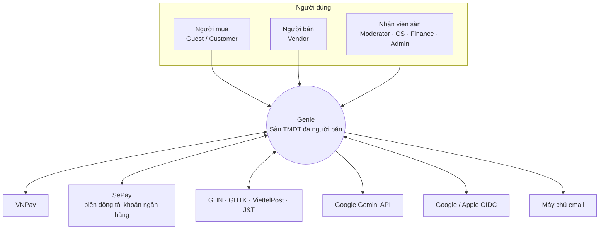
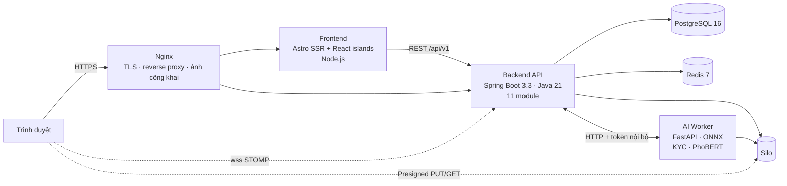
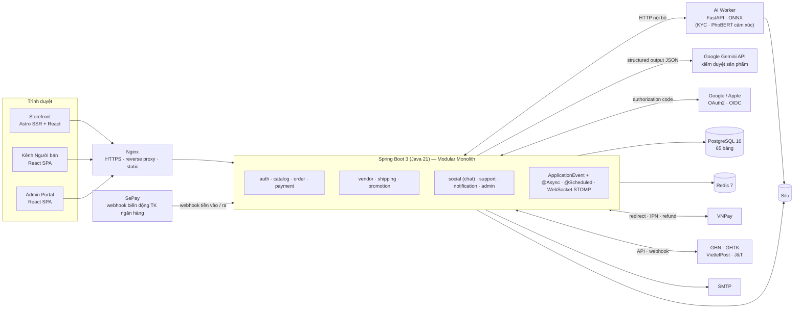
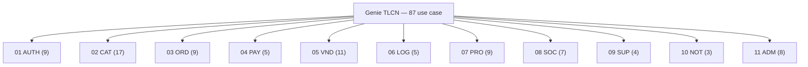
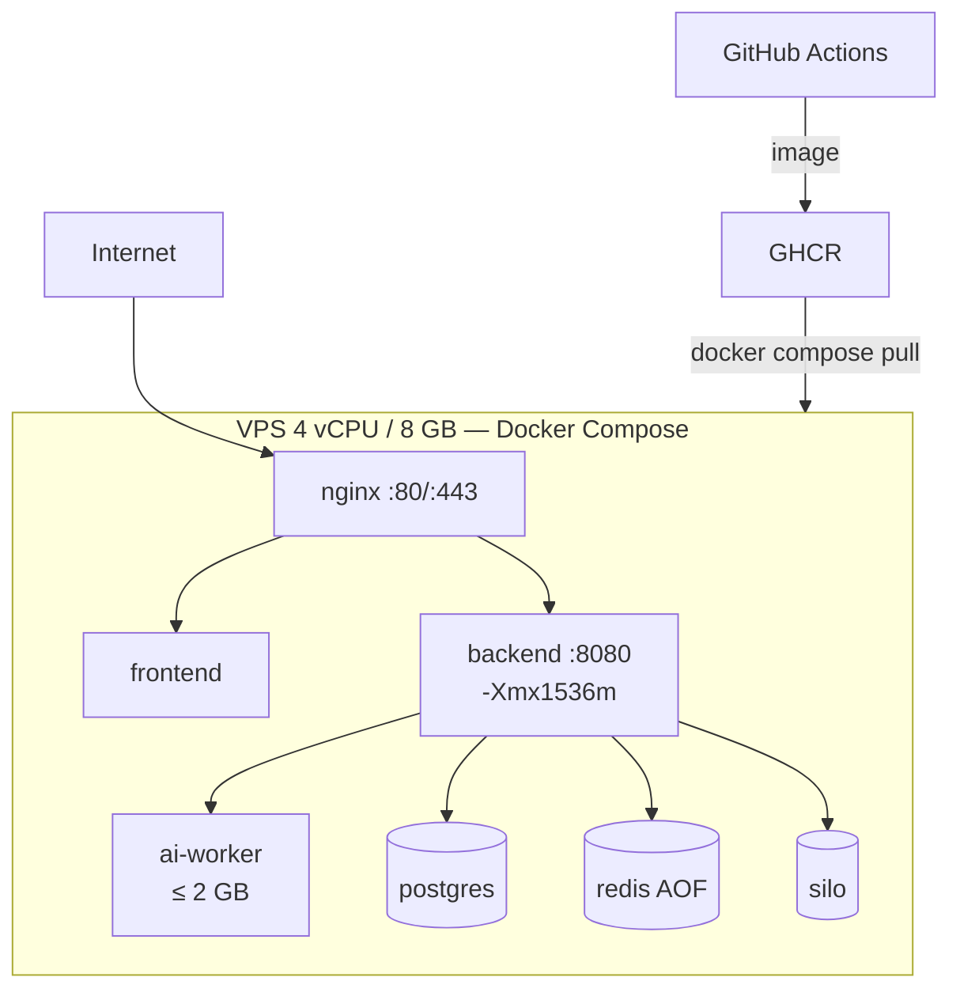

# HLD — THIẾT KẾ MỨC CAO (High-Level Design)

| Thuộc tính | Nội dung |
|---|---|
| Mã tài liệu | GENIE-TLCN-HLD |
| Dự án | Genie — Sàn thương mại điện tử đa người bán (bản TLCN — Tiểu luận chuyên ngành) |
| Phiên bản | 1.1 (đồng bộ bộ tài liệu TLCN v1.4 và mã nguồn 2026-11-16) |
| Ngày ban hành | 2026-11-06 |
| Nhóm tác giả | Mo Ha Mach Bu Ba Ka · Nguyen Quoc Khoa · Nguyen Ngoc Thien · Nghiem Phu Dang Quan |
| Trạng thái | Bản phát hành để rà soát |
| Mục đích | Mô tả kiến trúc tổng thể của Genie: ngữ cảnh, container, module, luồng nghiệp vụ trọng yếu, tích hợp, dữ liệu, bảo mật, triển khai và các quyết định kiến trúc. |
| Người đọc | Nhóm phát triển, giảng viên hướng dẫn, hội đồng đánh giá |
| Tài liệu liên quan | SRS.md, LLD.md, TECH_STACK_VA_QUY_UOC.md, LUU_TRU_DU_LIEU.md, ENTITY.md, Usecase.md |

> Các tham chiếu trong tài liệu ghi theo **tên tệp và mục** (ví dụ "Usecase.md, Phần III, UC-ORD-07"), không dùng liên kết, để tài liệu dùng được khi tách khỏi thư mục gốc.

### Lịch sử phiên bản

| Phiên bản | Ngày | Nội dung |
|---|---|---|
| 1.0 | 2026-11-06 | Phát hành lần đầu, tổng hợp từ bộ tài liệu TLCN v1.2 (87 use case, 11 phân hệ, 16 tác nhân, 64 bảng) |
| 1.1 | 2026-11-16 | Đồng bộ với mã nguồn `genie-multivendor-platform` (TLCN v1.4): kho tệp MinIO → **Silo** (ADR-15 / ADR 0009 trong repo); AUTH chỉnh theo phần đã hiện thực (đăng ký giữ tạm Redis 15 phút, `GNE-AUTH-4012`, `GNE-AUTH-4098`, khóa tạm không đổi `status`, refresh giữ `family_id` + ân hạn 10 giây, xóa tài khoản giữ phiên hiện tại, cron 02:30); `V14__auth_additions.sql` thay cho `V14__api_sync_v13.sql`; đổi tên UC-AUTH-03 / 06 / 11 theo giao diện; thêm mã lỗi `GNE-SYS-4040/4050/5000` |
## Mục lục

1. Mục tiêu & nguyên tắc thiết kế
2. Ràng buộc kiến trúc
3. Bối cảnh hệ thống (C4 mức 1)
4. Kiến trúc container (C4 mức 2)
5. Kiến trúc ứng dụng
6. Phân rã chức năng & module
7. Luồng nghiệp vụ trọng yếu
8. Giao tiếp & luồng dữ liệu
9. Kiến trúc dữ liệu
10. Kiến trúc bảo mật
11. Triển khai & hạ tầng
12. Vận hành, CI/CD & giám sát
13. Điểm nhấn kỹ thuật
14. Ngăn xếp công nghệ
15. Quyết định kiến trúc (ADR)
16. Lộ trình mở rộng

## 1. Mục tiêu & nguyên tắc thiết kế

| Thuộc tính chất lượng | Mục tiêu | Cách đạt |
|---|---|---|
| Toàn vẹn tiền | Không lệch tiền, không chi trùng | Giao dịch ACID trong một tiến trình, sổ cái kép chỉ ghi thêm, idempotency, `balanceHash` |
| Toàn vẹn tồn kho | Không bán vượt | Giữ chỗ bằng `UPDATE` có điều kiện + khóa lạc quan |
| Hiệu năng | Đọc P95 < 300 ms, ghi P95 < 500 ms với 50 CCU; LCP < 1,5 s | Index đúng đường nóng, cache Redis, SSR storefront |
| Bảo mật | Không lộ dữ liệu cá nhân, đúng quyền | JWT + refresh xoay vòng, RBAC 13 mã quyền, mã hóa ảnh CCCD, bucket riêng tư |
| Bảo trì | Thêm tính năng không phá phần khác | Modular monolith, Clean Architecture theo tính năng, ArchUnit, adapter cho dịch vụ ngoài |
| Chi phí | ≤ 1,5 triệu / tháng khi demo | Một VPS, tự host AI, không broker / search engine riêng |
| Mở rộng | Lên DATN chỉ thêm, không đổi tên | Tên bảng / enum / mã UC trùng DATN; module tách được |

## 2. Ràng buộc kiến trúc
- Nhóm 4 người, 16 tuần; một VPS 4 vCPU / 8 GB; quy mô ~50 CCU.
- Không giữ ví tiền người mua; OTP chỉ qua email; dữ liệu sinh trắc chỉ xử lý khi có đồng ý riêng.
- Dịch vụ ngoài có thể lỗi bất kỳ lúc nào — mọi tích hợp phải có timeout, thử lại và phương án dự phòng.

## 3. Bối cảnh hệ thống (C4 mức 1)

## 4. Kiến trúc container (C4 mức 2)

| Container | Công nghệ | Trách nhiệm |
|---|---|---|
| Nginx | Nginx 1.27 | Kết thúc TLS, định tuyến `/` → frontend, `/api` + `/ws` → backend, phục vụ ảnh công khai |
| Frontend | Astro + React 19 + Tailwind | Storefront SSR (SEO, Open Graph), Seller Center và Admin Portal dạng SPA |
| Backend API | Spring Boot 3.3 | Toàn bộ nghiệp vụ 11 phân hệ, REST, WebSocket, Cron, tích hợp ngoài |
| AI Worker | Python 3.12, FastAPI, ONNX Runtime | KYC (QR, MRZ, khuôn mặt) và phân tích cảm xúc PhoBERT |
| PostgreSQL | 16 | Nguồn sự thật — 65 bảng, full-text search |
| Redis | 7 | OTP, rate limit, idempotency, cache, bộ đếm |
| Silo | S3-compatible | Ảnh, video, giấy tờ, hồ sơ KYC, mô hình ONNX |

## 5. Kiến trúc ứng dụng

**Vì sao modular monolith thay vì microservices:** nhóm 4 người, một học kỳ; một tiến trình Spring Boot giữ được **giao dịch ACID** cho luồng tiền (đặt hàng → giữ tồn → ký quỹ) mà không cần Saga / message broker; vẫn chia module rõ để sau này tách dịch vụ (bản đầy đủ). Quy tắc: module chỉ gọi nhau qua interface `*Service` công khai hoặc sự kiện; không truy cập repository của module khác.

### 5.1 Giao tiếp nội bộ & bất đồng bộ

| Nhu cầu | MVP dùng | Bản đầy đủ dùng |
|---|---|---|
| Sau khi đơn đổi trạng thái → gửi thông báo, email | `ApplicationEventPublisher` + `@TransactionalEventListener(AFTER_COMMIT)` + `@Async` | RabbitMQ + Transactional Outbox |
| Gửi KYC sang AI Worker | HTTP `@Async` + callback `PATCH /internal/kyc/{id}/result` (token nội bộ) | RabbitMQ queue `vendor.kyc` |
| Phân tích cảm xúc đánh giá (PhoBERT) | `@TransactionalEventListener(AFTER_COMMIT)` + `@Async` gọi AI Worker `POST /sentiment`, callback `PATCH /internal/reviews/{id}/sentiment` | RabbitMQ `review.created` |
| Việc định kỳ | `@Scheduled` + `SELECT … FOR UPDATE SKIP LOCKED` (chạy an toàn nếu sau này nhiều instance) | Quartz cluster / Kafka |
| Chat, thông báo realtime | Spring WebSocket STOMP, simple broker trong bộ nhớ | STOMP + broker relay RabbitMQ |
| Tìm kiếm | PostgreSQL full-text + bảng `search_keyword_stats` cho gợi ý / xu hướng | Elasticsearch + Qdrant |
| Kiểm duyệt sản phẩm | `@TransactionalEventListener(AFTER_COMMIT)` + `@Async` gọi Gemini API | AI Worker + RabbitMQ |
| Lượt xem / bấm banner | Bộ đếm Redis `INCR`, `@Scheduled` 5 phút ghi gộp vào `product_view_stats` / `home_banners` | Kafka clickstream |

### 5.2 Chiến lược hiệu năng mức MVP
- Cache Redis cho: cây danh mục (TTL 1 giờ), số liệu sản phẩm `product:stats:{id}`, số liệu shop, phí ship (10 phút).
- Phân trang offset cho danh sách nhỏ, keyset (cursor) cho đơn hàng và tin nhắn.
- Ảnh: client nén WebP trước khi tải, Nginx phục vụ ảnh công khai qua Silo với `Cache-Control: max-age=7d`.
- Astro SSR + `stale-while-revalidate` 60 giây cho trang sản phẩm.

## 6. Phân rã chức năng & module

| Module (package) | Phân hệ | Trách nhiệm chính |
|---|---|---|
| `auth` | 01 AUTH | Đăng ký, đăng nhập, token, OAuth, mật khẩu, hồ sơ, địa chỉ, xóa tài khoản |
| `catalog` | 02 CAT | Danh mục, thuộc tính, thương hiệu, sản phẩm, tìm kiếm, kiểm duyệt Gemini, thống kê, yêu thích, đề xuất danh mục |
| `order` | 03 ORD | Giỏ hàng, checkout, đơn hàng, giữ chỗ tồn kho |
| `payment` | 04 PAY | VNPay, SePay, ký quỹ, sổ cái, ví shop |
| `vendor` | 05 VND | Gian hàng, KYC, cài đặt, phân tích bán hàng |
| `shipping` | 06 LOG | Adapter hãng vận chuyển, vận đơn, webhook, đối soát COD |
| `promotion` | 07 PRO | Voucher, xếp chồng, Flash Sale, Điểm, điểm danh |
| `social` | 08 SOC | Chat, đánh giá, theo dõi shop, phân tích cảm xúc |
| `support` | 09 SUP | Trả hàng, hoàn tiền, phân xử |
| `notification` | 10 NOT | Thông báo in-app, email, thông báo toàn sàn, hộp thư quản trị |
| `admin` | 11 ADM | Nhân viên, RBAC, rút tiền, dashboard, nhật ký, banner, người dùng |

Thiết kế chi tiết từng module (bảng sở hữu, facade, sự kiện): LLD.md, mục 3.

## 7. Luồng nghiệp vụ trọng yếu

### 7.1 Đăng ký & đăng nhập (UC-AUTH-01, UC-AUTH-02)
Đăng ký lưu dữ liệu tạm ở Redis `register:temp:{email}` (TTL 5 phút) cùng OTP; chỉ tạo `users` + `customer_profiles` khi OTP đúng — không để bản ghi rác. Đăng nhập trả access token (15 phút) trong body và refresh token trong cookie `HttpOnly; Secure; SameSite=Strict`; refresh token lưu băm SHA-256 ở `refresh_tokens`, mỗi lần làm mới cấp token mới và thu hồi token cũ.

### 7.2 Mở shop & KYC theo tầng (UC-VND-01…04)
`VendorProfile` tạo với `NOT_SUBMITTED` → nộp hồ sơ `PENDING` → AI Worker `AI_PROCESSING` → `VERIFIED` (riskScore < 30) / `MANUAL_REVIEW` (30–69 hoặc lấy mẫu 5%) / `REJECTED` (≥ 70). Tầng 0: giải mã QR mặt trước (< 100 ms), đọc MRZ mặt sau, đối chiếu số CCCD, ngày sinh, hạn thẻ. Tầng 1: YuNet + SFace so khớp chân dung với selfie (≥ 0,85) + liveness chủ động. Tầng 2: tiền chỉ rút về tài khoản ngân hàng đứng đúng tên trên CCCD (UC-VND-07).

### 7.3 Đăng bán sản phẩm (UC-CAT-09, UC-CAT-12, UC-CAT-13)
Client xin Presigned PUT URL (5 phút) cho từng ảnh, tải thẳng lên Silo, gửi danh sách khóa ảnh cùng dữ liệu SPU + SKU. Backend kiểm tra shop đã `VERIFIED` và `isPickupConfigured()`, kiểm tra thuộc tính bắt buộc của danh mục (`category_attributes`) và giấy tờ bắt buộc (`requiresBusinessLicense`), tạo `products` (`PENDING_APPROVAL`), `product_variants`, `product_images`, `product_documents` trong 1 transaction → sự kiện `ProductSubmitted` → Gemini chấm (mục 7.8) → `REJECTED` tự động hoặc hàng chờ Moderator → Moderator duyệt → `PUBLISHED`.

### 7.4 Checkout nhiều shop (UC-ORD-04, UC-ORD-07)
Nhóm dòng giỏ theo `vendorId` → phí ship GHN từng shop → áp voucher (shop cho từng đơn con, sàn cho cả phiên, phân bổ xuống `order_items.prorated_discount`) → 1 transaction: tạo `checkout_sessions`, N `orders` (`PENDING_PAYMENT`), `order_items` (snapshot), `order_discounts`, `stock_reservations` (ACTIVE, hết hạn 15 phút, `reserved_count += q` có điều kiện) → VNPay: tạo `payment_transactions` và URL thanh toán; COD: tạo ký quỹ `PENDING_FUNDING`, đơn chờ shop xác nhận.

### 7.5 IPN VNPay & ký quỹ (UC-PAY-03, UC-PAY-05)
Kiểm tra `vnp_SecureHash` (HMAC-SHA512) → tìm giao dịch theo `vnp_TxnRef` → đã `SUCCESS` thì trả `02` (idempotent) → số tiền khớp → 1 transaction: `PaymentTransaction.markSuccess()`, `StockReservation.confirm()` + `ProductVariant.commitSale()`, `Order.markPaid()`, `EscrowLedger.fund(ONLINE_GATEWAY)` → `HELD` → commit → sự kiện `OrderPaid` gửi thông báo shop.

### 7.6 COD kết hợp ký quỹ & đối soát (UC-PAY-05, UC-LOG-03)
Bưu tá GHN thu tiền khi giao (`DELIVERED`) → GHN chuyển tiền thu hộ về tài khoản sàn theo chu kỳ kèm bảng kê → Staff tải bảng kê → hệ thống khớp `trackingCode` + số tiền → `EscrowLedger.fund(COD_CASH)` → `HELD`, `Order.markPaid()`, ghi bút toán sổ cái. Ký quỹ COD chỉ giải ngân sau bước này — COD dùng **cùng** cơ chế Escrow 7 ngày với VNPay / VietQR, khác ở thời điểm tiền vào ký quỹ.

### 7.7 Giải ngân 7 ngày (UC-ORD-11, UC-ORD-12, UC-PAY-07)
Khách bấm "Đã nhận hàng" hoặc hết 7 ngày từ `delivered_at` không có khiếu nại, **và** ký quỹ đã `HELD` (VNPay / VietQR luôn `HELD`; COD sau khi đối soát GHN — nếu khách xác nhận trước khi đối soát thì đơn được hoàn tất ngay tại bước đối soát) → `Order.complete()` → `EscrowLedger.release()` trả `netAmount` → `VendorWallet.credit()` + `WalletTransaction(CREDIT_ESCROW_RELEASE)` + `system_logs(ESCROW_RELEASED)` trong 1 transaction.

### 7.8 Kiểm duyệt sản phẩm bằng Gemini (UC-CAT-12, UC-CAT-13)
Sau commit, listener `@Async` dựng yêu cầu (tên, mô tả đã bỏ HTML, danh mục, thương hiệu, giá, tối đa 4 ảnh, tên + loại giấy tờ chứng thực, chính sách cấm bán) và gọi `generateContent` với `responseMimeType = application/json` + `responseSchema` (`decision` APPROVE / REJECT / NEED_REVIEW, `riskScore` 0–100, `violations[]`, `reasoning`). Kết quả lưu `product_moderation_results` (`modelName`, phản hồi gốc). `REJECT` và `riskScore` ≥ 85 → `REJECTED` + thông báo lý do; `NEED_REVIEW` / `REJECT` dưới ngưỡng → `Product.flag()` vào hàng chờ ưu tiên cao; `APPROVE` → hàng chờ thường; Moderator duyệt cuối (UC-CAT-13) kèm ô "Phân tích từ AI". Gemini lỗi / quá 20 s / hết hạn mức: thử lại 3 lần (2 s, 8 s, 30 s) rồi `ProductModerationResult.fallback()` (`fallbackToManual = true`). Sửa tên / mô tả / ảnh của sản phẩm đã duyệt → chấm lại.

### 7.9 Xếp chồng voucher 3 tầng + Điểm (UC-PRO-04, UC-PRO-10)
Tầng 1 — mỗi shop tối đa 1 voucher Shop, đơn tối thiểu tính trên tạm tính hàng hợp lệ của shop, giảm trực tiếp tiền hàng của shop. Tầng 2 — 1 voucher Sàn trên tổng sau tầng 1, phân bổ về từng shop rồi từng dòng theo tỷ lệ giá trị. Tầng 3 — 1 mã Freeship trừ vào tổng phí ship, phân bổ theo phí ship từng shop, không vượt phí thực tế. Sau cùng — Điểm tối đa 50% tiền hàng còn lại (1 Điểm = 1₫). Ghi `order_discounts` từng tầng, `order_items` (`shopDiscount`, `platformDiscount`, `coinDiscount`, `proratedDiscount`). Điểm trừ trong cùng transaction tạo đơn (`UserCoin.spend()` có `version`), hoàn lại theo phần phân bổ khi đơn hủy / quá hạn / hoàn tiền; sàn chịu phần giảm Điểm (bút toán `COIN_COST`).

### 7.10 Mua Flash Sale chống bán vượt suất (UC-PRO-05, UC-PRO-06)
Cron mở (`activate()`) / đóng (`end()`) chiến dịch theo khung giờ. Khi tạo đơn: `UPDATE flash_sale_items SET reserved_count = reserved_count + :q WHERE id = :id AND flash_stock - sold_count - reserved_count >= :q` (0 dòng → `GNE-INV-4091`, khách mua giá thường); giá Flash Sale snapshot vào `order_items`; thanh toán thành công `recordSale()` chuyển suất giữ thành đã bán; phiên hết hạn `releaseReservation()`.

### 7.11 Phân tích cảm xúc đánh giá bằng PhoBERT (UC-AI-07)
Lưu đánh giá có chữ → sự kiện `ReviewCreatedEvent` sau commit → backend gọi AI Worker `POST /sentiment` → tiền xử lý tiếng Việt (chuẩn hóa, tách từ) → PhoBERT ONNX → nhãn `POSITIVE` / `NEUTRAL` / `NEGATIVE` + độ tin cậy → callback lưu `product_reviews.aspect_sentiment_json` → Phân tích bán hàng của shop (độ tin cậy ≥ 0,6) và ưu tiên hàng chờ kiểm duyệt (tiêu cực ≥ 0,85). Lỗi → để trống, Cron chạy lại; không tự ẩn đánh giá.

## 8. Giao tiếp & luồng dữ liệu

| Tích hợp | Chiều | Giao thức | Bảo mật | Idempotency |
|---|---|---|---|---|
| VNPay thanh toán | Backend → VNPay (redirect) | HTTPS query string | HMAC-SHA512 `vnp_SecureHash` | `vnp_TxnRef` = `payment_transactions.id` |
| VNPay IPN | VNPay → Backend | HTTPS GET | Kiểm tra chữ ký + IP whitelist | Trạng thái giao dịch đã xử lý |
| VNPay refund | Backend → VNPay | HTTPS POST JSON | HMAC-SHA512 | `vnp_RequestId` = `payment_refunds.id` |
| SePay webhook | SePay → Backend | HTTPS POST JSON | Header `Authorization: Apikey …`; chỉ nhận nội dung có tiền tố `TR` | `id` giao dịch SePay (UNIQUE) |
| VietQR | Client hiển thị | Ảnh QR `qr.sepay.vn/img?acc=…&bank=…&amount=…&des=TR{id}` | — | Mã `TR{id}` trong nội dung chuyển khoản |
| GHN phí / vận đơn | Backend → GHN | HTTPS REST | Header `Token`, `ShopId` | Mã đơn `orderCode` làm `client_order_code` |
| GHN webhook | GHN → Backend | HTTPS POST | Token bí mật trên URL + kiểm tra đơn tồn tại | `(trackingCode, status, time)` |
| GHTK / ViettelPost / J&T | Backend ↔ hãng | HTTPS REST + webhook | Token theo hãng (`CarrierAdapter`) | `client_order_code` = `orderCode` |
| Gemini API | Backend → Google | HTTPS POST `generateContent` | API key trong biến môi trường, không gửi dữ liệu cá nhân / nội dung giấy tờ | Mỗi lần gửi duyệt 1 dòng `product_moderation_results` |
| Google / Apple OAuth2 | Trình duyệt ↔ IdP ↔ Backend | Authorization Code + PKCE | Kiểm tra `state`, `nonce`, chữ ký `id_token` (JWKS) | `(provider, providerUserId)` UNIQUE |
| AI Worker | Backend ↔ AI Worker | HTTP nội bộ (mạng Docker) | Header `X-Internal-Token` | `vendorProfileId` + lần nộp |
| Silo | Client ↔ Silo | Presigned URL | Chữ ký S3 v4, hết hạn 5 phút | Khóa đối tượng UUID |
| Client ↔ Backend | | REST JSON + STOMP/WebSocket | JWT Bearer; WebSocket xác thực ở `CONNECT` | Header `Idempotency-Key` cho POST tạo đơn / rút tiền |

## 9. Kiến trúc dữ liệu

| Kho | Vai trò | Nguyên tắc |
|---|---|---|
| PostgreSQL 16 | Nguồn sự thật 65 bảng / 12 nhóm | ACID, snapshot giao dịch, sổ chỉ ghi thêm, khóa lạc quan, full-text `tsvector` |
| Redis 7 | Dữ liệu tạm có TTL | Không bao giờ là nguồn của tiền / tồn kho / Điểm; mất Redis chỉ chậm hơn |
| Silo | Tệp nhị phân | DB chỉ lưu object key; tải thẳng qua Presigned URL; bucket riêng tư cho KYC, giấy tờ, bằng chứng, chat |
| Trình duyệt | Trạng thái giao diện | Access token chỉ trong bộ nhớ; refresh token cookie HttpOnly; giỏ khách vãng lai localStorage |

Mô hình khái niệm 12 nhóm: SRS.md, mục 6. Danh mục khóa Redis, bucket Silo, khóa trình duyệt: LUU_TRU_DU_LIEU.md.

## 10. Kiến trúc bảo mật

| Lớp | Biện pháp |
|---|---|
| Truyền tải | HTTPS (Let's Encrypt) cho mọi domain; HSTS; WebSocket qua `wss://` |
| Xác thực | JWT HS256 (khóa ≥ 256 bit trong biến môi trường), refresh token xoay vòng, khóa đăng nhập sau 5 lần sai |
| Phân quyền | Tầng 1 — vai trò: `@PreAuthorize("hasRole('VENDOR')")`, RoleHierarchy `ADMIN > STAFF`, `VENDOR > CUSTOMER`. Tầng 2 — 13 mã quyền của nhân viên nạp từ `staff_permissions` vào authority khi đăng nhập: `@PreAuthorize("hasAuthority('REVIEW_KYC')")`; ADMIN có mọi quyền, `MANAGE_RBAC` không cấp được cho STAFF. Kiểm tra **quyền sở hữu** tài nguyên ở service (shop chỉ sửa sản phẩm của mình — chống IDOR) |
| Đăng nhập mạng xã hội | Authorization Code + PKCE; kiểm tra `state`, `nonce`, chữ ký `id_token`; nhận diện bằng `sub` (UNIQUE `uk_users_oauth` trên `oauth_provider`, `oauth_provider_id`); không liên kết khi IdP báo email chưa xác minh hoặc tài khoản đang bị khóa |
| Đầu vào | Bean Validation, giới hạn kích thước tệp (ảnh 5 MB, video 30 MB), kiểm tra MIME phía server |
| Dữ liệu nhạy cảm | Ảnh CCCD mã hóa AES-256-GCM (khóa trong biến môi trường, không trong CSDL); số CCCD / STK che khi hiển thị (`0792******34`); bucket `kyc-dossiers` không công khai |
| Tích hợp | Xác minh chữ ký VNPay; API Key cho webhook SePay; token bí mật cho webhook 3PL; token nội bộ cho AI Worker; API key Gemini chỉ ở backend, prompt không chứa dữ liệu cá nhân; không mở cổng PostgreSQL / Redis / Silo ra Internet |
| Bí mật | `.env` không commit; GitHub Actions Secrets khi triển khai |
| Kiểm toán | `system_logs` cho thao tác nhạy cảm (NFR-08) |

Ma trận quyền mặc định theo chức danh: LLD.md, mục 11.

## 11. Triển khai & hạ tầng

| Môi trường | Cấu hình | Thành phần |
|---|---|---|
| **Local** (mỗi thành viên) | Docker Desktop | `postgres`, `redis`, `silo` (+ `silo-init`), `mailpit` bằng Compose; backend / frontend chạy từ IDE |
| **Staging / Demo** | 1 VPS 4 vCPU / 8 GB RAM / 80 GB SSD (≈ 1,4 triệu đồng / tháng theo đơn giá của `BAO_CAO_DU_TOAN_CHI_PHI_VA_GIAI_PHAP_AI_v1.0.md`; giai đoạn phát triển có thể chạy 0 đồng bằng laptop + Cloudflare Tunnel) | Toàn bộ Compose: `nginx`, `backend`, `ai-worker`, `frontend`, `postgres`, `redis`, `silo`, `uptime-kuma` |

Tệp Compose: LLD.md, mục 14; CI/CD: mục 12 bên dưới.

Chỉ Nginx mở cổng 80 / 443; PostgreSQL, Redis, Silo, AI Worker chỉ trong mạng nội bộ Compose. Tệp Compose: LLD.md, mục 14.

## 12. Vận hành, CI/CD & giám sát

| Bước | Kích hoạt | Nội dung |
|---|---|---|
| CI | Pull request vào `develop` / `main` | Build Maven + chạy unit / integration test (Testcontainers), `npm run build` frontend, lint, SonarCloud |
| Build image | Merge `main` hoặc tag `v*` | Build 3 image (`backend`, `frontend`, `ai-worker`), gắn tag = git tag / SHA ngắn, đẩy GHCR |
| Deploy | Tag `v*` (thủ công phê duyệt) | SSH vào VPS: `docker compose pull && docker compose up -d`; Flyway chạy migration khi backend khởi động |
| Rollback | Thủ công | Đặt `TAG` về phiên bản trước và `up -d`; migration chỉ tiến (viết migration sửa lỗi thay vì lùi) |

- **Spring Boot Actuator** `/actuator/health` (kèm DB, Redis, Silo), `/actuator/metrics`; chỉ mở cho mạng nội bộ.
- **Uptime Kuma** kiểm tra storefront, API health, VNPay IPN endpoint mỗi 1 phút, gửi email khi lỗi.
- **Log** JSON (Logback + `logstash-logback-encoder`) có `traceId` (Micrometer Tracing), xoay vòng file 7 ngày; xem bằng `docker compose logs`.
- Prometheus / Grafana / Loki để DATN (cấu hình mẫu ở `Document_Vi.md` mục 4.6).

## 13. Điểm nhấn kỹ thuật

| Điểm nhấn | Vấn đề giải quyết | Kỹ thuật |
|---|---|---|
| **Tách đơn đa shop + ký quỹ** | Một lần trả tiền cho nhiều shop, mỗi shop giao và nhận tiền riêng; bảo vệ người mua 7 ngày | `CheckoutSession` 1–N `Order`, `EscrowLedger` theo đơn con, hoa hồng theo dòng hàng, idempotent IPN |
| **Chống bán vượt tồn kho** | Nhiều người cùng đặt SKU cuối | Giữ chỗ mềm 15 phút có điều kiện SQL + `@Version`, sweeper nhả chỗ, trừ tồn cứng chỉ khi đã thanh toán |
| **KYC tự động theo tầng** | Duyệt người bán nhanh mà vẫn an toàn | QR + MRZ (không cần OCR toàn ảnh), ONNX face match, điểm rủi ro, lấy mẫu hậu kiểm, rút tiền chỉ về tài khoản chính chủ |
| **Kiểm duyệt sản phẩm bằng LLM** | Duyệt hàng nghìn sản phẩm mà ít nhân viên | Gemini structured output JSON, ngưỡng `riskScore`, hàng chờ ưu tiên theo kết quả AI, Moderator duyệt cuối, lưu phản hồi gốc |
| **Phân tích cảm xúc PhoBERT tự host** | Shop và đội kiểm duyệt nắm được cảm xúc đánh giá | Mô hình nhóm tự fine-tune, ONNX trong AI Worker, bất đồng bộ, không gửi dữ liệu ra ngoài |

## 14. Ngăn xếp công nghệ

| Thành phần | Lựa chọn | Lý do chọn cho MVP | Thay thế đã cân nhắc |
|---|---|---|---|
| Backend | Spring Boot 3.3 / Java 21 | Nhóm đã học Java / Spring; hệ sinh thái Security, JPA, WebSocket, Scheduling đủ cho mọi phân hệ trong một tiến trình | Node.js NestJS |
| ORM & migration | Spring Data JPA + Hibernate 6, Flyway | Ánh xạ trực tiếp ENTITY.md; migration có phiên bản | MyBatis |
| CSDL | PostgreSQL 16 | ACID cho luồng tiền, JSONB, full-text + `unaccent` + `pg_trgm` thay được search engine ở quy mô nhỏ | MySQL 8 |
| Cache | Redis 7 | OTP có TTL, rate limit, cache | Caffeine (chỉ trong tiến trình) |
| Lưu trữ tệp | Silo | Tương thích S3, tự host miễn phí, Presigned URL | Cloudinary, AWS S3 |
| AI KYC | FastAPI + ONNX Runtime + OpenCV | Mô hình nhỏ (YuNet, SFace), chạy CPU ~1–2 s / hồ sơ | API eKYC VNPT / FPT (~8.000đ / hồ sơ) |
| AI cảm xúc đánh giá | PhoBERT (nhóm tự fine-tune 3 nhãn) xuất ONNX, chạy trong AI Worker + RDRSegmenter tách từ | Mô hình chuyên cho tiếng Việt, nhóm đã huấn luyện; tự host nên không tốn phí theo lượt, nội dung đánh giá không rời hệ thống | Gemini API (tốn hạn mức, gửi dữ liệu ra ngoài), từ điển cảm xúc (kém với văn nói) |
| Kiểm duyệt sản phẩm | Google Gemini API (bản Flash) | Hiểu cả chữ lẫn ảnh, structured output JSON, có hạn mức miễn phí đủ cho demo | Tự huấn luyện mô hình phân loại (thiếu dữ liệu), duyệt tay 100% |
| Đa ngôn ngữ | i18n JSON phía frontend (vi / en) | Không cần thư viện server; Astro tạo trang theo `lang` | Spring `MessageSource` |
| Frontend | Astro + React + Tailwind | SSR cho SEO storefront, React cho trang quản trị | Next.js |
| Triển khai | Docker Compose + Nginx | 1 VPS, một lệnh `docker compose up -d` | Kubernetes (quá mức cho MVP) |
| CI | GitHub Actions | Miễn phí cho repo nhóm | GitLab CI |

## 15. Quyết định kiến trúc (ADR)

| Mã | Quyết định | Bối cảnh | Hệ quả |
|---|---|---|---|
| ADR-01 | **Modular monolith Spring Boot** thay microservices | Nhóm 4 người, 1 học kỳ, cần ACID cho luồng tiền | Triển khai đơn giản; module rõ ranh giới để tách sau |
| ADR-02 | **PostgreSQL full-text** thay Elasticsearch | Vài nghìn sản phẩm; tiết kiệm ~2 GB RAM và một hệ thống phải vận hành | Không có gợi ý ngữ nghĩa; đủ cho tìm theo từ khóa |
| ADR-03 | **Sự kiện nội bộ Spring** thay RabbitMQ / Kafka | Một tiến trình; khối lượng sự kiện nhỏ | Sự kiện mất nếu tiến trình chết giữa chừng → chỉ dùng cho việc không ảnh hưởng tiền (thông báo, email); việc liên quan tiền làm trong transaction |
| ADR-04 | **Không làm ví khách hàng** | Giữ tiền người mua cần giấy phép NHNN (vốn tối thiểu 50 tỷ theo NĐ 52/2024) | Hoàn tiền về VNPay / chuyển khoản; ví chỉ cho shop (tiền sàn nợ shop, không phải ví điện tử) |
| ADR-05 | **3PL qua adapter chung** (GHN mặc định + GHTK / ViettelPost / J&T), không đội xe riêng | Genie Express là cả một hệ thống (tài xế, PWA, định tuyến); giao diện cho shop bật nhiều hãng | Mỗi hãng một `CarrierAdapter`; `ShipmentTracking.carrierType`; Genie Express để DATN |
| ADR-06 | **KYC tự host theo tầng** (QR + MRZ + ONNX) | Là điểm nhấn kỹ thuật của đồ án; mô hình nhỏ chạy CPU; API eKYC trả phí theo hồ sơ | Không đọc chip NFC; rủi ro thẻ giả khống chế bằng rút tiền chính chủ |
| ADR-07 | **Giữ nguyên tên / mã của bản đầy đủ** | Sau đồ án sẽ phát triển tiếp | Dãy mã UC có khoảng trống; migration chỉ thêm |
| ADR-08 | **Docker Compose 1 VPS** thay Kubernetes | Quy mô demo | Không tự co giãn; đủ cho ~50 CCU |
| ADR-09 | **SePay cho phía ngân hàng** (chuyển khoản VietQR + xác nhận tiền vào / ra) | Chuyển khoản không mất phí % như cổng thẻ; cần tự động hóa đối soát COD, rút tiền, hoàn tiền khi không có API chi hộ | Lệnh chi vẫn làm tay qua internet banking; phụ thuộc nội dung chuyển khoản đúng mã (có luồng xác nhận tay) |
| ADR-10 | **OTP chỉ qua email** | SMS / ZNS tốn ~300–700đ/tin, cần đăng ký brandname | Không đăng ký bằng số điện thoại; cấu hình SPF / DKIM / DMARC để email không vào thư rác |
| ADR-11 | **Gemini API cho kiểm duyệt sản phẩm** (KYC vẫn ở AI Worker) | Kiểm duyệt cần hiểu ngữ cảnh chữ + ảnh; không có dữ liệu để tự huấn luyện | Phụ thuộc dịch vụ ngoài → luôn có người duyệt cuối cho ca nghi ngờ / lỗi; DATN chuyển sang AI Worker tự host |
| ADR-12 | **RBAC 2 tầng, 3 chức danh, không có Super Admin** | Giao diện Admin có nhiều mục cần chia việc; nhóm nhỏ không cần cấp quản trị trên Admin | Chức danh chỉ là mẫu quyền; DATN mở rộng thêm 7 chức danh cùng cơ chế |
| ADR-14 | **PhoBERT tự host cho phân tích cảm xúc đánh giá** | Nhóm đã fine-tune mô hình PhoBERT 3 nhãn cho tiếng Việt; gọi LLM / API ngoài tốn hạn mức và đưa nội dung đánh giá ra ngoài | Chạy trong AI Worker có sẵn (ONNX, CPU); kết quả chỉ tham khảo, không tự ẩn đánh giá; DATN mở rộng sang theo khía cạnh trên cùng cột |
| ADR-13 | **COD kết hợp Escrow** | Người mua Việt Nam chuộng COD; cần cùng một bảo đảm 7 ngày cho mọi phương thức | Ký quỹ COD `PENDING_FUNDING` tới khi đối soát; giải ngân chậm hơn VNPay vài ngày |
| ADR-15 | **Silo thay MinIO làm kho tệp S3** (2026-11-15, ADR 0009 trong repo) | MinIO Inc. ngừng phát hành bản cộng đồng: repo `minio/minio` lưu trữ 04/2026, image Docker Hub bị gỡ 09/2026, không còn bản vá → máy mới / CI / VPS không kéo được image, test tích hợp đỏ | Dùng `pgsty/silo:RELEASE.2026-10-26T00-00-00Z` (fork cộng đồng của MinIO do Pigsty duy trì, AGPL-3.0, cùng API S3 / admin); code chỉ đổi tên `MinioObjectStorage` → `SiloObjectStorage`, vẫn dùng SDK `io.minio`; giữ biến `MINIO_*`, mã `GNE-MINIO-5003`. Phụ thuộc bên thứ ba (Pigsty) — nếu Silo ngừng, nhờ cổng `ObjectStorage` chỉ cần đổi image + `init.sh` (RustFS / Garage) |

## 16. Lộ trình mở rộng

| Giai đoạn | Nội dung | Tài liệu tham chiếu (DATN) |
|---|---|---|
| 1 | Ví khách hàng (khi có đối tác ví được cấp phép), MoMo / ZaloPay / BNPL, voucher tầng 4 | `implement.md` Phần 3, 5 |
| 2 | Gamification đầy đủ (hạng thành viên, nhiệm vụ, vòng quay), đa kho, tài khoản phụ shop, MFA | Phần 2, 3.1, 10.11–10.12 |
| 3 | Genie Express & Shipper PWA | Phần 4 |
| 4 | Elasticsearch + gợi ý vector cá nhân hóa, trợ lý AI; kiểm duyệt sản phẩm chuyển từ Gemini sang AI Worker tự host | Phần 7, 8, 30 |
| 5 | Message broker, Kubernetes, quan sát đầy đủ khi lưu lượng thật vượt ~1.000 CCU | Phần 17, 22, 23, 28 |

Theo dõi tiến độ: `Quản Lý UseCase.xlsx` của DATN — cột *Hiện trạng mã nguồn* đánh “Đã triển khai” (dòng chuyển xám) cho các use case đã có ở TLCN.
