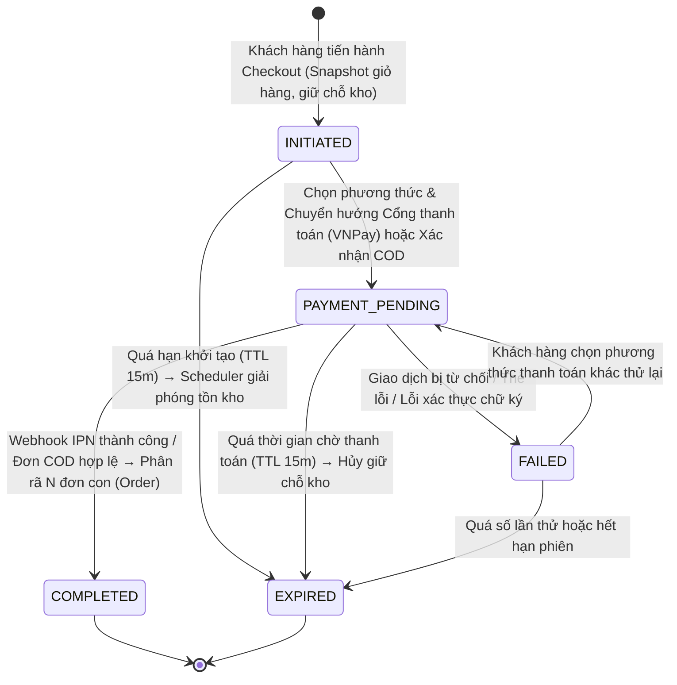
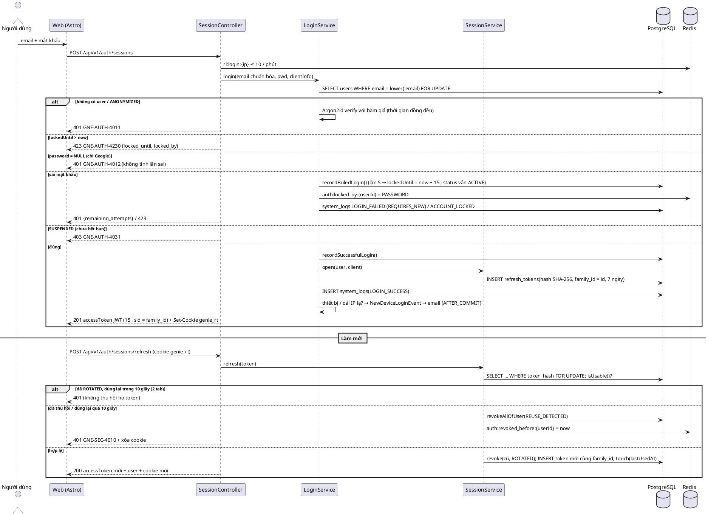
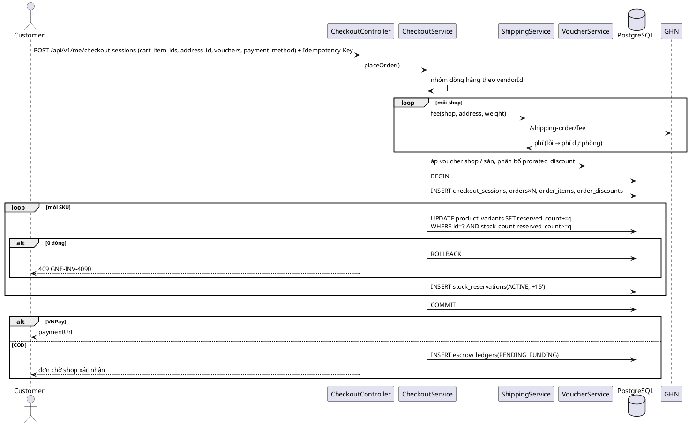
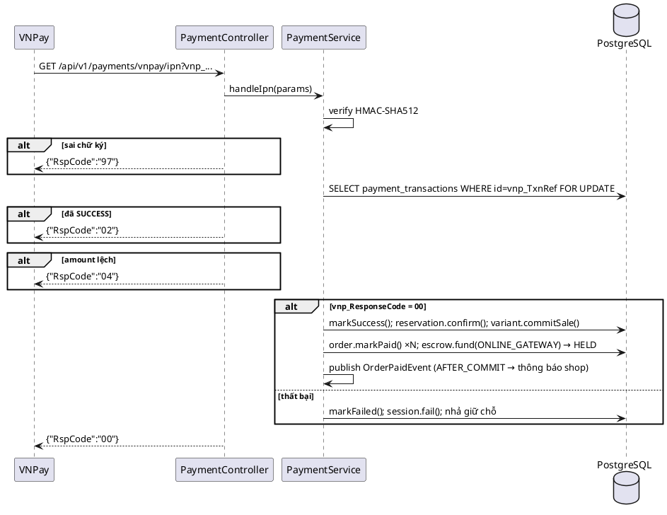
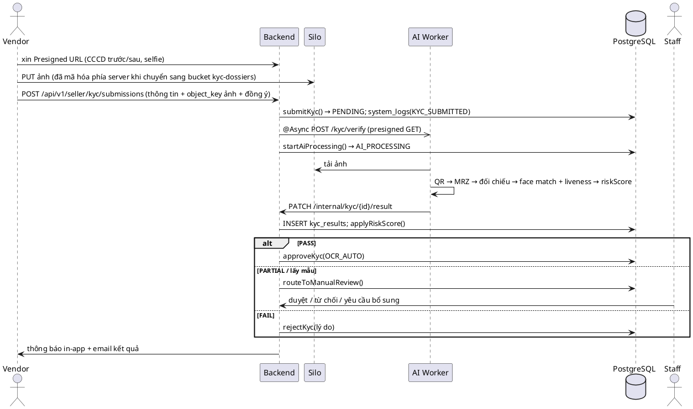
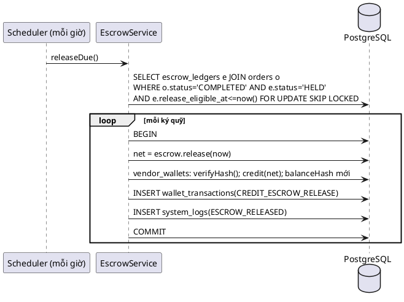
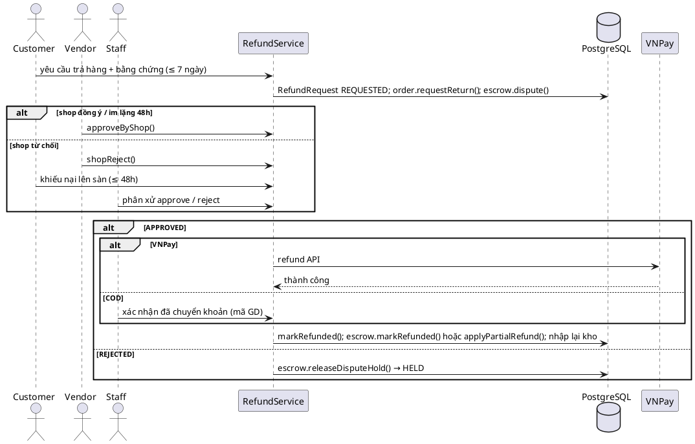
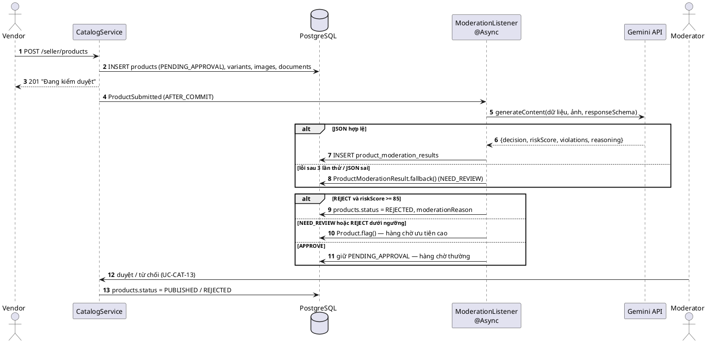
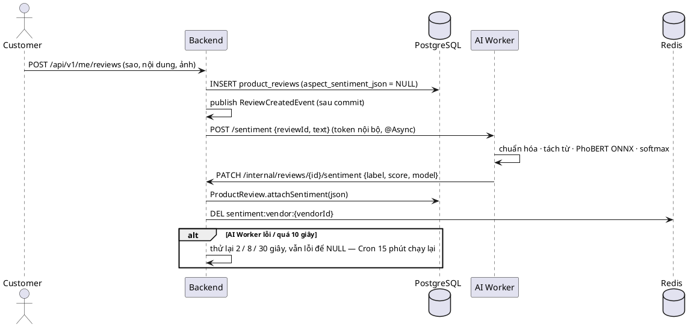

# LLD — THIẾT KẾ MỨC CHI TIẾT (Low-Level Design)

| Thuộc tính | Nội dung |
|---|---|
| Mã tài liệu | GENIE-TLCN-LLD |
| Dự án | Genie — Sàn thương mại điện tử đa người bán (bản TLCN — Tiểu luận chuyên ngành) |
| Phiên bản | 1.2 (đồng bộ bộ tài liệu TLCN v1.4 và mã nguồn 2026-11-16) |
| Ngày ban hành | 2026-11-06 |
| Nhóm tác giả | Mo Ha Mach Bu Ba Ka · Nguyen Quoc Khoa · Nguyen Ngoc Thien · Nghiem Phu Dang Quan |
| Trạng thái | Bản phát hành để rà soát |
| Mục đích | Thiết kế chi tiết để lập trình: cấu trúc mã nguồn, module, cơ sở dữ liệu vật lý, máy trạng thái, sơ đồ tuần tự, API, thuật toán, tác vụ định kỳ, bảo mật, xử lý lỗi và cấu hình triển khai. |
| Người đọc | Lập trình viên backend / frontend / AI, kiểm thử viên |
| Tài liệu liên quan | HLD.md, SRS.md, ENTITY.md (định nghĩa 65 entity), GIAI_NGHIA_ENTITY.md, Usecase.md, TECH_STACK_VA_QUY_UOC.md, LUU_TRU_DU_LIEU.md |

> Các tham chiếu trong tài liệu ghi theo **tên tệp và mục** (ví dụ "Usecase.md, Phần III, UC-ORD-07"), không dùng liên kết, để tài liệu dùng được khi tách khỏi thư mục gốc.

### Lịch sử phiên bản

| Phiên bản | Ngày | Nội dung |
|---|---|---|
| 1.1 | 2026-11-08 | Đồng bộ `API_SPEC.md`: danh mục API mục 8.5 viết lại theo tài nguyên REST, đường dẫn trong sơ đồ tuần tự, upload không cần bước confirm, 65 mã lỗi mới, bảng `cod_remittances` (65 bảng) và 9 cột mới (TLCN v1.3) |
| 1.0 | 2026-11-06 | Phát hành lần đầu, tổng hợp từ bộ tài liệu TLCN v1.2 (87 use case, 11 phân hệ, 16 tác nhân, 64 bảng) |
| 1.2 | 2026-11-16 | Đồng bộ với mã nguồn `genie-multivendor-platform` (TLCN v1.4): kho tệp MinIO → **Silo** (ADR-15 / ADR 0009 trong repo); AUTH chỉnh theo phần đã hiện thực (đăng ký giữ tạm Redis 15 phút, `GNE-AUTH-4012`, `GNE-AUTH-4098`, khóa tạm không đổi `status`, refresh giữ `family_id` + ân hạn 10 giây, xóa tài khoản giữ phiên hiện tại, cron 02:30); `V14__auth_additions.sql` thay cho `V14__api_sync_v13.sql`; đổi tên UC-AUTH-03 / 06 / 11 theo giao diện; thêm mã lỗi `GNE-SYS-4040/4050/5000` |
## Mục lục

1. Phạm vi
2. Cấu trúc mã nguồn
3. Thiết kế module
4. Sơ đồ lớp & quy ước entity
5. Cơ sở dữ liệu vật lý
6. Máy trạng thái
7. Sơ đồ tuần tự
8. Thiết kế API
9. Thuật toán & quy tắc tính
10. Tác vụ định kỳ (Cron)
11. Bảo mật chi tiết
12. Xử lý lỗi & phục hồi
13. Lưu trữ tạm & tệp
14. Cấu hình triển khai

## 1. Phạm vi
LLD mô tả **cách hiện thực** các yêu cầu trong SRS.md theo kiến trúc ở HLD.md. Định nghĩa đầy đủ từng trường, kiểu, ràng buộc và phương thức nghiệp vụ của 65 entity nằm ở ENTITY.md; tài liệu này không chép lại mà nêu các quyết định thiết kế cần để lập trình.

## 2. Cấu trúc mã nguồn

Một monorepo `genie-platform`: `server-spring/`, `server-python/`, `web/`, `deploy/`, `docs/`, `scripts/`, `.github/`. Backend tổ chức `com.genie.<module>.<feature>.<layer>` với 4 tầng Clean Architecture và gói `event/`:

| Tầng | Chứa | Phụ thuộc được phép |
|---|---|---|
| `api` | Controller, DTO `record` request / response, mapper | `application` |
| `application` | Service (use case), `*Facade` công khai, listener sự kiện, port ra ngoài | `domain`, `common` |
| `domain` | `@Entity` (rich domain model), enum, value object, Spring Data repository | `common` |
| `event` | Sự kiện công khai `record` (chỉ ID và giá trị) | `common` |
| `infra` | Adapter cài đặt port: VNPay, SePay, 3PL, Gemini, Silo, AI Worker | `domain`, `application` |

Luật: module khác chỉ gọi `*Facade` và nghe `event/`; `domain` không phụ thuộc tầng khác; không vòng phụ thuộc — kiểm bằng ArchUnit trong CI. Cây thư mục đầy đủ (backend, frontend, AI Worker): TECH_STACK_VA_QUY_UOC.md, mục 2, 4, 5, 6.

## 3. Thiết kế module

| Module | Feature | Bảng sở hữu | Facade công khai | Sự kiện phát | Port ra ngoài |
|---|---|---|---|---|---|
| `auth` | register, login, token, oauth, password, profile, address, deletion | users, customer_profiles, addresses, refresh_tokens | `UserFacade`, `AddressFacade` | `UserRegisteredEvent`, `AccountLockedEvent`, `AccountDeletionRequestedEvent` | `IdentityProviderVerifier`, `MailSender` |
| `catalog` | category, attribute, brand, product, search, moderation, stats, wishlist, proposal | categories, category_attributes, brands, products, product_variants, product_images, product_documents, category_proposals, product_moderation_results, search_keyword_stats, product_view_stats, user_wishlists | `ProductFacade`, `InventoryFacade` (giữ / xác nhận / nhả tồn), `CategoryFacade` | `ProductSubmittedEvent`, `ProductModeratedEvent` | `ProductModerationClient` (Gemini) |
| `order` | cart, checkout, order, reservation | carts, cart_items, checkout_sessions, orders, order_items, order_discounts, stock_reservations | `OrderFacade` | `CheckoutCreatedEvent`, `OrderPaidEvent`, `OrderStatusChangedEvent`, `OrderCompletedEvent`, `OrderCancelledEvent` | — |
| `payment` | vnpay, sepay, escrow, ledger, wallet | payment_transactions, payment_refunds, escrow_ledgers, vendor_wallets, wallet_transactions, financial_ledger, cod_remittances | `PaymentFacade`, `EscrowFacade`, `WalletFacade` | `PaymentSucceededEvent`, `PaymentFailedEvent`, `EscrowReleasedEvent`, `RefundProcessedEvent` | `PaymentGateway`, `BankTransferWatcher` |
| `vendor` | shop, kyc, settings, analytics | vendor_profiles, kyc_results | `VendorFacade` | `KycSubmittedEvent`, `KycDecidedEvent` | `AiWorkerClient` (KYC) |
| `shipping` | carrier, shipment, webhook, cod | shipment_trackings, shipment_events, vendor_shipping_config | `ShippingFacade` | `ShipmentStatusChangedEvent`, `CodRemittedEvent` | `CarrierAdapter` (GHN, GHTK, VTP, J&T, Genie Express) |
| `promotion` | voucher, stacking, flashsale, coin | vouchers, voucher_categories, voucher_products, voucher_excluded_categories, voucher_excluded_products, voucher_usages, user_vouchers, flash_sale_campaigns, flash_sale_items, user_coins, coin_transactions, daily_checkins | `VoucherFacade`, `CoinFacade`, `FlashSaleFacade` | `FlashSaleStartedEvent` | — |
| `social` | chat, review, follow, sentiment | conversations, messages, product_reviews, review_helpful_votes, review_reports, shop_follows | `ReviewFacade`, `ChatFacade` | `ReviewCreatedEvent`, `ReviewHiddenEvent` | `AiWorkerClient` (cảm xúc) |
| `support` | refund, dispute | refund_requests, refund_request_items, refund_evidences | `RefundFacade` | `RefundRequestedEvent`, `RefundResolvedEvent` | — |
| `notification` | inbox, email, platform, admin | notifications, platform_notifications, user_platform_notification_reads, admin_notifications | `NotificationFacade` | — | `MailSender`, WebSocket |
| `admin` | staff, rbac, payout, dashboard, banner, users | admin_profiles, staff_permissions, withdrawal_requests, home_banners | `PermissionFacade` | `PayoutCompletedEvent`, `PermissionsChangedEvent` | — |
| `common` | audit, storage, security, idempotency | system_logs | `AuditLogger`, `ObjectStorage` | — | Silo |

Tổng 65 bảng. Khóa ngoại sang bảng của module khác lưu dạng ID (`Long vendorId`), không dùng quan hệ JPA điều hướng xuyên module.

**Bảng lắng nghe sự kiện chính**

| Sự kiện | Module nghe | Phản ứng (AFTER_COMMIT, bất đồng bộ) |
|---|---|---|
| `OrderPaidEvent` | notification | Báo shop có đơn mới, email xác nhận đơn |
| `PaymentSucceededEvent` | order | *(đồng bộ, trong transaction IPN)* chuyển đơn sang `PAID`, xác nhận giữ chỗ |
| `ShipmentStatusChangedEvent` | order, notification | Cập nhật trạng thái đơn, thông báo khách |
| `OrderCompletedEvent` | catalog | Cộng lượt bán, xóa cache `product:stats` |
| `ReviewCreatedEvent` | social.sentiment, catalog | Gọi AI Worker PhoBERT; tính lại điểm sản phẩm / shop |
| `ProductSubmittedEvent` | catalog.moderation | Gọi Gemini, đưa vào hàng chờ |
| `KycSubmittedEvent` | vendor.kyc | Gọi AI Worker KYC |
| `RefundResolvedEvent` | payment | *(đồng bộ)* hoàn tiền, đảo bút toán, hoàn Điểm |
| `PermissionsChangedEvent` | auth | Thu hồi refresh token của nhân viên |

Việc đụng tới tiền / tồn kho luôn chạy **đồng bộ trong transaction** của use case; listener bất đồng bộ chỉ dùng cho thông báo, AI, cache, thống kê.

## 4. Sơ đồ lớp & quy ước entity

| Sơ đồ | Tên | Entity | File Java |
|:---:|---|---|---|
| 1 | Định danh, Hồ sơ người dùng, KYC & Phân quyền nhân viên (Nhóm 1) | `User`, `CustomerProfile`, `Address`, `VendorProfile`, `AdminProfile`, `KycResult`, `RefreshToken`, `StaffPermission` | `Diagram01_IdentityAndRbac.java` |
| 2 | Danh mục, Thương hiệu, Sản phẩm, Biến thể SKU, Yêu thích & Giỏ hàng (Nhóm 2–3) | `Category`, `CategoryAttribute`, `Brand`, `Product`, `ProductVariant`, `ProductImage`, `UserWishlist`, `Cart`, `CartItem` | `Diagram02_CatalogAndCart.java` |
| 3 | Voucher 3 tầng Shop / Sàn / Freeship & Phạm vi áp dụng (Nhóm 4) | `Voucher`, `VoucherCategory`, `VoucherProduct`, `VoucherExcludedCategory`, `VoucherExcludedProduct`, `VoucherUsage`, `UserVoucher` | `Diagram03_VoucherPromotion.java` |
| 4 | Phiên thanh toán, Đơn hàng con theo shop & Giữ chỗ tồn kho (Nhóm 5) | `CheckoutSession`, `Order`, `OrderItem`, `OrderDiscount`, `StockReservation` | `Diagram04_OrderAndInventory.java` |
| 5 | Thanh toán VNPay / VietQR, Ký quỹ Escrow, Ví shop, Rút tiền & Sổ cái (Nhóm 6) | `PaymentTransaction`, `PaymentRefund`, `EscrowLedger`, `VendorWallet`, `WalletTransaction`, `WithdrawalRequest`, `FinancialLedger`, `CodRemittance` | `Diagram05_PaymentAndEscrow.java` |
| 6 | Vận đơn 3PL, Cấu hình vận chuyển của shop, Trả hàng & Hoàn tiền (Nhóm 7–8) | `ShipmentTracking`, `ShipmentEvent`, `VendorShippingConfig`, `RefundRequest`, `RefundRequestItem`, `RefundEvidence` | `Diagram06_ShippingAndRefund.java` |
| 7 | Đánh giá, Hữu ích, Báo cáo vi phạm, Theo dõi shop & Chat (Nhóm 9, 11) | `ProductReview`, `ReviewHelpfulVote`, `ReviewReport`, `ShopFollow`, `Conversation`, `Message` | `Diagram07_ReviewFollowAndChat.java` |
| 8 | Kiểm duyệt sản phẩm, Giấy tờ chứng thực, Đề xuất danh mục & Thống kê truy cập (Nhóm 2) | `ProductDocument`, `ProductModerationResult`, `CategoryProposal`, `SearchKeywordStat`, `ProductViewStat` | `Diagram08_ProductModerationAndInsights.java` |
| 9 | Flash Sale, Điểm Genie & Điểm danh (Nhóm 4) | `FlashSaleCampaign`, `FlashSaleItem`, `UserCoin`, `CoinTransaction`, `DailyCheckin` | `Diagram09_FlashSaleAndCoin.java` |
| 10 | Thông báo cá nhân, Thông báo sàn, Thông báo quản trị, Banner & Nhật ký hệ thống (Nhóm 10, 12) | `Notification`, `PlatformNotification`, `UserPlatformNotificationRead`, `HomeBanner`, `AdminNotification`, `SystemLog` | `Diagram10_NotificationBannerAndAudit.java` |

Mỗi sơ đồ có danh sách entity (PK / FK / UQ), enum, ngăn Operations và ma trận quan hệ ở ENTITY.md Phụ lục C; import vào Enterprise Architect bằng `Genie_ClassDiagram_UML25.xmi` hoặc *Code Import* thư mục `java-code/`.

Quy ước entity bắt buộc (Lombok, `@Builder.Default`, `@Version`, `@CreationTimestamp`, tiền `BigDecimal`, enum chuỗi, JSONB, xóa mềm, snapshot): ENTITY.md, phần "Quy ước chung toàn dự án" (12 quy ước).

## 5. Cơ sở dữ liệu vật lý

| # | Bảng | Entity | Nhóm | Số cột | Ghi chú |
|:---:|---|---|---|:---:|---|
| 1 | `users` | `User` | 1. Người dùng & định danh | 18 |  |
| 2 | `customer_profiles` | `CustomerProfile` | 1. Người dùng & định danh | 14 |  |
| 3 | `addresses` | `Address` | 1. Người dùng & định danh | 16 |  |
| 4 | `vendor_profiles` | `VendorProfile` | 1. Người dùng & định danh | 51 |  |
| 5 | `admin_profiles` | `AdminProfile` | 1. Người dùng & định danh | 9 |  |
| 6 | `kyc_results` | `KycResult` | 1. Người dùng & định danh | 29 | Kết quả AI theo tầng |
| 7 | `refresh_tokens` | `RefreshToken` | 1. Người dùng & định danh | 9 | Lưu băm SHA-256 |
| 8 | `staff_permissions` | `StaffPermission` | 1. Người dùng & định danh | 6 | 13 mã quyền, thu hồi bằng `revoked_at` |
| 9 | `categories` | `Category` | 2. Danh mục & sản phẩm | 10 |  |
| 10 | `products` | `Product` | 2. Danh mục & sản phẩm | 33 | `search_vector` (tsvector) cho tìm kiếm |
| 11 | `product_variants` | `ProductVariant` | 2. Danh mục & sản phẩm | 12 |  |
| 12 | `product_images` | `ProductImage` | 2. Danh mục & sản phẩm | 12 |  |
| 13 | `user_wishlists` | `UserWishlist` | 2. Danh mục & sản phẩm | 4 |  |
| 14 | `category_attributes` | `CategoryAttribute` | 2. Danh mục & sản phẩm | 15 |  |
| 15 | `brands` | `Brand` | 2. Danh mục & sản phẩm | 7 |  |
| 16 | `product_documents` | `ProductDocument` | 2. Danh mục & sản phẩm | 10 | Bucket riêng tư |
| 17 | `category_proposals` | `CategoryProposal` | 2. Danh mục & sản phẩm | 11 |  |
| 18 | `product_moderation_results` | `ProductModerationResult` | 2. Danh mục & sản phẩm | 11 | Kết quả Gemini + phản hồi gốc |
| 19 | `search_keyword_stats` | `SearchKeywordStat` | 2. Danh mục & sản phẩm | 6 | Gộp theo ngày |
| 20 | `product_view_stats` | `ProductViewStat` | 2. Danh mục & sản phẩm | 8 | Gộp theo ngày & nguồn |
| 21 | `carts` | `Cart` | 3. Giỏ hàng | 3 |  |
| 22 | `cart_items` | `CartItem` | 3. Giỏ hàng | 7 |  |
| 23 | `vouchers` | `Voucher` | 4. Khuyến mãi, voucher, flash sale & điểm | 23 |  |
| 24 | `voucher_usages` | `VoucherUsage` | 4. Khuyến mãi, voucher, flash sale & điểm | 7 |  |
| 25 | `user_vouchers` | `UserVoucher` | 4. Khuyến mãi, voucher, flash sale & điểm | 6 |  |
| 26 | `voucher_categories` | `VoucherCategory` | 4. Khuyến mãi, voucher, flash sale & điểm | 4 |  |
| 27 | `voucher_products` | `VoucherProduct` | 4. Khuyến mãi, voucher, flash sale & điểm | 4 |  |
| 28 | `voucher_excluded_categories` | `VoucherExcludedCategory` | 4. Khuyến mãi, voucher, flash sale & điểm | 4 |  |
| 29 | `voucher_excluded_products` | `VoucherExcludedProduct` | 4. Khuyến mãi, voucher, flash sale & điểm | 4 |  |
| 30 | `flash_sale_campaigns` | `FlashSaleCampaign` | 4. Khuyến mãi, voucher, flash sale & điểm | 8 |  |
| 31 | `flash_sale_items` | `FlashSaleItem` | 4. Khuyến mãi, voucher, flash sale & điểm | 9 | `sold_count + reserved_count <= flash_stock`, `@Version` |
| 32 | `user_coins` | `UserCoin` | 4. Khuyến mãi, voucher, flash sale & điểm | 5 | `@Version` |
| 33 | `coin_transactions` | `CoinTransaction` | 4. Khuyến mãi, voucher, flash sale & điểm | 8 | Chỉ ghi thêm, hạn 12 tháng |
| 34 | `daily_checkins` | `DailyCheckin` | 4. Khuyến mãi, voucher, flash sale & điểm | 4 | UNIQUE (user_id, checkin_date) |
| 35 | `checkout_sessions` | `CheckoutSession` | 5. Đơn hàng | 8 |  |
| 36 | `orders` | `Order` | 5. Đơn hàng | 31 | Đơn con theo shop, `@Version`, máy trạng thái 19 trạng thái |
| 37 | `order_items` | `OrderItem` | 5. Đơn hàng | 17 |  |
| 38 | `order_discounts` | `OrderDiscount` | 5. Đơn hàng | 7 |  |
| 39 | `stock_reservations` | `StockReservation` | 5. Đơn hàng | 9 | Giữ chỗ 15 phút |
| 40 | `payment_transactions` | `PaymentTransaction` | 6. Thanh toán & ký quỹ | 12 | UNIQUE `idempotency_key` |
| 41 | `payment_refunds` | `PaymentRefund` | 6. Thanh toán & ký quỹ | 6 |  |
| 42 | `escrow_ledgers` | `EscrowLedger` | 6. Thanh toán & ký quỹ | 18 | Ký quỹ 7 ngày, tách nguồn online (VNPay / VietQR qua SePay) / COD |
| 43 | `vendor_wallets` | `VendorWallet` | 6. Thanh toán & ký quỹ | 8 | `balanceHash` HMAC |
| 44 | `wallet_transactions` | `WalletTransaction` | 6. Thanh toán & ký quỹ | 10 | Chỉ ghi thêm |
| 45 | `withdrawal_requests` | `WithdrawalRequest` | 6. Thanh toán & ký quỹ | 12 |  |
| 46 | `financial_ledger` | `FinancialLedger` | 6. Thanh toán & ký quỹ | 10 |  |
| 47 | `shipment_trackings` | `ShipmentTracking` | 7. Vận chuyển | 10 |  |
| 48 | `shipment_events` | `ShipmentEvent` | 7. Vận chuyển | 7 |  |
| 49 | `vendor_shipping_config` | `VendorShippingConfig` | 7. Vận chuyển | 8 |  |
| 50 | `refund_requests` | `RefundRequest` | 8. Hoàn tiền / khiếu nại | 20 |  |
| 51 | `refund_request_items` | `RefundRequestItem` | 8. Hoàn tiền / khiếu nại | 5 |  |
| 52 | `refund_evidences` | `RefundEvidence` | 8. Hoàn tiền / khiếu nại | 7 |  |
| 53 | `product_reviews` | `ProductReview` | 9. Đánh giá & tương tác shop | 16 | `aspect_sentiment_json` (jsonb, UC-AI-07) |
| 54 | `shop_follows` | `ShopFollow` | 9. Đánh giá & tương tác shop | 4 | PK (user_id, vendor_id) |
| 55 | `review_reports` | `ReviewReport` | 9. Đánh giá & tương tác shop | 6 |  |
| 56 | `review_helpful_votes` | `ReviewHelpfulVote` | 9. Đánh giá & tương tác shop | 4 | PK (review_id, user_id) |
| 57 | `notifications` | `Notification` | 10. Thông báo & nội dung sàn | 16 |  |
| 58 | `platform_notifications` | `PlatformNotification` | 10. Thông báo & nội dung sàn | 12 |  |
| 59 | `user_platform_notification_reads` | `UserPlatformNotificationRead` | 10. Thông báo & nội dung sàn | 3 |  |
| 60 | `home_banners` | `HomeBanner` | 10. Thông báo & nội dung sàn | 17 |  |
| 61 | `admin_notifications` | `AdminNotification` | 10. Thông báo & nội dung sàn | 9 |  |
| 62 | `conversations` | `Conversation` | 11. Nhắn tin (chat) | 9 |  |
| 63 | `messages` | `Message` | 11. Nhắn tin (chat) | 10 |  |
| 64 | `system_logs` | `SystemLog` | 12. Nhật ký hệ thống | 11 | Không FK cứng — chụp email / role |
| 65 | `cod_remittances` | `CodRemittance` | 6. Thanh toán & ký quỹ | 12 | Phiên đối soát COD, UNIQUE `bank_reference` (TLCN v1.3) |

### 5.1 Index cho đường truy vấn nóng

| Bảng | Index | Phục vụ |
|---|---|---|
| `products` | `GIN (search_vector)` — cột `tsvector` sinh từ `name`, `brand`, `description` (qua `unaccent`) | UC-CAT-02 tìm kiếm theo từ khóa |
| `products` | `GIN (name gin_trgm_ops)` | Gợi ý khi gõ sai nhẹ (`similarity()`) |
| `products` | `(category_id, status, created_at DESC)` | UC-CAT-01 / UC-CAT-05 duyệt & lọc |
| `products` | `(vendor_id, status)` | UC-CAT-16 trang shop, kênh người bán |
| `product_variants` | `UNIQUE (sku)` | Chống trùng SKU |
| `orders` | `(customer_id, created_at DESC)`, `(vendor_id, status, created_at DESC)` | UC-ORD-09 lịch sử đơn, kênh người bán |
| `orders` | `(status, delivered_at)` partial `WHERE status = 'DELIVERED'` | UC-ORD-12 cron tự hoàn tất |
| `stock_reservations` | `(status, expires_at)` partial `WHERE status = 'ACTIVE'` | UC-ORD-08 sweeper hủy đơn quá hạn |
| `escrow_ledgers` | `(status, release_eligible_at)` partial `WHERE status = 'HELD'` | UC-PAY-07 cron giải ngân |
| `payment_transactions` | `UNIQUE (idempotency_key)`, `UNIQUE (gateway_transaction_id)` | UC-PAY-03 IPN VNPay / webhook SePay idempotent |
| `notifications` | `(user_id, is_read, created_at DESC)` | UC-NOT-01 hộp thông báo |
| `messages` | `(conversation_id, created_at DESC)` | UC-SOC-01 tải lịch sử chat |
| `product_reviews` | `(vendor_id, created_at DESC)` + biểu thức `((aspect_sentiment_json ->> 'overall'))` | UC-AI-07 / UC-VND-08 tỉ lệ cảm xúc theo shop, UC-SOC-05 ưu tiên đánh giá tiêu cực |
| `system_logs` | `(created_at, action_type)` | UC-ADM-03 tra cứu kiểm toán |

### 5.2 Migration

- **Flyway** quản lý schema: `V1__identity.sql`, `V2__catalog.sql`, … `V12__audit.sql` — mỗi nhóm thực thể một file; **không sửa migration đã merge**, thay đổi bằng file mới.
- **Không phân vùng bảng** (partitioning) trong MVP — dữ liệu dưới vài triệu dòng; bản đầy đủ phân vùng `system_logs`, `notifications` theo tháng khi cần.
- **Seed dữ liệu demo** (`R__seed_demo.sql`, chỉ khi placeholder `seed_demo = true`): tài khoản trùng mock web `mai.tran@gmail.com` / `Genie@123`, 1 Admin, 3 nhân viên; shop đã KYC, sản phẩm, voucher mẫu bổ sung theo từng phân hệ — phục vụ chấm đồ án.
- **Sao lưu:** `pg_dump` hằng ngày bằng cron trên máy chủ, giữ 7 bản.

Danh sách tệp Flyway: `V1__identity.sql` … `V12__audit.sql` (theo 12 nhóm), `V13__bootstrap_admin.sql`, `V14__auth_additions.sql` (bổ sung của AUTH: `refresh_tokens.family_id` / `last_used_at`, `users.deletion_requested_at`, 5 index, +8 `AuditAction` — ADR 0007), `R__seed_demo.sql` (bảng `cod_remittances` và 9 cột TLCN v1.3 đã nằm sẵn trong `V1…V12`); `ddl-auto=validate` ở mọi môi trường; không sửa migration đã merge.

## 6. Máy trạng thái

### 6.1 Máy trạng thái Phiên thanh toán Đơn hàng Tổng (CheckoutSession Lifecycle — SessionStatus)

Phiên thanh toán tổng (`checkout_sessions` — tương ứng với Master Order) đại diện cho một phiên giao dịch checkout hợp nhất của khách hàng chứa nhiều gian hàng (`vendor_id`). Vòng đời của phiên tuân thủ nghiêm ngặt enum **`SessionStatus` (5 trạng thái chuẩn)** được khai báo trong `ENTITY.md`:



*Quy tắc chuyển đổi CheckoutSession (Master Order):*
1. `INITIATED`: Phiên checkout được khởi tạo ngay khi khách hàng bấm "Tiến hành đặt hàng". Hệ thống chụp ảnh bất biến giỏ hàng và kích hoạt `StockReservation` (trạng thái `ACTIVE`) với thời hạn sống (TTL) 15 phút.
2. `PAYMENT_PENDING`: Khách hàng chọn phương thức thanh toán. Với thanh toán trực tuyến, hệ thống sinh URL chuyển hướng sang cổng thanh toán (VNPay, ZaloPay, VietQR); với đơn COD, phiên ghi nhận phương thức thu hộ.
3. `COMPLETED`: Khi nhận được Webhook IPN hợp lệ có chữ ký điện tử an toàn từ cổng thanh toán (hoặc khi xác thực đơn COD hợp lệ), phiên thanh toán chuyển sang `COMPLETED`. Hệ thống kích hoạt Saga Orchestrator tự động phân tách phiên thành N đơn hàng con vật lý (`orders`) tương ứng với từng gian hàng (`vendor_id`).
4. `FAILED` & `EXPIRED`: Nếu giao dịch bị cổng từ chối hoặc quá thời hạn thanh toán 15 phút, Scheduler tự động cập nhật phiên sang `EXPIRED`, giải phóng tồn kho (`StockReservation` chuyển `RELEASED`), hoàn trả lượt dùng Voucher và Điểm Genie.
5. *Phân tách trách nhiệm:* Mọi trạng thái nghiệp vụ tiếp theo (chuẩn bị hàng, giao vận, ký quỹ, khiếu nại, hoàn tiền) được bàn giao hoàn toàn cho từng đơn hàng con (`Order`) độc lập theo máy trạng thái `OrderStatus` (19 trạng thái chuẩn) tại mục 6.2 bên dưới.

### 6.2 Máy trạng thái Đơn hàng Con (Sub-Order Lifecycle)

```mermaid
stateDiagram-v2
    [*] --> PENDING_PAYMENT : Đơn online/COD vừa tạo

    state "Online Flow" as Online {
        PENDING_PAYMENT --> PAID : Webhook IPN OK → Escrow HELD
        PAID --> CONFIRMED : Shop xác nhận
    }

    state "COD Flow" as COD {
        PENDING_PAYMENT --> CONFIRMED : Shop xác nhận (COD không cần chờ TT)
    }

    CONFIRMED --> PREPARING : Đóng gói hàng
    PREPARING --> READY_FOR_PICKUP : In nhãn vận chuyển
    READY_FOR_PICKUP --> DELIVERING : GHN lấy hàng
    DELIVERING --> DELIVERED : Ký POD thành công

    state "Hậu giao hàng & Đối soát Ký quỹ" as PostDelivery {
        DELIVERED --> COMPLETED : Đơn Online (đã PAID) — 7 ngày không khiếu nại (Escrow RELEASED)
        DELIVERED --> PAID : Đơn COD — Staff đối soát tiền thu hộ GHN (Escrow HELD)
        PAID --> COMPLETED : Đơn COD — 7 ngày không khiếu nại (Escrow RELEASED)
    }

    PENDING_PAYMENT --> CANCELLED : Khách hủy đơn chủ động
    PENDING_PAYMENT --> CANCELLED_BY_VENDOR : Shop từ chối đơn COD chờ xác nhận / đơn chưa thanh toán (hết hàng, không giao tới khu vực)
    PENDING_PAYMENT --> AUTO_CANCELLED : Quá hạn 15p (Sweeper Cron)
    PAID --> CANCELLED : Khách hủy đơn online chưa giao (hoàn tiền UC-SUP-04)
    PAID --> CANCELLED_BY_VENDOR : Shop hủy đơn online đã thanh toán
    CONFIRMED --> CANCELLED : Khách hủy trước khi đóng gói xong (UC-ORD-10)
    CONFIRMED --> CANCELLED_BY_VENDOR : Shop hết hàng / Hủy
    PREPARING --> CANCELLED : Khách hủy khi chưa bàn giao vận chuyển (UC-ORD-10)
    PREPARING --> CANCELLED_BY_VENDOR : Shop hủy khi đang đóng gói
    DELIVERING --> DELIVERY_FAILED : Không liên lạc được / Sai địa chỉ (tổng tối đa 3 lần giao = 1 lần đầu + 2 lần giao lại)
    DELIVERY_FAILED --> DELIVERING : Tái phát giao (Leg tiếp theo)
    DELIVERY_FAILED --> RETURNING : Chuyển hoàn về kho Shop sau 3 lần thất bại
    RETURNING --> RETURNED_TO_VENDOR : Shop nhận lại hàng
    RETURNED_TO_VENDOR --> REFUNDED : Đơn đã trả tiền online — tự tạo RefundRequest REFUND_ONLY, hoàn theo UC-SUP-04
    DELIVERED --> RETURN_REQUESTED : Khách mở yêu cầu đổi trả/khiếu nại
    PAID --> RETURN_REQUESTED : Đơn COD đã đối soát — khách khiếu nại trong 7 ngày
    RETURN_REQUESTED --> RETURN_APPROVED : Shop / CSKH duyệt đổi trả
    RETURN_REQUESTED --> RETURN_REJECTED : Khiếu nại bị từ chối
    RETURN_APPROVED --> REFUNDED : Hoàn đủ grandTotal (hoàn ngay, hoặc sau khi hàng hoàn về kho shop)
    RETURN_APPROVED --> PARTIALLY_REFUNDED : Hoàn một phần (trả một số món)
    RETURN_APPROVED --> COMPLETED : Khách không gửi hàng hoàn trong 7 ngày (RefundRequest RETURN_FAILED)
    PARTIALLY_REFUNDED --> RETURN_REQUESTED : Trả tiếp món khác trong hạn 7 ngày
    PARTIALLY_REFUNDED --> COMPLETED : Hết hạn khiếu nại — giải ngân phần còn lại
    RETURN_REJECTED --> COMPLETED : Duy trì trạng thái hoàn thành

    COMPLETED --> [*]
    REFUNDED --> [*]
```

> **Quy tắc bảo vệ máy trạng thái (khớp `Order.ALLOWED` — ENTITY.md mục 5.2):** mọi chuyển trạng thái đi qua `transitionTo()`; đơn **online** chỉ `CONFIRMED` sau `PAID`, đơn **COD** chỉ `PAID` sau `DELIVERED` (Staff đối soát COD với GHN — UC-LOG-03) và chỉ `COMPLETED` sau `PAID`; `PAID → COMPLETED / RETURN_REQUESTED` chỉ hợp lệ khi đơn đã giao (`deliveredAt ≠ null`); không thể hủy từ `READY_FOR_PICKUP` trở đi (`GNE-ORD-4092`); `markRefunded(amount)` chuyển `REFUNDED` khi tổng hoàn đủ `grandTotal`, ngược lại `PARTIALLY_REFUNDED` (hoàn nhiều đợt được; v2.8 — 19 trạng thái). `paymentStatus` / `fundingStatus` được cập nhật cùng lúc trong `markPaid()`, `markPaymentFailed()`, `markDelivered()`, `markRefunded()`.

### 6.3 Các máy trạng thái khác

| Đối tượng | Trạng thái (enum) | Chuyển chính |
|---|---|---|
| `RefundRequest` | `REQUESTED → AWAITING_EVIDENCE → SHOP_REJECTED → DISPUTED → AWAITING_RETURN_SHIPMENT → RETURN_FAILED / APPROVED / REJECTED → REFUNDED` | Shop phản hồi trong 48 giờ (quá hạn tự chấp thuận); bổ sung bằng chứng tối đa 1 lần; khách khiếu nại trong 48 giờ sau khi shop từ chối; khách gửi hàng hoàn trong 7 ngày |
| `EscrowLedger` | `PENDING_FUNDING → HELD → RELEASED / REFUNDED`; `HELD ⇄ DISPUTED`; `FROZEN` | COD ở `PENDING_FUNDING` tới khi đối soát; có yêu cầu trả hàng → `DISPUTED`; giải ngân khi đơn `COMPLETED` |
| `VendorProfile.kycStatus` | `NOT_SUBMITTED → PENDING → AI_PROCESSING → VERIFIED / MANUAL_REVIEW / REJECTED`; `SUPPLEMENT_REQUESTED` | Điểm rủi ro < 30 tự duyệt, 30–69 duyệt tay, ≥ 70 từ chối; bổ sung trong 7 ngày |
| `Product.status` | `DRAFT → PENDING_APPROVAL → FLAGGED → PUBLISHED / REJECTED`; `HIDDEN`, `DELETED` | Sửa trường quan trọng của sản phẩm đang bán → về `PENDING_APPROVAL` |
| `WithdrawalRequest` | `PENDING → APPROVED → PROCESSING → COMPLETED`; `REJECTED` (hoàn ví) | SePay báo tiền ra → `COMPLETED`; quá 24 giờ chưa khớp → xác nhận tay |
| `FlashSaleCampaign` | `DRAFT → SCHEDULED → ACTIVE → ENDED` | Cron mở / đóng đúng khung giờ |
| `StockReservation` | `ACTIVE → CONFIRMED / EXPIRED / RELEASED` | Thanh toán thành công → `CONFIRMED`; quá 15 phút → `EXPIRED` |

## 7. Sơ đồ tuần tự

### 7.1 SD-01: Đăng nhập & làm mới token



### 7.2 SD-02: Checkout nhiều shop & giữ chỗ tồn kho



### 7.3 SD-03: IPN VNPay & ghi ký quỹ



### 7.4 SD-04: KYC tự động



### 7.5 SD-05: Giải ngân ký quỹ



### 7.6 SD-06: Trả hàng & hoàn tiền



### 7.7 SD-07: Kiểm duyệt sản phẩm bằng Gemini



### 7.8 SD-08: Phân tích cảm xúc đánh giá bằng PhoBERT



## 8. Thiết kế API

### 8.1 Cấu trúc Đóng gói Chuẩn (Standard JSON Envelope)

Mọi HTTP Response trả về từ Spring Boot Application đều được bọc trong cấu trúc `ApiResponse<T>` đồng nhất:

#### 8.1.1 Cấu trúc Thành công (HTTP 200 OK / 201 Created):
```json
{
  "code": "SUCCESS",
  "status": 200,
  "message": "Chi tiết đơn hàng được xử lý thành công.",
  "data": {
    "order_id": "ord_88291049",
    "status": "PAID",
    "total_amount": 1250000,
    "currency": "VND"
  },
  "meta": {
    "request_id": "req_01HP8S9W5Q8Y9K1M3B00000001",
    "timestamp": "2026-10-16T08:00:00.125Z",
    "server_version": "mvp-1.0"
  }
}
```

#### 8.1.2 Cấu trúc Thất bại theo RFC 7807 Problem Details (HTTP 4xx / 5xx):
```json
{
  "code": "GNE-VAL-4220",
  "status": 422,
  "message": "Dữ liệu yêu cầu không hợp lệ.",
  "errors": [
    {
      "field": "shipping_address.phone",
      "code": "PATTERN_MISMATCH",
      "rejected_value": "012345",
      "message": "Số điện thoại người nhận phải gồm 10 chữ số hợp lệ tại Việt Nam."
    }
  ],
  "meta": {
    "request_id": "req_01HP8S9W5Q8Y9K1M3B00000002",
    "timestamp": "2026-10-16T08:00:01.050Z",
    "path": "/api/v1/me/checkout-sessions"
  }
}
```

### 8.2 Chuẩn Tính Bất khả lặp (Idempotency Contract)

Đối với tất cả các thao tác thay đổi trạng thái tài chính và kho hàng (`POST /api/v1/me/checkout-sessions`, `POST /api/v1/me/checkout-sessions/{id}/payments`, `POST /api/v1/seller/withdrawals`, `POST /api/v1/me/refund-requests`, `POST /api/v1/seller/orders/{id}/shipments`, `POST /api/v1/admin/refunds/{id}/retry`, `POST /api/v1/admin/cod-remittances/{id}/confirm`), client bắt buộc phải gửi Header `Idempotency-Key: <UUIDv4>`.

```
Client                             Spring Boot Gateway                  Redis 7
  |                                        |                                  |
  |--- POST /checkout-sessions (Key: 123)->|                                  |
  |                                        |--- SETNX idempotency:uuid-123 -->|
  |                                        |<-- 1 (Khóa thành công, TTL 24h)--|
  |                                        |                                  |
  |                                        |== Thực thi nghiệp vụ Database ==|
  |                                        |                                  |
  |                                        |--- Lưu Response payload cache -->|
  |<-- 201 Created (Data) -----------------|                                  |
  |                                        |                                  |
  |--- [RETRY] POST /checkout-sessions --->|                                  |
  |                                        |--- SETNX idempotency:uuid-123 -->|
  |                                        |<-- 0 (Khóa đã tồn tại) ----------|
  |                                        |--- Đọc Response từ Cache ------->|
  |<-- 201 Created (Cached Data) ----------|                                  |
```

### 8.3 Chuẩn Phân trang Dữ liệu Lớn (Cursor / Keyset Pagination)

Để loại bỏ hoàn toàn vấn đề suy giảm hiệu năng do `OFFSET` lớn trong PostgreSQL 16 đối với các bảng hàng chục triệu bản ghi, hệ thống áp dụng Cursor Pagination dựa trên `id` tuần tự hoặc `created_at`:

```http
GET /api/v1/me/notifications?limit=20&cursor=eyJpZCI6OTg0NTEsInByaWNlIjoxNTAwMDB9
```

#### 8.3.1 Cấu trúc Response Phân trang:
```json
{
  "code": "SUCCESS",
  "status": 200,
  "data": [ ... 20 items ... ],
  "pagination": {
    "limit": 20,
    "has_more": true,
    "next_cursor": "eyJpZCI6OTg0NzEsInByaWNlIjoxNjUwMDB9",
    "total_estimated": 1250000
  }
}
```

### 8.4 Quy trình Tải ảnh Lên Silo S3 qua Presigned URL

Khắc phục hoàn toàn nghẽn cổ chai I/O trên máy chủ ứng dụng Spring Boot, toàn bộ tệp đa phương tiện (ảnh sản phẩm, video đánh giá, ảnh ký nhận hàng POD, hồ sơ KYC định danh) được tải trực tiếp từ Client lên Silo Object Storage:

```
Client (Web/App)                  Spring Boot Backend                  Silo S3 Storage  
  |                                        |                                  |
  |--- 1. POST /api/v1/uploads/presigned-urls                                  |
  |    { purpose, file_name, content_type, |                                  |
  |      content_length } ---------------->|                                  |
  |                                        |--- 2. MinioClient.getPresignedObjectUrl(
  |                                        |       PutObjectArgs, TTL=15m) -->|
  |<-- 3. { upload_url, object_key } -----|                                  |
  |                                                                           |
  |--- 4. PUT direct upload payload (Binary) -------------------------------->|
  |<-- 5. 200 OK (ETag header) -----------------------------------------------|
  |                                                                           |
  |--- 6. Request nghiệp vụ kèm object_key (vd POST /seller/products) ------>|
  |       (server statObject, chuyển tmp/ → khóa chính thức, lưu DB — không   |
  |        có bước confirm riêng, API_SPEC.md 0.8)                            |
```

#### 8.4.1 Danh mục Phân quyền Silo Bucket:
| Bucket Tên | Quyền Truy cập | Thời hạn Presigned URL | Mục đích Sử dụng |
| :--- | :--- | :--- | :--- |
| `product-media` | Public Read, Signed Write | 15 phút (Write) | Ảnh / video sản phẩm, ảnh theo phân loại, ảnh trong mô tả |
| `avatar-assets` | Public Read, Signed Write | 15 phút (Write) | Ảnh đại diện người dùng, logo & ảnh bìa shop, logo thương hiệu |
| `review-media` | Public Read, Signed Write | 15 phút (Write) | Ảnh / video đánh giá |
| `content-assets` | Public Read, Signed Write | 15 phút (Write) | Banner trang chủ, ảnh thông báo sàn |
| `chat-media` | Private, Signed Get/Put | 15 phút (Write), 5 phút (Get) | Ảnh trong chat (chỉ 2 bên hội thoại) |
| `product-docs` | Private, Signed Get/Put | 15 phút (Write), 5 phút (Get) | Giấy tờ chứng thực sản phẩm |
| `refund-evidence` | Private, Signed Get/Put | 15 phút (Write), 5 phút (Get) | Bằng chứng trả hàng của khách và shop |
| `kyc-dossiers` | Encrypted Private (AES-256-GCM), Signed Get/Put | 10 phút (Write), 5 phút (Get — NFR-07) | Ảnh CCCD, selfie, giấy phép kinh doanh |
| `ml-models` | Private, nội bộ | Không cấp ra ngoài | Mô hình ONNX của AI Worker (KYC, PhoBERT) |

Tệp tải lên vào tiền tố `tmp/` trước, server kiểm tra rồi chuyển sang khóa chính thức; quy tắc đặt khóa và vòng đời ở LUU_TRU_DU_LIEU.md mục 5. Bucket `delivery-pod` (ảnh giao hàng của shipper) thuộc DATN.

### 8.5 Danh mục API

> Đặc tả đầy đủ (request / response mẫu, màn hình dùng, lỗi từng endpoint): **`document/API_SPEC.md`** — bảng dưới chỉ là mục lục. Đồng bộ TLCN v1.3 (2026-11-08).

| Phân hệ | Method & Path | Vai trò | UC |
|---|---|---|---|
| AUTH | `POST /auth/registrations`, `POST /auth/otp-challenges`, `POST /auth/otp-challenges/{id}/resend`, `POST /auth/otp-challenges/{id}/verify` (purpose `LOGIN`, `PASSWORD_RESET`, `ACCOUNT_UNLOCK`) | Guest | AUTH-01, 02, 04 |
| AUTH | `POST /auth/sessions`, `POST /auth/sessions/refresh`, `DELETE /auth/sessions/current`, `POST /auth/password-resets` | Mọi vai trò | AUTH-02, 04, 11 |
| AUTH | `GET /auth/oauth/{provider}/authorize`, `POST /auth/oauth/{provider}/token`, `GET /me/login-methods`, `POST/DELETE /me/identities/{provider}` | Guest · mọi vai trò | AUTH-03 |
| AUTH | `POST /auth/staff-activations` | Nhân viên được mời | ADM-01 |
| AUTH | `GET /me`, `GET/PATCH /me/profile`, `POST /me/password/verify`, `PUT /me/password` 🔐, `POST /me/otp-challenges`, `POST /me/otp-challenges/{id}/resend` | Mọi vai trò | AUTH-06, 08 |
| AUTH | `GET /me/sessions`, `DELETE /me/sessions/{id}`, `DELETE /me/sessions?scope=others` | Mọi vai trò | AUTH-11 |
| AUTH | `PUT /me/deletion-request` 🔐, `DELETE /me/deletion-request`, `POST /me/email-change-requests`, `POST /me/email-change-requests/{id}/confirm` | Customer | AUTH-08, 10 |
| AUTH | `GET/POST /me/addresses`, `PUT/PATCH/DELETE /me/addresses/{id}`, `GET /public/regions/{provinces,…/districts,…/wards}`, `GET /public/regions/reverse-geocode`, `GET /public/banks` | Customer · Vendor | AUTH-09, VND-05 |
| — | `POST /uploads/presigned-urls` | Mọi vai trò | Dùng chung (Silo) |
| CAT | `GET /public/categories`, `GET /public/categories/{slug}`, `GET /public/products`, `GET /public/products/{id}`, `GET /public/products/{id}/variants`, `POST /public/products/{id}/views` | Guest | CAT-01, 02, 05, 06 |
| CAT | `GET /public/search/suggestions`, `GET /public/search/trending`, `GET /public/recommendations`, `GET /public/products/{id}/similar` | Guest | CAT-04, 07 |
| CAT | `GET /public/shops/{id}`, `GET /public/shops?featured=true` | Guest | CAT-16 |
| CAT | `GET /me/wishlist`, `GET /me/wishlist/product-ids`, `PUT/DELETE /me/wishlist/{product_id}` | Customer | CAT-08 |
| CAT | `GET /seller/products`, `GET/PUT/PATCH/DELETE /seller/products/{id}`, `POST /seller/products`, `GET /seller/categories/{id}/listing-rules`, `GET/POST /seller/brands` | Vendor | CAT-09, 10, 11, 15 |
| CAT | `GET /seller/categories`, `GET/POST /seller/category-proposals`, `GET /admin/category-proposals`, `POST /admin/category-proposals/{id}/{approve,reject}` | Vendor · `MANAGE_CATALOG` | CAT-17 |
| CAT | `GET /admin/product-moderation`, `GET /admin/product-moderation/{id}`, `POST /admin/products/{id}/{approve,reject,requeue,lock,unlock}`, `PUT /admin/products/{id}/assignee`, `GET /admin/moderators`, `PUT /admin/moderators/availability`, `POST /admin/moderators/redistribute` | `MANAGE_CATALOG` | CAT-11, 12, 13 |
| CAT | `GET/POST /admin/categories`, `PATCH/DELETE /admin/categories/{id}`, `GET/POST /admin/categories/{id}/attributes`, `PUT/PATCH /admin/categories/{id}/attributes/{code}`, `GET /admin/products?category_id=`, `GET/PATCH /admin/commission-settings` | `MANAGE_CATALOG` · `UPDATE_COMMISSION` | CAT-14, 15 |
| ORD | `GET /me/cart`, `GET /me/cart/items`, `POST /me/cart/items`, `PATCH /me/cart/items/{id}`, `DELETE /me/cart/items?ids=`, `POST /me/cart/items/batch`, `POST /me/cart/merge` | Customer | ORD-01 |
| ORD | `POST /me/checkout/preview`, `POST /me/checkout/applicable-vouchers`, `POST /me/checkout-sessions` 🔁, `GET /me/checkout-sessions/{id}`, `POST /me/checkout-sessions/{id}/cancel` | Customer | ORD-04, 06, 07, 10, PRO-04, 10 |
| ORD | `GET /me/orders`, `GET /me/orders/{id}`, `POST /me/orders/{id}/cancel`, `POST /me/orders/{id}/confirm-receipt` | Customer | ORD-09, 10, 11 |
| PAY | `POST /me/checkout-sessions/{id}/payments` 🔁, `GET /payments/vnpay/return`, `GET /payments/vnpay/ipn`, `POST /payments/sepay/webhook` | Customer · VNPay · SePay | PAY-01, 03 |
| VND | `POST /me/shop-registrations`, `POST /me/shop-registrations/{id}/confirm`, `GET /seller/me` | Customer → Vendor | VND-01 |
| VND | `GET /seller/kyc`, `PUT /seller/kyc/draft`, `POST /seller/kyc/submissions`, `POST /seller/kyc/manual-review-requests`, `PATCH /internal/kyc/{id}/result` | Vendor · AI Worker | VND-02, 03 |
| VND | `GET /admin/kyc-submissions`, `GET /admin/kyc-submissions/{id}`, `POST /admin/kyc-submissions/{id}/{approve,reject,request-supplement,requeue}` | `REVIEW_KYC` | VND-04 |
| VND | `GET/PATCH /seller/settings`, `PUT /seller/pickup-address`, `POST /seller/payout-account/verification`, `PUT/DELETE /seller/payout-account` 🔐, `PUT/DELETE /seller/vacation` | Vendor | VND-05, 06, 07, 19, 21 |
| VND | `GET /seller/dashboard`, `GET /seller/analytics/{revenue,overview,traffic-sources,top-products,sentiment}` | Vendor | VND-08, AI-07 |
| VND | `GET /seller/wallet`, `GET /seller/wallet/transactions`, `GET /seller/wallet/transactions/export`, `POST /seller/withdrawals` 🔁🔐 | Vendor | VND-20, ADM-04 |
| LOG | `GET /seller/orders`, `GET /seller/orders/{id}`, `POST /seller/orders/{id}/{confirm,reject,prepare}` | Vendor | LOG-16, LOG-01 |
| LOG | `GET /seller/search?q=` (tìm nhanh đơn + sản phẩm của shop) | Vendor | LOG-16, CAT-10 |
| LOG | `GET /seller/orders/{id}/shipping-quotes`, `POST /seller/orders/{id}/shipments` 🔁, `GET /seller/orders/{id}/shipping-label` | Vendor | LOG-02, 15 |
| LOG | `POST /shipping/{carrier}/webhook/{secret}`, `GET /admin/cod-remittances`, `GET /admin/cod-remittances/{id}`, `POST /admin/cod-remittances/{id}/{reconciliation-preview,confirm}` | 3PL · `PROCESS_PAYOUT` | LOG-03 |
| PRO | `GET /seller/vouchers`, `GET/PUT/PATCH /seller/vouchers/{id}`, `POST /seller/vouchers` | Vendor | PRO-01 |
| PRO | `GET/POST /admin/vouchers`, `GET/PUT/PATCH/DELETE /admin/vouchers/{id}` | `MANAGE_VOUCHER` | PRO-02 |
| PRO | `GET /public/vouchers`, `GET /me/vouchers`, `POST /me/vouchers`, `DELETE /me/vouchers/{id}` | Guest · Customer | PRO-03 |
| PRO | `GET /public/flash-sales/current`, `GET /seller/flash-sales`, `GET /seller/flash-sales/{id}/{eligible-products,items}`, `POST /seller/flash-sales/{id}/items`, `GET/POST /admin/flash-sales`, `GET /admin/flash-sales/{id}`, `POST /admin/flash-sales/{id}/{schedule,end}`, `PATCH /admin/flash-sales/{id}/items/{item_id}` | Guest · Vendor · `MANAGE_VOUCHER` | PRO-05, 06 |
| PRO | `GET /me/coins`, `POST /me/coins/check-ins`, `GET /me/coins/transactions`, `GET /public/coin-rewards`, `POST /me/coins/redemptions` | Customer | PRO-08, 09 |
| SOC | `GET/POST /me/conversations`, `GET/POST /me/conversations/{id}/messages`, `POST /me/conversations/{id}/read`, `GET /seller/conversations`, `GET/POST /seller/conversations/{id}/messages`, `POST /seller/conversations/{id}/read`, WS `/app/chat.send` | Customer · Vendor | SOC-01, 02 |
| SOC | `GET /public/products/{id}/reviews`, `POST /me/reviews`, `PUT/DELETE /reviews/{id}/helpful-vote`, `GET /seller/reviews`, `PUT /seller/reviews/{id}/reply` | Customer · Vendor | SOC-03, 04 |
| SOC | `POST /reviews/{id}/reports`, `GET /admin/review-reports`, `PATCH /admin/reviews/{id}` | Customer · Vendor · `MODERATE_REVIEW` | SOC-05 |
| SOC | `GET /me/following`, `GET /me/following/shop-ids`, `PUT/DELETE /me/following/{shop_id}` | Customer | SOC-06 |
| AI | `PATCH /internal/reviews/{id}/sentiment`, `GET /seller/analytics/sentiment` | AI Worker · Vendor | AI-07 |
| SUP | `POST /me/refund-requests` 🔁, `POST /me/refund-requests/{id}/{evidence,escalate,accept-rejection}` | Customer | SUP-01, 03 |
| SUP | `GET /seller/refund-requests`, `POST /seller/refund-requests/{id}/{request-evidence,approve,reject,confirm-return-received,escalate}` | Vendor | SUP-02 |
| SUP | `GET /admin/disputes`, `POST /admin/disputes/{id}/{resolve,confirm-return-received,reopen}`, `POST /admin/refunds/{id}/{sync,retry,mark-transferred}`, `POST /admin/escrows/{id}/{freeze,unfreeze}` | `HANDLE_DISPUTE` | SUP-03, 04 |
| NOT | `GET /me/notifications`, `PATCH /me/notifications/{id}`, `POST /me/notifications/mark-all-read`, WS `/user/queue/notifications` | Mọi vai trò | NOT-01 |
| NOT | `GET/POST /admin/platform-notifications`, `GET/PUT/DELETE /admin/platform-notifications/{id}`, WS `/topic/platform` | `MANAGE_PLATFORM_NOTIFICATION` | NOT-05 |
| ADM | `GET /admin/withdrawals`, `GET /admin/withdrawals/{id}/transfer`, `POST /admin/withdrawals/{id}/{approve,reject,complete}` | `PROCESS_PAYOUT` | ADM-05 |
| ADM | `GET /admin/users`, `POST /admin/users/{id}/{suspend,reactivate}` | `MANAGE_USER` | ADM-03 |
| ADM | `GET /admin/queues`, `GET /admin/dashboard/{finance,gmv-chart,operations,growing-shops,export}`, `GET /admin/ledger-entries`, `GET /admin/ledger-entries/export` | `VIEW_DASHBOARD` · `VIEW_FINANCE` | ADM-06, PAY-06 |
| ADM | `GET/PATCH /admin/me`, `GET /admin/permission-catalog`, `GET /admin/staff`, `POST /admin/staff/invitations`, `POST /admin/staff/{id}/invitations/resend`, `PUT /admin/staff/{id}/permissions`, `POST /admin/staff/{id}/{lock,unlock}`, `DELETE /admin/staff/{id}` | `MANAGE_RBAC` | ADM-01, 02 |
| ADM | `GET /admin/audit-logs`, `GET /admin/audit-logs/export` | `VIEW_AUDIT_LOG` | ADM-07 |
| ADM | `GET/POST /admin/banners`, `PUT/PATCH/DELETE /admin/banners/{id}`, `GET /admin/shops`, `GET /public/banners`, `POST /public/banner-events` | `MANAGE_VOUCHER` · Guest | ADM-12 |

🔁 = bắt buộc `Idempotency-Key`; 🔐 = bắt buộc OTP bước 2 (`X-OTP-Challenge-Id` + `X-OTP-Code`).

Định dạng phản hồi, phân trang, idempotency: mục 8.1–8.4; mã lỗi: mục 12.1.

## 9. Thuật toán & quy tắc tính

### 9.1 Giữ chỗ tồn kho (UC-ORD-07, UC-ORD-08)
```sql
UPDATE product_variants SET reserved_count = reserved_count + :qty, version = version + 1
 WHERE id = :variantId AND stock_count - reserved_count >= :qty;      -- 0 dòng → GNE-INV-4090
```
Tạo `stock_reservations` (`ACTIVE`, hết hạn 15 phút). Thanh toán thành công: `stock_count -= qty`, `reserved_count -= qty`, `CONFIRMED`. Hết hạn / hủy: `reserved_count -= qty`, `EXPIRED` / `RELEASED`.

### 9.2 Suất Flash Sale (UC-PRO-06)
```sql
UPDATE flash_sale_items SET reserved_count = reserved_count + 1
 WHERE id = :itemId AND flash_stock - sold_count - reserved_count >= 1;   -- 0 dòng → GNE-INV-4091
```
Mỗi khách tối đa 1 suất / sản phẩm / chiến dịch; giá Flash phải thấp hơn giá 30 ngày ≥ 15%; suất ≤ tồn khả dụng.

### 9.3 Xếp chồng voucher 3 tầng + Điểm (UC-PRO-04, UC-PRO-10)
1. **Tầng 1 — Shop:** mỗi shop tối đa 1 voucher; đơn tối thiểu tính trên tạm tính hàng hợp lệ (đúng phạm vi danh mục / sản phẩm, trừ phần loại trừ) của shop; giảm vào tiền hàng của shop.
2. **Tầng 2 — Sàn:** 1 voucher trên tổng sau tầng 1; phân bổ xuống từng đơn và từng dòng theo tỷ lệ giá trị (`prorated_discount`, phần dư làm tròn dồn vào dòng cuối).
3. **Tầng 3 — Freeship:** 1 mã trừ vào phí ship (tối đa bằng phí ship).
4. **Ràng buộc:** tổng giảm tầng 1 + 2 ≤ 85% giá trị hàng; giá trị hàng sau giảm ≥ 1.000đ; voucher còn hạn, còn lượt tổng / lượt người, còn ngân sách → vi phạm `GNE-VCH-4221`.
5. **Điểm:** dùng sau cùng, tối đa 50% tiền hàng còn lại, 1 Điểm = 1₫; trừ lô sắp hết hạn trước (FEFO).
6. **Gợi ý bộ mã tốt nhất:** duyệt mọi tổ hợp hợp lệ của các mã khách đang có (mỗi tầng ≤ 1, số tổ hợp nhỏ) → chọn tổng giảm lớn nhất.
7. **Ai chịu:** voucher Shop → shop (trừ vào `grossAmount`); voucher Sàn, Freeship, Điểm → sàn (bút toán `PLATFORM_VOUCHER`, `FREESHIP_COST`, `COIN_COST`); đồng tài trợ theo `platformSharePercent`.

### 9.4 Hoa hồng & ký quỹ (UC-PAY-05, UC-PAY-07)
- Tỷ lệ cho từng dòng hàng: `VendorProfile.commissionRate` → `Category.commissionRate` → mặc định 5%.
- `grossAmount` = tiền hàng của đơn − voucher Shop; `commissionFee` = Σ (giá trị dòng sau voucher Shop × tỷ lệ); `netAmount` = `grossAmount` − `commissionFee`.
- Online (VNPay / SePay): ký quỹ `HELD` khi IPN / webhook hợp lệ. COD: `PENDING_FUNDING` tới khi đối soát xong mới `HELD`.
- Giải ngân khi đơn `COMPLETED` (khách bấm "Đã nhận hàng" hoặc 7 ngày sau `DELIVERED` không khiếu nại) và ký quỹ `HELD`: cộng ví `netAmount`, ghi `wallet_transactions` `CREDIT_ESCROW_RELEASE`, bút toán `ESCROW_RELEASE` + `PAYOUT_ACCRUE`; ví kiểm `balanceHash` trước và sau.
- Hoàn một phần: chia theo dòng hàng, giữ "khách + shop + sàn = tiền đơn"; Điểm đã dùng hoàn theo tỷ lệ.

### 9.5 Điều phối hãng vận chuyển (UC-LOG-15)
Gọi tính phí song song các hãng shop đã bật (timeout 3 giây mỗi hãng) → loại hãng lỗi → chọn **phí thấp nhất** trong các hãng có thời gian giao dự kiến ≤ hãng nhanh nhất + 1 ngày; nội thành ≤ 15 km và ≤ 30 kg được chọn Genie Express nếu shop bật; tất cả lỗi → phí cố định 15.000 / 30.000đ và dùng GHN.

### 9.6 KYC theo tầng (UC-VND-03)
Tầng 0: kiểm mờ / lóa phía client. Tầng 1: giải mã QR mặt trước, đọc MRZ mặt sau (check digit 7-3-1), đối chiếu QR ↔ MRZ ↔ dữ liệu kê khai. Tầng sinh trắc (khi có đồng ý): YuNet + SFace, cosine ≥ 0,85, liveness. `riskScore`: < 30 tự duyệt (lấy mẫu 5% hậu kiểm), 30–69 duyệt tay, ≥ 70 từ chối. Lỗi / quá 30 giây → `MANUAL_REVIEW`.

### 9.7 Kiểm duyệt sản phẩm bằng Gemini (UC-CAT-12)
Structured output `{decision, riskScore, violations[], reasoning}`. `REJECT` và `riskScore ≥ 85` → `REJECTED` kèm lý do; `NEED_REVIEW` hoặc `REJECT` dưới ngưỡng → `FLAGGED` (hàng chờ ưu tiên); `APPROVE` → hàng chờ thường. Moderator luôn là người đăng bán cuối. Chỉ gọi khi tạo / sửa tên, mô tả, ảnh; tối đa 4 ảnh; lỗi → hàng chờ Moderator.

### 9.8 Phân tích cảm xúc PhoBERT (UC-AI-07)
Tiền xử lý: NFC → viết thường → chuẩn hóa teencode → bỏ URL → tách từ (RDRSegmenter) → ≤ 256 token. Suy luận ONNX → softmax 3 nhãn → `{overall, score, model, analyzedAt}`. Thống kê chỉ tính `score ≥ 0,6`; ưu tiên kiểm duyệt khi `NEGATIVE` và `score ≥ 0,85`; không tự ẩn đánh giá.

### 9.9 Điểm danh & Điểm (UC-PRO-08, UC-PRO-09)
Ngày 1–6 liên tiếp: 100 Điểm; ngày 7 liên tiếp: 1.000 Điểm; đứt 1 ngày → chuỗi về 1; `UNIQUE(user_id, checkin_date)`. Mỗi lần cộng tạo một lô `coin_transactions` có hạn 12 tháng; tiêu / hết hạn trừ lô sắp hết hạn trước; `user_coins.balance_hash` kiểm mỗi lần ghi.

### 9.10 Rút tiền (UC-ADM-04, UC-ADM-05)
Tối thiểu 100.000đ, tối đa số dư khả dụng (`GNE-WAL-4001`); tài khoản nhận tiền đã xác minh chính chủ (`GNE-WAL-4032`); OTP email. Finance Officer duyệt → chuyển khoản tay nội dung `TRWD{id}` → webhook SePay (tiền ra) tự hoàn tất; từ chối → hoàn ví.

### 9.11 Tìm kiếm, gợi ý & sản phẩm tương tự (UC-CAT-02, 04, 05, 07 — đã hiện thực, plan 2026-11-17)
- **Tìm theo từ khóa:** chuẩn hóa (NFC, chữ thường, bỏ ký tự đặc biệt, bỏ dấu khớp `unaccent()`) → `search_vector @@ to_tsquery('simple', 'tai & nghe:*')` (từ cuối khớp tiền tố) xếp `ts_rank_cd` trên vector có trọng số tên A / thương hiệu B / mô tả D (`V18`); dưới 5 kết quả thì bù trigram `:q <% immutable_unaccent(lower(name))` (`word_similarity ≥ 0,3`, index GIN `V18`).
- **Lọc & facet:** SQL động chỉ tham số đặt tên; danh mục gồm danh mục con bằng CTE đệ quy; facet *disjunctive* (mỗi facet bỏ bộ lọc của chính nó). Đo p95 = 50 ms trên 10.000 sản phẩm (`SearchPerformanceIT`).
- **Xu hướng:** Redis Sorted Set `search:kw:{ngày}` (`ZINCRBY`, một IP / từ / 10 phút), top-K bằng `ZUNION` hôm nay ×1 + hôm qua ×0,5, bỏ từ bị chặn; cache 10 phút.
- **Lượt xem:** `HINCRBY pv:pending`, HyperLogLog `pv:uv:*` đếm khách duy nhất, chống lặp 30 phút / người xem.
- **Sản phẩm tương tự:** ứng viên cùng lá, giá ±50%, còn hàng → điểm `0,5·similarity + 0,3·ln(1+sold)/ln(1+max) + 0,2·rating/5`; bù danh mục cha + anh em.
- **Gợi ý hôm nay:** 300 bán chạy ∪ 300 mới, `ORDER BY md5(id ‖ yyyyMMdd)` (ổn định trong ngày), tối đa 240; có token → xen kẽ 3 : 2 với 3 danh mục xem gần đây (Redis LIST `recent:cat:{userId}`).

## 10. Tác vụ định kỳ (Cron)

| Tác vụ | Chu kỳ | Việc | UC |
|---|---|---|---|
| Hủy phiên / đơn quá hạn thanh toán | 60 giây | `EXPIRED` / `AUTO_CANCELLED`, nhả tồn, hoàn voucher & Điểm | ORD-08 |
| Tự xác nhận đơn shop chưa xử lý | 15 phút **(đề xuất)** | Quá 24 giờ → tự xác nhận, ghi điểm "chậm xác nhận" | LOG-16 |
| Tự hoàn tất đơn | 1 giờ **(đề xuất)** | `DELIVERED` quá 7 ngày không khiếu nại → `COMPLETED` | ORD-12 |
| Giải ngân ký quỹ | 15 phút **(đề xuất)** | Đơn `COMPLETED` + ký quỹ `HELD` → cộng ví shop | PAY-07 |
| Hạn phản hồi trả hàng | 15 phút | Shop quá 48 giờ → tự chấp thuận; khách quá hạn → đóng | SUP-02, SUP-03 |
| Đồng bộ trạng thái 3PL dự phòng | 30 phút | Gọi API tra cứu khi lỡ webhook | LOG-03 |
| Mở / đóng Flash Sale | 1 phút | `SCHEDULED → ACTIVE → ENDED` | PRO-05 |
| Ghi gộp bộ đếm | 5 phút | Lượt xem, từ khóa, hiển thị / bấm banner từ Redis vào PostgreSQL. **Đã hiện thực** `SearchKeywordFlushJob`, `ProductViewFlushJob`: khóa `SET NX` → `RENAME pending → flushing` → UPSERT cộng dồn → xóa `flushing` sau commit (DB lỗi thì giữ để ghi lại) | CAT-04, CAT-06, ADM-12 |
| Chạy lại phân tích cảm xúc | 15 phút | Đánh giá có chữ chưa có kết quả trong 24 giờ | AI-07 |
| Phát thông báo hẹn giờ | 1 phút | Thông báo toàn sàn tới giờ phát | NOT-05 |
| Thử gửi lại email | 5 phút **(đề xuất)** | Email lỗi, tối đa 3 lần | NOT-03 |
| Hết hạn yêu cầu bổ sung KYC | Hằng ngày | Quá 7 ngày → `REJECTED` | VND-04 |
| Hết hạn Điểm | Hằng ngày | Trừ lô quá 12 tháng | PRO-09 |
| Kết thúc chế độ nghỉ | Hằng giờ | Tới `vacationEndsAt` → mở bán | VND-19 |
| Ẩn danh hóa tài khoản (`AnonymizeAccountsJob`, **đã hiện thực**) | 02:30 hằng ngày (giờ VN) | Yêu cầu xóa quá 30 ngày → ẩn danh user + hồ sơ, xóa mềm địa chỉ, thu hồi phiên, `PII_ANONYMIZED`; tối đa 1.000 tài khoản / lượt, mỗi tài khoản 1 transaction; xóa ảnh đại diện Silo sau commit | AUTH-10 |
| Dọn refresh token (`RefreshTokenCleanupJob`, **đã hiện thực**) | 03:00 hằng ngày | Xóa token hết hạn / đã thu hồi quá 90 ngày (giữ 90 ngày cho phát hiện thiết bị lạ) | AUTH-02, AUTH-11 |
| Tính chỉ số shop | Hằng giờ | Điểm đánh giá, tỉ lệ phản hồi chat | CAT-16 |
| Đối soát ví / sổ cái | Hằng đêm | Kiểm `balanceHash`, cân sổ, báo `ESCROW_DISCREPANCY` | PAY-06 |

Mọi Cron dùng `@Scheduled` + `SELECT … FOR UPDATE SKIP LOCKED`, xử lý theo lô, ghi log kết quả.

## 11. Bảo mật chi tiết

### 11.1 Ma trận quyền mặc định

** mặc định (UC-ADM-01, UC-ADM-02):**

| Mã quyền | Mục nav Admin | Moderator | CS Specialist | Finance Officer | Admin |
|---|---|:---:|:---:|:---:|:---:|
| `VIEW_DASHBOARD` | Tổng quan | ✓ | ✓ | ✓ | ✓ |
| `REVIEW_KYC` | Duyệt KYC | ✓ | | | ✓ |
| `MANAGE_CATALOG` | Danh mục, thuộc tính, duyệt sản phẩm, đề xuất danh mục | ✓ | | | ✓ |
| `MODERATE_REVIEW` | Kiểm duyệt đánh giá | ✓ | ✓ | | ✓ |
| `HANDLE_DISPUTE` | Trả hàng & hoàn tiền | | ✓ | | ✓ |
| `PROCESS_PAYOUT` | Rút tiền, đối soát COD | | | ✓ | ✓ |
| `UPDATE_COMMISSION` | Cấu hình hoa hồng | | | ✓ | ✓ |
| `VIEW_FINANCE` | Sổ cái tài chính | | | ✓ | ✓ |
| `MANAGE_VOUCHER` | Voucher sàn, Flash Sale, banner trang chủ | | | ✓ | ✓ |
| `MANAGE_PLATFORM_NOTIFICATION` | Thông báo sàn | | | | ✓ |
| `VIEW_AUDIT_LOG` | Nhật ký hệ thống | | | | ✓ |
| `MANAGE_USER` | Người dùng (khóa / mở) | | | | ✓ |
| `MANAGE_RBAC` | Nhân viên & phân quyền | | | | ✓ (chỉ Admin) |

Admin có thể thêm / bớt từng quyền cho từng nhân viên; bảng trên chỉ là bộ mặc định theo chức danh. Không có Super Admin — tài khoản Admin đầu tiên tạo bằng seed Flyway khi triển khai.

### 11.2 Refresh token xoay vòng & rate limit

```java
@Transactional
public OpenedSession refresh(String rawRefresh, ClientInfo client) {            // SessionService (đã hiện thực)
    OffsetDateTime now = OffsetDateTime.now(clock);
    RefreshToken t = repo.findByTokenHashForUpdate(sha256(rawRefresh))       // FOR UPDATE: 2 tab không bị coi là dùng lại
            .orElseThrow(() -> rejected("GNE-SEC-4010", true));
    if (!t.isUsable(now)) {
        boolean graceReuse = "ROTATED".equals(t.getRevokedReason())
                && t.getRevokedAt().plusSeconds(10).isAfter(now);            // ân hạn 10 giây
        if (!graceReuse) {                                                   // dùng lại token cũ → nghi bị đánh cắp
            repo.revokeAllOfUser(t.getUserId(), "REUSE_DETECTED", now);
            revokedBefore.mark(t.getUserId(), now);                          // auth:revoked_before:{userId} — chặn access token cũ
        }
        throw rejected("GNE-SEC-4010", !graceReuse);
    }
    t.revoke("ROTATED", now);
    String newRaw = randomUrlSafe(48);
    RefreshToken next = repo.save(RefreshToken.issue(t.getUserId(), t.getFamilyId(), sha256(newRaw),
            client.userAgent(), client.ip(), now.plusDays(7)));
    next.touch(now);
    return new OpenedSession(jwt.issueAccess(t.getUserId(), role, t.getFamilyId()), newRaw, next);   // sid = familyId
}
```

| Endpoint | Giới hạn | Khóa Redis |
|---|---|---|
| `POST /auth/sessions` | 10 / phút / IP | `rl:login:{ip}` |
| `POST /auth/otp-challenges`, `…/resend`, `POST /me/otp-challenges` | 1 / 60 giây / email, 5 / giờ / email | `rl:otp:{email}`, `rl:otp:hour:{email}` |
| `POST /me/password/verify`, `DELETE /me/identities/{provider}` (nhập lại mật khẩu) | 10 / phút / tài khoản | `rl:pwverify:{userId}` |
| `GET /public/products`, `GET /public/search/suggestions` | 60 / phút / IP | `rl:search:{ip}` |

```java
boolean allow(String key, int limit, Duration window) {
    Long n = redis.opsForValue().increment(key);
    if (n != null && n == 1) redis.expire(key, window);
    return n != null && n <= limit;          // vượt → 429 GNE-RAT-4290
}
```

## 12. Xử lý lỗi & phục hồi

### 12.1 Danh mục mã lỗi

| Mã Lỗi Hệ thống | HTTP Code | Miêu tả Ý nghĩa Nghiệp vụ | Hành động Phục hồi Khuyến nghị cho Client |
| :--- | :--- | :--- | :--- |
| `GNE-SEC-4010` | 401 Unauthorized | Access Token hết hạn hoặc chữ ký JWT không hợp lệ | Gọi ngay `POST /api/v1/auth/sessions/refresh` |
| `GNE-SEC-4030` | 403 Forbidden | Tài khoản không có quyền thao tác trên Resource | Thông báo người dùng nâng cấp quyền / Đăng nhập lại |
| `GNE-VAL-4220` | 422 Unprocessable | Dữ liệu đầu vào sai định dạng hoặc không vượt qua Bean Validation | Hiển thị lỗi đỏ dưới từng ô nhập liệu tương ứng |
| `GNE-INV-4090` | 409 Conflict | Hết tồn kho khi giữ chỗ (`ProductVariant.reserve()` cập nhật 0 dòng) | Hiển thị "Sản phẩm vừa hết hàng", tải lại giỏ |
| `GNE-ORD-4094` | 409 Conflict | Giỏ hàng / đơn chứa sản phẩm của chính shop người mua (cấm tự mua — UC-ORD-01, UC-ORD-07) | Bỏ sản phẩm của shop mình khỏi giỏ |
| `GNE-ORD-4092` | 409 Conflict | Đơn hàng đã ở trạng thái xử lý, không thể hủy bỏ | Tải lại chi tiết đơn hàng để đồng bộ trạng thái mới |
| `GNE-WAL-4001` | 400 Bad Request | Số dư khả dụng của ví shop không đủ cho lệnh rút (UC-ADM-04) | Hiển thị số dư khả dụng, giảm số tiền rút |
| `GNE-RAT-4290` | 429 Too Many Req | Vượt giới hạn tần suất (bộ đếm Redis theo IP / tài khoản) | Đọc Header `Retry-After`, thử lại sau |
| `GNE-AUTH-4011` | 401 Unauthorized | Sai email/mật khẩu (kèm số lần thử còn lại, UC-AUTH-02) | Hiển thị cảnh báo, gợi ý Quên mật khẩu |
| `GNE-AUTH-4012` | 401 Unauthorized | Tài khoản chỉ có Google / Apple (`password = NULL`) đăng nhập bằng mật khẩu — không tính lần sai (UC-AUTH-02, v1.4) | Gợi ý Đăng nhập Google / bằng mã email / Thiết lập mật khẩu |
| `GNE-AUTH-4031` | 403 Forbidden | Tài khoản bị đình chỉ (`users.status = SUSPENDED`, kèm `suspensionReason`) | Hiển thị lý do và kênh khiếu nại |
| `GNE-AUTH-4091` | 409 Conflict | Email đã được đăng ký (UC-AUTH-01) | Chuyển sang Đăng nhập / Quên mật khẩu |
| `GNE-AUTH-4101` | 410 Gone | Mã OTP quá hạn 5 phút | Hiển thị nút 'Gửi lại mã' |
| `GNE-AUTH-4221` | 422 Unprocessable | Nhập sai OTP quá 5 lần, OTP bị hủy | Yêu cầu gửi lại OTP mới |
| `GNE-AUTH-4230` | 423 Locked | Sai mật khẩu / OTP đăng nhập 5 lần liên tiếp — khóa đăng nhập 15 phút (`lockedUntil`, `status` vẫn `ACTIVE`, UC-AUTH-02) | Hiển thị đếm ngược + nút Mở khóa qua email |
| `GNE-WAL-4032` | 403 Forbidden | Tài khoản nhận tiền chưa xác minh chính chủ (UC-VND-07, UC-ADM-04) | Chuyển tới màn hình xác minh tài khoản ngân hàng |
| `GNE-PAY-4021` | 402 Payment Required | VNPay từ chối giao dịch (thẻ hết hạn, không đủ số dư) | Gợi ý thanh toán lại hoặc chọn COD |
| `GNE-PAY-4092` | 409 Conflict | IPN/Webhook trùng lặp (`Idempotency-Key` hoặc mã giao dịch đã xử lý) | Trả HTTP 200 cho cổng, không xử lý lại |
| `GNE-VCH-4221` | 422 Unprocessable | Voucher không hợp lệ: hết hạn, chưa đạt đơn tối thiểu, sai cổng (`applicablePaymentMethod`) hoặc Tầng 1 + 2 vượt 85% | Bỏ chọn voucher, gợi ý voucher khác |
| `GNE-INV-4093` | 409 Conflict | Giữ chỗ tồn kho đã hết hạn 15 phút | Tải lại giỏ hàng, kiểm tra tồn kho |
| `GNE-INV-4091` | 409 Conflict | Sản phẩm Flash Sale đã hết suất (UC-PRO-06) | Mua với giá thường |
| `GNE-ORD-4093` | 409 Conflict | Shop đang tạm nghỉ hoặc đã từ chối đơn (UC-VND-19, UC-LOG-16) | Bỏ sản phẩm khỏi giỏ / chọn shop khác |
| `GNE-SEC-4031` | 403 Forbidden | Thao tác phân quyền không hợp lệ (cấp `MANAGE_RBAC` cho STAFF — UC-ADM-02) | Hiển thị lý do |
| `GNE-SYS-5030` | 503 Service Unavailable | Không kiểm được Idempotency-Key vì Redis lỗi — API tiền (checkout, thanh toán, rút tiền, hoàn tiền) từ chối xử lý để không tạo giao dịch trùng | Báo "Hệ thống đang bận", thử lại sau với **cùng** Idempotency-Key |
| `GNE-DB-5002` | 500 Internal | Deadlock PostgreSQL giữa 2 giao dịch tài chính (đã tự động thử lại) | Thử lại sau vài giây |
| `GNE-SYS-4040` | 404 Not Found | Không tìm thấy tài nguyên / không thuộc người gọi (v1.4) | Hiển thị trang 404 / tải lại |
| `GNE-SYS-4050` | 405 Method Not Allowed | Phương thức HTTP không hỗ trợ (v1.4) | Lỗi lập trình phía client |
| `GNE-SYS-5000` | 500 Internal | Lỗi không lường trước — không lộ stack trace, kèm `request_id` (v1.4) | Báo lỗi chung, gửi `request_id` cho hỗ trợ |
| `GNE-MINIO-5003` | 500 Internal | Presigned URL Silo hết hạn khi tải tệp lớn | Gọi lại API cấp Presigned URL mới |
| `GNE-AUTH-4001` | 400 Bad Request | OAuth `state` / `nonce` / `id_token` không hợp lệ | Bắt đầu lại luồng |
| `GNE-AUTH-4032` | 403 Forbidden | Email phía Google/Apple chưa xác minh — không liên kết | Hiển thị lý do, chặn thao tác |
| `GNE-AUTH-4092` | 409 Conflict | Tài khoản Google đã gắn với người dùng khác | Tải lại dữ liệu, hiển thị lý do kèm `details` |
| `GNE-AUTH-4093` | 409 Conflict | Không gỡ được cách đăng nhập duy nhất | Tải lại dữ liệu, hiển thị lý do kèm `details` |
| `GNE-AUTH-4098` | 409 Conflict | Liên kết Google: email Google khác email tài khoản Genie (UC-AUTH-03, v1.4) | Nhắc chọn đúng tài khoản Google (`details.account_email`) |
| `GNE-AUTH-4102` | 410 Gone | `reset_token` hết hạn | Cho làm lại bước trước (gửi lại mã / xin link mới) |
| `GNE-AUTH-4103` | 410 Gone | Lời mời nhân viên hết hạn | Cho làm lại bước trước (gửi lại mã / xin link mới) |
| `GNE-AUTH-4222` | 422 Unprocessable | Sai OTP (`remaining_attempts`) | Hiển thị lỗi ngay tại ô / bước tương ứng |
| `GNE-AUTH-4223` | 422 Unprocessable | Mật khẩu mới trùng mật khẩu hiện tại / gần nhất | Hiển thị lỗi ngay tại ô / bước tương ứng |
| `GNE-USR-4091` | 409 Conflict | Còn đơn đang xử lý, chưa xóa được tài khoản (`active_order_codes`) | Tải lại dữ liệu, hiển thị lý do kèm `details` |
| `GNE-USR-4092` | 409 Conflict | Không xóa được địa chỉ mặc định | Tải lại dữ liệu, hiển thị lý do kèm `details` |
| `GNE-CAT-4041` | 404 Not Found | Danh mục không tồn tại / đã ẩn | Hiển thị "không tìm thấy" và gợi ý thay thế |
| `GNE-CAT-4042` | 404 Not Found | Sản phẩm không còn bán | Hiển thị "không tìm thấy" và gợi ý thay thế |
| `GNE-CAT-4091` | 409 Conflict | Trùng tên / slug danh mục (`existing_category`) | Tải lại dữ liệu, hiển thị lý do kèm `details` |
| `GNE-CAT-4092` | 409 Conflict | Danh mục còn sản phẩm / danh mục con | Tải lại dữ liệu, hiển thị lý do kèm `details` |
| `GNE-CAT-4093` | 409 Conflict | Sản phẩm đang bị sàn khóa | Tải lại dữ liệu, hiển thị lý do kèm `details` |
| `GNE-CAT-4094` | 409 Conflict | Sản phẩm còn đơn đang xử lý | Tải lại dữ liệu, hiển thị lý do kèm `details` |
| `GNE-CAT-4095` | 409 Conflict | Trùng mã thuộc tính trong ngành | Tải lại dữ liệu, hiển thị lý do kèm `details` |
| `GNE-CAT-4221` | 422 Unprocessable | Đã có 5 đề xuất danh mục đang chờ | Hiển thị lỗi ngay tại ô / bước tương ứng |
| `GNE-CAT-4222` | 422 Unprocessable | Ngành bắt buộc giấy tờ chứng thực | Hiển thị lỗi ngay tại ô / bước tương ứng |
| `GNE-CAT-4223` | 422 Unprocessable | Thiếu thông số bắt buộc của ngành (`missing_specs`) | Hiển thị lỗi ngay tại ô / bước tương ứng |
| `GNE-INV-4094` | 409 Conflict | Số lượng vượt tồn khả dụng trong giỏ (`stock`) | Tải lại dữ liệu, hiển thị lý do kèm `details` |
| `GNE-ORD-4095` | 409 Conflict | Đơn chưa giao, chưa xác nhận nhận hàng được | Tải lại dữ liệu, hiển thị lý do kèm `details` |
| `GNE-ORD-4041` | 404 Not Found | Đơn không tồn tại hoặc không thuộc shop của người gọi | Hiển thị "không tìm thấy" và gợi ý thay thế |
| `GNE-VCH-4041` | 404 Not Found | Mã voucher không tồn tại / đã hết hạn | Hiển thị "không tìm thấy" và gợi ý thay thế |
| `GNE-VCH-4091` | 409 Conflict | Voucher đã được lưu | Tải lại dữ liệu, hiển thị lý do kèm `details` |
| `GNE-VCH-4092` | 409 Conflict | Trùng mã voucher | Tải lại dữ liệu, hiển thị lý do kèm `details` |
| `GNE-VCH-4093` | 409 Conflict | Voucher đã có lượt dùng, không xóa được | Tải lại dữ liệu, hiển thị lý do kèm `details` |
| `GNE-PRO-4091` | 409 Conflict | Đã điểm danh hôm nay | Tải lại dữ liệu, hiển thị lý do kèm `details` |
| `GNE-PRO-4221` | 422 Unprocessable | Giá Flash không thấp hơn ≥ 15% / số suất không hợp lệ | Hiển thị lỗi ngay tại ô / bước tương ứng |
| `GNE-PRO-4222` | 422 Unprocessable | Không đủ Điểm | Hiển thị lỗi ngay tại ô / bước tương ứng |
| `GNE-PRO-4223` | 422 Unprocessable | Quá số sản phẩm tối đa / quá hạn đăng ký Flash Sale | Hiển thị lỗi ngay tại ô / bước tương ứng |
| `GNE-PRO-4224` | 422 Unprocessable | Lên lịch Flash Sale khi chưa có sản phẩm được duyệt | Hiển thị lỗi ngay tại ô / bước tương ứng |
| `GNE-SUP-4091` | 409 Conflict | Đã yêu cầu bổ sung bằng chứng một lần | Tải lại dữ liệu, hiển thị lý do kèm `details` |
| `GNE-SUP-4092` | 409 Conflict | Quá hạn 7 ngày / đơn đã có yêu cầu trả hàng đang mở | Tải lại dữ liệu, hiển thị lý do kèm `details` |
| `GNE-SUP-4221` | 422 Unprocessable | Thiếu ảnh hoặc video bằng chứng | Hiển thị lỗi ngay tại ô / bước tương ứng |
| `GNE-SOC-4031` | 403 Forbidden | Thẻ đơn / sản phẩm không thuộc hội thoại | Hiển thị lý do, chặn thao tác |
| `GNE-SOC-4091` | 409 Conflict | Đã đánh giá dòng hàng này | Tải lại dữ liệu, hiển thị lý do kèm `details` |
| `GNE-SOC-4092` | 409 Conflict | Đơn chưa hoàn thành, chưa đánh giá được | Tải lại dữ liệu, hiển thị lý do kèm `details` |
| `GNE-SOC-4093` | 409 Conflict | Đã báo cáo đánh giá này | Tải lại dữ liệu, hiển thị lý do kèm `details` |
| `GNE-SOC-4094` | 409 Conflict | Shop đã phản hồi đánh giá | Tải lại dữ liệu, hiển thị lý do kèm `details` |
| `GNE-SOC-4221` | 422 Unprocessable | Phản hồi chứa số điện thoại | Hiển thị lỗi ngay tại ô / bước tương ứng |
| `GNE-VND-4031` | 403 Forbidden | Shop chưa `VERIFIED` (cổng KYC) | Hiển thị lý do, chặn thao tác |
| `GNE-VND-4091` | 409 Conflict | Đổi tên shop quá 1 lần / 30 ngày | Tải lại dữ liệu, hiển thị lý do kèm `details` |
| `GNE-VND-4092` | 409 Conflict | Còn đơn chưa bàn giao, chưa bật chế độ nghỉ được | Tải lại dữ liệu, hiển thị lý do kèm `details` |
| `GNE-VND-4093` | 409 Conflict | Tài khoản đã có shop | Tải lại dữ liệu, hiển thị lý do kèm `details` |
| `GNE-VND-4094` | 409 Conflict | Tên shop đã được dùng | Tải lại dữ liệu, hiển thị lý do kèm `details` |
| `GNE-VND-4095` | 409 Conflict | Hồ sơ KYC đang được xử lý / đã duyệt | Tải lại dữ liệu, hiển thị lý do kèm `details` |
| `GNE-VND-4096` | 409 Conflict | Đã gửi yêu cầu nhân viên xem xét hồ sơ KYC | Tải lại dữ liệu, hiển thị lý do kèm `details` |
| `GNE-VND-4221` | 422 Unprocessable | Phải bật ít nhất 1 hãng vận chuyển | Hiển thị lỗi ngay tại ô / bước tương ứng |
| `GNE-VND-4222` | 422 Unprocessable | Bật tự trả lời mà không có nội dung | Hiển thị lỗi ngay tại ô / bước tương ứng |
| `GNE-VND-4223` | 422 Unprocessable | Hồ sơ KYC thiếu giấy tờ (`missing`) | Hiển thị lỗi ngay tại ô / bước tương ứng |
| `GNE-VND-4224` | 422 Unprocessable | Ngày mở lại của chế độ nghỉ phải trong 30 ngày tới | Hiển thị lỗi ngay tại ô / bước tương ứng |
| `GNE-WAL-4221` | 422 Unprocessable | Dưới mức rút tối thiểu 100.000₫ | Hiển thị lỗi ngay tại ô / bước tương ứng |
| `GNE-WAL-4222` | 422 Unprocessable | Tên chủ tài khoản không khớp CCCD | Hiển thị lỗi ngay tại ô / bước tương ứng |
| `GNE-WAL-4092` | 409 Conflict | Duyệt chi cho shop chưa `VERIFIED` | Tải lại dữ liệu, hiển thị lý do kèm `details` |
| `GNE-WAL-4091` | 409 Conflict | Còn lệnh rút đang chờ, chưa xóa tài khoản nhận tiền | Tải lại dữ liệu, hiển thị lý do kèm `details` |
| `GNE-LOG-4221` | 422 Unprocessable | Bảng kê COD không cân | Hiển thị lỗi ngay tại ô / bước tương ứng |
| `GNE-LOG-5021` | 502 Bad Gateway | Hãng vận chuyển lỗi khi tạo vận đơn | Báo hãng đối tác đang lỗi, cho thử lại |
| `GNE-LOG-5022` | 502 Bad Gateway | GHN lỗi khi đồng bộ kho lấy hàng | Báo hãng đối tác đang lỗi, cho thử lại |
| `GNE-BNR-4221` | 422 Unprocessable | Vị trí banner đã đủ 8 banner đang hiển thị | Hiển thị lỗi ngay tại ô / bước tương ứng |
| `GNE-BNR-4222` | 422 Unprocessable | Liên kết banner ngoài miền sàn | Hiển thị lỗi ngay tại ô / bước tương ứng |
| `GNE-NOT-4091` | 409 Conflict | Thông báo sàn đã phát, không sửa được | Tải lại dữ liệu, hiển thị lý do kèm `details` |
| `GNE-NOT-4221` | 422 Unprocessable | Danh sách người nhận rỗng hoặc có email không tồn tại (`unknown_emails`) | Hiển thị lỗi ngay tại ô / bước tương ứng |
| `GNE-ADM-4091` | 409 Conflict | Email nhân viên đã được dùng | Tải lại dữ liệu, hiển thị lý do kèm `details` |
| `GNE-ADM-4092` | 409 Conflict | Không xóa được chính mình | Tải lại dữ liệu, hiển thị lý do kèm `details` |
| `GNE-ADM-4221` | 422 Unprocessable | Email nhân viên không có đuôi `@genie.example` | Hiển thị lỗi ngay tại ô / bước tương ứng |
| `GNE-AUTH-4094` | 409 Conflict | Email mới đã thuộc tài khoản khác | Tải lại dữ liệu, hiển thị lý do kèm `details` |
| `GNE-AUTH-4096` | 409 Conflict | Tài khoản không ở trạng thái khóa tạm, không cần mở khóa | Hiển thị lý do, quay về màn Đăng nhập |
| `GNE-AUTH-4097` | 409 Conflict | Không thu hồi được phiên hiện tại bằng `/me/sessions/{id}` (dùng `DELETE /auth/sessions/current`) | Tải lại dữ liệu, hiển thị lý do kèm `details` |
| `GNE-AUTH-4095` | 409 Conflict | Tài khoản chỉ có Google, cần thiết lập mật khẩu trước khi đổi email | Tải lại dữ liệu, hiển thị lý do kèm `details` |
| `GNE-AUTH-4224` | 422 Unprocessable | Email mới trùng email hiện tại | Hiển thị lỗi ngay tại ô / bước tương ứng |
| `GNE-PAY-4093` | 409 Conflict | Ký quỹ đã giải ngân / hoàn, không phong tỏa được | Tải lại dữ liệu, hiển thị lý do kèm `details` |
| `GNE-BNR-4091` | 409 Conflict | Xóa banner đang hiển thị / đã lên lịch | Tải lại dữ liệu, hiển thị lý do kèm `details` |

> **Quy ước mã lỗi:** `GNE-<MIỀN>-<HTTP><STT>`. TLCN v1.3 thêm 66 mã cho các màn hình (nguồn: `API_SPEC.md` mục 15). Bản TLCN giữ nguyên mã của DATN cho các lỗi còn dùng; mã của tính năng chỉ có ở DATN (ví khách, MFA, Risk Engine, Saga…) chưa kích hoạt.

### 12.2 Phục hồi khi gọi dịch vụ ngoài

| Dịch vụ | Timeout | Thử lại | Dự phòng |
|---|---|---|---|
| GHN phí ship | 3 s | Không (đang trong request người dùng) | Phí cố định 15.000 / 30.000đ |
| GHN tạo vận đơn | 10 s | 3 lần, cách 2 / 4 / 8 s (Spring Retry) | Báo shop "Tạo vận đơn thất bại, thử lại" |
| VNPay refund | 10 s | 3 lần | Staff hoàn tay |
| SMTP | 10 s | 3 lần qua `@Scheduled` | Ghi `Notification.FAILED` |
| AI Worker | 30 s | 1 lần | `MANUAL_REVIEW` |
| Gemini API | 20 s | 3 lần (2 / 8 / 30 s) | `fallback()` → hàng chờ Moderator |
| Hãng 3PL phụ | 10 s | Không | Chuyển hãng kế tiếp / GHN |

Lỗi CSDL do xung đột khóa lạc quan (`OptimisticLockException`) ở giữ chỗ tồn kho / ví shop được thử lại tối đa 3 lần trong service (`@Retryable`). MVP **không** dùng circuit breaker / bulkhead (Resilience4j) — để bản mở rộng.

## 13. Lưu trữ tạm & tệp

- **Redis:** khóa `<miền>:<đối tượng>:<id>`, mọi khóa có TTL; OTP 5 phút, idempotency 24 giờ, rate limit, cache (danh mục 1 giờ, sản phẩm 5 phút, phí ship 30 phút, banner 60 giây, Flash Sale 30 giây), bộ đếm ghi gộp 5 phút; không chứa tiền / tồn kho / Điểm.
- **Silo:** 9 bucket (`product-media`, `avatar-assets`, `review-media`, `content-assets` công khai; `chat-media`, `product-docs`, `refund-evidence`, `kyc-dossiers` riêng tư; `ml-models` nội bộ); tải lên qua `tmp/` rồi server chuyển sang khóa chính thức; DB lưu object key.
- **Trình duyệt:** access token trong bộ nhớ, refresh token cookie HttpOnly `SameSite=Strict`, giỏ khách vãng lai `localStorage` 30 ngày.

Danh mục khóa, TTL, bucket, khóa trình duyệt đầy đủ: LUU_TRU_DU_LIEU.md.

## 14. Cấu hình triển khai

```yaml
# docker-compose.yml (staging / demo) — rút gọn
services:
  nginx:
    image: nginx:1.27-alpine
    ports: ["80:80", "443:443"]
    volumes: [./nginx/conf.d:/etc/nginx/conf.d:ro, ./certs:/etc/letsencrypt:ro]
    depends_on: [backend, frontend]
    restart: unless-stopped
  frontend:
    image: ghcr.io/genie/frontend:${TAG}
    environment: [PUBLIC_API_URL=https://api.genie.vn]
    restart: unless-stopped
  backend:
    image: ghcr.io/genie/backend:${TAG}
    env_file: .env                       # DB_URL, JWT_SECRET, VNPAY_*, SEPAY_API_KEY, GHN_*, GHTK_*, VTP_*, JT_*, SMTP_*, GEMINI_API_KEY, GOOGLE_* / APPLE_* (OAuth), KYC_AES_KEY, INTERNAL_TOKEN
    environment: [SPRING_PROFILES_ACTIVE=prod, JAVA_OPTS=-Xms512m -Xmx1536m]
    depends_on: [postgres, redis, silo]
    healthcheck: {test: ["CMD", "wget", "-qO-", "http://localhost:8080/actuator/health"], interval: 30s}
    restart: unless-stopped
  ai-worker:
    image: ghcr.io/genie/ai-worker:${TAG}
    environment: [WORKERS=1, INTERNAL_TOKEN=${INTERNAL_TOKEN}]
    deploy: {resources: {limits: {memory: 2g}}}
    restart: unless-stopped
  postgres:
    image: postgres:16-alpine
    environment: [POSTGRES_DB=genie, POSTGRES_USER=genie, POSTGRES_PASSWORD=${DB_PASSWORD}]
    volumes: [pgdata:/var/lib/postgresql/data]
    restart: unless-stopped
  redis:
    image: redis:7-alpine
    command: ["redis-server", "--appendonly", "yes", "--requirepass", "${REDIS_PASSWORD}"]
    volumes: [redisdata:/data]
    restart: unless-stopped
  silo:                                  # kho tệp S3 — Silo, fork cộng đồng của MinIO (ADR 0009); biến MINIO_* là tên Silo bắt buộc
    image: pgsty/silo:RELEASE.2026-10-26T00-00-00Z
    command: server /data --console-address ":9001"
    environment: [MINIO_ROOT_USER=${MINIO_ROOT_USER}, MINIO_ROOT_PASSWORD=${MINIO_ROOT_PASSWORD}]
    volumes: [silodata:/data]
    healthcheck: {test: ["CMD-SHELL", "silo healthcheck ready || mcli ready local || mc ready local"], interval: 15s}
    restart: unless-stopped
  silo-init:                             # chạy một lần: 9 bucket, chính sách công khai, lifecycle tmp/ 1 ngày, tài khoản ứng dụng
    image: pgsty/silo:RELEASE.2026-10-26T00-00-00Z
    depends_on: {silo: {condition: service_healthy}}
    entrypoint: ["/bin/sh", "/init.sh"]
    volumes: [./silo/init.sh:/init.sh:ro]
volumes: {pgdata: {}, redisdata: {}, silodata: {}}
```

- PostgreSQL, Redis, Silo **không** publish cổng ra ngoài; chỉ Nginx mở 80 / 443.
- AI Worker 1 worker, giới hạn 2 GB RAM (nạp các mô hình ONNX KYC và PhoBERT một lần khi khởi động; PhoBERT-base lượng tử hóa INT8 khoảng vài trăm MB — đo lại theo mô hình thật của nhóm).
- Sao lưu: cron máy chủ `docker exec postgres pg_dump … | gzip > /backup/$(date +%F).sql.gz`, xoá bản cũ hơn 7 ngày.
