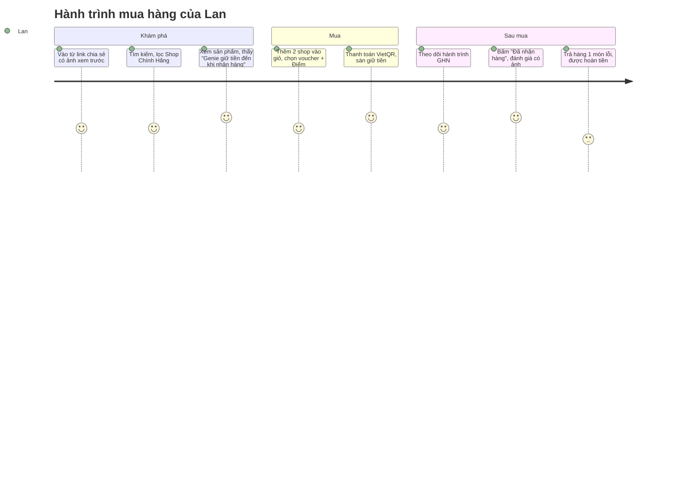

# PRD — TÀI LIỆU YÊU CẦU SẢN PHẨM (Product Requirements Document)

| Thuộc tính | Nội dung |
|---|---|
| Mã tài liệu | GENIE-TLCN-PRD |
| Dự án | Genie — Sàn thương mại điện tử đa người bán (bản TLCN — Tiểu luận chuyên ngành) |
| Phiên bản | 1.1 (đồng bộ bộ tài liệu TLCN v1.4 và mã nguồn 2026-11-16) |
| Ngày ban hành | 2026-11-06 |
| Nhóm tác giả | Mo Ha Mach Bu Ba Ka · Nguyen Quoc Khoa · Nguyen Ngoc Thien · Nghiem Phu Dang Quan |
| Trạng thái | Bản phát hành để rà soát |
| Mục đích | Mô tả sản phẩm Genie từ góc nhìn người dùng: tầm nhìn, chân dung người dùng, hành trình, danh sách tính năng theo từng bề mặt, yêu cầu trải nghiệm, chỉ số sản phẩm và kế hoạch phát hành. |
| Người đọc | Nhóm dự án (Product Owner, Frontend, Backend), giảng viên hướng dẫn |
| Tài liệu liên quan | BRD.md, SRS.md, HLD.md, LLD.md; Usecase.md; PRODUCT.md và DESIGN.md (repo prototype); TECH_STACK_VA_QUY_UOC.md |

> Các tham chiếu trong tài liệu ghi theo **tên tệp và mục** (ví dụ "Usecase.md, Phần III, UC-ORD-07"), không dùng liên kết, để tài liệu dùng được khi tách khỏi thư mục gốc.

### Lịch sử phiên bản

| Phiên bản | Ngày | Nội dung |
|---|---|---|
| 1.0 | 2026-11-06 | Phát hành lần đầu, tổng hợp từ bộ tài liệu TLCN v1.2 (87 use case, 11 phân hệ, 16 tác nhân, 64 bảng) |
| 1.1 | 2026-11-16 | Đồng bộ với mã nguồn `genie-multivendor-platform` (TLCN v1.4): kho tệp MinIO → **Silo** (ADR-15 / ADR 0009 trong repo); AUTH chỉnh theo phần đã hiện thực (đăng ký giữ tạm Redis 15 phút, `GNE-AUTH-4012`, `GNE-AUTH-4098`, khóa tạm không đổi `status`, refresh giữ `family_id` + ân hạn 10 giây, xóa tài khoản giữ phiên hiện tại, cron 02:30); `V14__auth_additions.sql` thay cho `V14__api_sync_v13.sql`; đổi tên UC-AUTH-03 / 06 / 11 theo giao diện; thêm mã lỗi `GNE-SYS-4040/4050/5000` |
## Mục lục

1. Tầm nhìn & định vị
2. Mục tiêu & phi mục tiêu
3. Chân dung người dùng
4. Hành trình chính
5. Tính năng theo bề mặt
6. Yêu cầu trải nghiệm & thương hiệu
7. Chỉ số sản phẩm
8. Kế hoạch phát hành
9. Phụ thuộc, giả định & câu hỏi mở
10. Tiêu chí ra mắt

## 1. Tầm nhìn & định vị

> **"Nhận hàng rồi, tiền mới đến shop."**

Genie là sàn đa người bán cho người mua Việt Nam, nơi **an tâm về tiền** là lý do chọn — không phải mức giảm giá. Sàn giữ tiền của người mua và chỉ chuyển cho shop sau khi người mua nhận hàng hoặc hết 7 ngày đổi trả; người bán phải xác minh danh tính mới được bán.

**Nguyên tắc sản phẩm**
1. **An tâm trước, giá sau** — trạng thái tiền của người mua luôn nhìn thấy được ở những lúc quyết định (trang sản phẩm, giỏ, thanh toán, đơn hàng).
2. **Chứng minh thay vì tuyên bố** — cho thấy cơ chế đang chạy trên đơn hàng cụ thể ("Genie đang giữ 345.000₫ của bạn").
3. **Nói bằng tiếng của người mua** — không lộ mã kỹ thuật, thuật ngữ tài chính chưa giải thích.
4. **Mua hàng vẫn phải nhanh** — bản sắc không cản việc tìm, so sánh và thanh toán.

## 2. Mục tiêu & phi mục tiêu

| Mục tiêu | Phi mục tiêu (không làm ở TLCN) |
|---|---|
| Người mua dám đặt hàng từ shop chưa từng biết | Ví khách hàng, trả góp, MoMo / ZaloPay, thẻ quốc tế |
| Người bán mở shop và nhận đơn đầu trong một buổi | Đội giao hàng riêng, app shipper, đa kho, tài khoản phụ shop |
| Nhân viên sàn xử lý hàng chờ đúng quyền, có nhật ký | Ticket CSKH theo SLA, chatbot, trợ lý mua sắm AI |
| Hội đồng thấy rõ cơ chế ký quỹ, KYC, phân quyền | Gamification ngoài Điểm (hạng thành viên, vòng quay), livestream, affiliate |
| Chạy trên 1 máy chủ, chi phí sinh viên | App native, đa tiền tệ, B2B, quảng cáo PPC |

## 3. Chân dung người dùng

| Persona | Mô tả | Việc cần làm | Nỗi lo | Tác nhân |
|---|---|---|---|---|
| **Lan — người mua lần đầu** | 24 tuổi, mua bằng điện thoại, quen COD | Tìm hàng, so sánh, đặt nhiều shop, theo dõi đơn | Trả tiền rồi nhận hàng lỗi; shop lạ | Guest → Customer |
| **Minh — chủ shop nhỏ** | Bán phụ kiện điện thoại, 1 người vận hành | Mở shop, đăng sản phẩm, xác nhận đơn, in vận đơn, rút tiền | KYC rườm rà; tiền về chậm; khách bom hàng | Vendor |
| **Tú — nhân viên kiểm duyệt** | Duyệt KYC, sản phẩm, đánh giá | Hàng chờ ưu tiên, xem kết quả AI, quyết định nhanh | Duyệt sai, thiếu thông tin | Moderator |
| **Vy — nhân viên CSKH** | Phân xử trả hàng | Xem bằng chứng hai bên, ra phán quyết, hoàn tiền | Thiếu bằng chứng, sai số tiền | CS Specialist |
| **Linh — kế toán sàn** | Duyệt rút tiền, đối soát COD, hoa hồng | Chi đúng người, đúng số, đối soát nhanh | Chi nhầm tài khoản, lệch sổ | Finance Officer |
| **Admin** | Quản trị toàn sàn | Nhân viên & quyền, khóa tài khoản, banner, thông báo, nhật ký | Lạm quyền nội bộ | Admin |
| **Hội đồng đánh giá** | Xem demo | Nhận ra cơ chế riêng, luồng nghiệp vụ thật | Giao diện giống bài trình diễn | — |

## 4. Hành trình chính

Luồng mua chính: **Trang chủ → Tìm kiếm → Chi tiết sản phẩm (♥ / Chia sẻ / trang shop) → Giỏ hàng → Checkout (địa chỉ, hãng vận chuyển, voucher 3 tầng + Điểm, VNPay / VietQR / COD) → Kết quả → Đơn của tôi → Đã nhận hàng → Đánh giá**.
Luồng bán chính: **Trở thành người bán → Nộp KYC → Chờ duyệt → Cấu hình kho & vận chuyển → Thông tin gian hàng → Thêm sản phẩm (Gemini duyệt) → Đơn mới → Xác nhận / từ chối → In phiếu → Ví & sổ giao dịch → Rút tiền**.
Luồng quản trị: **Admin mời nhân viên → gán chức danh & quyền → nhân viên thấy đúng mục nav → duyệt KYC / sản phẩm / rút tiền / khiếu nại**.

## 5. Tính năng theo bề mặt

Ưu tiên theo MoSCoW; mã use case để truy vết sang SRS.md và Usecase.md.

### 5.1 Storefront (người mua — Astro SSR)

| Nhóm | Tính năng | UC | Ưu tiên |
|---|---|---|:---:|
| Tài khoản | Đăng ký email + OTP, đăng nhập mật khẩu / OTP / Google / Apple, quên & đổi mật khẩu, liên kết đăng nhập, thiết bị đăng nhập, hồ sơ, sổ địa chỉ GHN, xóa tài khoản | AUTH-01…11 | MUST / SHOULD |
| Khám phá | Trang chủ (banner 6 vị trí, Flash Sale, voucher, "Gợi ý cho bạn" → "Gợi ý hôm nay"), cây danh mục, tìm kiếm có gợi ý & xu hướng, bộ lọc (thương hiệu, giá, sao, Shop Chính Hãng, freeship), trang chiến dịch | CAT-01, 02, 04, 05, 07, ADM-12 | MUST / SHOULD |
| Sản phẩm & shop | Chi tiết SKU (ma trận biến thể, tồn, đặt trước, tạm nghỉ), yêu thích, chia sẻ deeplink + Open Graph, sản phẩm tương tự, trang shop (điểm, người theo dõi, tỉ lệ phản hồi chat), theo dõi shop | CAT-06, 07, 08, 16, 18, SOC-06 | MUST / SHOULD |
| Mua hàng | Giỏ nhiều shop (cả khách vãng lai), mini-cart, checkout tách đơn, phí ship theo hãng, voucher 3 tầng + Điểm, VNPay / chuyển khoản qua SePay (VietQR) / COD, giữ hàng 15 phút | ORD-01, 04, 06, 07, PAY-01, PRO-03, 04, 10 | MUST |
| Sau mua | Đơn của tôi (nhóm theo phiên), theo dõi hành trình, hủy đơn, đã nhận hàng, đánh giá có ảnh / video, trả hàng có bằng chứng, khiếu nại lên sàn | ORD-09…12, SOC-03, SUP-01…03 | MUST |
| Tương tác & giữ chân | Chat với shop (ảnh, thẻ sản phẩm / đơn), thông báo, kho voucher, Điểm Genie (điểm danh, lịch sử, đổi voucher), Flash Sale | SOC-01, 02, NOT-01, PRO-03, 05, 06, 08, 09 | SHOULD |

### 5.2 Seller Center (người bán — React SPA)

| Nhóm | Tính năng | UC | Ưu tiên |
|---|---|---|:---:|
| Mở shop | Trở thành người bán, KYC (CCCD 2 mặt + selfie, đồng ý sinh trắc), trạng thái hồ sơ | VND-01…04 | MUST |
| Sản phẩm | Thêm / sửa / ẩn / xóa, ≤ 8 ảnh + 1 video, ≤ 2 nhóm phân loại, giấy tờ chứng thực, đặt trước, đề xuất danh mục mới | CAT-09…11, 17 | MUST / SHOULD |
| Đơn hàng | Xác nhận / từ chối đơn, so sánh hãng, tạo vận đơn, in phiếu A6, trả hàng 48 giờ | LOG-01, 02, 15, 16, SUP-02 | MUST |
| Khuyến mãi | Voucher shop (phạm vi, ngoại trừ), đăng ký Flash Sale | PRO-01, 05 | MUST / SHOULD |
| Tương tác | Chat + tự trả lời, phản hồi & báo cáo đánh giá | SOC-01, 04, 05, VND-06 | SHOULD |
| Tiền | Ví & sổ giao dịch (xuất CSV), tài khoản nhận tiền chính chủ, rút tiền có OTP | VND-07, 20, ADM-04 | MUST |
| Phân tích | Doanh thu, đơn, kết quả đơn, nguồn truy cập, sản phẩm bán chạy, **cảm xúc đánh giá (PhoBERT)** | VND-08, AI-07 | SHOULD |
| Cài đặt | Thông tin gian hàng, kho lấy hàng GHN, hãng vận chuyển & freeship, chế độ nghỉ | VND-05, 19, 21 | MUST / SHOULD |

### 5.3 Admin Portal (nhân viên sàn — React SPA, nav theo 13 mã quyền)

| Nhóm | Tính năng | UC | Quyền |
|---|---|---|---|
| Tổng quan | Dashboard GMV, hoa hồng, lợi nhuận ròng, ký quỹ, hàng chờ | ADM-06 | `VIEW_DASHBOARD` |
| Kiểm duyệt | Duyệt KYC (kết quả AI, hậu kiểm 5%), duyệt sản phẩm (kết quả Gemini, phân phối việc), danh mục & thuộc tính & đề xuất, kiểm duyệt đánh giá (ưu tiên đánh giá PhoBERT gắn tiêu cực) | VND-04, CAT-13…15, 17, SOC-05 | `REVIEW_KYC`, `MANAGE_CATALOG`, `MODERATE_REVIEW` |
| Tranh chấp | Phân xử trả hàng, hoàn tiền VNPay / chuyển khoản | SUP-03, 04 | `HANDLE_DISPUTE` |
| Tài chính | Duyệt rút tiền (QR chuyển khoản, SePay xác nhận), đối soát COD, hoa hồng, sổ cái | ADM-05, LOG-03, CAT-14, PAY-06 | `PROCESS_PAYOUT`, `UPDATE_COMMISSION`, `VIEW_FINANCE` |
| Tiếp thị | Voucher sàn, Flash Sale, banner trang chủ | PRO-02, 05, ADM-12 | `MANAGE_VOUCHER` |
| Hệ thống | Thông báo toàn sàn, người dùng (khóa / mở), nhân viên & phân quyền, nhật ký | NOT-05, ADM-01…03, 07 | `MANAGE_PLATFORM_NOTIFICATION`, `MANAGE_USER`, `MANAGE_RBAC`, `VIEW_AUDIT_LOG` |

### 5.4 Nền tảng (không có màn hình riêng)

AI Worker: KYC tự động (VND-03), phân tích cảm xúc đánh giá PhoBERT (AI-07). Gemini: kiểm duyệt sản phẩm (CAT-12). Cron: hủy đơn quá hạn (ORD-08), tự hoàn tất (ORD-12), giải ngân (PAY-07). Webhook: IPN VNPay / SePay (PAY-03), hành trình 3PL (LOG-03). Sổ: ký quỹ (PAY-05), sổ cái kép (PAY-06). Email giao dịch (NOT-03).

## 6. Yêu cầu trải nghiệm & thương hiệu

| Mục | Yêu cầu |
|---|---|
| Thương hiệu | Tên **Genie**; điểm thưởng **Điểm Genie / Điểm**; nhãn **Chính hãng**; không dùng "Xu", "Mall", "Lazadee"; không trông giống Shopee / Lazada / Tiki |
| Màu & chữ | Mực navy cho chữ, xanh dương đậm cho nút / link, vàng hoa cúc làm màu nhấn cho tiền; nền giấy ấm; font hiển thị tốt dấu tiếng Việt (theo DESIGN.md của prototype) |
| Trạng thái tiền | Ở trang sản phẩm, giỏ, thanh toán, đơn hàng luôn nói rõ "Genie đang giữ tiền" / "đã chuyển cho shop" / "đang giữ trong lúc xử lý trả hàng" |
| Responsive | 360–1440 px; thao tác chạm tối thiểu 44 px |
| Ngôn ngữ | Tiếng Việt / tiếng Anh, chọn ở header, nhớ bằng cookie; dữ liệu người dùng nhập giữ ngôn ngữ gốc |
| Khả năng truy cập | WCAG AA về tương phản; nhãn cho ô nhập; điều hướng bàn phím ở form chính |
| Trạng thái biên | Rỗng, đang tải, lỗi, hết hàng, hết suất Flash Sale, shop tạm nghỉ, quá hạn thanh toán, mất kết nối — mỗi màn đều có |
| Chia sẻ | Link `/p/{slug}-{id}` hiện ảnh, tên, giá khi dán vào Facebook / Zalo / Messenger |
| Dữ liệu demo | Không trình bày số liệu mẫu như thành tích thật |

Prototype tương tác (repo prototype, thư mục genie/ui_kits) là mẫu giao diện chuẩn cho bản hiện thực.

## 7. Chỉ số sản phẩm

| Chỉ số | Định nghĩa | Mục tiêu |
|---|---|---|
| Tỷ lệ chuyển đổi checkout | Phiên thanh toán hoàn tất / phiên tạo | ≥ 60% |
| Tỷ lệ hủy do quá hạn thanh toán | Đơn tự hủy / đơn tạo | ≤ 20% |
| Thời gian mở shop | Từ "Trở thành người bán" tới KYC được duyệt | Tự duyệt < 1 phút |
| Tỷ lệ phản hồi chat của shop | Bình quân `chat_response_rate` | ≥ 80% |
| Tỷ lệ đánh giá tích cực | Đánh giá PhoBERT gắn `POSITIVE` (độ tin cậy ≥ 0,6) / đánh giá có chữ | Theo dõi |
| Lượt vào từ link chia sẻ | Lượt xem nguồn `EXTERNAL_LINK` / tổng | Theo dõi |
| Tỷ lệ bán hết suất Flash Sale | Đã bán / suất | ≥ 70% |

## 8. Kế hoạch phát hành

| Sprint | Tuần | Mục tiêu | Số UC | Use case | Rủi ro chính |
|:---:|:---:|---|:---:|---|---|
| S1 | 1–2 | Nền tảng tài khoản & phân quyền | 7 | AUTH-01, AUTH-02, AUTH-04, AUTH-06, AUTH-11, ADM-01, ADM-02 | Cấu hình Spring Security, RBAC 13 quyền, refresh token |
| S2 | 3–4 | Danh mục, sản phẩm & KYC | 17 | AUTH-08, AUTH-09, CAT-01, CAT-02, CAT-05, CAT-06, CAT-09, CAT-10, CAT-11, CAT-13, CAT-14, CAT-16, VND-01, VND-02, VND-03, VND-04, VND-05 | Sprint nặng — AI Worker KYC làm song song bởi thành viên AI |
| S3 | 5–6 | Giỏ hàng, đặt hàng & thanh toán | 9 | ORD-01, ORD-04, ORD-06, ORD-07, ORD-08, PAY-01, PAY-03, PAY-05, PAY-06 | Đồng thời tồn kho; IPN / webhook cần URL HTTPS công khai; sổ cái cân bằng |
| S4 | 7–8 | Vận chuyển, ví & rút tiền | 12 | ORD-09, ORD-10, ORD-11, ORD-12, PAY-07, VND-07, LOG-01, LOG-02, LOG-03, LOG-16, ADM-04, ADM-05 | Tài khoản GHN dev, kiểm thử luồng tiền |
| S5 | 9–10 | Khuyến mãi, chat, đánh giá & trả hàng | 11 | PRO-01, PRO-02, PRO-03, SOC-03, SOC-04, SUP-01, SUP-02, SUP-03, SUP-04, NOT-01, NOT-03 | Máy trạng thái hoàn tiền nhiều nhánh |
| S6 | 11–12 | Thông báo, quản trị, phân tích cảm xúc & hoàn thiện | 6 | CAT-08, VND-08, SOC-01, ADM-03, ADM-06, AI-07 | Thời gian kiểm thử bị dồn; đóng gói PhoBERT sang ONNX và khớp bước tách từ với lúc huấn luyện |
| S7 | 13–14 | Mở rộng tài khoản, sản phẩm, gian hàng & quản trị (đối chiếu giao diện) | 14 | AUTH-03, AUTH-10, CAT-04, CAT-07, CAT-12, CAT-15, CAT-17, CAT-18, VND-06, VND-19, VND-20, VND-21, LOG-15, ADM-07 | Nhiều UC nhỏ; hạn mức Gemini; OAuth cần domain HTTPS |
| S8 | 15–16 | Khuyến mãi nâng cao, Điểm, tương tác & nội dung sàn | 11 | PRO-04, PRO-05, PRO-06, PRO-08, PRO-09, PRO-10, SOC-02, SOC-05, SOC-06, NOT-05, ADM-12 | Tính tiền xếp chồng + Điểm; tải Flash Sale — giữ ≥ 1 tuần kiểm thử cuối |

| Mốc | Sau sprint | Nội dung trình diễn |
|---|---|---|
| `v0.1.0` | S2 | Đăng nhập, phân quyền, danh mục, sản phẩm, mở shop + KYC |
| `v0.2.0` | S4 | Mua hàng nhiều shop, VNPay / SePay / COD, vận chuyển, giải ngân, rút tiền |
| `v0.3.0` | S6 | Voucher, đánh giá, trả hàng, thông báo, chat, phân tích bán hàng + cảm xúc PhoBERT, dashboard — **vòng lõi hoàn chỉnh**, triển khai VPS lần 1 |
| `v1.0.0` | S8 | Toàn bộ 87 use case, kiểm thử tải / bảo mật, bản bảo vệ |

**Thứ tự cắt nếu trễ:** UC-ADM-12 → UC-NOT-05 → UC-SOC-05 → UC-PRO-08/09 → UC-CAT-07 → UC-AUTH-03. Không cắt luồng tiền (ORD, PAY, SUP) và phân quyền (ADM-01, ADM-02).

## 9. Phụ thuộc, giả định & câu hỏi mở

| Loại | Nội dung |
|---|---|
| Phụ thuộc | Tài khoản sandbox VNPay, SePay + tài khoản ngân hàng demo, GHN dev, khóa Gemini, Google / Apple OAuth (cần domain HTTPS) |
| Phụ thuộc | Mô hình PhoBERT nhóm đã huấn luyện xuất được ONNX, bước tách từ khớp lúc huấn luyện |
| Giả định | Người dùng demo truy cập bằng trình duyệt; dữ liệu mẫu ~200 sản phẩm, 5 shop |
| Câu hỏi mở | Hiển thị tóm tắt cảm xúc đánh giá cho người mua ở trang sản phẩm (hiện chỉ cho shop và nhân viên) |
| Câu hỏi mở | Trang chiến dịch có cần màn quản lý riêng (hiện cấu hình tĩnh) |
| Câu hỏi mở | Thời điểm bổ sung khấu trừ thuế người bán trước khi chạy thương mại |

## 10. Tiêu chí ra mắt

- [ ] Mọi màn hình của prototype có bản hiện thực tương ứng, đủ trạng thái biên.
- [ ] Toàn bộ chuỗi giao diện có khóa i18n vi / en.
- [ ] Lighthouse trang sản phẩm: LCP < 1,5 giây; Open Graph hiển thị đúng khi dán link.
- [ ] 9 kịch bản E2E và 5 kịch bản tiền xanh; k6 50 người dùng đồng thời đạt mục tiêu hiệu năng.
- [ ] Tài khoản demo: khách, shop, Admin, 3 nhân viên (Moderator, CS Specialist, Finance Officer).
