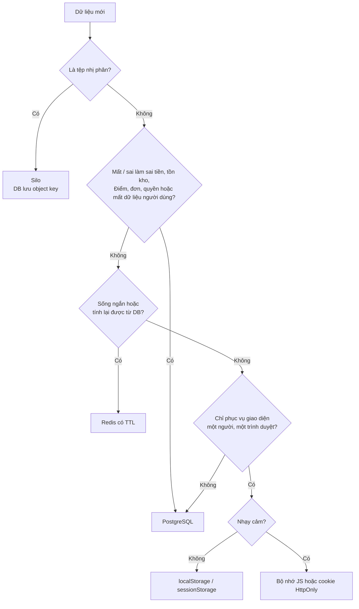
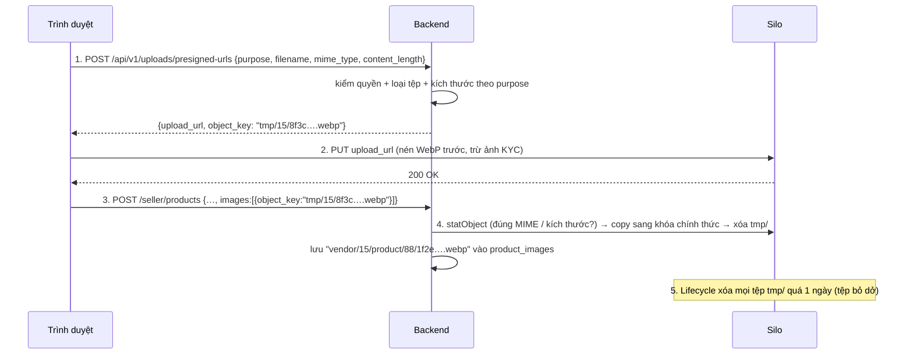
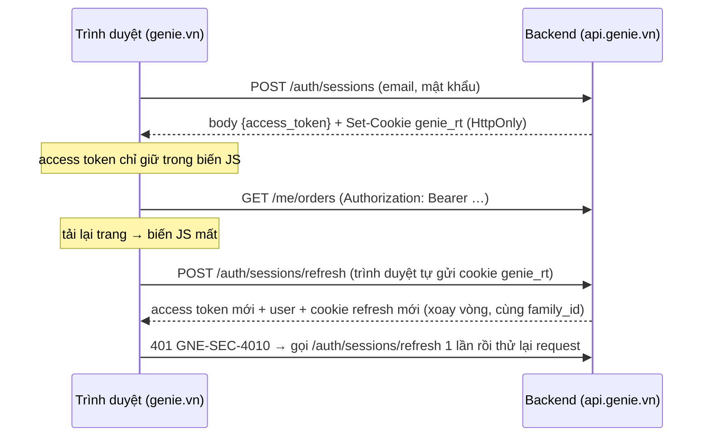
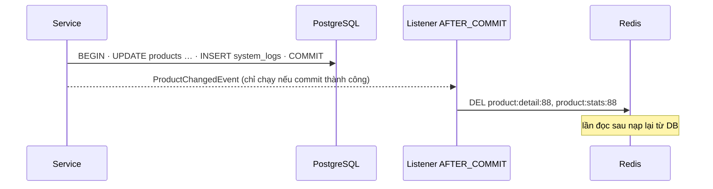

# LƯU TRỮ DỮ LIỆU — GENIE TLCN
## Dữ liệu nào lưu ở PostgreSQL, Redis, Silo, bộ nhớ máy chủ hay trình duyệt — và vì sao

> **Dùng khi:** thiết kế bảng, viết service có cache, thêm chức năng tải tệp, hoặc định lưu bất cứ thứ gì ở frontend.
> **Đọc theo thứ tự:** mục 0 (5 phút) → mục 1 (khái niệm) → mục 2 (cách chọn) → mục của nơi lưu bạn đang làm → mục 10 (ví dụ trọn luồng) → mục 13 (checklist).
> **Nguồn:** ENTITY.md (quy ước 10, 13.1–13.3), Document_Vi.md (2.1.1, 3.5, 3.6, NFR-03/04/07/11), Usecase.md (UC-ORD-01, UC-AUTH-*, UC-CAT-07/10, UC-ADM-12, UC-AI-07…), implement.md (Phần 3, 4), Kien_Thuc_Can_Nam.md (Phần 6, 7, 8). Đi kèm TECH_STACK_VA_QUY_UOC.md.
> Mục ghi **(đề xuất)** là bổ sung mới, chưa có trong tài liệu cũ — chốt khi dựng codebase.

---

## MỤC LỤC

0. Đọc nhanh
1. Khái niệm cần biết
2. Cách chọn nơi lưu
3. PostgreSQL — nguồn sự thật
4. Redis — dữ liệu tạm có hạn dùng
5. Silo — tệp
6. Trình duyệt
7. Bộ nhớ trong tiến trình máy chủ
8. Giữ các nơi lưu khớp nhau
9. Vòng đời & thời hạn lưu
10. Ví dụ trọn luồng: dữ liệu đi qua những đâu
11. Lỗi hay gặp & cách đúng
12. Hỏi đáp
13. Checklist khi thêm một loại dữ liệu mới

---

## 0. Đọc nhanh

| Nơi lưu | Hình dung đơn giản | Lưu gì | Nếu mất thì sao |
|---|---|---|---|
| **PostgreSQL** | **Sổ cái gốc** của cả sàn | Mọi thứ không được sai hoặc mất: tài khoản, sản phẩm, tồn kho, giỏ hàng tài khoản, đơn, tiền, Điểm, voucher, chat, thông báo, nhật ký | **Không được mất** — sao lưu hằng ngày |
| **Redis** | **Tờ giấy nhớ** dán cạnh bàn, tự bong sau một thời gian | OTP, đếm số lần thử, chống bấm trùng, bản sao đọc nhanh (cache), bộ đếm lượt xem chờ ghi sổ | Chỉ chậm hơn hoặc mất vài phút thống kê — **không sai tiền, không sai tồn kho** |
| **Silo** | **Kho chứa đồ** (ảnh, video, giấy tờ) | Ảnh sản phẩm, ảnh đánh giá, ảnh đại diện, banner, giấy tờ, ảnh CCCD (mã hóa), bằng chứng trả hàng, mô hình AI | Mất tệp nhưng không mất giao dịch — sao lưu hằng tuần |
| **Bộ nhớ máy chủ** | Thứ đang cầm trên tay | Kết nối WebSocket, khóa công khai của Google / Apple, mô hình AI đã nạp | Tự nạp lại khi khởi động |
| **Trình duyệt** | **Ghi chú riêng** trên máy người dùng | Access token (chỉ trong bộ nhớ), giỏ của khách chưa đăng nhập, ngôn ngữ, nháp checkout | Người dùng làm lại thao tác; server luôn kiểm lại |

**5 luật cứng — vi phạm là sai nghiệp vụ**
1. **Tiền, tồn kho, suất Flash Sale, số dư Điểm, lượt dùng voucher, trạng thái đơn** chỉ đọc / ghi ở PostgreSQL trong transaction. Redis không bao giờ giữ con số gốc của những thứ này.
2. **Ghi PostgreSQL trước, xóa cache sau khi commit.** Không cập nhật cache khi giao dịch chưa chắc thành công.
3. **Mọi khóa Redis có TTL** (hạn sống), kể cả bộ đếm.
4. **Database lưu khóa đối tượng (object key) của Silo**, không lưu URL đầy đủ, không lưu Presigned URL.
5. **Trình duyệt không lưu** token trong storage, dữ liệu cá nhân, ảnh giấy tờ, số tài khoản ngân hàng, giá hay quyền để làm căn cứ.

---

## 1. Khái niệm cần biết

| Khái niệm | Giải thích dễ hiểu | Ở Genie |
|---|---|---|
| **Nguồn sự thật** (source of truth) | Nơi duy nhất có con số "đúng". Nơi khác chỉ là bản sao | PostgreSQL |
| **Transaction (ACID)** | Một nhóm thao tác hoặc thành công hết, hoặc không có gì xảy ra | Đặt hàng: tạo phiên + N đơn + giữ chỗ tồn kho trong một transaction |
| **TTL** (time to live) | Hạn sống của một khóa Redis; hết hạn thì Redis tự xóa | OTP 5 phút, idempotency 24 giờ |
| **Cache** | Bản sao để đọc nhanh, chấp nhận cũ đi một chút | Cây danh mục cache 1 giờ |
| **Cache-aside** | Đọc cache trước; không có thì đọc DB rồi ghi vào cache. Khi DB đổi thì xóa cache | Mọi cache ở Genie theo kiểu này (mục 4.5) |
| **Ghi gộp** (write-behind) | Đếm nhanh trong Redis, vài phút ghi tổng một lần vào DB | Lượt xem sản phẩm, lượt bấm banner |
| **Idempotency** | Gửi cùng một yêu cầu nhiều lần chỉ có tác dụng một lần | Bấm "Đặt hàng" 2 lần vẫn chỉ ra 1 đơn |
| **Object key** | "Đường dẫn" của một tệp bên trong bucket Silo | `vendor/15/product/88/1f2e….webp` |
| **Presigned URL** | Đường link tạm có chữ ký, cho phép tải lên / xem đúng một tệp trong vài phút mà không cần mật khẩu Silo | Trình duyệt PUT ảnh thẳng lên Silo |
| **Cookie HttpOnly** | Cookie mà JavaScript không đọc được, chỉ trình duyệt tự gửi kèm request | Refresh token |
| **localStorage** | Kho chữ của trình duyệt, còn mãi kể cả khi tắt máy, dùng chung mọi tab cùng trang | Giỏ hàng khách vãng lai |
| **sessionStorage** | Giống localStorage nhưng mỗi tab một bản, đóng tab là mất | Nháp checkout |
| **XSS** | Kẻ gian chèn được JavaScript vào trang → đọc được mọi thứ JS đọc được (kể cả localStorage) | Lý do không để token trong localStorage |
| **Snapshot** | Chụp lại dữ liệu tại một thời điểm, sau này không đổi theo bản gốc | Tên, giá, địa chỉ trong đơn hàng |
| **Append-only** | Chỉ được thêm dòng, không sửa / xóa; sai thì thêm dòng đảo | Sổ cái, sổ ví, lịch sử Điểm, nhật ký |

---

## 2. Cách chọn nơi lưu

### 2.1 Bốn câu hỏi

1. **Đây có phải tệp (ảnh, video, PDF, mô hình)?** → Silo; DB chỉ giữ object key.
2. **Mất hoặc sai nó có làm sai tiền, tồn kho, Điểm, đơn, quyền, hay làm mất dữ liệu người dùng?** → PostgreSQL.
3. **Nó chỉ sống ngắn, hoặc tính lại được từ DB?** (OTP, đếm số lần thử, cache, bộ đếm chờ ghi) → Redis có TTL.
4. **Nó chỉ phục vụ giao diện của một người trên một trình duyệt?** → Trình duyệt, nếu không nhạy cảm; nhạy cảm thì giữ trong bộ nhớ JS hoặc cookie HttpOnly.



### 2.2 Áp dụng thử

| Dữ liệu | Trả lời 4 câu | Nơi lưu |
|---|---|---|
| Số lượng tồn của một SKU | Sai → bán vượt | PostgreSQL `product_variants` |
| "Còn 3 sản phẩm" hiển thị trên trang | Tính lại được, cũ vài phút không sao | Redis `product:detail:{id}` (5 phút) — đặt hàng vẫn kiểm DB |
| Mã OTP xác nhận rút tiền | Sống 5 phút | Redis (lưu bản băm) |
| Số lần đăng nhập sai | Phải nhớ qua lần khởi động lại để khóa 15 phút | PostgreSQL `users.failed_login_attempts`, `locked_until` |
| Ảnh đánh giá | Là tệp | Silo `review-media` |
| Giỏ hàng khi chưa đăng nhập | Chưa có tài khoản để ghi DB | `localStorage` |
| Giỏ hàng sau khi đăng nhập | Mất là mất dữ liệu người dùng, cần trên mọi thiết bị | PostgreSQL `carts` |
| Access token | Nhạy cảm, sống 15 phút | Bộ nhớ JS |
| Kết quả PhoBERT của một đánh giá | Tính lại tốn kém, cần thống kê | PostgreSQL `product_reviews.aspect_sentiment_json` |
| Tỉ lệ cảm xúc của một shop | Tính lại được từ DB | Redis `sentiment:vendor:{id}` (10 phút) |

---

## 3. PostgreSQL — nguồn sự thật

### 3.1 Bảng nào, ai ghi, ai đọc

| Nhóm (module) | Bảng | Ai ghi | Ai đọc | Ghi chú lưu trữ |
|---|---|---|---|---|
| 1. Định danh (`auth`, `vendor`, `admin`) | `users`, `customer_profiles`, `addresses`, `refresh_tokens` · `vendor_profiles`, `kyc_results` · `admin_profiles`, `staff_permissions` | Đăng ký, đổi hồ sơ, KYC, Admin | Đăng nhập, mọi API (lấy quyền) | Refresh token **băm SHA-256**; đếm sai mật khẩu + `locked_until` ở `users`; số CCCD / STK che khi trả ra API |
| 2. Danh mục & sản phẩm (`catalog`) | `categories`, `category_attributes`, `brands`, `products`, `product_variants`, `product_images`, `product_documents`, `category_proposals`, `product_moderation_results`, `user_wishlists`, `search_keyword_stats`, `product_view_stats` | Shop, Moderator, Gemini (qua backend), job ghi gộp | Storefront, tìm kiếm | `products.search_vector` (`tsvector`, GIN) cho tìm kiếm; `product_variants` có `stock_count`, `reserved_count`, `version`; hai bảng `*_stats` chỉ do job ghi |
| 3. Giỏ hàng (`order`) | `carts`, `cart_items` | Khách đã đăng nhập | Khách, checkout | Giỏ khách vãng lai **không** ở đây |
| 4. Khuyến mãi & Điểm (`promotion`) | `vouchers` + 4 bảng phạm vi, `voucher_usages`, `user_vouchers`, `flash_sale_campaigns`, `flash_sale_items`, `user_coins`, `coin_transactions`, `daily_checkins` | Shop, Finance, checkout, Cron | Checkout, kho voucher | Suất Flash Sale trừ bằng `UPDATE` có điều kiện; `coin_transactions` chỉ ghi thêm; `user_coins.balance_hash` chống sửa tay |
| 5. Đơn hàng (`order`) | `checkout_sessions`, `orders`, `order_items`, `order_discounts`, `stock_reservations` | Checkout, IPN, webhook 3PL, Cron | Khách, shop, Admin | **Snapshot** tên / SKU / giá / địa chỉ / voucher |
| 6. Thanh toán & ký quỹ (`payment`, `admin`) | `payment_transactions`, `payment_refunds`, `escrow_ledgers`, `vendor_wallets`, `wallet_transactions`, `financial_ledger` · `withdrawal_requests` | IPN / webhook, Cron giải ngân, Finance | Shop (ví), Finance, dashboard | Sổ **chỉ ghi thêm**; `UNIQUE` mã giao dịch cổng; `vendor_wallets.balance_hash` |
| 7. Vận chuyển (`shipping`) | `shipment_trackings`, `shipment_events`, `vendor_shipping_config` | Shop, webhook hãng | Khách (hành trình), shop | Lưu cả mã trạng thái thô của hãng và trạng thái đã chuẩn hóa |
| 8. Hoàn tiền (`support`) | `refund_requests`, `refund_request_items`, `refund_evidences` | Khách, shop, CS | 3 bên | Bằng chứng là object key Silo |
| 9. Đánh giá (`social`) | `product_reviews`, `review_helpful_votes`, `review_reports`, `shop_follows` | Khách, shop, AI Worker (cảm xúc) | Storefront, shop, Moderator | `aspect_sentiment_json` giữ kết quả PhoBERT |
| 10. Thông báo & nội dung (`notification`, `admin`) | `notifications`, `platform_notifications`, `user_platform_notification_reads`, `admin_notifications` · `home_banners` | Hệ thống, Admin | Người dùng, Admin | Thông báo sàn kiểu "fan-out on read": lưu 1 dòng, ai đọc thì ghi 1 dòng đã đọc |
| 11. Chat (`social`) | `conversations`, `messages` | Khách, shop | Khách, shop | **Lưu trước, đẩy WebSocket sau** |
| 12. Nhật ký (`common`) | `system_logs` | Mọi thao tác nhạy cảm | Admin | Chỉ ghi thêm |

Tên bảng giữ đúng `@Table` trong ENTITY.md — hai bảng số ít để trùng DATN: `financial_ledger`, `vendor_shipping_config`.

### 3.2 Năm mẫu lưu trữ cần nắm

**a) Snapshot — đơn cũ không đổi theo sản phẩm**
```json
// orders.shipping_address_snapshot_json
{ "recipient_name": "Nguyễn Thị Lan", "phone": "09******12", "province_id": 202,
  "district_id": 1442, "ward_code": "20109", "detail": "25 Nguyễn Huệ" }
// order_items: product_name_snapshot = "Tai nghe ANC Pro 5", sku_snapshot = "ANC5-BLK", price_snapshot = 389000.00
```
Shop đổi tên / giá sau này → đơn cũ vẫn hiện đúng như lúc mua. Không JOIN ngược về `products` để hiển thị đơn.

**b) Append-only — sổ chỉ ghi thêm**
```
financial_ledger
id   event_type       ref                  debit      credit
981  ESCROW_IN        TR-20260608-000141              345000.00
982  COMMISSION       TR-20260608-000141              26400.00
990  REFUND           TRRF231              178000.00
991  REFUND (đảo)     TRRF231                          178000.00   ← sai thì thêm dòng đảo, không UPDATE
```

**c) Khóa lạc quan (`version`) — hai người sửa cùng lúc**
```sql
UPDATE vendor_wallets SET available_balance = ?, balance_hash = ?, version = version + 1
 WHERE id = ? AND version = ?;           -- 0 dòng → có người ghi trước → thử lại (tối đa 3 lần)
```

**d) Cập nhật có điều kiện — không bán vượt**
```sql
UPDATE product_variants SET reserved_count = reserved_count + 2
 WHERE id = 501 AND stock_count - reserved_count >= 2;    -- 0 dòng → hết hàng (GNE-INV-4090)
```

**e) JSONB — khi nào dùng**
Dùng cho dữ liệu chụp lại một lần và ít khi lọc theo từng trường: snapshot địa chỉ / giỏ, cấu hình động (`targetAudienceJson`), kết quả AI (`aspect_sentiment_json`, kết quả Gemini). Cần JOIN, khóa ngoại hoặc lọc thường xuyên → làm cột / bảng thường. Lọc JSONB thường xuyên thì thêm index biểu thức, ví dụ `((aspect_sentiment_json ->> 'overall'))`.

### 3.3 Dữ liệu trông "tạm" nhưng vẫn phải ở PostgreSQL

| Dữ liệu | Vì sao không để Redis |
|---|---|
| Giữ chỗ tồn kho 15 phút (`stock_reservations`) | Gắn chặt với tồn kho và đơn; phải nằm cùng transaction với việc tạo đơn |
| Refresh token | Phải thu hồi được từng thiết bị, liệt kê "Thiết bị đăng nhập" |
| Số lần đăng nhập sai, thời điểm khóa | Mất khi Redis khởi động lại → kẻ gian thử mật khẩu tiếp |
| Đã điểm danh hôm nay | Là căn cứ cộng Điểm; ràng buộc `UNIQUE(user_id, checkin_date)` |
| Đã đọc thông báo sàn | Thống kê tỉ lệ đọc cho Admin |

---

## 4. Redis — dữ liệu tạm có hạn dùng

### 4.1 Cấu hình

| Thiết lập | Giá trị | Vì sao |
|---|---|---|
| Một instance Redis 7, có `requirepass` | — | MVP một VPS |
| `appendonly yes`, `appendfsync everysec` | Ghi xuống đĩa mỗi giây | Khởi động lại không mất OTP / idempotency đang dùng |
| `maxmemory 256mb`, `maxmemory-policy volatile-lru` | Đầy bộ nhớ thì xóa khóa có TTL ít dùng nhất | Mọi khóa đều có TTL nên luôn có cái để xóa |
| Giá trị dạng chuỗi JSON (Jackson) | — | Xem được bằng `redis-cli`, không phụ thuộc class Java |
| Đặt tên `<miền>:<đối tượng>:<id>[:<trường>]`, chữ thường | `product:stats:123` | Đọc là biết của ai, xóa theo mẫu được |

### 4.2 Nhóm khóa xác thực & chống lạm dụng

| Khóa | Ví dụ giá trị | TTL | Ghi khi | Xóa khi | UC |
|---|---|---|---|---|---|
| `otp:challenge:{challengeId}` | Hash `{purpose, email, user_id, code_hash: "9f2c…", attempts: 0, resend_count}` — `purpose` ∈ 11 giá trị `$OtpChallenge.purpose` (`REGISTER`, `LOGIN`, `ACCOUNT_UNLOCK`, `PASSWORD_RESET`, `PASSWORD_CHANGE`, `EMAIL_CHANGE`, `ACCOUNT_DELETION`, `WITHDRAWAL`, `PAYOUT_ACCOUNT_*`…) | 5 phút | Gửi OTP (đăng ký, đăng nhập bằng mã, mở khóa, quên mật khẩu, OTP bước 2) | Nhập đúng (dùng một lần) / sai lần thứ 5 / hết hạn | AUTH-01/02/04/06/08/10, ADM-04, VND-07 |
| `otp:active:{purpose}:{email}` | `"<challengeId>"` — mỗi email / mục đích chỉ một mã còn sống | 5 phút | Phát mã mới (hủy mã cũ cùng mục đích) | Như trên | như trên |
| `register:temp:{email}` | `{full_name, phone, password_hash}` (đã băm Argon2id) | 15 phút | Bước 1 đăng ký | OTP đúng → tạo `users` rồi xóa; sai OTP 5 lần → xóa | AUTH-01 |
| `oauth:state:{state}` | `{provider, nonce, code_verifier, redirect_uri, next, link_user_id?}` — có `link_user_id` = state **liên kết** (không dùng để đăng nhập) | 10 phút | Bấm "Tiếp tục với Google" / "Liên kết Google" | Callback đọc xong xóa ngay (dùng một lần) | AUTH-03 |
| `auth:reset:{sha256(reset_token)}` | `{user_id}` | 10 phút | Xác minh OTP quên mật khẩu | Đặt mật khẩu xong (dùng một lần) / hết hạn | AUTH-04 |
| `auth:pwreset_lock:{email}` | `"1"` | 30 phút | Sai OTP quên mật khẩu lần thứ 5 | Hết hạn | AUTH-04 |
| `auth:locked_by:{userId}` | `PASSWORD` \| `OTP` | Bằng thời gian khóa (15 phút) | Khóa tạm do sai mật khẩu / sai OTP đăng nhập (khóa thật nằm ở `users.locked_until`) | Mở khóa qua email / hết hạn | AUTH-02 |
| `auth:denylist:{jti}` | `"1"` | Thời gian còn lại của access token (≤ 15 phút) | Đăng xuất phiên hiện tại | Hết hạn | AUTH-11 |
| `auth:revoked_before:{userId}` | epoch giây — token có `iat` nhỏ hơn bị từ chối | 15 phút | Đặt lại mật khẩu, phát hiện dùng lại refresh token, đình chỉ tài khoản, đổi vai trò | Hết hạn | AUTH-02/04, ADM-02/03 |
| `rl:login:{ip}` | `7` | 1 phút (tối đa 10) | Mỗi lần gọi đăng nhập | Hết hạn | AUTH-02 |
| `rl:otp:{email}` · `rl:otp:hour:{email}` | `1` | 60 giây · 1 giờ (tối đa 5) | Mỗi lần xin / gửi lại OTP | Hết hạn | AUTH-01/02/04 |
| `rl:pwverify:{userId}` | `3` | 1 phút (tối đa 10) | Kiểm mật khẩu hiện tại (đổi mật khẩu, gỡ liên kết Google) | Hết hạn | AUTH-03/06 |
| `region:provinces` · `region:districts:{provinceId}` · `region:wards:{districtId}` | JSON danh mục hành chính GHN | 24 giờ | Lần đọc đầu (cache-aside) | Hết hạn | AUTH-09 |
| `rl:search:{ip}` | `42` | 1 phút | Mỗi lần tìm kiếm | Hết hạn | CAT-02 |
| `idempotency:{userId}:{key}` | `{state: "DONE", status: 201, body: "{…}"}` | **24 giờ** | Gọi API tiền có header `Idempotency-Key` | Hết hạn | ORD-07, PAY-01, ADM-04, SUP-04 |

**Mẫu code — OTP (chỉ lưu bản băm, đếm số lần sai — theo `OtpChallengeService` thật)**
```java
public IssuedOtp issue(OtpPurpose purpose, String email, Long userId) {
    rateLimiter.check("rl:otp:" + email, 1, Duration.ofSeconds(60));       // gửi lại sau 60 giây
    rateLimiter.check("rl:otp:hour:" + email, 5, Duration.ofHours(1));     // tối đa 5 lần / giờ
    cancelActive(purpose, email);                                          // otp:active:{purpose}:{email}
    String id = randomId(); String code = sixDigits();                     // SecureRandom
    String key = "otp:challenge:" + id;
    redis.opsForHash().putAll(key, Map.of("purpose", purpose.name(), "email", email,
            "user_id", String.valueOf(userId), "code_hash", sha256(code + otpPepper), "attempts", "0"));
    redis.expire(key, Duration.ofMinutes(5));
    mailSender.send(email, MailTemplate.OTP, Map.of("code", code));        // mã gốc chỉ đi qua email
    return new IssuedOtp(id, mask(email), 300, 60);
}
public OtpChallenge verify(String id, String input, OtpPurpose expected) {
    String key = "otp:challenge:" + id;
    Map<Object, Object> c = redis.opsForHash().entries(key);
    if (c.isEmpty() || !expected.name().equals(c.get("purpose"))) throw error("GNE-AUTH-4101");  // hết hạn / sai mục đích
    if (!MessageDigest.isEqual(bytes(c.get("code_hash")), bytes(sha256(input + otpPepper)))) {
        long attempts = redis.opsForHash().increment(key, "attempts", 1);  // HINCRBY an toàn khi song song
        if (attempts >= 5) { redis.delete(key); throw error("GNE-AUTH-4221"); }
        throw error("GNE-AUTH-4222", Map.of("remaining_attempts", 5 - attempts));
    }
    redis.delete(key);                                                    // dùng một lần
    return toChallenge(c);
}
```

**Mẫu code — chống bấm trùng (Idempotency-Key)**
```java
// 1. Trước khi xử lý
Boolean first = redis.opsForValue().setIfAbsent(key, "{\"state\":\"PROCESSING\"}", Duration.ofHours(24));
if (Boolean.FALSE.equals(first)) {
    Stored s = read(key);
    if (s.state() == DONE) return s.replay();             // trả lại đúng kết quả lần đầu
    throw conflict("Yêu cầu đang được xử lý");            // lần đầu chưa xong
}
// 2. Xử lý nghiệp vụ trong transaction (tạo phiên checkout…)
// 3. Sau khi thành công: lưu kết quả để lần sau trả lại
redis.opsForValue().set(key, json(DONE, 201, body), Duration.ofHours(24));
// Lỗi nghiệp vụ (4xx) cũng lưu để không chạy lại; lỗi hệ thống (5xx) thì xóa khóa cho phép thử lại
```

### 4.3 Nhóm cache đọc

| Khóa | Chứa | TTL | Xóa khi | UC |
|---|---|---|---|---|
| `categories:tree:all` | Cây danh mục 3 cấp | 1 giờ | Thêm / sửa / xóa danh mục, duyệt đề xuất | CAT-01, 14, 17 |
| `product:detail:{id}` **(tên đề xuất)** | Thông tin hiển thị trang sản phẩm (không gồm giá Flash Sale đang chạy) | 5 phút | Sửa giá / tồn / thông tin, đổi trạng thái | CAT-06, CAT-10 |
| `product:stats:{id}` | Điểm đánh giá, số đã bán, lượt xem | 10 phút | Đánh giá mới, đơn hoàn tất | CAT-06 |
| `similar:{productId}` | Danh sách ID sản phẩm tương tự | 30 phút | Hết hạn | CAT-07 |
| `shop:stats:{vendorId}` | Điểm shop, người theo dõi, tỉ lệ phản hồi chat | 10 phút | Đánh giá mới, theo dõi / bỏ theo dõi | CAT-16 |
| `ship:fee:{hash}` | Phí ship theo (hãng, nơi gửi, nơi nhận, cân nặng) | 30 phút | Hết hạn | ORD-06 |
| `banner:live:{position}` | Banner đang hiển thị ở một vị trí | 60 giây | Sửa / tắt banner | ADM-12 |
| `flashsale:active` | Chiến dịch đang chạy + danh sách sản phẩm | 30 giây | Mở / đóng chiến dịch | PRO-06 |
| `search:trending` **(đề xuất)** | 10 từ khóa xu hướng | 10 phút | Hết hạn | CAT-04 |
| `sentiment:vendor:{id}` | Tỉ lệ 3 nhãn cảm xúc của shop | 10 phút | Kết quả PhoBERT mới | AI-07, VND-08 |
| `dashboard:admin:{kỳ}` **(đề xuất)** | Số liệu dashboard một kỳ | 5 phút | Hết hạn | ADM-06 |

**Không cache chung:** dữ liệu riêng của một người (giỏ, đơn, ví, thông báo, quyền). Những thứ này đọc thẳng DB theo ID người dùng — đã có index.

### 4.4 Nhóm bộ đếm chờ ghi gộp

| Khóa | Lệnh | Ghi vào DB | UC |
|---|---|---|---|
| `pv:{yyyyMMdd}:{productId}:{source}` | `INCR` mỗi lượt xem | `product_view_stats` (ngày + nguồn) | CAT-06, VND-08 |
| `pv:uv:{yyyyMMdd}:{productId}` | `PFADD` (đếm số khách khác nhau, rất ít RAM) | cột khách duy nhất | VND-08 |
| `search:kw:{yyyyMMdd}` | `ZINCRBY` mỗi lần tìm | `search_keyword_stats` | CAT-04 |
| `banner:{id}:imp`, `banner:{id}:clk` | `INCR` | `home_banners.impression_count`, `click_count` | ADM-12 |

Tất cả có TTL an toàn **2 ngày** để khóa bị bỏ quên không nằm mãi.

**Mẫu code — job ghi gộp 5 phút (không đếm trùng)**
```java
@Scheduled(fixedDelay = 300_000)
void flushBannerCounters() {
    for (Long id : bannerRepo.findLiveIds()) {
        long imp = toLong(redis.opsForValue().getAndDelete("banner:" + id + ":imp"));   // GETDEL: đọc và xóa một lần
        long clk = toLong(redis.opsForValue().getAndDelete("banner:" + id + ":clk"));
        if (imp + clk > 0) bannerRepo.addStats(id, imp, clk);                          // UPDATE … SET count = count + ?
    }
}
```

### 4.5 Mẫu cache-aside chuẩn

```java
public ProductDetail getDetail(long id) {
    String key = "product:detail:" + id;
    String cached = redis.opsForValue().get(key);
    if (cached != null) return json.read(cached, ProductDetail.class);         // 1. có trong cache
    ProductDetail fresh = loadFromDatabase(id);                                   // 2. không có → đọc DB
    redis.opsForValue().set(key, json.write(fresh), jitter(Duration.ofMinutes(5))); // 3. ghi cache, TTL ±10%
    return fresh;
}

// Xóa cache SAU KHI commit — nếu transaction lỗi thì cache vẫn đúng
@TransactionalEventListener(phase = TransactionPhase.AFTER_COMMIT)
void onProductChanged(ProductChangedEvent e) {
    redis.delete(List.of("product:detail:" + e.productId(), "product:stats:" + e.productId()));
}
```

- **Xóa, không sửa cache:** lần đọc sau tự nạp bản mới — đơn giản và không lệch.
- **TTL ±10% ngẫu nhiên:** tránh nhiều khóa cùng hết hạn một lúc làm DB bị dồn.
- **Hiển thị có thể cũ một chút, quyết định thì không:** trang sản phẩm đọc tồn kho từ cache; đặt hàng luôn chạy `UPDATE` có điều kiện trên DB.

### 4.6 Khóa ngắn & trạng thái trực tuyến

| Khóa | Lệnh | TTL | Dùng cho |
|---|---|---|---|
| `lock:checkin:{userId}:{yyyyMMdd}` | `SET NX EX 5` | 5 giây | Chặn bấm điểm danh 2 lần liền — ràng buộc thật vẫn là `UNIQUE(user_id, checkin_date)` |
| `presence:user:{id}` | `SET … EX 60`, gia hạn theo nhịp WebSocket | 60 giây | Nhãn "Đang hoạt động" trong chat |

### 4.7 Không bao giờ đặt ở Redis

Giỏ hàng tài khoản · tồn kho · số dư Điểm · suất / số đã bán Flash Sale · lượt dùng voucher · refresh token · tin nhắn · thông báo · trạng thái đơn / thanh toán · bộ đếm khóa đăng nhập. (Flash Sale trừ suất bằng Redis Lua là phương án của DATN, không dùng ở TLCN.)

### 4.8 Khi Redis lỗi

| Chức năng | Hành vi |
|---|---|
| Cache | Bỏ qua, đọc thẳng PostgreSQL (chậm hơn nhưng đúng) |
| OTP, đăng ký tạm, `state` OAuth | Báo "Hệ thống đang bận, vui lòng thử lại" (`503 GNE-SYS-5030`; lệnh Redis timeout 2 giây, mất kết nối thì từ chối ngay — `RedisConfig`) |
| Rate limit | Cho qua và ghi log cảnh báo (đã hiện thực ở `RateLimiter`) |
| Idempotency | API tiền (checkout, thanh toán, rút tiền, hoàn tiền) trả `503 GNE-SYS-5030` — **không xử lý** khi không chống bấm trùng được; frontend báo "Hệ thống đang bận, vui lòng thử lại sau ít phút" và giữ nguyên Idempotency-Key để lần thử sau dùng lại |
| Bộ đếm thống kê | Mất số liệu trong lúc lỗi |
| Denylist access token, `auth:revoked_before` | Cho qua — token đã thu hồi vẫn dùng được tối đa 15 phút (refresh token vẫn bị chặn vì nằm ở DB) |

---

## 5. Kho tệp S3 — Silo (máy dev / test) và AWS S3 (production)

> **Cập nhật 2026-11-17 (ADR 0010 trong repo):** production lưu tệp trên **AWS S3** (`ap-southeast-1`), máy dev / test
> dùng **Silo** — cùng giao thức S3, cùng 9 bucket, cùng quy tắc bên dưới. Khác biệt ở production: tên bucket thật có
> **tiền tố** `STORAGE_BUCKET_PREFIX` (vd. `genie-prod-product-media`, vì tên bucket S3 là duy nhất toàn cầu) — mã nghiệp
> vụ và khóa đối tượng vẫn dùng tên logic; URL ảnh công khai dạng `https://<bucket>.s3.ap-southeast-1.amazonaws.com/<key>`;
> bucket công khai mở bằng bucket policy (trừ `tmp/`), bucket riêng tư bật Block Public Access, mọi bucket SSE-S3 +
> lifecycle `tmp/` 1 ngày + CORS, `kyc-dossiers` bật versioning — tạo bằng `deploy/aws/s3-init.sh`.

> **Silo** (`pgsty/silo`) là fork cộng đồng của MinIO do Pigsty duy trì, giữ nguyên API S3 / admin — dự án chuyển từ MinIO sang Silo ngày 2026-11-15 vì MinIO ngừng phát hành bản cộng đồng (ADR 0009 trong repo). Code vẫn gọi qua SDK S3 `io.minio`, biến môi trường giữ tên `MINIO_*`; với ứng dụng, Silo chỉ là "một kho S3".

### 5.1 Khái niệm

- **Bucket** = một "ổ" chứa tệp, có quyền riêng (công khai hoặc riêng tư).
- **Object key** = tên đầy đủ của tệp trong bucket, ví dụ `vendor/15/product/88/1f2e….webp`.
- **Công khai** = ai có link cũng xem được (ảnh sản phẩm). **Riêng tư** = chỉ xem qua Presigned GET do backend cấp sau khi kiểm quyền (ảnh CCCD).
- Các cột tên `*_url` trong ENTITY.md (vd. `image_url`) giữ tên để trùng DATN, nhưng **giá trị lưu là object key**; API ghép thành URL đầy đủ khi trả về.

### 5.2 Danh mục bucket

| Bucket | Quyền đọc | Chứa gì | Loại / giới hạn | Ai được tải lên |
|---|---|---|---|---|
| `product-media` | Công khai | Ảnh (≤ 8 / sản phẩm), video sản phẩm, ảnh theo phân loại, ảnh trong mô tả | Ảnh JPG / PNG / WEBP ≤ 5 MB; video MP4 ≤ 30 MB | Shop sở hữu sản phẩm |
| `avatar-assets` | Công khai | Ảnh đại diện, logo & ảnh bìa shop, logo thương hiệu | Ảnh đại diện ≤ 1 MB; ảnh bìa ≤ 2 MB | Chủ tài khoản / shop |
| `review-media` | Công khai | Ảnh (≤ 5) và video (1) đánh giá | 5 MB / 30 MB | Khách có đơn hoàn tất |
| `content-assets` | Công khai | Banner trang chủ (desktop / mobile), ảnh thông báo sàn | 5 MB | Nhân viên có quyền |
| `chat-media` | Riêng tư | Ảnh gửi trong chat | 5 MB | Hai bên hội thoại |
| `product-docs` | Riêng tư | Giấy tờ chứng thực (PDF / DOC / XLS) | ≤ 10 MB, ≤ 4 tệp | Shop; Moderator xem |
| `refund-evidence` | Riêng tư | Ảnh / video bằng chứng trả hàng | 10 MB / tệp | Khách, shop; CS xem |
| `kyc-dossiers` | Riêng tư, **mã hóa AES-256-GCM** | CCCD 2 mặt, selfie, giấy phép kinh doanh | ≤ 10 MB | Người mở shop; Moderator xem (có ghi nhật ký) |
| `ml-models` **(đề xuất)** | Nội bộ | Tệp ONNX KYC + PhoBERT có phiên bản | — | Kỹ thuật |

### 5.3 Thời hạn Presigned URL

| Việc | Thời hạn |
|---|---|
| Tải lên (PUT) — mọi bucket trừ KYC | 15 phút |
| Tải lên ảnh KYC | 10 phút |
| Xem tệp riêng tư (GET) | 5 phút (NFR-07) |
| Xem tệp công khai | Không cần ký — `https://s3.genie.vn/<bucket>/<object key>` |

### 5.4 Luồng tải lên chuẩn (5 bước)



**Ví dụ request / response**
```json
// POST /api/v1/uploads/presigned-urls
{ "purpose": "PRODUCT_IMAGE", "filename": "tai-nghe.webp", "mime_type": "image/webp", "content_length": 245760 }

// 200 OK
{ "code": "SUCCESS", "data": {
    "upload_url": "https://s3.genie.vn/product-media/tmp/15/8f3c2a….webp?X-Amz-Algorithm=…&X-Amz-Expires=900&X-Amz-Signature=…",
    "object_key": "tmp/15/8f3c2a….webp",
    "expires_at": "2026-11-06T08:15:00Z" } }
```

| `purpose` | Bucket | MIME cho phép | Tối đa |
|---|---|---|---|
| `PRODUCT_IMAGE` / `PRODUCT_VIDEO` | `product-media` | image/webp, jpeg, png / video/mp4 | 5 MB / 30 MB |
| `AVATAR` (đã hiện thực) · `SHOP_LOGO`, `SHOP_COVER` | `avatar-assets` | `AVATAR`: image/jpeg, image/png · logo / bìa: image/* | 1 MB / 2 MB |
| `REVIEW_IMAGE` / `REVIEW_VIDEO` | `review-media` | image/* / video/mp4 | 5 MB / 30 MB |
| `BANNER`, `PLATFORM_NOTICE_IMAGE` | `content-assets` | image/* | 5 MB |
| `CHAT_IMAGE` | `chat-media` | image/* | 5 MB |
| `PRODUCT_DOCUMENT` | `product-docs` | application/pdf, Word, Excel | 10 MB |
| `REFUND_EVIDENCE` | `refund-evidence` | image/*, video/mp4 | 10 MB |
| `KYC_ID_FRONT`, `KYC_ID_BACK`, `KYC_SELFIE`, `KYC_LICENSE` | `kyc-dossiers` | image/jpeg, png, application/pdf | 10 MB |

### 5.5 Đặt tên khóa đối tượng

```
product-media    vendor/{vendorId}/product/{productId}/{uuid}.webp
avatar-assets    user/{userId}/{uuid}.{jpg|png} (ảnh đại diện, kể cả ảnh nhập từ Google) · vendor/{vendorId}/logo/{uuid}.webp · vendor/{vendorId}/cover/{uuid}.webp
review-media     review/{reviewId}/{uuid}.webp
content-assets   banner/{bannerId}/{desktop|mobile}-{uuid}.webp · notice/{noticeId}/{uuid}.webp
chat-media       conversation/{conversationId}/{uuid}.webp
product-docs     vendor/{vendorId}/product/{productId}/{uuid}.pdf
refund-evidence  refund/{refundId}/{customer|vendor}/{uuid}.{webp|mp4}
kyc-dossiers     vendor/{vendorId}/{front|back|selfie|license}-{uuid}.enc
(mọi bucket)     tmp/<khóa chính thức không có đuôi uuid>/{uuid}.{ext}   ← chỗ tải lên tạm (vd avatar: tmp/user/{userId}/{uuid}.png)
```

- Dùng UUID, **không** đưa tên gốc của tệp vào khóa (tránh lộ thông tin, lỗi ký tự lạ). Cần hiển thị tên gốc (giấy tờ) thì lưu ở cột riêng.
- Thư mục theo chủ sở hữu → xóa theo tiền tố khi xóa sản phẩm / ẩn danh hóa tài khoản.

### 5.6 Hiển thị tệp

| Loại | Backend trả về | Ví dụ |
|---|---|---|
| Công khai | URL ghép sẵn từ `PUBLIC_S3_URL` + bucket + khóa | `https://s3.genie.vn/product-media/vendor/15/product/88/1f2e….webp` |
| Riêng tư | Presigned GET 5 phút, chỉ cấp sau khi kiểm quyền | Moderator mở hồ sơ KYC → backend giải mã → trả link 5 phút + ghi `system_logs` |

Đổi tên miền / CDN chỉ đổi biến `PUBLIC_S3_URL`, không phải sửa dữ liệu.

### 5.7 Riêng ảnh KYC

> **Đã hiện thực (2026-11-18, plan Mở shop & KYC D4–D5, ADR 0011):** dùng **một** purpose `KYC_DOCUMENT` (theo API 4.1) thay cho 4 purpose riêng; loại giấy tờ nằm ở khóa của `document_object_keys`. Khi nộp, backend đọc tệp `tmp/`, mã hóa AES-256-GCM (IV 12 byte đầu tệp, AAD = `vendorProfileId:docType`, khóa `KYC_AES_KEY`), ghi `kyc-dossiers/vendor/{id}/{front|back|selfie|license}-{uuid}.enc`, xóa bản tạm. Xem: giải mã ra `kyc-dossiers/tmp/view/{uuid}.{ext}` + Presigned GET 5 phút, job xóa sau 10 phút; người bán không bao giờ nhận lại URL ảnh.

Người bán tải ảnh lên `tmp/` → khi nộp hồ sơ, backend đọc ảnh, **mã hóa AES-256-GCM** bằng `KYC_AES_KEY` (biến môi trường, không lưu trong DB), ghi vào `kyc-dossiers` đuôi `.enc`, xóa bản `tmp/` → AI Worker nhận ảnh đã giải mã qua kênh nội bộ để chấm → AI Worker **không** lưu ảnh, chỉ lưu embedding khuôn mặt khi có đồng ý.

### 5.8 Vòng đời tệp

| Sự kiện | Việc với tệp |
|---|---|
| Tải lên mà không hoàn tất | Lifecycle xóa `tmp/` sau 1 ngày |
| Shop đổi ảnh sản phẩm | Ghi khóa mới vào DB, xóa tệp cũ sau khi commit |
| Xóa mềm sản phẩm | Giữ tệp (đơn cũ có thể cần ảnh); dọn khi xóa hẳn **(đề xuất)** |
| Ẩn danh hóa tài khoản | Xóa ảnh đại diện, ảnh đánh giá theo tiền tố |
| Hồ sơ KYC bị từ chối quá 30 ngày | Xóa embedding khuôn mặt; ảnh giữ theo thời hạn pháp lý |

---

## 6. Trình duyệt

### 6.1 So sánh các chỗ lưu ở trình duyệt

| Chỗ lưu | JS đọc được? | Còn sau khi đóng tab / tải lại? | Gửi kèm request tự động? | Dùng ở Genie cho |
|---|:---:|:---:|:---:|---|
| Biến trong bộ nhớ JS | Có | **Không** | Không | Access token, danh sách quyền |
| Cookie `HttpOnly` | **Không** | Có (tới hạn) | Có | Refresh token |
| Cookie thường | Có | Có | Có | Ngôn ngữ `lang` (Astro SSR cần đọc) |
| `localStorage` | Có | Có, mọi tab dùng chung | Không | Giỏ khách vãng lai, tùy chọn giao diện |
| `sessionStorage` | Có | Mất khi đóng tab, mỗi tab riêng | Không | Nháp checkout, Idempotency-Key đang dùng |
| IndexedDB | Có | Có | Không | Không dùng ở MVP |

### 6.2 Danh mục khóa

| Dữ liệu | Nơi | Khóa | Hạn | Ví dụ giá trị |
|---|---|---|---|---|
| Access token | Bộ nhớ JS (`shared/auth/session.ts`) | — | 15 phút / tới khi tải lại | `eyJhbGciOiJIUzI1NiJ9…` |
| Refresh token | Cookie `HttpOnly; Secure; SameSite=Strict; Path=/api/v1/auth`, đặt bởi `api.genie.vn` | `genie_rt` | 7 ngày | (JS không thấy) |
| Ngôn ngữ | Cookie thường, `SameSite=Lax` | `lang` | 1 năm | `vi` |
| Giỏ khách vãng lai | `localStorage` | `genie.cart.guest` | 30 ngày | xem 6.3 |
| Nháp checkout | `sessionStorage` | `genie.checkout.draft` | Phiên tab | `{"selected_item_ids":[11,12],"notes":{"15":"Gói kỹ giúp mình"},"voucher_codes":["GENIE30K"],"use_coins":true}` |
| Idempotency-Key của lần đặt hàng | `sessionStorage` | `genie.checkout.idem` | Tới khi đặt thành công | `"6f1c2a9e-…"` |
| Popup banner đã xem | `sessionStorage` | `genie.popup.seen` | Phiên | `"1"` |
| Tìm kiếm gần đây **(đề xuất)** | `localStorage` | `genie.search.recent` | Tối đa 10 | `["tai nghe","ốp lưng"]` |
| Sản phẩm vừa xem **(đề xuất)** | `localStorage` | `genie.recent.viewed` | Tối đa 20 ID | `[88,102,7]` |
| Tùy chọn giao diện Seller / Admin **(đề xuất)** | `localStorage` | `genie.ui.{seller\|admin}.{tùy chọn}` | Không hạn | `genie.ui.admin.sidebar = "collapsed"` |

### 6.3 Giỏ khách vãng lai

```json
// localStorage["genie.cart.guest"]
{ "version": 1,
  "expires_at": "2026-12-06T08:00:00Z",
  "items": [
    { "product_variant_id": 5012, "quantity": 2, "added_at": "2026-11-06T08:00:00Z" },
    { "product_variant_id": 7731, "quantity": 1, "added_at": "2026-11-06T08:03:10Z" } ] }
```
- Chỉ lưu **ID biến thể + số lượng**, không lưu giá / tên — luôn lấy mới từ API khi hiển thị.
- Tối đa 50 dòng; quá 30 ngày thì bỏ.
- Đăng nhập xong → `POST /api/v1/me/cart/merge` gửi `items` → server bỏ SKU ngừng bán, bỏ hàng của chính shop người dùng, cắt theo tồn → trả danh sách dòng bị điều chỉnh để báo người dùng → client **xóa** khóa này.
- Nhiều tab: sự kiện `storage` của trình duyệt báo tab khác cập nhật số lượng trên mini-cart.

### 6.4 Đăng nhập & token chạy thế nào



- Cookie `genie_rt`: `HttpOnly; SameSite=Strict; Path=/api/v1/auth; Max-Age=604800`; `Secure` bật ở prod (`AUTH_COOKIE_SECURE`). Refresh trả kèm `user` để web dựng lại phiên sau khi tải lại trang.
- `genie.vn` và `api.genie.vn` cùng tên miền gốc nên cookie `SameSite=Strict` vẫn được gửi; frontend gọi `fetch(..., { credentials: 'include' })`, backend bật CORS cho `https://genie.vn` kèm `Access-Control-Allow-Credentials: true`.
- Trang storefront SSR (sản phẩm, danh mục) **không cần** token; trang của người đã đăng nhập (giỏ, đơn, tài khoản) lấy dữ liệu bằng island trong trình duyệt.

### 6.5 Mẫu code `shared/lib/storage.ts`

```ts
const PREFIX = 'genie.';

export function readJson<T>(area: Storage, key: string, version: number): T | null {
  try {
    const raw = area.getItem(PREFIX + key);
    if (!raw) return null;
    const data = JSON.parse(raw);
    if (data.version !== version) { area.removeItem(PREFIX + key); return null; }   // định dạng cũ → bỏ
    if (data.expires_at && Date.parse(data.expires_at) < Date.now()) { area.removeItem(PREFIX + key); return null; }
    return data as T;
  } catch { return null; }                                  // chế độ ẩn danh / bị chặn storage
}

export function writeJson(area: Storage, key: string, value: object) {
  try { area.setItem(PREFIX + key, JSON.stringify(value)); } catch { /* đầy bộ nhớ / bị chặn: bỏ qua */ }
}

export function clearUserData() {                           // gọi khi đăng xuất
  ['checkout.draft', 'checkout.idem'].forEach((k) => sessionStorage.removeItem(PREFIX + k));
  ['search.recent', 'recent.viewed'].forEach((k) => localStorage.removeItem(PREFIX + k));
}
```

### 6.6 Khi đăng xuất

- Frontend xóa token trong bộ nhớ, gọi `clearUserData()`.
- Backend thu hồi refresh token hiện tại (hoặc mọi thiết bị) và trả `Set-Cookie: genie_rt=; Max-Age=0`.
- Giữ lại: `lang`, `genie.ui.*`.

### 6.7 Không bao giờ lưu ở trình duyệt

Access / refresh token trong storage · họ tên + số điện thoại + địa chỉ (trừ trong form đang nhập) · số CCCD, ảnh giấy tờ · số tài khoản ngân hàng · mã OTP · giá, tổng tiền, số dư, quyền dùng làm căn cứ quyết định. Prototype đang dùng khóa `lz_*` — không mang sang sản phẩm.

---

## 7. Bộ nhớ trong tiến trình máy chủ

| Dữ liệu | Ở đâu | Ghi chú |
|---|---|---|
| Kết nối WebSocket / đăng ký kênh | STOMP simple broker trong backend | Chỉ chạy được 1 instance backend; DATN chuyển sang broker relay |
| Khóa công khai JWKS của Google / Apple | Cache trong bộ nhớ theo `Cache-Control` của nhà cung cấp | Không cần Redis |
| Mô hình ONNX (KYC, PhoBERT) | RAM của AI Worker | Nạp một lần khi khởi động, giới hạn container 2 GB |
| Cấu hình từ biến môi trường | Bean `@ConfigurationProperties` | Không lưu bí mật trong DB |

Không dùng cache trong tiến trình (Caffeine) cho dữ liệu nghiệp vụ: giữ **một** nơi cache là Redis để xóa cache nhất quán.

---

## 8. Giữ các nơi lưu khớp nhau

### 8.1 Đường ghi chuẩn



### 8.2 Các trường hợp lệch và cách chịu

| Trường hợp | Hệ quả | Chấp nhận vì |
|---|---|---|
| Xóa cache thất bại (Redis lỗi đúng lúc) | Trang hiện dữ liệu cũ tối đa bằng TTL | TTL ngắn; quyết định tiền / tồn luôn kiểm DB |
| Hai request đọc cùng lúc khi cache trống | Cả hai đọc DB rồi ghi cache | Kết quả như nhau, chỉ tốn thêm 1 truy vấn |
| Redis khởi động lại, mất bộ đếm chưa ghi | Thiếu ≤ 5 phút thống kê | Chỉ là số liệu tham khảo |
| Tải tệp lên xong nhưng không gửi form | Tệp mồ côi trong `tmp/` | Lifecycle xóa sau 1 ngày |
| Lưu DB thành công nhưng xóa tệp cũ lỗi | Tệp cũ còn thừa | Không ảnh hưởng người dùng; dọn định kỳ **(đề xuất)** |

---

## 9. Vòng đời & thời hạn lưu

| Dữ liệu | Thời hạn | Cách xóa |
|---|---|---|
| OTP, đăng ký tạm, `state` OAuth | 5–15 phút | TTL Redis |
| Đơn chờ thanh toán / giữ chỗ tồn | 15 phút | Cron 60 giây hủy và nhả tồn (UC-ORD-08) |
| Idempotency-Key | 24 giờ | TTL Redis |
| Refresh token | 7 ngày | Hết hạn thì vô hiệu; dọn dòng hết hạn quá 30 ngày **(đề xuất)** |
| Tài khoản yêu cầu xóa | 30 ngày chờ | Cron ẩn danh hóa, giữ đơn hàng & sổ cái (UC-AUTH-10) |
| Embedding khuôn mặt KYC | Theo hồ sơ | Xóa khi hồ sơ bị từ chối quá 30 ngày |
| Điểm Genie | 12 tháng | Cron hết hạn theo lô (trừ lô sắp hết hạn trước) |
| Sổ cái, sổ ví, `coin_transactions`, `system_logs` | Không xóa | Chỉ ghi thêm |
| Giỏ khách vãng lai | 30 ngày | Tự bỏ khi đọc thấy quá hạn |
| Log ứng dụng | 7 ngày | Xoay vòng |
| Bản sao lưu `pg_dump` | 7 bản gần nhất | Cron máy chủ |
| Tệp tạm `tmp/` | 1 ngày | Lifecycle Silo |

---

## 10. Ví dụ trọn luồng: dữ liệu đi qua những đâu

### 10.1 Lan mua 2 shop bằng chuyển khoản VietQR

| Bước | Trình duyệt | Redis | PostgreSQL | Silo |
|---|---|---|---|---|
| Xem sản phẩm khi chưa đăng nhập | — | Đọc `product:detail:88`; `INCR pv:20261106:88:SEARCH` | (chỉ khi cache trống) | Ảnh công khai từ `product-media` |
| Thêm vào giỏ | Ghi `genie.cart.guest` | — | — | — |
| Đăng nhập | Access token vào bộ nhớ; cookie `genie_rt` | `INCR rl:login:{ip}` | Đọc `users`; ghi `refresh_tokens` (băm) | — |
| Gộp giỏ | Xóa `genie.cart.guest` | — | Ghi `carts`, `cart_items` | — |
| Chọn voucher, Điểm | Ghi `genie.checkout.draft` | Đọc `ship:fee:{hash}` | Đọc voucher, `user_coins` | — |
| Bấm "Đặt hàng" | Tạo / dùng lại `genie.checkout.idem` | `SET NX idempotency:{userId}:{key}` | **1 transaction:** `checkout_sessions`, 2 `orders`, `order_items` (snapshot), `order_discounts`, `stock_reservations`, `reserved_count += …` | — |
| Chuyển khoản → SePay báo tiền | — | — | `payment_transactions` (`UNIQUE` mã SePay), đơn → `PAID`, `escrow_ledgers` `HELD`, `financial_ledger` | — |
| Nhận hàng, đánh giá có ảnh | Xóa nháp checkout | `DEL product:stats:88` sau commit | `product_reviews`; sau đó PhoBERT ghi `aspect_sentiment_json` | Ảnh vào `review-media` |
| Sau 7 ngày / bấm "Đã nhận hàng" | — | `DEL sentiment:vendor:15` | Cron giải ngân: `vendor_wallets`, `wallet_transactions`, `financial_ledger` | — |

### 10.2 Minh mở shop và đăng sản phẩm

| Bước | Redis | PostgreSQL | Silo |
|---|---|---|---|
| Nộp KYC | — | `vendor_profiles` `PENDING`, sau đó `kyc_results` | Ảnh `tmp/` → mã hóa → `kyc-dossiers` |
| Đăng sản phẩm 6 ảnh | `DEL categories:tree:all` (nếu đề xuất danh mục được duyệt) | `products`, `product_variants`, `product_images` (object key) | Ảnh `tmp/` → `product-media/vendor/…` |
| Gemini chấm | — | `product_moderation_results`, `products.status` | — |
| Moderator duyệt | — | `products` `PUBLISHED`, `system_logs` | — |

---

## 11. Lỗi hay gặp & cách đúng

| Sai | Hậu quả | Đúng |
|---|---|---|
| Lưu access token vào `localStorage` | Một lỗ XSS là mất tài khoản | Giữ trong bộ nhớ JS; refresh bằng cookie HttpOnly |
| Trừ tồn kho trong Redis rồi "đồng bộ sau" | Bán vượt khi Redis lỗi / khởi động lại | `UPDATE` có điều kiện trên PostgreSQL |
| Cập nhật cache trước khi commit | Cache có dữ liệu của giao dịch bị rollback | Xóa cache bằng listener `AFTER_COMMIT` |
| Khóa Redis không có TTL | Bộ nhớ đầy dần, dữ liệu rác nằm mãi | Luôn `SET … EX` / `EXPIRE` |
| Lưu Presigned URL vào DB | Link hết hạn sau vài phút → ảnh vỡ | Lưu object key, ký link khi trả về |
| Upload tệp qua backend Spring | Tốn RAM, chậm, nghẽn | Presigned PUT thẳng lên Silo |
| Đặt tên tệp theo tên gốc người dùng | Lộ thông tin, trùng tên, lỗi ký tự | UUID + đuôi tệp |
| Lưu giá trong giỏ khách vãng lai | Hiển thị giá cũ, khách khiếu nại | Chỉ lưu ID + số lượng |
| Cache dữ liệu riêng của người dùng dưới khóa chung | Người này thấy dữ liệu người kia | Không cache dữ liệu riêng, hoặc khóa phải có `userId` |
| Sửa / xóa dòng sổ cái | Mất dấu vết, lệch tiền | Thêm bút toán đảo |
| JOIN đơn cũ về `products` để lấy tên / giá | Đơn cũ đổi theo sản phẩm | Đọc snapshot trong `order_items` |
| Lưu mã OTP gốc trong Redis | Ai đọc được Redis là dùng được OTP | Lưu bản băm (SHA-256 + pepper) |

---

## 12. Hỏi đáp

**Sao không để giỏ hàng của người đã đăng nhập ở Redis cho nhanh?**
Giỏ là dữ liệu người dùng cần còn trên mọi thiết bị; mất là khách khó chịu. PostgreSQL đọc giỏ theo `customer_id` có index đã đủ nhanh ở quy mô MVP.

**Redis đã có AOF ghi xuống đĩa, sao vẫn không coi là nguồn sự thật?**
AOF `everysec` có thể mất tới 1 giây dữ liệu, và Redis không có transaction cùng với PostgreSQL. Tiền và tồn kho cần nằm cùng một transaction với đơn hàng.

**Sao access token không để trong cookie HttpOnly luôn?**
Có thể, nhưng khi đó mọi request đều cần chống CSRF. Genie để access token trong bộ nhớ và gửi qua header `Authorization`; chỉ refresh token nằm trong cookie, đi đúng một đường `/api/v1/auth` có `SameSite=Strict`.

**Cache cũ 5 phút có làm khách mua phải giá cũ không?**
Không. Giá và tồn kho khi đặt hàng luôn tính lại từ PostgreSQL; cache chỉ dùng để hiển thị.

**Muốn thêm một cache mới thì làm gì?**
Đặt tên theo mẫu `<miền>:<đối tượng>:<id>`, chọn TTL, viết listener xóa cache khi dữ liệu gốc đổi, thêm một dòng vào mục 4.3.

**Ảnh sản phẩm công khai thì ai cũng tải về được?**
Đúng, như mọi sàn. Thứ cần bảo vệ (CCCD, giấy tờ, bằng chứng, ảnh chat) nằm ở bucket riêng tư, chỉ xem qua link 5 phút sau khi kiểm quyền.

---

## 13. Checklist khi thêm một loại dữ liệu mới

- [ ] Trả lời 4 câu ở mục 2.1 và ghi lý do chọn nơi lưu vào PR.
- [ ] **PostgreSQL:** cập nhật ENTITY.md trước → migration Flyway mới → entity; thêm index nếu là đường truy vấn nóng; quyết định có cần `version`, snapshot, xóa mềm, chỉ ghi thêm không.
- [ ] **Redis:** tên theo mẫu, có TTL, có nơi xóa khi dữ liệu gốc đổi, hành vi khi Redis lỗi; thêm vào bảng mục 4.
- [ ] **Silo:** chọn bucket đúng quyền, thêm `purpose` với MIME / kích thước, mẫu object key, cách xóa; DB lưu object key.
- [ ] **Trình duyệt:** khóa có tiền tố `genie.`, có `version` và hạn, không nhạy cảm, được dọn khi đăng xuất nếu là dữ liệu riêng; thêm vào bảng mục 6.2.
- [ ] Ghi vào bảng vòng đời (mục 9) nếu dữ liệu có thời hạn.

---

## LỊCH SỬ PHIÊN BẢN

- **v2.2 (2026-11-16):** đồng bộ với mã nguồn: kho tệp MinIO → **Silo** (ADR 0009); bảng khóa xác thực mục 4.2 theo hiện thực AUTH (`otp:challenge:{id}` thay `otp:email_verify` / `otp:forgot_pw` / `otp:action`, thêm `otp:active`, `auth:reset`, `auth:pwreset_lock`, `auth:locked_by`, `auth:revoked_before`, `rl:otp:hour`, `rl:pwverify`, `region:*`); mẫu code OTP theo `OtpChallengeService`; purpose `AVATAR` chỉ JPG / PNG 1 MB, khóa `tmp/user/{id}/…` → `user/{id}/…`; refresh `POST /auth/sessions/refresh` trả kèm `user`.
- **v2.1 (2026-11-06):** chốt chính thức: khóa `otp:action:*`, `pv:*`, `pv:uv:*`, `presence:user:*`; Redis `maxmemory-policy volatile-lru`; Redis lỗi → API tiền trả `503 GNE-SYS-5030`.
- **v2.0 (2026-11-06):** viết lại cho dễ hiểu: thêm khái niệm (mục 1), cách chọn có ví dụ (mục 2), 5 mẫu lưu trữ PostgreSQL và dữ liệu "trông tạm nhưng phải ở DB" (mục 3), ví dụ giá trị + mẫu code OTP / idempotency / cache-aside / ghi gộp (mục 4), luồng tải lên 5 bước + bảng `purpose` + ảnh KYC + vòng đời tệp (mục 5), so sánh chỗ lưu trình duyệt + luồng token + mẫu `storage.ts` (mục 6), đồng bộ giữa các nơi lưu (mục 8), ví dụ trọn luồng (mục 10), lỗi hay gặp (mục 11), hỏi đáp (mục 12), checklist (mục 13).
- **v1.0 (2026-11-06):** tổng hợp lần đầu từ TLCN v1.2; chuẩn hóa danh mục khóa Redis, 9 bucket Silo, luồng tải lên qua `tmp/`, quy tắc lưu ở trình duyệt.
