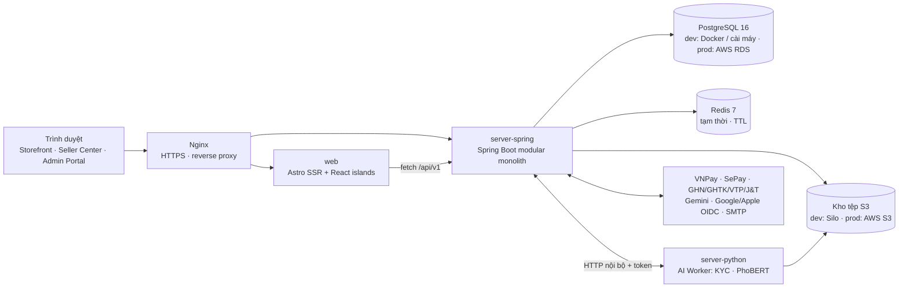
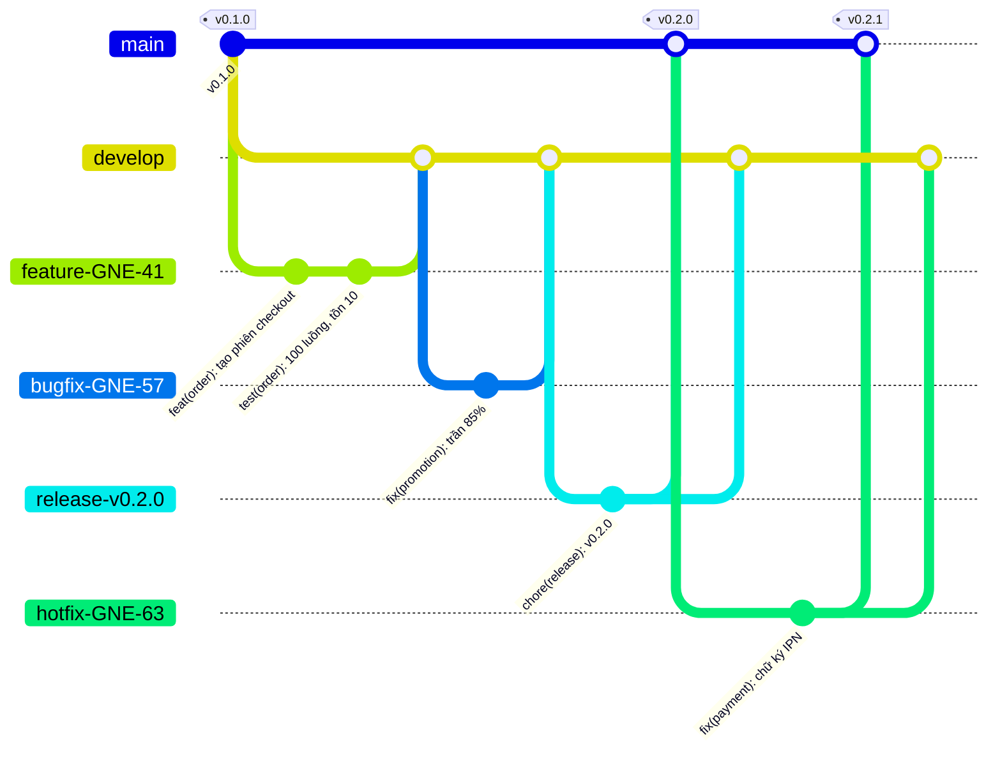

# TECH STACK & QUY ƯỚC THỐNG NHẤT — GENIE TLCN
## Nền tảng để dựng codebase: kiến trúc, cấu trúc repo, công nghệ và mọi luật phải theo

> **Phạm vi:** 87 use case · 11 phân hệ · 65 bảng · 1 ứng dụng Spring Boot (modular monolith) + 1 AI Worker Python (KYC + PhoBERT) + 1 frontend Astro / React · triển khai Docker Compose trên 1 VPS.
> **Nguồn tổng hợp:** `document/Document_Vi.md` (2.1–2.9, 3.4–3.7, 4.1–4.6, NFR-01…15, ADR-01…15), `diagrams/ClassDiagram/ENTITY.md` (12 quy ước chung, 13.1–13.3), `kien-thuc/implement.md` (Phần 2, 3, 4, 14, 16, 17), `kien-thuc/Kien_Thuc_Can_Nam.md` (Phần 6, 7, 8, 22), `PRODUCT.md` / `DESIGN.md` ở gốc repo prototype.
> **Tài liệu đi kèm:** [LUU_TRU_DU_LIEU.md](./LUU_TRU_DU_LIEU.md) — dữ liệu nào lưu ở PostgreSQL, Redis, Silo hay trình duyệt.
> **Thứ tự ưu tiên khi có mâu thuẫn:** file này (mục 12 đã chốt) → `Usecase.md` / `ENTITY.md` (nghiệp vụ, dữ liệu) → `Document_Vi.md` → `implement.md` → phần còn lại.

---

## MỤC LỤC

1. [Kiến trúc tổng thể](#1)
2. [Repo & cây thư mục (backend, frontend, AI Worker, hạ tầng)](#2)
3. [Tech stack chi tiết](#3)
4. [Clean Architecture + tổ chức theo tính năng (backend)](#4)
5. [Frontend Astro + React islands — Clean theo tính năng](#5)
6. [AI Worker Python](#6)
7. [Luật dữ liệu & CSDL](#7)
8. [Luật API](#8)
9. [Luật bảo mật](#9)
10. [Luật tích hợp ngoài, giao dịch & đồng thời](#10)
11. [Luật đặt tên & thương hiệu](#11)
12. [Các điểm tài liệu cũ mâu thuẫn — đã chốt](#12)
13. [Quy trình nhóm: nhánh, commit, PR, phiên bản & release](#13)
14. [Kiểm thử](#14)
15. [CI/CD](#15)
16. [Hạ tầng MVP](#16)
17. [Checklist khởi tạo codebase](#17)

---

<a id="1"></a>
## 1. Kiến trúc tổng thể



| Quyết định | Nội dung | Nguồn |
|---|---|---|
| Kiểu kiến trúc | **Modular monolith** — một tiến trình Spring Boot, 11 module theo 11 phân hệ, giữ được giao dịch ACID cho luồng tiền | ADR-01, NFR-09 |
| AI | AI Worker Python tách riêng: KYC (ONNX + OpenCV) và phân tích cảm xúc đánh giá (PhoBERT ONNX); kiểm duyệt sản phẩm gọi Gemini API từ backend | ADR-06, ADR-11, ADR-14 |
| Bất đồng bộ | Sự kiện nội bộ Spring (`ApplicationEvent` + `@TransactionalEventListener(AFTER_COMMIT)` + `@Async`), `@Scheduled` cho Cron — **không** Kafka / RabbitMQ | ADR-03 |
| Tìm kiếm | PostgreSQL full-text (`tsvector` + `unaccent` + `pg_trgm`) — **không** Elasticsearch | ADR-02 |
| Realtime | WebSocket STOMP, simple broker trong bộ nhớ (một instance) | Document_Vi 2.1.1 |
| Triển khai | Docker Compose trên 1 VPS 4 vCPU / 8 GB, Nginx + Let's Encrypt | ADR-08 |
| Quy mô mục tiêu | ~50 CCU, API đọc P95 < 300 ms, ghi P95 < 500 ms | NFR-01 |

**Ngoài phạm vi TLCN (không dựng sẵn "cho tương lai"):** Kafka, RabbitMQ, Elasticsearch, Qdrant, Kubernetes, Saga, Resilience4j, feature flag, MFA, ví khách hàng. Khi lên DATN chỉ **thêm**, không đổi tên bảng / cột / enum / mã UC (NFR-12).

---

<a id="2"></a>
## 2. Repo & cây thư mục

### 2.1 Cần bao nhiêu repo GitHub

| Repo | Bắt buộc? | Nội dung | Ghi chú |
|---|:---:|---|---|
| **`genie-platform`** (monorepo) | **Có — 1 repo duy nhất cho sản phẩm** | `server-spring/`, `server-python/`, `web/`, `deploy/`, `docs/`, `scripts/`, `.github/` | Một PR sửa được API + giao diện + migration cùng lúc; một CI (lọc theo đường dẫn); một số phiên bản `vX.Y.Z` cho cả 3 image |
| `multivendor-ecommerce-prototype` (đã có) | Giữ nguyên | Prototype tương tác `genie/ui_kits/`, `DESIGN.md`, `PRODUCT.md` | Chỉ là mẫu thiết kế; không phát triển tính năng mới ở đây |
| Repo riêng cho backend / frontend / AI / tài liệu | **Không** | — | Nhóm 4 người, API đổi liên tục trong 8 sprint: tách repo làm lệch phiên bản, nhân đôi CI và PR. Sau này cần tách thì 3 thư mục đã độc lập, chỉ việc chuyển ra |

Thiết lập repo `genie-platform`: bảo vệ nhánh `main` và `develop` (bắt buộc PR, CI xanh, ≥ 2 duyệt, cấm force push), bảo vệ tag `v*`, `CODEOWNERS` theo thư mục, bật Dependabot, lưu bí mật ở GitHub Actions Secrets + Environment `production` có người duyệt.

### 2.2 Cây tổng thể từ frontend đến backend

```
genie-platform/
├── web/                                   # FRONTEND — Astro SSR + React islands (mục 2.4, 5)
│   └── src/{app, pages, layouts, features, shared, i18n, styles}
├── server-spring/                         # BACKEND — Spring Boot modular monolith (mục 2.3, 4)
│   └── src/main/java/com/genie/{common, auth, catalog, order, payment, vendor,
│                                 shipping, promotion, social, support, notification, admin}
├── server-python/                         # AI WORKER — FastAPI: KYC + PhoBERT (mục 2.5, 6)
│   └── app/{core, kyc, sentiment}
├── deploy/                                # HẠ TẦNG — Compose, Nginx, sao lưu (mục 2.6, 16)
├── scripts/                               # tiện ích dev: seed, tải mô hình, giả lập webhook, kiểm i18n
├── docs/                                  # ADR mới, OpenAPI xuất ra, sơ đồ — bản dev dùng hằng ngày
├── .github/
│   ├── workflows/{ci.yml, release.yml, deploy.yml}
│   ├── pull_request_template.md
│   ├── ISSUE_TEMPLATE/{bug_report.md, feature.md}
│   ├── CODEOWNERS
│   └── dependabot.yml
├── .husky/{commit-msg, pre-commit}
├── commitlint.config.cjs                  # luật commit (mục 13.3)
├── cliff.toml                             # git-cliff sinh CHANGELOG từ commit (mục 13.6)
├── package.json                           # chỉ chứa công cụ gốc: husky, commitlint, lint-staged
├── CHANGELOG.md
├── .editorconfig · .gitattributes (eol=lf) · .gitignore · .env.example
└── README.md                              # chạy local trong 15 phút
```

**Không commit:** `.env`, khóa bí mật, tệp mô hình `*.onnx` (tải bằng `scripts/fetch-models.sh` từ bucket `ml-models` hoặc GitHub Release), dump CSDL, `node_modules/`, `target/`, `.venv/`.

### 2.3 Cây backend — `server-spring`

```
server-spring/
├── pom.xml · mvnw · .mvn/
├── Dockerfile                              # multi-stage: build Maven → JRE 21 slim, user không phải root
└── src/
    ├── main/
    │   ├── java/com/genie/
    │   │   ├── GenieApplication.java
    │   │   ├── common/                     # shared kernel — không chứa nghiệp vụ phân hệ
    │   │   │   ├── api/         ApiResponse(+Factory), ErrorResponse(+Factory, details), CursorPage, GlobalExceptionHandler, RequestIds
    │   │   │   ├── error/       ErrorCode (GNE-*), BusinessException, NotFoundException, TooManyRequestsException (Retry-After)
    │   │   │   ├── domain/      BaseEntity, Money, NameNormalizer, Haversine, UserRole, PaymentMethod, PaymentStatus…
    │   │   │   ├── security/    SecurityConfig, JwtAuthFilter, JwtService, AuthUser, CurrentUser, AuthorityProvider (cổng đảo ngược),
    │   │   │   │                InternalTokenFilter, RateLimiter, TokenRevocationStore, ClientInfo(+Resolver), PasswordPolicy,
    │   │   │   │                @StrongPassword, Hashing, RestAuthEntryPoint, RestAccessDeniedHandler
    │   │   │   ├── mail/        EmailSender (cổng), SmtpEmailSender (Thymeleaf, thử lại 3 lần), MailTemplate, MailBranding   ← ADR 0008
    │   │   │   ├── idempotency/ IdempotencyFilter, IdempotencyStore
    │   │   │   ├── storage/     ObjectStorage (port), SiloObjectStorage, UploadController, UploadService, UploadPurpose, StorageProperties  ← ADR 0009
    │   │   │   ├── audit/       AuditLogger, AuditAction, AuditActor, ActorDirectory (cổng đảo ngược), SystemLog, SystemLogRepository
    │   │   │   ├── ai/          AiWorkerHttpClient (cấu hình chung cho kyc + sentiment)
    │   │   │   └── config/      JacksonConfig (snake_case), RedisConfig (timeout 2 s), AsyncConfig, WebConfig,
    │   │   │                    SchedulingConfig, WebSocketConfig, OpenApiConfig, ClockConfig, DotEnvEnvironmentPostProcessor (.env local)
    │   │   ├── order/                      # ví dụ một module đầy đủ
    │   │   │   ├── cart/
    │   │   │   │   ├── api/          CartController, AddCartItemRequest, CartResponse, CartMapper
    │   │   │   │   ├── application/  CartService, CartMergeService
    │   │   │   │   └── domain/       Cart, CartItem, CartRepository
    │   │   │   ├── checkout/
    │   │   │   │   ├── api/          CheckoutController, CreateCheckoutRequest, CheckoutResponse
    │   │   │   │   ├── application/  CheckoutService, CheckoutFacade, ShippingFeeQuoter
    │   │   │   │   ├── domain/       CheckoutSession, SessionStatus, CheckoutSessionRepository
    │   │   │   │   └── event/        CheckoutCreatedEvent
    │   │   │   ├── order/
    │   │   │   │   ├── api/          OrderController, SellerOrderController, OrderResponse
    │   │   │   │   ├── application/  OrderService, OrderFacade, OrderLifecycleListener,
    │   │   │   │   │                 AutoCompleteOrdersJob
    │   │   │   │   ├── domain/       Order, OrderItem, OrderDiscount, OrderStatus, OrderRepository
    │   │   │   │   └── event/        OrderPaidEvent, OrderStatusChangedEvent, OrderCompletedEvent
    │   │   │   └── reservation/
    │   │   │       ├── application/  ReservationService, ExpiredSessionSweeper
    │   │   │       └── domain/       StockReservation, StockReservationRepository
    │   │   ├── auth/         register/ login/ token/ otp/ oauth/ password/ profile/ address/ deletion/   (đã hiện thực — `otp/` thêm theo ADR 0007; `User` ở `profile/domain`)
    │   │   ├── catalog/      category/ attribute/ brand/ product/ search/ moderation/ stats/ wishlist/ proposal/
    │   │   ├── payment/      vnpay/ sepay/ escrow/ ledger/ wallet/
    │   │   ├── vendor/       shop/ kyc/ settings/ analytics/
    │   │   ├── shipping/     carrier/ shipment/ webhook/ cod/
    │   │   ├── promotion/    voucher/ stacking/ flashsale/ coin/
    │   │   ├── social/       chat/ review/ follow/ sentiment/
    │   │   ├── support/      refund/ dispute/
    │   │   ├── notification/ inbox/ email/ platform/ admin/
    │   │   └── admin/        staff/ rbac/ payout/ dashboard/ banner/ users/
    │   └── resources/
    │       ├── application.yml              # mặc định chung
    │       ├── application-local.yml        # máy dev (Docker local)
    │       ├── application-prod.yml         # VPS
    │       ├── db/migration/
    │       │   ├── V1__identity.sql … V12__audit.sql
    │       │   ├── V13__bootstrap_admin.sql
    │       │   ├── V14__auth_additions.sql  # bổ sung của AUTH (ADR 0007); từ nay mọi thay đổi schema = V15+
    │       │   └── R__seed_demo.sql         # chỉ chạy khi placeholder seed_demo = true (profile local / test)
    │       ├── templates/email/             # otp.html, password-changed.html, new-device.html, email-changed.html,
    │       │                                #   deletion-scheduled.html, order-confirmed.html, refund.html, img/
    │       └── logback-spring.xml           # JSON log có traceId
    └── test/java/com/genie/
        ├── architecture/   ModuleBoundaryTest (ArchUnit)
        ├── support/        IntegrationTestBase (Testcontainers PostgreSQL + Redis), TestDataBuilder
        ├── order/checkout/ CheckoutServiceTest (unit), CheckoutConcurrencyIT (100 luồng / tồn 10)
        └── payment/vnpay/  VnPayIpnIdempotencyIT …          # *Test = unit, *IT = tích hợp
```

Mỗi feature chỉ tạo tầng nó cần (`reservation/` không có `api/`). Package chi tiết và luật phụ thuộc: mục 4.

### 2.4 Cây frontend — `web` (Astro + React islands, Clean theo feature)

```
web/
├── astro.config.mjs        # output: 'server', adapter @astrojs/node, integrations: react, tailwind
├── tailwind.config.ts      # theme lấy từ token prototype (màu, chữ, bo góc, đổ bóng)
├── tsconfig.json           # strict, alias @/* → src/*
├── .eslintrc.cjs           # eslint-plugin-boundaries: luật phụ thuộc tầng & feature (mục 5.2)
├── package.json · Dockerfile
├── public/                 # favicon, robots.txt, ảnh tĩnh không qua build
├── tests/e2e/              # Playwright: checkout-vnpay.spec.ts, kyc-onboarding.spec.ts…
└── src/
    ├── env.d.ts
    ├── middleware.ts       # đọc cookie lang, gắn locale; chặn /seller, /admin khi chưa đăng nhập (chỉ UX)
    ├── app/                # khởi động & ghép nối — không chứa nghiệp vụ
    │   ├── seller/SellerApp.tsx       # React SPA: QueryClientProvider + Router + layout Seller
    │   ├── seller/routes.tsx          # /seller/* → màn của features
    │   ├── admin/AdminApp.tsx
    │   ├── admin/routes.tsx           # nav lọc theo quyền
    │   └── providers.tsx              # i18n, query client, toast dùng chung
    ├── pages/              # ROUTE — mỏng: lấy dữ liệu SSR rồi ghép component của feature
    │   ├── index.astro
    │   ├── c/[slug].astro                 p/[slug]-[id].astro
    │   ├── shop/[id].astro                search.astro          flash-sale.astro
    │   ├── campaign/[slug].astro          discover.astro
    │   ├── cart.astro                     checkout.astro        checkout/result.astro
    │   ├── orders/index.astro             orders/[id].astro     chat.astro
    │   ├── account/[...section].astro     # hồ sơ, địa chỉ, voucher, Điểm, yêu thích…
    │   ├── auth/{login,register,forgot,oauth-callback}.astro
    │   ├── seller/[...path].astro         # <SellerApp client:only="react" />
    │   ├── admin/[...path].astro          # <AdminApp client:only="react" />
    │   ├── policies/[slug].astro          sitemap.xml.ts        404.astro
    ├── layouts/
    │   ├── StorefrontLayout.astro         # header, footer, SEO, Open Graph
    │   └── AppShellLayout.astro           # khung trống cho SPA Seller / Admin
    ├── features/           # THEO TÍNH NĂNG — cùng tên với module backend
    │   ├── cart/                          # ví dụ một feature đầy đủ
    │   │   ├── domain/                    # TS thuần, không React / không fetch
    │   │   │   ├── cart.types.ts          #   CartLine, GuestCart…
    │   │   │   └── cart.rules.ts          #   groupByShop(), lineSubtotal(), MAX_GUEST_LINES
    │   │   ├── application/               # use case phía client: hook + store
    │   │   │   ├── cart.store.ts          #   nanostores: số lượng giỏ dùng chung giữa các island
    │   │   │   ├── useCart.ts             #   TanStack Query: đọc / sửa giỏ
    │   │   │   └── mergeGuestCart.ts      #   gộp giỏ khách sau đăng nhập
    │   │   ├── infrastructure/            # nói chuyện với bên ngoài
    │   │   │   ├── cart.api.ts            #   gọi /api/v1/cart qua shared/api/http
    │   │   │   ├── cart.dto.ts            #   kiểu JSON snake_case của API
    │   │   │   ├── cart.mapper.ts         #   DTO ⇄ domain
    │   │   │   └── guestCart.storage.ts   #   localStorage genie.cart.guest
    │   │   ├── ui/
    │   │   │   ├── CartPage.tsx           #   island lớn của trang giỏ
    │   │   │   ├── MiniCart.tsx           #   island trên header
    │   │   │   ├── AddToCartButton.tsx    #   island trên trang sản phẩm
    │   │   │   └── CartSummary.astro      #   phần tĩnh render SSR
    │   │   └── index.ts                   # API công khai của feature — nơi duy nhất feature khác import
    │   ├── auth/  catalog/  product/  search/  shop/  checkout/  payment/  orders/
    │   ├── reviews/  chat/  promotions/  coins/  refunds/  notifications/  account/
    │   ├── seller-onboarding/  seller-products/  seller-orders/  seller-wallet/  seller-analytics/
    │   └── admin-kyc/  admin-moderation/  admin-disputes/  admin-finance/  admin-marketing/  admin-system/
    ├── shared/             # dùng chung, KHÔNG phụ thuộc features
    │   ├── ui/            Button, Input, Select, Modal, Badge, Toast, Price, Rating, EmptyState…
    │   ├── api/           http.ts (fetch + token + refresh 1 lần khi 401), server-http.ts (SSR gọi nội bộ),
    │   │                  errors.ts (GNE-* → thông điệp i18n), idempotency.ts
    │   ├── auth/          session.ts (access token trong bộ nhớ), usePermissions.ts
    │   ├── lib/           i18n.ts (t()), format.ts (Intl tiền / ngày), storage.ts (tiền tố genie.), seo.ts
    │   └── config/        env.ts (PUBLIC_API_URL, INTERNAL_API_URL đọc qua zod)
    ├── i18n/{vi.json, en.json}
    └── styles/{global.css, tokens.css}
```

### 2.5 Cây AI Worker — `server-python`

```
server-python/
├── pyproject.toml · Dockerfile           # Python 3.12 slim + JRE (nếu tách từ bằng VnCoreNLP)
├── app/
│   ├── main.py                           # FastAPI, lifespan nạp mô hình một lần
│   ├── core/
│   │   ├── config.py                     # pydantic-settings: INTERNAL_TOKEN, BACKEND_URL, MINIO_*
│   │   ├── security.py                   # kiểm header token nội bộ
│   │   ├── callback.py                   # gọi lại backend /api/v1/internal/*
│   │   └── logging.py                    # log JSON
│   ├── kyc/
│   │   ├── router.py                     # POST /kyc/verify
│   │   ├── service.py                    # điều phối tầng, chấm riskScore
│   │   ├── qr.py · mrz.py · face.py · scoring.py · schemas.py
│   ├── sentiment/
│   │   ├── router.py                     # POST /sentiment, POST /sentiment/batch
│   │   ├── service.py
│   │   ├── preprocess.py                 # NFC, teencode, tách từ — giống lúc huấn luyện
│   │   ├── model.py                      # ONNX Runtime + tokenizer PhoBERT
│   │   └── schemas.py
│   └── health.py                         # GET /health: mô hình đã nạp chưa
├── models/                               # *.onnx tải về lúc build / khởi động — không commit
├── resources/teencode.txt
└── tests/{kyc/, sentiment/ (tập kiểm thử cố định → accuracy, macro-F1), conftest.py}
```

### 2.6 Cây hạ tầng — `deploy` & `scripts`

```
deploy/
├── docker-compose.yml                # production: nginx, frontend, backend, ai-worker, redis (CSDL = RDS, tệp = S3 — mục 16)
├── docker-compose.local.yml          # máy dev: postgres, redis, silo, silo-init, mailpit
├── .env.example                      # mọi biến cần có, giá trị giả
├── nginx/
│   ├── nginx.conf                    # gzip, log, giới hạn, header bảo mật chung
│   └── conf.d/{web.conf, api.conf}
├── silo/init.sh                     # máy dev: tạo bucket, chính sách công khai, lifecycle tmp/ 1 ngày
├── aws/{README.md, s3-init.sh, iam-policy.json}   # production: RDS, 9 bucket S3, IAM user ứng dụng
├── redis/redis.conf                  # AOF, maxmemory 256mb, volatile-lru, requirepass
├── backup/{backup.sh, restore.sh}    # pg_dump từ RDS hằng ngày giữ 7 bản (bổ sung cho RDS automated backups)
└── scripts/deploy.sh                 # pull image theo TAG, up -d, kiểm health, rollback
scripts/
├── fetch-models.sh                   # tải ONNX KYC + PhoBERT
├── seed-local.sh                     # nạp dữ liệu demo
├── check-i18n.mjs                    # so khóa vi.json / en.json
└── webhooks/{ghn-webhook.http, sepay-webhook.http, vnpay-ipn.http}   # giả lập webhook khi dev
```

---

<a id="3"></a>
## 3. Tech stack chi tiết

### 3.1 Backend — `server-spring`

| Thành phần | Chọn | Ghi chú / luật |
|---|---|---|
| Ngôn ngữ / runtime | **Java 21 LTS** | Dùng `record` cho DTO / sự kiện, `switch` pattern, virtual thread chưa bật mặc định |
| Framework | **Spring Boot 3.3.x** | Starter: Web, Security 6, Data JPA, Validation, WebSocket, Mail, Actuator, Cache (Redis), Data Redis |
| Build | Maven (wrapper `./mvnw`) | Một module Maven; ranh giới module kiểm bằng ArchUnit (mục 4.4) |
| ORM | Spring Data JPA + Hibernate 6 | `ddl-auto=validate` ở **mọi** môi trường |
| Migration | **Flyway** | `V1__identity.sql` … `V12__audit.sql`, `V13__bootstrap_admin.sql`, `V14__auth_additions.sql`, `R__seed_demo.sql` |
| Boilerplate | Lombok 1.18.34 | Entity theo mẫu ở mục 7.2; **không** `@Data` trên entity |
| Mapping DTO | MapStruct (đề xuất) | Hoặc viết tay `toResponse()` — chọn một cách cho cả dự án ở S1 |
| Mật khẩu | `Argon2PasswordEncoder` | Argon2id (NFR-05) |
| JWT | `spring-security-oauth2-resource-server` / `jjwt` | HS256, khóa ≥ 256 bit trong biến môi trường |
| OAuth Google / Apple | Spring Security OAuth2 Client hoặc tự xác minh `id_token` (JWKS) | Authorization Code + PKCE |
| Thử lại | Spring Retry (`@Retryable`) | Theo bảng timeout mục 10.2 |
| Tài liệu API | springdoc-openapi 2.6 | Hợp đồng đầy đủ ở repo `genie-api-spec` (Swagger UI, `docs/openapi/openapi.json`) — nguồn cho Apidog / sinh client |
| Log | Logback + `logstash-logback-encoder` (JSON), Micrometer Tracing (`traceId`) | Xoay vòng 7 ngày |
| Kiểm thử | JUnit 5, Mockito, Spring Boot Test, **Testcontainers** (PostgreSQL, Redis), **ArchUnit** | Mục 14 |
| Thư viện tích hợp | MinIO Java SDK `io.minio` (gọi Silo qua API S3), VNPay (tự ký HMAC-SHA512), Google Gen AI SDK / REST cho Gemini | Bọc sau interface (mục 10.1) |

### 3.2 Dữ liệu & hạ tầng

| Thành phần | Phiên bản | Vai trò |
|---|---|---|
| PostgreSQL | **16** (+ `unaccent`, `pg_trgm`) | Nguồn sự thật — 65 bảng |
| Redis | **7** (AOF bật, có mật khẩu) | OTP, rate limit, idempotency, cache, bộ đếm — **không** là nguồn sự thật |
| Kho tệp S3 | Máy dev / test: **Silo** `pgsty/silo:RELEASE.2026-10-26T00-00-00Z` (chốt tag); production: **AWS S3** (`ap-southeast-1`, tiền tố bucket `STORAGE_BUCKET_PREFIX` — ADR 0010 trong repo) | Ảnh, video, hồ sơ KYC, giấy tờ, bằng chứng — Presigned URL |
| Nginx | 1.27-alpine | HTTPS (Let's Encrypt), reverse proxy, phục vụ ảnh công khai |
| Docker / Compose | Compose v2 | Môi trường local + staging |
| Mail | Mailpit (local) · Gmail SMTP / Mailtrap (demo) | OTP là kênh duy nhất qua email (ADR-10) |

### 3.3 AI Worker — `server-python`

| Thành phần | Chọn |
|---|---|
| Runtime | **Python 3.12**, FastAPI, Uvicorn (1 worker), Pydantic v2 |
| KYC | OpenCV, ONNX Runtime (YuNet + SFace), đọc QR + MRZ |
| Cảm xúc đánh giá | PhoBERT nhóm đã fine-tune 3 nhãn → ONNX (INT8) + ONNX Runtime; tokenizer của PhoBERT; tách từ RDRSegmenter / VnCoreNLP (cần JRE trong image, hoặc bản Python tương đương — phải **giống lúc huấn luyện**) |
| Giới hạn | 2 GB RAM, nạp mô hình một lần khi khởi động |
| Kiểm thử | pytest; tập ảnh KYC mẫu; tập kiểm thử cảm xúc cố định (accuracy, macro-F1) |

### 3.4 Frontend — `web`

| Thành phần | Chọn | Luật |
|---|---|---|
| Framework | **Astro** (SSR, adapter Node) | Storefront render phía máy chủ cho SEO + Open Graph (bot Facebook / Zalo không chạy JS) |
| UI động | **React 19** (islands) | Seller Center, Admin Portal là React SPA gắn dưới `/seller/*`, `/admin/*` |
| Ngôn ngữ | **TypeScript** strict | Không `any` trong mã mới |
| CSS | **Tailwind CSS** | Theme lấy từ token prototype (`genie/tokens/*.css`, `DESIGN.md`); breakpoint `sm/md/lg`, 360–1440 px |
| Runtime SSR | Node.js 22 LTS | Một image `frontend` |
| Ảnh | `browser-image-compression` → WebP trước khi PUT lên Silo | |
| i18n | `src/i18n/vi.json`, `en.json` + hàm `t(key)` dùng chung Astro / React | CI kiểm thiếu khóa |
| Kiểm thử | Playwright (E2E), Vitest (đơn vị, đề xuất) | |
| Lint / format | ESLint + Prettier, `astro check`, `tsc --noEmit` | Chạy trong CI |

> Prototype đang dùng React 18 UMD + Babel trong trình duyệt — **chỉ** để trình diễn. Sản phẩm thật dùng ngăn xếp ở bảng trên.

### 3.5 Dịch vụ ngoài

| Dịch vụ | Dùng cho | Môi trường demo |
|---|---|---|
| VNPay `vnp_Version 2.1.0` | Thanh toán thẻ / QR, IPN, hoàn tiền | Sandbox |
| SePay | Webhook biến động số dư: chuyển khoản VietQR, tiền COD hãng chuyển về, xác nhận lệnh chi | Tài khoản ngân hàng demo |
| GHN (mặc định), GHTK, ViettelPost, J&T | Phí ship, vận đơn, webhook hành trình, thu hộ COD | Môi trường dev của từng hãng |
| Google Gemini API (bản Flash) | Kiểm duyệt sản phẩm, structured output JSON | Hạn mức miễn phí |
| Google / Apple OIDC | Đăng nhập mạng xã hội | Domain HTTPS (Cloudflare Tunnel khi dev) |

### 3.6 Công cụ nhóm

GitHub + GitHub Actions + GHCR · Jira (key `GNE`) · SonarCloud · Apidog (hoặc Postman) · k6 · OWASP ZAP · Uptime Kuma · Husky + commitlint.

---

<a id="4"></a>
## 4. Clean Architecture + tổ chức theo tính năng (backend)

### 4.1 Ba cấp tổ chức

```
com.genie.<module>.<feature>.<layer>
          │        │          └─ api · application · domain · infra   (Clean Architecture)
          │        └─ nhóm tính năng trong phân hệ: cart, checkout, order, reservation…
          └─ 11 module = 11 phân hệ (bounded context) + common
```

- **Module** = phân hệ nghiệp vụ, đúng danh sách NFR-09: `auth`, `catalog`, `order`, `payment`, `vendor`, `shipping`, `promotion`, `social`, `support`, `notification`, `admin`. Không tạo module theo tầng kỹ thuật (`controllers/`, `services/` ở gốc).
- **Feature** = nhóm use case gần nhau trong một phân hệ. Thêm tính năng mới = thêm thư mục feature, không phải sửa 4 thư mục rải rác.
- **Layer** = 4 tầng Clean Architecture bên trong mỗi feature (tên tầng giữ đúng `implement.md` 2.2), cộng gói `event/` chứa sự kiện công khai cho module khác.

### 4.2 Bốn tầng và chiều phụ thuộc

```
   api  ──────►  application  ──────►  domain  ◄──────  infra
(controller,     (use case service,      (entity, value     (adapter: JPA custom
 DTO request/     facade, event           object, repository  query, VNPay, GHN,
 response,        listener, port          interface, domain   Gemini, Silo, AI
 mapper)          interface)              event, rule)        Worker client)
```

| Tầng | Chứa | Được phép phụ thuộc | Cấm |
|---|---|---|---|
| `api` | `@RestController`, DTO `record` (`*Request`, `*Response`), mapper, xử lý STOMP | `application` | Gọi repository trực tiếp; chứa logic nghiệp vụ; trả entity ra JSON |
| `application` | `*Service` (một use case / nhóm use case), `*Facade` (cửa công khai cho module khác), `@TransactionalEventListener`, **port** (interface ra ngoài: `PaymentGateway`, `CarrierAdapter`, `ObjectStorage`, `AiWorkerClient`) | `domain`, `common` | Biết Spring MVC / HTTP; gọi `infra` cụ thể (chỉ qua port) |
| `domain` | `@Entity` (rich domain model — phương thức nghiệp vụ trong ENTITY.md), enum, value object (`Money`), Spring Data `Repository` interface | `common` (kernel) | Phụ thuộc `api`, `application`, `infra`, module khác |
| `event` | Sự kiện công khai `record` (`OrderPaidEvent`, `ReviewCreatedEvent`) — chỉ chứa ID và giá trị, không chứa entity | `common` | Chứa logic; tham chiếu entity |
| `infra` | Cài đặt port: `VnPayGateway`, `GhnCarrierAdapter`, `SiloObjectStorage`, `GeminiModerationClient`, `HttpAiWorkerClient`, truy vấn native / Specification phức tạp | `domain`, `application` (port), `common` | Bị `api` / `application` gọi trực tiếp không qua port |

**Thỏa hiệp có chủ đích (pragmatic clean architecture):** entity JPA **chính là** domain model (đúng ENTITY.md: phương thức nghiệp vụ nằm trong entity, ném `IllegalStateException` khi sai máy trạng thái). Không tạo cặp entity domain thuần + entity JPA trùng nhau — quá nặng cho 65 bảng / 16 tuần.

### 4.3 Cây package mẫu

```
server-spring/src/main/java/com/genie/
├── GenieApplication.java
├── common/                         # shared kernel — không chứa nghiệp vụ phân hệ
│   ├── api/          ApiResponse, ProblemDetail mapper, GlobalExceptionHandler, CursorPage
│   ├── error/        ErrorCode (GNE-*), BusinessException
│   ├── domain/       BaseEntity (createdAt/updatedAt), Money, các util (NameNormalizer, Haversine)
│   ├── security/     JwtAuthFilter, CurrentUser, InternalTokenFilter, RateLimiter
│   ├── idempotency/  IdempotencyFilter (Redis SET NX)
│   ├── storage/      ObjectStorage (port) + SiloObjectStorage (infra), PresignService
│   ├── audit/        AuditLogger → system_logs
│   └── config/       Jackson (snake_case), Redis, Async, Scheduling, WebSocket, OpenAPI
├── auth/
│   ├── register/ login/ token/ oauth/ password/ profile/ address/ deletion/
├── catalog/
│   ├── category/ attribute/ brand/ product/ search/ moderation/ stats/ wishlist/ proposal/
├── order/
│   ├── cart/ checkout/ order/ reservation/
├── payment/
│   ├── vnpay/ sepay/ escrow/ ledger/ wallet/
├── vendor/
│   ├── shop/ kyc/ settings/ analytics/
├── shipping/
│   ├── carrier/ shipment/ webhook/ cod/
├── promotion/
│   ├── voucher/ stacking/ flashsale/ coin/
├── social/
│   ├── chat/ review/ follow/ sentiment/
├── support/
│   ├── refund/ dispute/
├── notification/
│   ├── inbox/ email/ platform/ admin/
└── admin/
    ├── staff/ rbac/ payout/ dashboard/ audit/ banner/ users/
```

Ví dụ một feature đầy đủ:

```
order/checkout/
├── api/            CheckoutController, CreateCheckoutRequest, CheckoutResponse, CheckoutMapper
├── application/    CheckoutService, CheckoutFacade, OrderPaidListener
├── domain/         CheckoutSession, SessionStatus, CheckoutSessionRepository
├── event/          OrderPaidEvent (module notification, promotion… lắng nghe)
└── infra/          (trống nếu không có adapter riêng)
```

### 4.4 Luật giao tiếp giữa module (kiểm bằng ArchUnit trong CI)

1. Module A **chỉ** dùng của module B: `*Facade` trong `application`, sự kiện `record` trong gói `event/` của feature, và DTO công khai mà facade trả về. Không inject repository / entity / service nội bộ của module khác (ví dụ `order` gọi `InventoryFacade.reserve()`, không inject `ProductVariantRepository`).
2. `domain` không phụ thuộc tầng nào khác; `api` không phụ thuộc `infra`.
3. Không vòng phụ thuộc giữa module (`slices().matching("com.genie.(*)..").should().beFreeOfCycles()`).
4. Khóa ngoại sang bảng của module khác lưu dạng **ID** (`Long vendorId`), quan hệ JPA điều hướng chỉ dùng trong cùng module.

```java
static final List<String> MODULES = List.of("auth", "catalog", "order", "payment", "vendor", "shipping",
        "promotion", "social", "support", "notification", "admin");

@ArchTest  // bên ngoài module X không được chạm domain / infra / api của X — chỉ *Facade (application) và event/
static void modules_only_talk_through_facades(JavaClasses classes) {
    for (String m : MODULES) {
        noClasses().that().resideOutsideOfPackage("com.genie." + m + "..")
            .should().dependOnClassesThat().resideInAnyPackage(
                "com.genie." + m + "..domain..", "com.genie." + m + "..infra..", "com.genie." + m + "..api..")
            .because("module " + m + " chỉ được gọi qua *Facade hoặc sự kiện trong event/")
            .check(classes);
    }
}
@ArchTest static final ArchRule api_never_touches_infra =
    noClasses().that().resideInAPackage("..api..").should().dependOnClassesThat().resideInAPackage("..infra..");
@ArchTest static final ArchRule domain_is_pure =
    noClasses().that().resideInAPackage("..domain..")
        .should().dependOnClassesThat().resideInAnyPackage("..api..", "..application..", "..infra..");
@ArchTest static final ArchRule modules_free_of_cycles =
    slices().matching("com.genie.(*)..").should().beFreeOfCycles();
```

### 4.5 Sự kiện & giao dịch

- Việc liên quan **tiền / tồn kho / Điểm / suất Flash Sale** làm **trong transaction chính** của service, không trong listener bất đồng bộ.
- Listener `@Async @TransactionalEventListener(AFTER_COMMIT)` chỉ cho: thông báo, email, xóa cache, gọi AI Worker / Gemini, cập nhật thống kê.
- Một use case = một method service `@Transactional` mở ở tầng `application`; controller không mở transaction.

---

<a id="5"></a>
## 5. Frontend Astro + React islands — Clean theo tính năng

Cây thư mục đầy đủ: mục 2.4.

### 5.1 Ba kiểu trang

| Kiểu | Dùng cho | Cách dựng | Lấy dữ liệu |
|---|---|---|---|
| **SSR + islands** | Storefront công khai: trang chủ, danh mục, sản phẩm, shop, tìm kiếm, chiến dịch, chính sách | `.astro` render HTML phía máy chủ; phần tương tác là island React | Frontmatter `.astro` gọi `features/*/infrastructure` qua `shared/api/server-http.ts` (`INTERNAL_API_URL=http://backend:8080`, không cần đăng nhập) |
| **SSR khung + island lớn** | Trang cần đăng nhập của người mua: giỏ, checkout, đơn, tài khoản, chat | `.astro` chỉ dựng layout; nội dung là một island `client:load` | Island gọi API từ trình duyệt (`PUBLIC_API_URL`) kèm access token |
| **SPA** | Seller Center, Admin Portal | `pages/seller/[...path].astro` → `<SellerApp client:only="react" />`, định tuyến bằng React Router | TanStack Query trong trình duyệt |

**Chọn chỉ thị hydrate cho island:**

| Chỉ thị | Khi nào | Ví dụ |
|---|---|---|
| (không có) | Phần tĩnh, không cần JS | Mô tả sản phẩm, footer, danh sách chính sách |
| `client:load` | Tương tác ngay khi vào trang | Header (ô tìm kiếm, mini-cart), trang giỏ, checkout |
| `client:idle` | Tương tác nhưng không gấp | Nút yêu thích, theo dõi shop, chia sẻ |
| `client:visible` | Nằm dưới màn hình đầu | Đánh giá, sản phẩm tương tự, "Gợi ý hôm nay" |
| `client:only="react"` | Không có ý nghĩa khi SSR | Seller / Admin SPA, chat, trình chụp selfie KYC |

### 5.2 Bốn tầng trong mỗi feature và chiều phụ thuộc

```
   ui  ──────►  application  ──────►  domain  ◄──────  infrastructure
 (.tsx island,   (hook, store,          (type, quy tắc       (gọi API, DTO,
  .astro tĩnh)    use case client)       thuần TypeScript)     mapper, storage)
```

| Tầng | Chứa | Được import | Cấm |
|---|---|---|---|
| `domain` | Kiểu dữ liệu, hằng số, hàm thuần (`groupByShop`, tính tạm tính hiển thị, kiểm hợp lệ) | `shared/lib` (thuần) | React, `fetch`, `localStorage` |
| `application` | Hook TanStack Query, store nanostores, luồng nhiều bước (`mergeGuestCart`) | `domain`, `infrastructure` của chính feature, `shared` | JSX |
| `infrastructure` | `*.api.ts`, `*.dto.ts` (snake_case như API), `*.mapper.ts`, `*.storage.ts` | `domain`, `shared/api`, `shared/lib` | React |
| `ui` | Island `.tsx`, thành phần `.astro` | `application`, `domain`, `shared/ui` | Gọi thẳng `infrastructure` (trừ `.astro` SSR lấy dữ liệu trong frontmatter) |

**Luật giữa các feature:** chỉ import qua `features/<x>/index.ts`; không import sâu (`features/cart/infrastructure/...` từ feature khác bị ESLint chặn). Dùng chung từ 2 feature trở lên → chuyển vào `shared/`. `shared/` không bao giờ import `features/`. `pages/` và `app/` được import mọi feature (qua `index.ts`).

```js
// .eslintrc.cjs — eslint-plugin-boundaries (rút gọn)
'boundaries/element-types': ['error', { default: 'disallow', rules: [
  { from: 'pages',          allow: ['features', 'layouts', 'shared', 'app'] },
  { from: 'app',            allow: ['features', 'shared'] },
  { from: 'feature-ui',     allow: ['feature-application', 'feature-domain', 'shared', 'features-public'] },
  { from: 'feature-app',    allow: ['feature-domain', 'feature-infrastructure', 'shared'] },
  { from: 'feature-infra',  allow: ['feature-domain', 'shared'] },
  { from: 'feature-domain', allow: ['shared-lib'] },
  { from: 'shared',         allow: ['shared'] },
]}]
```

### 5.3 Trạng thái & dữ liệu

| Loại trạng thái | Công cụ | Ví dụ |
|---|---|---|
| Dữ liệu từ server | **TanStack Query** (cache, tải lại, thử lại) | Giỏ, đơn hàng, ví shop, hàng chờ kiểm duyệt |
| Chia sẻ giữa các island trên cùng trang | **nanostores** (`@nanostores/react`) — mỗi island là một cây React riêng nên không dùng chung Context được | Số lượng giỏ trên header ↔ nút "Thêm vào giỏ" |
| Form | **react-hook-form + zod** | Đăng ký, địa chỉ, đăng bán sản phẩm, voucher |
| Phiên đăng nhập | `shared/auth/session.ts` — access token trong biến bộ nhớ | Tải lại trang → gọi `POST /auth/sessions/refresh` (cookie HttpOnly `genie_rt`), phản hồi kèm `user` để dựng lại phiên |
| Lưu ở trình duyệt | `shared/lib/storage.ts` theo LUU_TRU_DU_LIEU.md mục 6 | Giỏ khách vãng lai, nháp checkout |

### 5.4 Luật chung

- Trang storefront cần SEO **render SSR** đầy đủ: `<title>`, `meta description`, Open Graph, JSON-LD `Product` + `BreadcrumbList`; `sitemap.xml` sinh từ `pages/sitemap.xml.ts`.
- Mọi chuỗi giao diện qua `t()`; định dạng tiền / ngày bằng `Intl` (NFR-14).
- Phân quyền ở frontend chỉ để ẩn / hiện; server luôn kiểm `@PreAuthorize` (NFR-13). `middleware.ts` chặn `/seller`, `/admin` chỉ để chuyển hướng cho tiện.
- Ảnh nén WebP (`browser-image-compression`) trước khi PUT lên Silo; ảnh KYC giữ nguyên.
- Từ ngữ theo PRODUCT.md: **Genie**, **Điểm Genie / Điểm**, **Chính hãng**; giao diện bám prototype `genie/ui_kits`.
- Mỗi feature có test: Vitest cho `domain` / `application`, Playwright cho luồng chính ở `tests/e2e/`.

---

<a id="6"></a>
## 6. AI Worker Python

Cây thư mục đầy đủ: mục 2.5.

- Chỉ nhận request có header token nội bộ (`INTERNAL_TOKEN`); không mở ra Internet (chỉ trong mạng Compose).
- API: `POST /kyc/verify` → callback `PATCH /api/v1/internal/kyc/{id}/result`; `POST /sentiment` → callback `PATCH /api/v1/internal/reviews/{id}/sentiment`.
- Không lưu ảnh CCCD; chỉ lưu embedding khuôn mặt khi có đồng ý; không nhận tên / email / SĐT khách khi chấm cảm xúc.
- Tiền xử lý PhoBERT giống hệt lúc huấn luyện (NFC, viết thường, teencode, tách từ, ≤ 256 token); ghi tên + phiên bản mô hình trong kết quả.

---

<a id="7"></a>
## 7. Luật dữ liệu & CSDL

### 7.1 Kiểu dữ liệu (ENTITY.md quy ước 1–8)

| Loại | PostgreSQL | Java | Luật |
|---|---|---|---|
| Khóa chính | `BIGINT GENERATED ALWAYS AS IDENTITY` | `Long` + `@GeneratedValue(IDENTITY)` | Đã chốt (mục 12) |
| Tiền | `NUMERIC(19,2)` | `BigDecimal` | **Cấm** `float` / `double`; tỷ lệ `%` dùng `NUMERIC(5,2)` / `(5,4)` |
| Thời gian | `TIMESTAMPTZ` (UTC) | `OffsetDateTime` / `Instant` | Hiển thị theo múi giờ người dùng ở frontend |
| Enum | `VARCHAR` + `CHECK` | `@Enumerated(EnumType.STRING)` | **Cấm** `ORDINAL`; giá trị đúng Phụ lục A ENTITY.md |
| JSON | `JSONB` | `String` + `@JdbcTypeCode(SqlTypes.JSON)` | Tên trường hậu tố `*Json`; snapshot đơn hàng dùng JSONB |
| Nullable | cột cho phép NULL | Wrapper (`Integer`, `Boolean`…) | Cột NOT NULL có `nullable = false`; chú thích `// NULLABLE —` cho cột cho phép rỗng |
| Khóa lạc quan | `version BIGINT NOT NULL` | `@Version` | Trên 10 bảng nóng (User, Product, ProductVariant, Voucher, FlashSaleItem, UserCoin, Order, StockReservation, PaymentTransaction, VendorWallet) |

### 7.2 Entity (ENTITY.md quy ước 9–12)

```java
@Entity @Table(name = "orders")
@Getter @Setter @Builder @NoArgsConstructor(access = AccessLevel.PROTECTED) @AllArgsConstructor
public class Order {
    @Id @GeneratedValue(strategy = GenerationType.IDENTITY) private Long id;
    @Builder.Default @Column(nullable = false) private BigDecimal shippingFee = BigDecimal.ZERO;  // NOT NULL có giá trị đầu → @Builder.Default
    @Version @Column(nullable = false) private Long version;
    @CreationTimestamp @Column(nullable = false, updatable = false) private OffsetDateTime createdAt;
    @UpdateTimestamp private OffsetDateTime updatedAt;
    public void transitionTo(OrderStatus next) { /* kiểm máy trạng thái, ném IllegalStateException */ }
}
```

- **Không** `@Data` / `@EqualsAndHashCode` mặc định trên entity; so sánh bằng `id`.
- Phương thức nghiệp vụ chỉ đổi **chính entity đó**; đọc / ghi entity khác, khóa bi quan, sổ cái, cache do service điều phối.
- **Snapshot** ở dữ liệu giao dịch: tên, SKU, giá, địa chỉ, mã voucher chụp lúc đặt hàng — không JOIN ngược về sản phẩm để hiển thị đơn cũ.
- **Xóa:** dữ liệu tiền / danh tính / sản phẩm đã bán → xóa mềm (`status = DELETED`, ẩn danh hóa); con phụ thuộc hoàn toàn → `ON DELETE CASCADE`; tham chiếu phụ → `SET NULL`.
- Sổ cái `financial_ledger`, `wallet_transactions`, `coin_transactions`, `system_logs` **chỉ ghi thêm**; điều chỉnh = bút toán đảo.

### 7.3 Migration

- Một nguồn: **ENTITY.md → migration Flyway viết tay** (không để Hibernate sinh DDL). Đổi ENTITY.md trước, rồi viết migration, rồi entity Java.
- **Không sửa migration đã merge**; thay đổi = file `V<n+1>__mo_ta.sql` mới. Rollback = viết migration sửa (migration chỉ tiến).
- Tên bảng `snake_case` số nhiều (`order_items`), cột `snake_case`, index `idx_<bảng>_<cột>`, unique `uk_<bảng>_<ý nghĩa>`, FK `fk_<bảng>_<bảng đích>`.
- Mỗi đường truy vấn nóng phải có index (ENTITY.md 13.1) trước khi merge.

---

<a id="8"></a>
## 8. Luật API

| Luật | Nội dung |
|---|---|
| Đường dẫn | `/api/v1/...`; nhóm theo vai trò: `/public/**` (không đăng nhập), `/me/**`, `/seller/**` (VENDOR), `/admin/**` (STAFF + mã quyền), `/internal/**` (AI Worker, token nội bộ), webhook `/payments/vnpay/ipn`, `/payments/sepay/webhook`, `/shipping/{carrier}/webhook` |
| Tên tài nguyên | danh từ số nhiều, `kebab-case` (`/review-reports`); hành động đặc biệt là động từ cuối (`/orders/{id}/cancel`) |
| JSON | **`snake_case`** cho toàn bộ body (Jackson `SNAKE_CASE`) — đúng chuẩn Document_Vi 3.5 |
| Thành công | `ApiResponse { code: "SUCCESS", status, message, data, meta{request_id, timestamp, server_version} }` |
| Lỗi | RFC 7807 mở rộng: `{ code: "GNE-<MIỀN>-<HTTP><STT>", status, message, errors[{field, code, rejected_value, message}], meta{request_id, timestamp, path} }`; mã lấy từ danh mục Document_Vi 3.7.1 — thêm mã mới thì thêm vào danh mục |
| Validation | Bean Validation trên DTO request; lỗi → `422 GNE-VAL-4220` từng trường |
| Idempotency | Header `Idempotency-Key: <UUIDv4>` **bắt buộc** cho tạo phiên checkout, thanh toán, rút tiền, hoàn tiền; Redis `SET NX` 24 giờ, lần lặp trả lại response đã lưu; Redis lỗi → trả `503 GNE-SYS-5030`, **không** xử lý |
| Phân trang | Cursor / keyset: `?limit=20&cursor=...` → `pagination{limit, has_more, next_cursor}`; bảng quản trị nhỏ được dùng `page/size` |
| Tiền trong JSON | số nguyên VND (`1250000`) hoặc chuỗi thập phân — không dùng số thực có phần lẻ |
| Thời gian | ISO-8601 có múi giờ (`2026-10-16T08:00:00.125Z`) |
| Tải tệp | Không upload qua Spring: xin Presigned PUT → PUT thẳng Silo → gửi `object_key` trong **chính** request nghiệp vụ, không có bước `confirm` riêng (API_SPEC 0.8, 17.2) |
| Webhook | Xác thực chữ ký / API key / token; idempotent theo mã giao dịch; luôn trả 200 cho cổng khi đã xử lý (kể cả trùng) |
| Tài liệu | OpenAPI sinh tự động; mỗi endpoint ghi mã UC trong `@Operation(summary = "UC-ORD-07 …")` |

---

<a id="9"></a>
## 9. Luật bảo mật

| Lớp | Luật | Nguồn |
|---|---|---|
| Truyền tải | HTTPS bắt buộc, HSTS, WebSocket `wss://`; CORS chỉ domain của sàn | Document_Vi 3.6, NFR-06 |
| Xác thực | Access JWT HS256 **15 phút** (khóa ≥ 256 bit; claim `sub`, `role`, `sid` = `family_id`, `jti` — không email / quyền); refresh token **7 ngày**, 48 byte ngẫu nhiên, lưu **băm SHA-256**, cookie `genie_rt` `HttpOnly; SameSite=Strict; Path=/api/v1/auth`, xoay vòng mỗi lần dùng (giữ `family_id`); dùng lại token đã xoay quá 10 giây ân hạn → thu hồi mọi phiên + `auth:revoked_before`; đăng xuất → `auth:denylist:{jti}` | NFR-05, ADR 0007 |
| Mật khẩu | Argon2id `m = 19456 KiB, t = 2, p = 1` (OWASP 2024); 8–72 ký tự có hoa, thường, số, ký tự đặc biệt; sai 5 lần khóa 15 phút bằng `lockedUntil` (không đổi `status`); OTP 6 số TTL 5 phút, lưu SHA-256 + pepper (`OTP_PEPPER`), gửi lại sau 60 s, ≤ 5 / giờ, sai 5 lần hủy; so sánh bằng `MessageDigest.isEqual` | FR-AUTH-01/02, plan AUTH D9–D10 |
| Phân quyền | Tầng 1 vai trò `CUSTOMER < VENDOR`, `STAFF < ADMIN`; tầng 2: 13 mã quyền `@PreAuthorize("hasAuthority('…')")`; `MANAGE_RBAC` không cấp cho STAFF; truy cập trái quyền → 403 + `system_logs ACCESS_DENIED` | 3.6, NFR-13 |
| Sở hữu (IDOR) | Mọi thao tác của shop / khách kiểm quyền sở hữu ở service, không tin ID trên URL | implement 4.4 |
| OAuth | Authorization Code + PKCE S256; callback cố định `<web>/auth/oauth-callback` (không nhận `redirect_uri` từ client); kiểm `state` (dùng một lần), `nonce`, chữ ký `id_token` (JWKS), `iss`, `aud`; nhận diện bằng `sub` (UNIQUE `uk_users_oauth`); không liên kết khi email chưa xác minh hoặc tài khoản bị khóa; liên kết thủ công yêu cầu email Google trùng email tài khoản; gỡ liên kết phải nhập lại mật khẩu | UC-AUTH-03 |
| Rate limit | Redis: đăng nhập 10/phút/IP, OTP 1/60 s + 5/giờ/email, kiểm mật khẩu hiện tại 10/phút/tài khoản, tìm kiếm 60/phút/IP → 429 `GNE-RAT-4290` + `Retry-After`; Redis lỗi → cho qua + log cảnh báo | implement 4.3 |
| Dữ liệu cá nhân | Ảnh CCCD mã hóa AES-256-GCM (khóa trong biến môi trường), bucket riêng tư, Presigned GET 5 phút, ghi log khi Staff xem; che CCCD / STK (`0792******34`) | NFR-07 |
| Đầu vào | Bean Validation; ảnh ≤ 5 MB, video ≤ 30 MB, giấy tờ ≤ 10 MB; kiểm MIME phía server (`statObject`) | 3.6 |
| Bí mật | `.env` không commit; GitHub Actions Secrets; API key Gemini chỉ ở backend | 3.6 |
| Hạ tầng | Không publish cổng Redis / AI Worker; RDS chỉ mở 5432 cho security group của backend; bucket S3 riêng tư chặn công khai; Actuator chỉ mạng nội bộ | 4.4, 4.6 |
| Kiểm toán | Ghi `system_logs` cho đăng nhập, khóa tài khoản, đổi / đặt lại mật khẩu, đổi email, liên kết / gỡ Google, thu hồi phiên, yêu cầu / hủy xóa tài khoản, duyệt KYC / sản phẩm, giải ngân, rút tiền, hoàn tiền, đổi hoa hồng, đổi quyền; đăng nhập sai / truy cập bị chặn ghi bằng transaction riêng (`REQUIRES_NEW`) | NFR-08 |

---

<a id="10"></a>
## 10. Luật tích hợp ngoài, giao dịch & đồng thời

### 10.1 Adapter

Mỗi dịch vụ ngoài sau **một interface ở `application`**, cài đặt ở `infra`: `PaymentGateway` (VNPay), `BankTransferWatcher` (SePay), `CarrierAdapter` (GHN / GHTK / VTP / J&T / Genie Express — chuẩn hóa về `ShipmentTrackingStatus`), `ProductModerationClient` (Gemini), `AiWorkerClient` (KYC, cảm xúc), `IdentityProviderVerifier` (Google / Apple), `MailSender`, `ObjectStorage` (Silo). Kiểm thử dùng bản giả (fake) của interface.

### 10.2 Timeout, thử lại, dự phòng (Document_Vi 3.7.2)

| Dịch vụ | Timeout | Thử lại | Dự phòng |
|---|---|---|---|
| GHN phí ship | 3 s | Không | Phí cố định 15.000 / 30.000đ |
| GHN tạo vận đơn | 10 s | 3 lần (2 / 4 / 8 s) | Báo shop thử lại |
| Hãng 3PL phụ | 10 s | Không | Chuyển hãng kế tiếp / GHN |
| VNPay refund | 10 s | 3 lần | Staff hoàn tay |
| SMTP | 10 s | 3 lần qua `@Scheduled` | `Notification.FAILED` |
| AI Worker KYC | 30 s | 1 lần | `MANUAL_REVIEW` |
| AI Worker cảm xúc | 10 s | 3 lần (2 / 8 / 30 s) | Để `NULL`, Cron quét lại |
| Gemini | 20 s | 3 lần (2 / 8 / 30 s) | Hàng chờ Moderator |

### 10.3 Đồng thời & tiền

- Giữ chỗ tồn kho / suất Flash Sale / trừ Điểm bằng **`UPDATE … WHERE còn_đủ >= ?`** (cập nhật có điều kiện) + `@Version`; 0 dòng cập nhật = hết hàng (`GNE-INV-4090` / `4091`).
- Ví shop: `SELECT … FOR UPDATE` + kiểm `balanceHash` HMAC-SHA256 trước và sau mỗi lần ghi.
- `OptimisticLockException` → `@Retryable` tối đa 3 lần trong service.
- Cron: `@Scheduled` + `SELECT … FOR UPDATE SKIP LOCKED` (an toàn nếu sau này chạy nhiều instance).
- IPN / webhook: idempotent theo mã giao dịch (VNPay `vnp_TxnRef`, SePay `id`, 3PL `trackingCode + status + time`); Return URL **chỉ hiển thị**, không đổi trạng thái.
- Tổng tiền luôn cân: sổ cái kép nợ = có; hoàn một phần giữ "khách + shop + sàn = tiền đơn".

---

<a id="11"></a>
## 11. Luật đặt tên & thương hiệu

| Đối tượng | Quy ước | Ví dụ |
|---|---|---|
| Package Java | `com.genie.<module>.<feature>.<layer>` | `com.genie.order.checkout.application` |
| Class | Entity: danh từ; service: `<Feature>Service`; cổng module: `<Feature>Facade`; adapter: `<Provider><Port>` | `CheckoutService`, `InventoryFacade`, `GhnCarrierAdapter` |
| DTO | `record` hậu tố `Request` / `Response` / `Event` | `CreateCheckoutRequest`, `OrderPaidEvent` |
| Bảng / cột | `snake_case`, bảng số nhiều (ngoại lệ giữ tên DATN: `financial_ledger`, `vendor_shipping_config`) | `order_items.unit_price` |
| Enum | `UPPER_SNAKE_CASE`, đúng Phụ lục A ENTITY.md | `PENDING_PAYMENT` |
| Mã lỗi | `GNE-<MIỀN>-<HTTP><STT>` | `GNE-ORD-4094` |
| Mã đơn | `TR-yyyyMMdd-NNNNNN` | `TR-20260608-000141` |
| Nội dung chuyển khoản | `TR{paymentId}`, hoàn tiền `TRRF{id}`, rút tiền `TRWD{id}` | `TRWD12` |
| Khóa Redis | `<miền>:<đối tượng>:<id>[:<trường>]`, chữ thường | `product:stats:123` |
| Khóa đối tượng Silo | `<bucket>/<chủ sở hữu>/<id>/<uuid>.<ext>` | `product-media/vendor/15/product/88/1f2e….webp` |
| Route frontend | `kebab-case`, deeplink sản phẩm `/p/{slug}-{id}` | `/seller/flash-sales` |
| Khóa i18n | `<feature>.<màn>.<ý nghĩa>` | `checkout.summary.total` |
| Biến môi trường | `UPPER_SNAKE_CASE` có tiền tố dịch vụ | `VNPAY_HASH_SECRET`, `SEPAY_API_KEY` |
| Mã use case trong code | Javadoc / `@Operation` ghi `UC-…` để truy vết | `/** UC-PAY-03 */` |

**Thương hiệu (PRODUCT.md):** tên sàn **Genie**; điểm thưởng **Điểm Genie** (không "Xu"); nhãn **Chính hãng** / bộ lọc **Shop Chính Hãng** (không "Mall"); không dùng tiền tố `LZD-`. Tên kỹ thuật cũ trong mã (`UserCoin`, `CoinTransaction`, `isMall`) giữ nguyên vì trùng DATN.

---

<a id="12"></a>
## 12. Các điểm tài liệu cũ mâu thuẫn — đã chốt

| # | Chỗ lệch | Chốt | Đã sửa nguồn |
|---|---|---|---|
| 1 | Khóa chính: ENTITY.md quy ước 1 ghi `BIGSERIAL` hoặc identity; implement 3.3 ghi identity | `BIGINT GENERATED ALWAYS AS IDENTITY` | — (ENTITY.md cho phép cả hai) |
| 2 | Coverage: 4.1.3 "code mới ≥ 80%"; NFR-09 + 4.3 "service ≥ 60%" | Quality Gate: **code mới ≥ 80%**, toàn bộ tầng service ≥ 60% | Document_Vi 4.1.3 ghi rõ cả hai |
| 3 | TTL Idempotency-Key: 3.5.2 = 24 giờ; Kien_Thuc Phần 06 = 10 phút | **24 giờ** | Kien_Thuc Phần 06 |
| 4 | Presigned PUT: 3.5.4 = 15 phút; Kien_Thuc Phần 07 = 5 phút | PUT **15 phút** (KYC **10 phút**); GET riêng tư **5 phút** (NFR-07) | Kien_Thuc Phần 07, Document_Vi 3.5.4 |
| 5 | Bucket Silo: 3.5.4 có `delivery-pod` (shipper — DATN), thiếu bucket giấy tờ / bằng chứng | 9 bucket ở LUU_TRU_DU_LIEU.md mục 5 (8 bucket nghiệp vụ + `ml-models`) | Document_Vi 3.5.4, Kien_Thuc Phần 07 |
| 6 | RAM AI Worker: Compose `1500m`, mô tả 2 GB (sau khi thêm PhoBERT) | **2 GB** | Document_Vi 4.4 (YAML) |
| 7 | "Redis Cluster" trong sơ đồ idempotency | Một Redis 7 đơn (MVP) | Document_Vi 3.5.2 |
| 8 | React: header Document_Vi ghi React 19; prototype chạy React 18 UMD | Sản phẩm dùng **React 19**; prototype chỉ để tham chiếu | — |
| 9 | Tên bảng: `@Table` ghi `financial_ledger`, `vendor_shipping_config`; vài chỗ ghi `financial_ledgers`, `vendor_shipping_configs` | Theo `@Table` (số ít, trùng DATN) | Document_Vi, implement.md, BAO_CAO_KIEN_THUC_KINH_DOANH |
| 10 | Kho tệp: tài liệu ghi MinIO (`minio/minio`), nhưng MinIO ngừng phát hành bản cộng đồng (2026) | **Silo** `pgsty/silo:RELEASE.2026-10-26T00-00-00Z`; dịch vụ `silo` + `silo-init`, volume `silodata`, `deploy/silo/init.sh`; giữ biến `MINIO_*`, SDK `io.minio`, mã `GNE-MINIO-5003` (2026-11-15, ADR 0009 / ADR-15) | Toàn bộ bộ tài liệu (TLCN v1.4) |
| 11 | Đăng ký: API 2.1 tạo `users` `UNVERIFIED`; UC-AUTH-01 / LUU_TRU giữ tạm Redis | Giữ tạm Redis `register:temp:{email}` **15 phút**, tạo `users` khi OTP đúng; `UNVERIFIED` cho nhân viên được mời (plan AUTH D2, D3) | API_SPEC 2.1, Usecase UC-AUTH-01 |
| 12 | Khóa OTP Redis: LUU_TRU theo email, API theo `challenge_id` | `otp:challenge:{challengeId}` + `otp:active:{purpose}:{email}` (D4) | LUU_TRU 4.2 |
| 13 | Đăng xuất: UC-AUTH-11 `POST /auth/logout`; API `DELETE /auth/sessions/current` | Theo API (D5) | Usecase UC-AUTH-11 |
| 14 | Thiết bị đăng nhập cần id ổn định — `refresh_tokens` xoay vòng nên `id` đổi | Thêm `family_id`, `last_used_at` (V14, D6); claim `sid` | ENTITY 1.7 |
| 15 | Khóa tạm do sai mật khẩu: UC ghi `status = LOCKED`, entity chỉ đặt `lockedUntil` | Theo entity: `status` vẫn `ACTIVE`; `LOCKED` để dành (D9) | ENTITY 1.1, Usecase UC-AUTH-02 |
| 16 | Argon2 "cost factor = 12" (tham số bcrypt) | `m = 19456 KiB, t = 2, p = 1` (D10) | Usecase UC-AUTH-01 |
| 17 | Ảnh đại diện: chỗ 5 MB JPG/PNG/WEBP, chỗ 1 MB JPG/PNG | **1 MB, JPG / PNG** (D11) | Usecase UC-AUTH-08, LUU_TRU 5 |
| 18 | Gửi email: port `MailSender` ở cả `auth` và `notification` → vòng phụ thuộc | `common.mail.EmailSender` (D12, ADR 0008) | LLD 3 |
| 19 | `User.anonymize()` giữ `oauthProvider`; `AuditAction` thiếu hành động AUTH; email phân biệt hoa thường; thiếu index FK | Xóa cả provider; +8 `AuditAction`; `uk_users_email_lower`; 5 index (D19–D22, V14) | ENTITY 1.1, Phụ lục A, 13.1 |
| 20 | Tài khoản chỉ Google đăng nhập mật khẩu → coi như sai mật khẩu | `401 GNE-AUTH-4012`, không tính lần sai; quên mật khẩu = thiết lập mật khẩu | API_SPEC 2.5, Usecase UC-AUTH-02/04 |
| 21 | Liên kết Google thủ công gắn được bất kỳ Gmail nào | Email Google phải trùng email tài khoản (`409 GNE-AUTH-4098`); gỡ liên kết phải nhập lại mật khẩu | API_SPEC 3.3, Usecase UC-AUTH-03 |
| 22 | Xóa tài khoản đăng xuất mọi phiên | Đăng xuất thiết bị **khác**, giữ phiên hiện tại để thấy băng đỏ + nút hủy | API_SPEC 3.7, Usecase UC-AUTH-10 |
| 23 | Production: tài liệu cũ chạy PostgreSQL + Silo trong Docker trên VPS | **AWS RDS PostgreSQL 16 + AWS S3**; máy dev / test giữ PostgreSQL (Docker hoặc cài máy) + Silo. Code một cài đặt `S3ObjectStorage` (biến `STORAGE_REGION`, `STORAGE_BUCKET_PREFIX`); compose VPS bỏ `postgres`, `silo`, nginx `s3.genie.vn`; `deploy/aws/` tạo bucket + IAM — ADR 0010 trong repo |

---

<a id="13"></a>
## 13. Quy trình nhóm: nhánh, commit, PR, phiên bản & release (Document_Vi 4.1–4.2)

### 13.1 Mô hình nhánh (Gitflow rút gọn)



> Sơ đồ dùng dấu `-` thay cho `/` trong tên nhánh vì giới hạn của Mermaid; tên nhánh thật dùng `/` như bảng dưới.

| Nhánh | Tách từ | Gộp vào | Dùng khi |
|---|---|---|---|
| `main` | — | — | Chỉ chứa bản đã phát hành; mỗi lần gộp có tag `vX.Y.Z`; triển khai lên VPS demo |
| `develop` | `main` (một lần) | — | Tích hợp hằng ngày; CI chạy mọi PR vào đây |
| `feature/GNE-<số>-<mo-ta>` | `develop` | `develop` (squash) | Tính năng / use case mới |
| `bugfix/GNE-<số>-<mo-ta>` | `develop` | `develop` (squash) | Lỗi tìm thấy trong sprint, chưa phát hành |
| `release/vX.Y.Z` | `develop` | `main` (merge commit) + `develop` | Đóng băng cuối sprint mốc: chỉ sửa lỗi, cập nhật CHANGELOG |
| `hotfix/GNE-<số>-<mo-ta>` | `main` | `main` + `develop` | Lỗi trên bản đã phát hành (VPS demo) cần sửa ngay |

Tên nhánh chữ thường, gạch nối, có mã Jira: `feature/GNE-41-checkout-multi-shop`.

### 13.2 Quy trình một tính năng (hằng ngày)

```bash
git switch develop && git pull
git switch -c feature/GNE-41-checkout-multi-shop
# … code + test; commit nhỏ, đúng định dạng (13.3)
git commit -m "feat(order): create checkout session with stock reservation [#GNE-41]"
git push -u origin feature/GNE-41-checkout-multi-shop
# mở PR vào develop → CI xanh → 2 người duyệt → "Squash and merge" (tiêu đề PR = commit cuối)
```

Rebase lên `develop` mới nhất trước khi xin duyệt (`git pull --rebase origin develop`); không merge `develop` ngược vào nhánh tính năng nhiều lần.

### 13.3 Luật commit (Conventional Commits — Husky + commitlint chặn khi sai)

```
<type>(<scope>)!: <subject> [#GNE-<số>]

<body: vì sao thay đổi, cách làm — có thể viết tiếng Việt>

<footer: BREAKING CHANGE: …  |  Closes GNE-<số>  |  Refs GNE-<số>>
```

| `type` | Ý nghĩa | Ảnh hưởng phiên bản |
|---|---|---|
| `feat` | Tính năng mới cho người dùng | MINOR |
| `fix` | Sửa lỗi | PATCH |
| `perf` | Tăng tốc, giảm tài nguyên, không đổi hành vi | PATCH |
| `refactor` | Sửa cấu trúc, không đổi hành vi | — |
| `test` | Thêm / sửa test | — |
| `docs` | Tài liệu, OpenAPI, README | — |
| `build` | Maven, npm, pip, Dockerfile | — |
| `ci` | GitHub Actions | — |
| `chore` | Việc vặt (cấu hình công cụ, release) | — |
| `revert` | Hoàn tác commit trước | theo commit bị hoàn tác |
| `!` hoặc footer `BREAKING CHANGE:` | Phá tương thích API / dữ liệu | MAJOR (trước 1.0: MINOR) |

- **`scope`** (danh sách cố định trong `commitlint.config.cjs`): `auth`, `catalog`, `order`, `payment`, `vendor`, `shipping`, `promotion`, `social`, `support`, `notification`, `admin`, `common`, `web`, `seller-ui`, `admin-ui`, `ai-worker`, `db`, `deploy`, `deps`, `release`, `api`.
- **`subject`**: tiếng Anh, thể mệnh lệnh, **chữ thường** (`subject-case: lower-case`), không dấu chấm cuối; cả header ≤ **100** ký tự (`header-max-length`). Body cũng viết tiếng Anh.
- Một commit = một thay đổi logic, build được và test xanh. Không commit `wip`, `fix typo` lẻ tẻ vào `develop` — squash merge gom lại.
- Migration CSDL đi kèm commit dùng nó, scope `db` khi chỉ có migration.

**Ví dụ**
```
feat(promotion): stack shop, platform and freeship vouchers with coins [#GNE-88]
fix(payment): reject VNPay IPN when amount differs from transaction [#GNE-63]
perf(catalog): add trigram index for product name suggestions [#GNE-72]
refactor(order): move reservation release into ReservationService
feat(api)!: return money as integer VND instead of decimal string

BREAKING CHANGE: clients must parse total_amount as integer.
```

### 13.4 Sửa lỗi thế nào

| Tình huống | Làm gì |
|---|---|
| Lỗi tìm thấy trong sprint (chưa phát hành) | Tạo Bug Jira → nhánh `bugfix/GNE-<số>` từ `develop` → **viết test tái hiện lỗi trước** → sửa → `fix(<scope>): …` → PR vào `develop` |
| Lỗi trên bản đã phát hành (VPS demo) | Nhánh `hotfix/GNE-<số>` từ `main` → test + sửa → PR vào `main` → tag PATCH (`v0.2.0` → `v0.2.1`) → triển khai → gộp `main` ngược vào `develop` |
| Lỗi do commit vừa merge làm hỏng `develop` | `git revert <sha>` → commit `revert: …`; sửa lại sau trên nhánh mới |
| Lỗi dữ liệu do migration | **Không sửa** migration đã merge — viết migration mới `V<n+1>__fix_….sql` |

Mức nghiêm trọng và thời hạn xử lý: Document_Vi.md mục 4.2.2 (P0 hotfix ngay; P1 trong sprint; P2–P3 xếp backlog).

### 13.5 Phiên bản (SemVer) & tag

- Định dạng `vMAJOR.MINOR.PATCH[-rc.N]`, chỉ gắn trên `main`, tag **annotated có ký GPG**: `git tag -s v0.2.0 -m "Release v0.2.0"`. Tag `v*` được bảo vệ: không xóa, không ghi đè; tag sai → phát hành số mới.
- **Trước 1.0 (TLCN):** mỗi sprint mốc tăng MINOR; sửa lỗi tăng PATCH; `v1.0.0` là bản bảo vệ đồ án.

| Tag | Sau sprint | Nội dung |
|---|---|---|
| `v0.1.0` | S2 | Đăng nhập, phân quyền, danh mục, sản phẩm, mở shop + KYC |
| `v0.2.0` | S4 | Mua nhiều shop, VNPay / SePay / COD, vận chuyển, giải ngân, rút tiền |
| `v0.3.0` | S6 | Vòng lõi hoàn chỉnh: voucher, đánh giá, trả hàng, thông báo, chat, PhoBERT, dashboard |
| `v1.0.0-rc.1` | S8 tuần 15 | Đủ 87 use case, chạy k6 / ZAP / E2E |
| `v1.0.0` | S8 tuần 16 | Bản bảo vệ |

- Một số phiên bản cho cả monorepo: 3 image `backend`, `frontend`, `ai-worker` cùng tag; CI ghi phiên bản vào `pom.xml` (`-Drevision`), `package.json`, `pyproject.toml` và header `server_version` của API.

### 13.6 Release là gì & làm thế nào

**Release** = một phiên bản đã đóng băng và công bố: **tag `vX.Y.Z` trên `main` + GitHub Release có ghi chú thay đổi + 3 image Docker cùng tag trên GHCR**, sẵn sàng triển khai lên VPS.

1. Cuối sprint mốc: `git switch -c release/v0.2.0 develop`.
2. Chỉ sửa lỗi trên nhánh release; chạy toàn bộ E2E + 5 kịch bản tiền trên môi trường demo.
3. Sinh CHANGELOG từ commit: `npx git-cliff --tag v0.2.0 -o CHANGELOG.md` → commit `chore(release): v0.2.0`.
4. PR `release/v0.2.0` → `main` (merge commit, không squash) → `git tag -s v0.2.0` → `git push origin v0.2.0`.
5. Workflow `release.yml` (kích hoạt bởi tag) build + đẩy 3 image, tạo GitHub Release với ghi chú từ CHANGELOG.
6. Workflow `deploy.yml` chờ người duyệt (Environment `production`) → triển khai VPS → kiểm `/actuator/health`.
7. Gộp `main` ngược vào `develop`; xóa nhánh release.

### 13.7 Pull Request

- Tiêu đề = commit sẽ squash: `feat(order): create checkout session [#GNE-41]`.
- Mẫu PR: vấn đề, giải pháp, ảnh hưởng CSDL (migration), ảnh / video kết quả, checklist (test, i18n, OpenAPI, cập nhật `Quản Lý UseCase.xlsx` khi xong UC).
- Điều kiện merge: CI xanh, ≥ 2 duyệt (ít nhất 1 Tech Lead), SonarCloud đạt (code mới ≥ 80%), không còn trao đổi chưa giải quyết.
- PR ≤ ~400 dòng thay đổi (không tính migration / file sinh tự động); lớn hơn thì tách.
- Jira: Epic theo phân hệ, Story theo UC (`UC-…` trong tiêu đề), Bug theo mẫu 4.2.4 của Document_Vi.md.

**Định nghĩa "xong" một use case:** code + test + migration + OpenAPI + chuỗi i18n vi / en + chạy được trên môi trường demo + đánh "Đã triển khai" trong `Quản Lý UseCase.xlsx`.

---

<a id="14"></a>
## 14. Kiểm thử (Document_Vi 4.3)

| Tầng | Công cụ | Bắt buộc |
|---|---|---|
| Đơn vị | JUnit 5 + Mockito; pytest; Vitest | Phương thức nghiệp vụ entity (`Order.transitionTo`, `EscrowLedger.release`, `Voucher.calculateDiscount`, `ProductVariant.reserve`), tính tiền xếp chồng voucher + Điểm |
| Tích hợp | Spring Boot Test + **Testcontainers** (PostgreSQL, Redis) | 100% luồng tiền: giữ chỗ đồng thời, IPN lặp, giải ngân, hoàn tiền một phần |
| Kiến trúc | ArchUnit | Luật mục 4.4 |
| API | Apidog / Postman | Mỗi UC ≥ 1 kịch bản đúng + 1 kịch bản lỗi; ma trận 13 mã quyền |
| E2E | Playwright | 9 kịch bản chính (VNPay, VietQR, COD, mở shop + KYC, Gemini, voucher 3 tầng + Điểm, Flash Sale, trả hàng, nhân viên đúng quyền) |
| Tải | k6 | 50 VU đạt NFR-01 |
| Bảo mật | OWASP ZAP baseline | Không cảnh báo High |
| Mô hình AI | Tập kiểm thử cố định | KYC: FAR / FRR; PhoBERT: accuracy, macro-F1, ONNX khớp mô hình gốc |

**5 kịch bản tiền bắt buộc:** 100 luồng đặt cùng SKU tồn 10 → đúng 10 đơn; IPN gửi 5 lần → ghi 1 lần; Return URL tới trước IPN → không đổi trạng thái; giải ngân đúng sau 7 ngày; hoàn một phần cân "khách + shop + sàn".

---

<a id="15"></a>
## 15. CI/CD (Document_Vi 4.5)

| Workflow | Kích hoạt | Việc làm |
|---|---|---|
| `ci.yml` | PR vào `develop` / `main`, push `develop` | Lọc theo đường dẫn (`dorny/paths-filter`): **backend** `./mvnw verify` (unit + Testcontainers + ArchUnit); **web** `npm ci`, `astro check`, ESLint, Vitest, `npm run build`, `scripts/check-i18n.mjs`; **ai-worker** `ruff`, `pytest`; commitlint cho tiêu đề PR; SonarCloud |
| `release.yml` | Push tag `v*` | Build 3 image (`ghcr.io/<org>/genie-backend`, `-frontend`, `-ai-worker`) gắn tag `vX.Y.Z` + `sha-<7 ký tự>`, đẩy GHCR; tạo GitHub Release từ CHANGELOG |
| `deploy.yml` | Sau `release.yml` hoặc chạy tay | Environment `production` (cần người duyệt) → SSH VPS → `deploy/scripts/deploy.sh vX.Y.Z` |
| Playwright E2E | Hằng đêm trên `develop` + trước release | 9 kịch bản trên môi trường demo |

**Bí mật trên GitHub:** `VPS_HOST`, `VPS_USER`, `VPS_SSH_KEY`, `GHCR_TOKEN`, `SONAR_TOKEN`. Bí mật của ứng dụng (VNPay, SePay, Gemini…) **chỉ** nằm trong `.env` trên VPS, không đưa vào GitHub.

**Triển khai (`deploy.sh`):** `export TAG=vX.Y.Z` → `docker compose pull` → `docker compose up -d` → chờ `/actuator/health` = UP tối đa 120 giây → lỗi thì đặt `TAG` về bản trước và `up -d` lại. Flyway chạy khi backend khởi động; migration chỉ tiến nên rollback image không lùi CSDL — migration phải tương thích ngược ít nhất một phiên bản (thêm cột cho phép NULL trước, ràng buộc sau).

<a id="16"></a>
## 16. Hạ tầng MVP (Document_Vi 2.9, 4.4, 4.6; NFR-02, NFR-10, NFR-11)

### 16.1 Môi trường & tên miền

| Môi trường | Ở đâu | Thành phần | Dữ liệu |
|---|---|---|---|
| **local** | Máy từng thành viên | PostgreSQL **Docker** hoặc **cài thẳng máy**; `deploy/docker-compose.local.yml`: redis, silo + silo-init, mailpit (+ postgres nếu dùng Docker); backend / web / ai-worker chạy từ IDE | `R__seed_demo.sql` + seed `db/seed` |
| **production** (cũng dùng để demo) | App: 1 VPS / EC2 4 vCPU / 8 GB; **CSDL: AWS RDS PostgreSQL 16**; **tệp: AWS S3** (`ap-southeast-1`) | `deploy/docker-compose.yml`: nginx, frontend, backend, ai-worker, redis; hạ tầng AWS theo `deploy/aws/README.md` | Không có dữ liệu mẫu (`GENIE_SEED_DEMO=false`) |

| Tên miền | Trỏ tới | Ghi chú |
|---|---|---|
| `genie.vn` (+ `www`) | Nginx → `frontend:4321` | Storefront, `/seller/*`, `/admin/*` |
| `api.genie.vn` | Nginx → `backend:8080` | REST `/api/v1`, WebSocket `/ws`, webhook VNPay / SePay / 3PL |
| `<tiền tố><bucket>.s3.ap-southeast-1.amazonaws.com` | AWS S3 (không qua Nginx) | Đọc ảnh công khai + Presigned PUT / GET từ trình duyệt; CORS khai bằng `deploy/aws/s3-init.sh` |

Có thể đặt DNS sau Cloudflare (miễn phí); khi đó Nginx phải lấy IP thật từ `CF-Connecting-IP` (`set_real_ip_from`) để rate limit đúng người. Domain thật chọn khi chạy thử; khi dev dùng Cloudflare Tunnel (16.7).

### 16.2 Ngân sách tài nguyên trên VPS / EC2 8 GB

| Container | Giới hạn RAM | Ghi chú |
|---|---|---|
| nginx | 64 MB | |
| frontend (Node SSR) | 384 MB | |
| backend | 2 GB | `-Xms512m -Xmx1536m`, còn lại cho metaspace / thread |
| ai-worker | 2 GB | Mô hình KYC + PhoBERT ONNX INT8 |
| ~~postgres~~ | — | Chuyển sang **AWS RDS** `db.t4g.micro` (~80 kết nối; backend pool 20) |
| redis | 320 MB | `maxmemory 256mb` |
| ~~silo~~ | — | Chuyển sang **AWS S3** |
| Hệ điều hành + Docker | ~0,8 GB | Thêm **swap 2 GB** dự phòng |

Mỗi service khai `deploy.resources.limits.memory`, `restart: unless-stopped`, `healthcheck`, log Docker `json-file` `max-size: 10m`, `max-file: 3`.

### 16.3 Nginx

- Chỉ Nginx mở cổng **80 / 443**; HTTP chuyển hết sang HTTPS; HSTS.
- `api.genie.vn`: proxy `/api/` và `/ws` (header `Upgrade` / `Connection` cho WebSocket, `proxy_read_timeout 3600s`); `client_max_body_size 1m` (API không nhận tệp).
- Không còn `s3.genie.vn` / `s3.conf`: trình duyệt tải / xem tệp thẳng trên AWS S3.
- `genie.vn`: proxy frontend; tài nguyên `/_astro/*` `Cache-Control: public, max-age=31536000, immutable`; gzip.
- Header bảo mật: `X-Content-Type-Options: nosniff`, `Referrer-Policy: strict-origin-when-cross-origin`, `X-Frame-Options: DENY`, Content-Security-Policy cho phép `*.s3.ap-southeast-1.amazonaws.com`, `api.genie.vn`, VNPay.

### 16.4 TLS

Certbot (container hoặc cài trên VPS) cấp chứng chỉ Let's Encrypt cho 2 tên miền (`genie.vn`, `api.genie.vn`) bằng webroot; cron gia hạn 2 lần / ngày và `nginx -s reload`. Uptime Kuma cảnh báo khi chứng chỉ còn < 14 ngày.

### 16.5 Khởi tạo dữ liệu & dịch vụ

- **PostgreSQL (dev: Docker / cài máy; prod: AWS RDS):** Flyway tạo 65 bảng khi backend khởi động; `V13__bootstrap_admin.sql` tạo Admin đầu tiên từ biến môi trường; `R__seed_demo.sql` chỉ chạy ở profile `local` / `demo`.
- **Kho tệp:** production dùng **`deploy/aws/s3-init.sh`** (9 bucket có tiền tố, bucket policy đọc công khai trừ `tmp/`, chặn công khai bucket riêng tư, lifecycle `tmp/` 1 ngày, CORS, SSE-S3, versioning `kyc-dossiers`) + IAM user theo `deploy/aws/iam-policy.json`. Máy dev: **Silo (`deploy/silo/init.sh`, container chạy một lần):** tạo 9 bucket; `anonymous download` cho `product-media`, `avatar-assets`, `review-media`, `content-assets`; lifecycle xóa `tmp/` sau 1 ngày; tài khoản ứng dụng riêng (không dùng root). Ảnh KYC do backend mã hóa AES-256-GCM khi chuyển từ `tmp/` sang `kyc-dossiers`.
- **Redis:** `deploy/redis/redis.conf` — AOF `everysec`, `requirepass`, `maxmemory 256mb`, `volatile-lru`.
- **AI Worker:** `scripts/fetch-models.sh` tải mô hình đúng phiên bản trước khi khởi động; `/health` chỉ báo sẵn sàng khi đã nạp xong.

### 16.6 Biến môi trường (`.env.example`, `deploy/.env.example`)

**Nguyên tắc:** mọi giá trị thay đổi theo môi trường đọc từ biến `${TEN_BIEN}` trong `application*.yml`, không ghi cứng; mật khẩu / khóa thật chỉ nằm trong `.env` (máy dev: gốc repo — backend tự đọc qua `DotEnvEnvironmentPostProcessor`, kể cả `SPRING_PROFILES_ACTIVE`; VPS: `deploy/.env`), cả hai bị `.gitignore` chặn. `application-local.yml` chỉ chứa giá trị dự phòng cho máy dev; bí mật ở `application.yml` / `application-prod.yml` không có mặc định (thiếu → backend dừng). CSDL máy dev chọn một trong 2 khối trong `.env`: PostgreSQL Docker (mặc định) hoặc cài trên máy; CSDL production (AWS RDS) chỉ khai trong `deploy/.env`. Hướng dẫn đầy đủ + danh mục biến + lỗi thường gặp: `docs/cau-hinh-moi-truong.md` trong repo.


| Nhóm | Biến |
|---|---|
| Chung | `TAG`, `SPRING_PROFILES_ACTIVE`, `PUBLIC_WEB_URL`, `PUBLIC_API_URL`, `INTERNAL_API_URL`, `PUBLIC_S3_URL` |
| CSDL / Redis / kho tệp | `DB_URL` (prod: RDS `?sslmode=require`), `DB_USER`, `DB_PASSWORD`, `DB_POOL_SIZE`, `GENIE_SEED_DEMO`, `REDIS_PASSWORD`, `MINIO_ENDPOINT` (prod: `https://s3.<vùng>.amazonaws.com`), `MINIO_APP_ACCESS_KEY`, `MINIO_APP_SECRET_KEY` (prod: khóa IAM), `STORAGE_REGION`, `STORAGE_BUCKET_PREFIX`; chỉ máy dev: `MINIO_ROOT_USER`, `MINIO_ROOT_PASSWORD` |
| Bảo mật | `JWT_SECRET` (≥ 256 bit), `KYC_AES_KEY`, `INTERNAL_TOKEN`, `WALLET_HMAC_SECRET`, `BOOTSTRAP_ADMIN_EMAIL`, `BOOTSTRAP_ADMIN_PASSWORD_HASH` |
| Thanh toán | `VNPAY_TMN_CODE`, `VNPAY_HASH_SECRET`, `VNPAY_URL`, `VNPAY_RETURN_URL`, `SEPAY_API_KEY`, `SEPAY_ACCOUNT_NUMBER` |
| Vận chuyển | `GHN_TOKEN`, `GHN_SHOP_ID`, `GHTK_TOKEN`, `VTP_TOKEN`, `JT_KEY` |
| AI / danh tính / mail | `GEMINI_API_KEY`, `GOOGLE_CLIENT_ID`, `GOOGLE_CLIENT_SECRET`, `ZALO_APP_ID`, `ZALO_APP_SECRET`, `APPLE_*`, `SMTP_HOST`, `SMTP_PORT`, `SMTP_USER`, `SMTP_PASSWORD`, `MAIL_FROM` |
| Vận hành (tùy chọn) | `LOG_LEVEL_ROOT`, `LOG_LEVEL_GENIE`, `GENIE_SCHEDULING_ENABLED`, `SERVER_PORT`, `HEALTH_SHOW_DETAILS` |

`.env` trên VPS chỉ đọc được bởi người triển khai (`chmod 600`); đổi khóa thì khởi động lại service liên quan.

### 16.7 Dev ở máy local cần webhook công khai

VNPay IPN, SePay, GHN, OAuth Google cần gọi được về máy dev: chạy `cloudflared tunnel --url http://localhost:8080` (miễn phí) và khai URL tạm vào cổng sandbox; hoặc dùng `scripts/webhooks/*.http` để giả lập khi không cần đối tác thật. Mailpit (`http://localhost:8025`) xem mọi email OTP gửi ra.

### 16.8 Bảo vệ máy chủ

`ufw` chỉ mở 22, 80, 443 · SSH chỉ bằng khóa, tắt đăng nhập root và mật khẩu · `fail2ban` cho SSH · `unattended-upgrades` · người dùng `deploy` riêng trong nhóm `docker` · container chạy bằng user không phải root · Silo Console, Actuator, Postgres, Redis, AI Worker không có cổng ra ngoài (truy cập qua SSH tunnel khi cần).

### 16.9 Sao lưu & khôi phục (NFR-11)

| Việc | Lịch | Giữ |
|---|---|---|
| **RDS automated backups** (khôi phục theo thời điểm) | AWS tự động | 7 ngày |
| Snapshot RDS thủ công | Trước mỗi release | Đến release sau |
| `backup.sh`: `pg_dump -Fc` từ RDS → `/backup/pg/YYYY-MM-DD.dump` | 02:00 hằng ngày | 7 bản |
| S3: SSE-S3 mọi bucket + versioning `kyc-dossiers` (thay `mcli mirror` Silo của bản cũ) | Liên tục | Theo versioning |
| Đẩy bản sao lưu ra ngoài VPS (rclone → Google Drive / máy nhóm) **(đề xuất)** | Sau mỗi lần sao lưu | 7 ngày |
| `restore.sh` khôi phục thử vào CSDL tạm trên RDS | Trước mỗi release và trước buổi bảo vệ | — |

### 16.10 Giám sát & nhật ký (Document_Vi 4.6)

- Spring Boot Actuator `/actuator/health` (DB, Redis, kho tệp), `/actuator/metrics` — chỉ mạng nội bộ.
- **Uptime Kuma** (tài khoản miễn phí bên ngoài hoặc container 128 MB) kiểm `genie.vn`, `api.genie.vn/api/v1/public/health` (endpoint công khai chỉ trả UP / DOWN), IPN endpoint mỗi 1 phút; cảnh báo email.
- Log JSON (Logback + `logstash-logback-encoder`) có `traceId`, xem bằng `docker compose logs -f backend`; log Docker xoay vòng 10 MB × 3.
- Job đối soát đêm (sổ cái, `balanceHash`) gửi `ESCROW_DISCREPANCY` vào hộp thư Admin khi lệch.
- Prometheus / Grafana / Loki để DATN.

### 16.11 Hạ tầng MVP đã đủ chưa — bảng kiểm

| Hạng mục | Có trong tài liệu | Còn phải làm khi dựng |
|---|:---:|---|
| Kiến trúc, cổng, mạng nội bộ | ✅ | — |
| Ngân sách RAM từng container | ✅ (16.2) | Đo lại sau khi nạp mô hình PhoBERT thật |
| Nginx 3 tên miền, WebSocket, header bảo mật | ✅ (16.3) | Viết `conf.d/*.conf` |
| TLS + gia hạn | ✅ (16.4) | Mua / trỏ tên miền |
| Khởi tạo Silo, Redis, Admin đầu tiên | ✅ (16.5) | Viết `init.sh`, `redis.conf`, `V13` |
| Biến môi trường đầy đủ | ✅ (16.6) | Lấy khóa sandbox các đối tác |
| Webhook khi dev | ✅ (16.7) | — |
| Bảo vệ máy chủ | ✅ (16.8) | Làm một lần khi nhận VPS |
| Sao lưu + thử khôi phục | ✅ (16.9) | Viết `backup.sh`, `restore.sh` |
| Giám sát, cảnh báo | ✅ (16.10) | Tạo monitor Uptime Kuma |
| CI/CD + rollback | ✅ (15) | Viết 3 workflow |
| Tự co giãn, nhiều instance, broker, quan sát đầy đủ | ❌ có chủ đích | Để DATN (ADR-01, ADR-03, ADR-08) |

<a id="17"></a>
## 17. Checklist khởi tạo codebase (Sprint 1, tuần 1)

- [ ] Tạo repo `genie-platform`, cấu trúc mục 2.2, `.editorconfig`, `.gitattributes`, `.env.example`, nhánh `develop`, bảo vệ `main` / `develop`, Husky + commitlint.
- [ ] `server-spring`: Spring Boot 3.3 / Java 21, gói `common` (ApiResponse, ErrorCode, GlobalExceptionHandler, Jackson snake_case, BaseEntity), 11 module rỗng + test ArchUnit.
- [ ] Flyway `V1`–`V12` theo ENTITY.md, `V13__bootstrap_admin.sql`, `R__seed_demo.sql`; `ddl-auto=validate`.
- [ ] Spring Security: JWT 15 phút, refresh xoay vòng (cookie HttpOnly), RoleHierarchy, 13 mã quyền, rate limit Redis, `IdempotencyFilter`.
- [ ] `ObjectStorage` + 9 bucket + chính sách (LUU_TRU_DU_LIEU.md mục 5).
- [ ] `server-python`: FastAPI + token nội bộ + `/health`; khung `kyc/`, `sentiment/`; script tải mô hình.
- [ ] `web`: Astro SSR + React 19 + Tailwind (theme từ token prototype), `shared/lib/api.ts`, `i18n`, layout Storefront / Seller / Admin.
- [ ] `deploy/docker-compose.local.yml` chạy được; CI `ci.yml` xanh với một test mẫu mỗi tầng.
- [ ] Ghi các quyết định mới (MapStruct hay mapper tay, thư viện JWT…) thành ADR trong `docs/adr/`.

---

## LỊCH SỬ PHIÊN BẢN

- **v1.5 (2026-11-17):** production cố định **AWS RDS PostgreSQL + AWS S3** (sơ đồ mục 1, cây `deploy/` mục 2, bảng mục 3.2, mục 12, mục 16.1–16.6, 16.9, 16.10 — ADR 0010 trong repo); máy dev / test giữ PostgreSQL (Docker hoặc cài máy) + Silo; mọi giá trị theo môi trường đọc từ `.env` (`docs/cau-hinh-moi-truong.md`).
- **v1.4 (2026-11-16):** đồng bộ với mã nguồn: kho tệp MinIO → **Silo** (mục 3.2, 16, 12 dòng 10 — ADR 0009); cây `common` / `auth` theo code thật (thêm `mail/`, `otp/`, cổng đảo ngược `AuthorityProvider`, `ActorDirectory`); migration `V14__auth_additions.sql`; mục 9 bảo mật theo hiện thực AUTH (Argon2id, cookie, `sid`, ân hạn 10 giây, rate limit kiểm mật khẩu); mục 12 thêm 13 điểm đã chốt khi triển khai (plan AUTH D2–D22).

- **v1.1 (2026-11-06):** viết lại mục 2 (1 repo + 4 cây thư mục: tổng thể, backend, frontend, AI Worker, hạ tầng), mục 5 (Clean theo feature cho Astro + React islands: 4 tầng, chỉ thị hydrate, nanostores, luật ESLint), mục 13 (Gitflow, luật commit, sửa lỗi, SemVer, quy trình release), mục 15 (3 workflow), thêm mục 16 (hạ tầng MVP: tên miền, ngân sách RAM, Nginx, TLS, Silo, biến môi trường, tunnel webhook, bảo vệ máy chủ, sao lưu, giám sát).
- **v1.0 (2026-11-06):** tổng hợp lần đầu từ toàn bộ TLCN v1.2; chốt 9 điểm mâu thuẫn (mục 12); bổ sung cấu trúc monorepo, tổ chức backend / frontend theo tính năng trong Clean Architecture.
